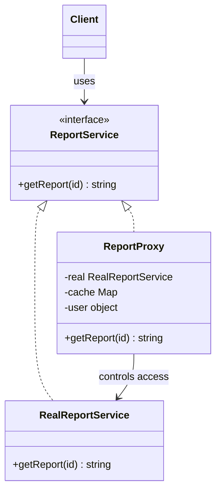

## The idea

A **bank card** stands in for the money in your account. A shop takes it just like cash. But before any money moves, the bank checks your PIN and your balance. The shop never touches your account directly.

A **Proxy** is a stand-in object with the **same interface** as the real one. Callers use it as if it were the real thing. Before passing a call on, the proxy can check, delay, cache or count it.

- **Intent:** put a stand-in in front of an object, to control access to it.
- **Group:** Structural (patterns about how objects fit together).

## The problem

A report service is slow, and only managers may read reports. Put all of that into the real class, and it gets three jobs:

```js
class ReportService {
  #cache = new Map();

  getReport(user, id) {
    if (user.role !== 'manager') throw new Error('Access denied'); // job 2: access check
    if (this.#cache.has(id)) return this.#cache.get(id);           // job 3: caching
    const report = `Report ${id}: sales are up`;                    // job 1: the real work
    this.#cache.set(id, report);
    return report;
  }
}

console.log(new ReportService().getReport({ role: 'manager' }, 7)); // Report 7: sales are up
```

- The class breaks [Single Responsibility](../design-principles/single-responsibility.mdx): one reason to change for each job.
- A trusted batch job that needs no check, or fresh data with no cache, can't skip them.
- You can't test the real work without the check and the cache around it.

## The pattern

The proxy and the real object share one interface. The proxy **holds** the real object, and decides if and when to call it.



```js
class ReportService { // interface
  getReport(id) { throw new Error('not implemented'); }
}

class RealReportService extends ReportService {
  constructor() {
    super();
    console.log('(connecting to the big database...)'); // slow to create
  }
  getReport(id) { return `Report ${id}: sales are up`; }
}

class ReportProxy extends ReportService {
  #real = null;
  #cache = new Map();
  #user;

  constructor(user) {
    super();
    this.#user = user;
  }

  getReport(id) {
    if (this.#user.role !== 'manager') throw new Error('Access denied'); // protection
    if (!this.#cache.has(id)) {
      this.#real ??= new RealReportService();         // lazy: create on first real use
      this.#cache.set(id, this.#real.getReport(id)); // caching
    }
    return this.#cache.get(id);
  }
}

const reports = new ReportProxy({ name: 'Asha', role: 'manager' });
console.log(reports.getReport(7));
// (connecting to the big database...)
// Report 7: sales are up
console.log(reports.getReport(7)); // Report 7: sales are up  (from the cache, no database)

try {
  new ReportProxy({ name: 'Ben', role: 'intern' }).getReport(7);
} catch (e) {
  console.log(e.message); // Access denied  (the database was never touched)
}
```

The real class now does only the real work. One proxy shows all three jobs here, to keep it short. In real code you would often write one proxy per job and stack them.

### Kinds of proxy

| Kind | What it does | Example |
| --- | --- | --- |
| Virtual (lazy) | Creates the costly real object only when first needed | A big image that loads when it scrolls into view |
| Caching | Remembers answers, so repeated calls skip the real object | Prices from a slow service |
| Protection | Checks who may call what | Only managers can read reports |
| Remote | Looks local, but each call goes over the network | An API client object |
| Logging | Records every call | An audit log |

### The JavaScript way: the built-in `Proxy`

JavaScript has a built-in `Proxy` object, named after this pattern. You give it a target object and a **handler** with **traps**: functions that run when someone reads a property, sets one, calls a function, and so on.

```js
const account = { owner: 'Asha', balance: 500 };

const safeAccount = new Proxy(account, {
  set(target, prop, value) { // runs on every write
    if (prop === 'balance' && value < 0) throw new Error('Balance cannot go below 0');
    target[prop] = value;
    return true;
  },
});

safeAccount.balance = 300;
console.log(account.balance); // 300

try {
  safeAccount.balance = -50;
} catch (e) {
  console.log(e.message); // Balance cannot go below 0
}
console.log(safeAccount.balance); // 300
```

Code that uses `safeAccount` can't tell it is not the real account, until it breaks a rule.

## Proxy vs Decorator

**Same shape, different purpose.** Both wrap an object and keep its interface. A proxy **controls access** to the real object. A [Decorator](../design-patterns/decorator.mdx) **adds behavior** to it.

| | Decorator | Proxy |
| --- | --- | --- |
| Purpose | Add behavior (milk, logging) | Control access (check, delay, cache) |
| The real object | Passed in by the caller | Often created or found by the proxy itself |
| Stacking | Made to stack, many layers | Usually one layer |
| Does the caller know? | Yes, it picks the add-ons | Often not. It thinks it has the real object |

## When to use it

- The real object is **costly to create**, and may not be needed at all (lazy loading).
- The same calls happen **again and again**, and the answers rarely change (caching).
- You need **access checks** without changing the real class.
- The real object is **far away** (another server), and you want calls to look local.

## When not to use it

- The real object is cheap and open to everyone. A proxy only adds a layer.
- The data changes all the time. A caching proxy would serve old answers.

## Common mistakes

- **Stale caches.** A caching proxy needs a rule for when answers expire, or users see old data.
- **Missing methods.** The proxy must offer every method of the interface, or callers break.
- **Hiding slow network calls.** A remote proxy looks local, so people call it in a loop. Make its cost clear in the name or the docs.

## In the real world

- **JavaScript's `Proxy`:** the built-in object above, with traps like `get`, `set` and `has`.
- **Vue 3:** `reactive(obj)` returns a `Proxy`. Reading a field records who uses it, and writing a field updates the parts of the page that use it.
- **Immer:** gives you a proxy "draft" of your data. You change the draft freely. Immer records the changes and builds a new object, and your original data stays unchanged.
- **Remote stubs:** in Java RMI and gRPC, a client "stub" looks like a local object, but each method call goes over the network.
- **Reverse proxies**, like Nginx, apply the same idea to whole servers: they sit in front, check, cache and pass requests on.

## In the interview

Proxies fit wherever a problem has a **slow** or **protected** resource:

> "The price service is slow, so I'll put a caching proxy in front of it. It has the same `getPrice()` method, so callers don't change. It returns a cached price if it is less than a minute old, and otherwise calls the real service. Access checks could be another proxy, kept separate from the real class."

**Likely follow-up:** "What can go wrong with a caching proxy?"

"Old data. I'd give each entry an expiry time, and clear an entry when the price changes. I'd also cap the cache size, so memory doesn't grow forever."

<Callout title="Remember this" type="success">
  - A Proxy is a **stand-in** with the **same interface** that controls access to the real object.
  - Main kinds: **lazy** (create when needed), **caching**, **protection** (access checks), **remote**.
  - JavaScript has a built-in **`Proxy`** with traps like `get` and `set`.
  - Proxy **controls access**. Decorator **adds behavior**. Same shape, different purpose.
  - Caching proxies need an **expiry rule**, or they serve old data.
</Callout>
