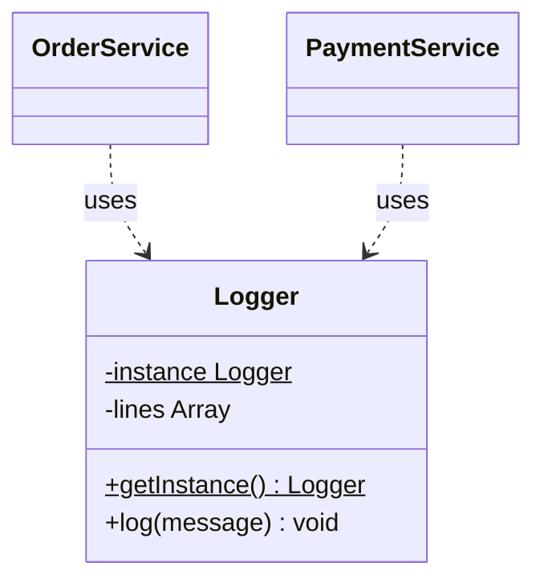

## The idea

A house has one **Wi-Fi router**. Every phone, laptop and TV connects to that same router. Nobody buys a new router when a guest comes over. If someone changes the password, everyone sees the change.

A **Singleton** is a class that has only **one object** in the whole app, and one known place to get it.

- **Intent:** make sure a class has only one object, and give everyone the same way to reach it.
- **Group:** Creational (patterns about how objects are created).

## The problem

Some things should exist only once: the app's settings, the logger, the database connection pool. If every file makes its own copy, you get wasted work and copies that disagree.

```js
class Config {
    constructor() {
        // Pretend this reads a file from disk, which is slow.
        console.log("Reading config file...");

        this.settings = {
            apiUrl: "https://api.shop.com",
            retries: 3,
        };
    }
}

const configInOrders = new Config(); // Reading config file...
const configInPayments = new Config(); // Reading config file...

configInOrders.settings.retries = 5;

// The two copies disagree.
console.log(configInPayments.settings.retries); // 3
```

The file is read twice, and a change in one place is not seen in the other.

## The pattern



Underlined members are **static**: they belong to the class itself, not to each object. The class keeps its one object in a static field. `getInstance()` creates the object the first time, and returns that same object every time after.

### The textbook form

```js
class Logger {
    // The one shared logger. "static" means it is kept on the class itself.
    static instance = null;

    constructor() {
        this.lines = [];
    }

    static getInstance() {
        // First call: create the logger and save it.
        if (Logger.instance === null) {
            Logger.instance = new Logger();
        }

        // Every call: return the saved logger.
        return Logger.instance;
    }

    log(message) {
        this.lines.push(message);
        console.log(`[LOG] ${message}`);
    }
}
```

Every caller asks `getInstance()`, and every caller gets the same logger:

```js
const logger1 = Logger.getInstance();
const logger2 = Logger.getInstance();

logger1.log("Order placed"); // [LOG] Order placed
logger2.log("Payment done"); // [LOG] Payment done

console.log(logger1 === logger2); // true
console.log(logger2.lines); // [ 'Order placed', 'Payment done' ]
```

**Java in one line:** Java makes the constructor `private`, so only `getInstance()` can call `new`. JavaScript has no private constructors, so here we simply agree to always use `getInstance()`.

### The JavaScript way: a module

In JavaScript you rarely need that class trick. A **module** (a file with `export`) runs only **once**. Node keeps it in a cache, so every file that imports it gets the **same** object.

```js noRun
// logger.js
class Logger {
    constructor() {
        this.lines = [];
    }

    log(message) {
        this.lines.push(message);
        console.log(`[LOG] ${message}`);
    }
}

// The one shared logger. This line runs only once.
export const logger = new Logger();
```

```js noRun
// orders.js
import { logger } from "./logger.js";

export function placeOrder(id) {
    logger.log(`Order ${id} placed`);
}
```

```js noRun
// app.js
import { logger } from "./logger.js";
import { placeOrder } from "./orders.js";

placeOrder(42); // [LOG] Order 42 placed
logger.log("Server started"); // [LOG] Server started

// Both files used the same logger.
console.log(logger.lines); // [ 'Order 42 placed', 'Server started' ]
```

## When to use it

- There must really be **one** of something: app config, a logger, a connection pool, an in-memory cache.
- The object is **read-only**, or only **adds** things (like a logger), so sharing it can't surprise anyone.
- Creating it is **costly**, and you want to do it once.

## When not to use it

- Just to make something **easy to reach** from everywhere. That is a global variable in a nice suit.
- When many parts of the code **change** its data.
- When tests need a **fresh** or **fake** copy.

### Why it is often overused

Singleton is the easiest pattern to learn, so people use it too often.

| Problem | What goes wrong |
| --- | --- |
| Hidden global state | Any code can change it. A function's inputs don't show that it uses the logger or the cart. |
| Hard to test | All tests share the one object, so data from one test leaks into the next. You can't swap in a fake. |
| Tight coupling | Code that calls `Logger.getInstance()` is glued to that exact class. |
| "Only one" changes | Today there is one database. Tomorrow there are two, and every `getInstance()` call must change. |

**The fix:** create the one object when the app starts, then **pass it in** to the classes that need it. There is still only one, but the code that uses it doesn't know or care. This is [Dependency Injection](../design-principles/dependency-injection.mdx).

```js
class OrderService {
    constructor(logger) {
        // The logger is passed in, not grabbed with getInstance().
        this.logger = logger;
    }

    place(id) {
        this.logger.log(`Order ${id} placed`);
    }
}

// In a test, pass in a fake logger that only remembers the messages.
const fakeLogger = {
    lines: [],
    log(message) {
        this.lines.push(message);
    },
};

const orderService = new OrderService(fakeLogger);
orderService.place(7);

console.log(fakeLogger.lines); // [ 'Order 7 placed' ]
```

## Common mistakes

- **Async setup that runs twice.** With `if (!db) db = await connect()`, two callers can both see `null` before the first `await` ends, and both connect. Save the **promise** at once instead:

  ```js
  let dbPromise = null;

  function getDb() {
      // Save the promise at once, before any await.
      // A second caller then gets the same promise, not a new connection.
      if (dbPromise === null) {
          dbPromise = connect();
      }

      return dbPromise;
  }

  async function connect() {
      // Pretend this is a slow connection to the database.
      console.log("Connecting...");
      return { name: "main-db" };
  }

  // Two callers ask for the database at the same time.
  const promise1 = getDb(); // Connecting...
  const promise2 = getDb(); // (prints nothing: it gets the same promise)

  const db1 = await promise1;
  const db2 = await promise2;

  console.log(db1 === db2); // true
  ```

  One catch: if `connect()` fails, the saved promise stays failed, and every later call gets the same error. Real code sets `dbPromise` back to `null` when connecting fails, so the next call can try again.

- **Two copies of the module.** If two versions of the same package end up in `node_modules`, each one has its own "single" object.
- **Keeping one user's data in it**, like the current user or cart. On a server, one user's data then leaks into another user's request.

## In the real world

- **Node.js modules:** every `import` of the same file returns the same cached module. That is why the module form works.
- **`console` and `process`** in Node are single shared objects that every file uses.
- **Java:** `Runtime.getRuntime()` returns the one `Runtime` object of the running program.
- **Spring (Java):** objects it manages are singletons by default. Spring creates one and passes it to everyone who needs it, which is the "pass it in" fix from above.

## In the interview

Singleton comes up in problems like the [Logger](../problems/logger.mdx) or a parking lot's main class. Show that you know its cost:

> "There should be only one `ParkingLot`, so a Singleton fits. But a static `getInstance()` makes testing hard, so I'll create one object at startup and pass it to the classes that need it. In JavaScript, exporting one instance from a module also works."

**Likely follow-up:** "Is your Singleton thread-safe?"

"In Java, two threads could both see `null` and create two objects, so you lock the creation (`synchronized`) or use an `enum`. JavaScript runs my code on one thread, so the plain check is safe. The real risk is async setup, so I store the promise, not the result."

<Callout title="Remember this" type="success">
  - A Singleton is **one object** for the whole app, reached in **one way**.
  - In JavaScript, **export one instance from a module**. The textbook form is a static `getInstance()` with a private constructor.
  - Fine for **config, a logger, a connection pool**. Not fine as a lazy way to share changing data.
  - Its costs are **hidden global state** and **hard tests**. Create one object and **pass it in**.
  - For async setup, store the **promise**, not the result.
</Callout>
