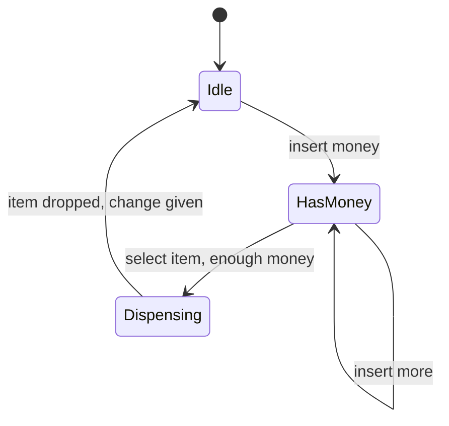
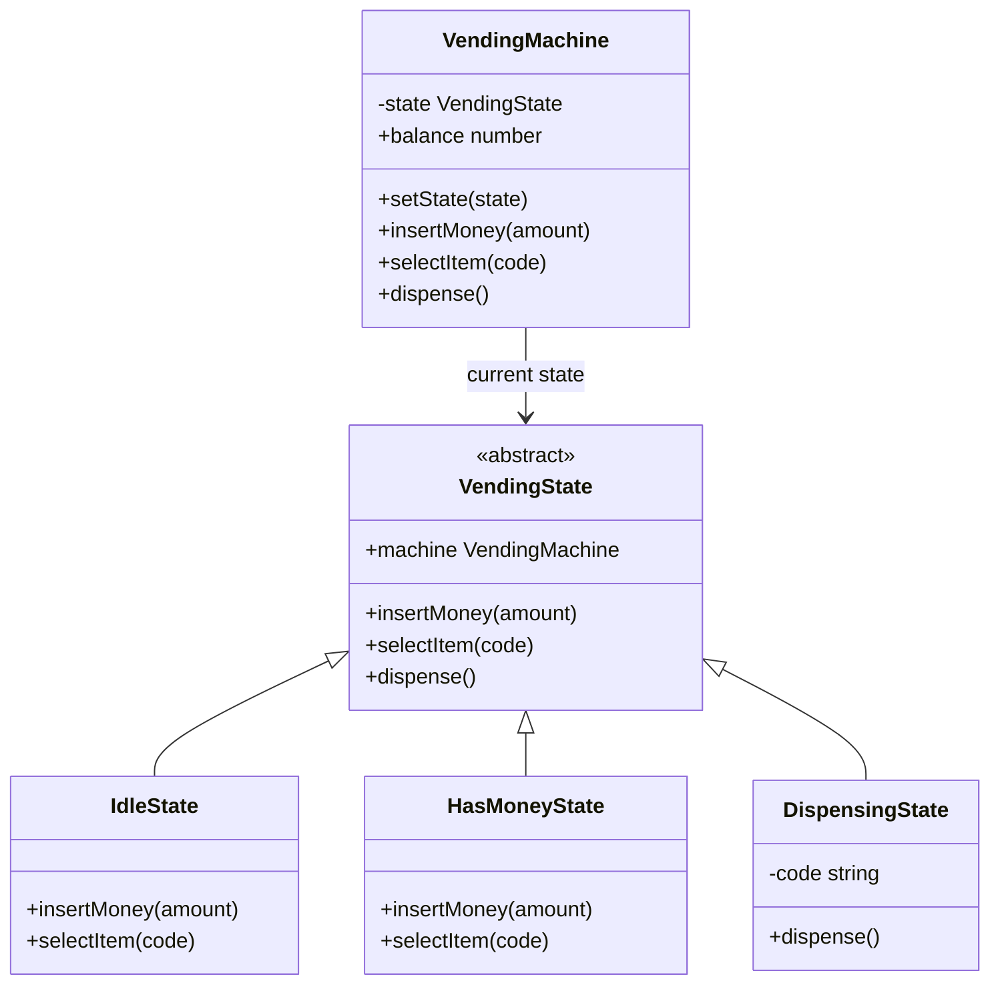

**Intent:** let an object act differently in each of its modes, by putting each mode in its own class.
**Group:** Behavioral (patterns about how objects share work).

## The idea

Think of a **toy robot with one big button**. When the robot is asleep, pressing the button wakes it up. When it is awake, the same press makes it walk. When it is walking, the press makes it stop. Same button, different result, because the robot is in a different **mode**.

A vending machine works the same way. "Select item" does nothing when no money is in. It buys the item when there is enough money. It is ignored while an item is dropping.

The **State** pattern puts each mode in its own class. The machine hands every button press to its **current state object**. To change mode, it swaps that object for another one.



## The problem

The first version keeps the mode in a string and checks it in every method:

```js
class VendingMachine {
    constructor() {
        this.state = "IDLE";
        this.balance = 0;
    }

    insertMoney(amount) {
        if (this.state === "IDLE") {
            this.balance += amount;
            this.state = "HAS_MONEY";
        } else if (this.state === "HAS_MONEY") {
            this.balance += amount;
        } else if (this.state === "DISPENSING") {
            console.log("Busy, please wait");
        }
    }

    selectItem(code) {
        if (this.state === "IDLE") {
            console.log("Insert money first");
        } else if (this.state === "HAS_MONEY") {
            // check the price, start dispensing...
        } else if (this.state === "DISPENSING") {
            console.log("Busy, please wait");
        }
    }

    // dispense() has the same three branches again...
}
```

Why it hurts:

- **Every method has a branch for every state.** Three methods times three states is nine branches. A new "out of stock" or "maintenance" mode touches every method.
- The rules for one mode are **spread across many methods**, so it is hard to answer "what can happen when it has money?".
- It is easy to **forget a branch**, and then the machine does something wrong in a rare mode.

## The pattern

Each mode becomes a class with the same methods. The machine (the **context**) keeps one state object and forwards every call to it.



The code comes in six small steps. Paste them in order into one file to run it.

**Step 1: the base state.** It says "not now" to every action by default, so each state only writes the actions it allows.

```js
// The base state. Don't create it directly: create one of the states below.
class VendingState {
    constructor(machine) {
        this.machine = machine;
    }

    insertMoney(amount) {
        console.log("Busy, please wait");
    }

    selectItem(code) {
        console.log("Busy, please wait");
    }

    dispense() {
        console.log("Nothing to dispense");
    }
}
```

**Step 2: the idle state.** No money is in yet.

```js
class IdleState extends VendingState {
    insertMoney(amount) {
        this.machine.balance += amount;
        console.log(`Balance: ${this.machine.balance}`);

        // Money is in now, so move to the next state.
        const nextState = new HasMoneyState(this.machine);
        this.machine.setState(nextState);
    }

    selectItem(code) {
        console.log("Insert money first");
    }
}
```

**Step 3: the has-money state.** The user can add more money or pick an item.

```js
class HasMoneyState extends VendingState {
    insertMoney(amount) {
        this.machine.balance += amount;
        console.log(`Balance: ${this.machine.balance}`);
    }

    selectItem(code) {
        const price = this.machine.prices[code];

        if (price === undefined) {
            console.log("No such item");
            return;
        }

        if (this.machine.balance < price) {
            const missing = price - this.machine.balance;
            console.log(`Need ${missing} more`);
            return;
        }

        this.machine.balance -= price;
        console.log(`Dispensing ${code}...`);

        const nextState = new DispensingState(this.machine, code);
        this.machine.setState(nextState);
    }
}
```

**Step 4: the dispensing state.** An item is dropping. This state remembers which item.

```js
class DispensingState extends VendingState {
    constructor(machine, code) {
        super(machine);
        this.code = code;
    }

    dispense() {
        console.log(`Here is ${this.code}. Change: ${this.machine.balance}`);
        this.machine.balance = 0;

        // Back to the start, ready for the next customer.
        const nextState = new IdleState(this.machine);
        this.machine.setState(nextState);
    }
}
```

**Step 5: the machine.** This is the context. It hands every call to its current state.

```js
class VendingMachine {
    constructor(prices) {
        this.prices = prices;
        this.balance = 0;
        this.state = new IdleState(this);
    }

    setState(state) {
        this.state = state;
    }

    insertMoney(amount) {
        this.state.insertMoney(amount);
    }

    selectItem(code) {
        this.state.selectItem(code);
    }

    // The machine calls this itself when the item drops.
    dispense() {
        this.state.dispense();
    }
}
```

**Step 6: try it.**

```js
const machine = new VendingMachine({ A1: 70, B2: 40 });

machine.selectItem("A1");  // Insert money first
machine.insertMoney(50);   // Balance: 50
machine.selectItem("A1");  // Need 20 more
machine.insertMoney(50);   // Balance: 100
machine.selectItem("A1");  // Dispensing A1...
machine.insertMoney(10);   // Busy, please wait
machine.dispense();        // Here is A1. Change: 30
machine.selectItem("B2");  // Insert money first
```

What changed:

- `VendingMachine` has **no if/else on the mode**. It forwards each call to `this.state`.
- Each state class holds **all the rules for one mode** in one place.
- The **states choose the next state** with `machine.setState(...)`.
- A new "out of stock" mode is **one new class**; the other states barely change.

### The JavaScript way: a transition table

If the modes only decide **which mode comes next**, and don't do much work, a plain object is enough:

```js
// For each state: which action leads to which next state.
const transitions = {
    IDLE: { insertMoney: "HAS_MONEY" },
    HAS_MONEY: { insertMoney: "HAS_MONEY", selectItem: "DISPENSING" },
    DISPENSING: { dispense: "IDLE" },
};

function next(state, action) {
    const nextState = transitions[state][action];

    // Not in the table means the action is not allowed right now.
    if (!nextState) {
        throw new Error(`Can't ${action} while ${state}`);
    }

    return nextState;
}

let state = "IDLE";
state = next(state, "insertMoney");
state = next(state, "selectItem");
console.log(state); // DISPENSING

try {
    next(state, "insertMoney");
} catch (error) {
    console.log(error.message); // Can't insertMoney while DISPENSING
}
```

Use the table when states mostly pick the next state. Use State classes when each mode **does different work**.

## Strategy vs State

In one line: the **caller** picks a strategy from outside, while a state object **switches itself** from inside as things happen.

| | [Strategy](./strategy.mdx) | State |
| --- | --- | --- |
| Who picks it | The caller, from outside | The states themselves, from inside |
| How often it changes | Rarely, usually set once | All the time, as events happen |
| Do the parts know each other? | No, each strategy stands alone | Yes, a state knows which state comes next |
| Example | The parking lot's fee rule | Idle, then HasMoney, then Dispensing |

Their class diagrams look almost the same. The difference is **who swaps the object, and why**.

## When to use it

- An object **acts differently in each mode**, and the same `if (state === ...)` shows up in many methods.
- There are **clear modes with rules** for moving between them: a vending machine, an ATM (no card, card in, PIN OK), an elevator (idle, moving, doors open), an order (placed, paid, shipped, delivered), a traffic light.
- You expect **more modes later**.

## When not to use it

- Two modes and one or two checks, like `isOpen`. A boolean is fine.
- Modes only decide the next mode. A transition table is shorter.

## Common mistakes

- **Changing the mode from outside**, like `machine.state = 'IDLE'` from anywhere. Only the states, through `setState`, should move the machine.
- **Forgetting what's not allowed.** Every state must answer every action, even if the answer is "not now". A base class with safe defaults helps.
- **Putting data in the wrong place.** Shared data (balance, stock) belongs in the context. A state class holds only what belongs to its mode, like the item being dropped.

## In the real world

- **JavaScript Promises** are a small state machine: *pending*, then either *fulfilled* or *rejected*. Once settled, a promise never changes again.
- **TCP connections** move through states such as LISTEN, ESTABLISHED and CLOSED, and the same packet means different things in each one. The original *Design Patterns* book used a TCP connection as its State example.
- **XState** is a JavaScript library for state machines, often used for UI flows like multi-step forms and checkouts.

## In the interview

State comes up in the classic "machine" problems: [Vending Machine](../problems/vending-machine.mdx), [ATM](../problems/atm.mdx), [Elevator](../problems/elevator.mdx) and traffic lights.

> "The machine acts differently in each mode, so I'll use the State pattern. `VendingMachine` holds a `VendingState`. Idle, has money and dispensing are each their own class with the same methods. The machine forwards every action to its current state, and the state decides what to do and which state comes next. A new 'maintenance' mode is one new class."

**Likely follow-up:** "Why not just an enum and a switch?"

**Answer:** "For two or three modes with little behavior, an enum with a switch or a transition table is fine, and I'd say so. Once each mode has real rules and the same switch repeats in every method, State classes keep each mode's rules in one place, and new modes don't touch the old ones."

<Callout title="Remember this" type="success">
  - **State = a toy with modes.** One class per mode; the context forwards every action to its current state.
  - The **states choose the next state** through `setState`.
  - A base state with **"not now" defaults** means each state writes only what it allows.
  - Strategy vs State: the **caller** picks a strategy; a state **switches itself**.
  - For small machines, an **enum plus a transition table** is enough.
</Callout>
