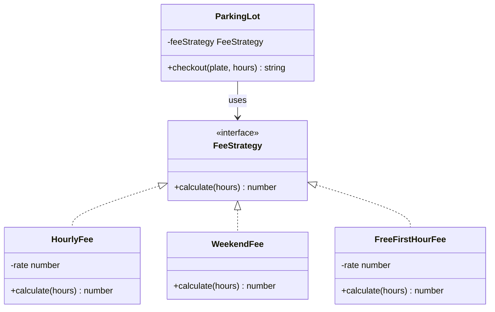

**Intent:** put each way of doing a job in its own object, so you can swap one for another.
**Group:** Behavioral (patterns about how objects share work).

## The idea

Think of a **food processor**. The motor is always the same. To slice, you snap in the slicing blade. To grate cheese, you snap in the grating blade. You never rebuild the motor to get a new cut.

The **Strategy** pattern works the same way:

- the **context** is the motor: the object that does the main job (a parking lot that charges fees);
- each **strategy** is a blade: one way of doing one part of the job (an hourly fee, a weekend fee);
- the context holds one strategy and calls it. It doesn't care which one it is.

## The problem

A parking lot charges by the hour on weekdays, a flat price at weekends, and gives the first hour free on holidays. The first version often looks like this:

```js
function parkingFee(hours, rule) {
    if (rule === "HOURLY") {
        // $3 for each started hour
        return Math.ceil(hours) * 3;
    } else if (rule === "WEEKEND") {
        // flat price for the whole day
        return 20;
    } else if (rule === "FREE_FIRST_HOUR") {
        // holiday offer: the first hour is free
        const paidHours = Math.max(0, Math.ceil(hours) - 1);
        return paidHours * 3;
    }

    throw new Error(`Unknown rule: ${rule}`);
}

console.log(parkingFee(2.5, "HOURLY")); // 9
console.log(parkingFee(2.5, "WEEKEND")); // 20
```

Why it hurts:

- **Every new rule edits this function.** An "event day" price means one more `else if`, and one more chance to break the old rules. This breaks the [Open-Closed Principle](../design-principles/open-closed.mdx).
- **All the rules live in one function,** so you can't test or reuse one rule on its own.
- The rule is picked by **strings**, and the same `if` chain tends to get copied to other places.

## The pattern

Put each rule behind one shared interface, `FeeStrategy`. The parking lot knows only the interface.



The code comes in five small steps. **Run** on a step also runs the earlier steps it needs.

**Step 1: the interface.** Every fee rule has the same method, `calculate(hours)`.

```js
// The interface: every fee rule must have calculate(hours).
class FeeStrategy {
    calculate(hours) {
        throw new Error("not implemented");
    }
}
```

**Step 2: two fee rules.** Each rule is its own small class.

```js
// $rate for each started hour.
class HourlyFee extends FeeStrategy {
    constructor(rate) {
        super();
        this.rate = rate;
    }

    calculate(hours) {
        // 2.5 hours counts as 3 hours.
        const fullHours = Math.ceil(hours);
        return fullHours * this.rate;
    }
}

// One flat price for the whole day.
class WeekendFee extends FeeStrategy {
    calculate(hours) {
        return 20;
    }
}
```

**Step 3: the holiday rule.** The first hour is free.

```js
// The first hour is free. After that, $rate for each started hour.
class FreeFirstHourFee extends FeeStrategy {
    constructor(rate) {
        super();
        this.rate = rate;
    }

    calculate(hours) {
        const fullHours = Math.ceil(hours);

        // Math.max(0, ...) stops the result from going below 0.
        const paidHours = Math.max(0, fullHours - 1);

        return paidHours * this.rate;
    }
}
```

**Step 4: the parking lot.** This is the context. It holds one fee rule and calls it, without knowing which one it is.

```js
// The context: it uses a fee rule, but doesn't know which one.
class ParkingLot {
    constructor(feeStrategy) {
        this.feeStrategy = feeStrategy;
    }

    // Swap the fee rule while the program runs.
    setFeeStrategy(strategy) {
        this.feeStrategy = strategy;
    }

    checkout(plate, hours) {
        const fee = this.feeStrategy.calculate(hours);
        return `${plate} pays $${fee}`;
    }
}
```

**Step 5: use it.** Start with the hourly rule, then swap it.

```js
const lot = new ParkingLot(new HourlyFee(3));
console.log(lot.checkout("KA-01", 2.5)); // KA-01 pays $9

// Saturday morning: switch to the weekend price.
lot.setFeeStrategy(new WeekendFee());
console.log(lot.checkout("KA-02", 2.5)); // KA-02 pays $20

// Holiday offer.
lot.setFeeStrategy(new FreeFirstHourFee(3));
console.log(lot.checkout("KA-03", 2.5)); // KA-03 pays $6
```

What changed:

- `ParkingLot` has **no if/else**. It calls `calculate()` and trusts the answer.
- A new rule is a **new class**. The old code stays untouched.
- The strategy can be **swapped at run time** with one line.
- Each rule can be **tested alone**: `new WeekendFee().calculate(3)`.

The lot **has** a fee rule instead of **being** one. That is composition; see [Composition vs Inheritance](../oop-basics/composition-vs-inheritance.mdx).

### The JavaScript way: pass a function

In JavaScript, functions are values. A strategy with one method can simply be a function. Thanks to duck typing, the lot doesn't need a base class either: any function that takes hours and returns a price will do.

```js
// Each strategy is just a function: hours in, price out.
function hourlyFee(hours) {
    const fullHours = Math.ceil(hours);
    return fullHours * 3;
}

function weekendFee(hours) {
    return 20;
}

function freeFirstHourFee(hours) {
    const fullHours = Math.ceil(hours);
    const paidHours = Math.max(0, fullHours - 1);
    return paidHours * 3;
}
```

Now `checkout` gets the fee rule as a normal argument, and calls it:

```js
function checkout(plate, hours, feeRule) {
    const fee = feeRule(hours);
    return `${plate} pays $${fee}`;
}

console.log(checkout("KA-01", 2.5, hourlyFee)); // KA-01 pays $9
console.log(checkout("KA-02", 2.5, weekendFee)); // KA-02 pays $20

// Pick a strategy by name with a lookup table, not an if/else chain.
const feeRules = {
    weekday: hourlyFee,
    weekend: weekendFee,
    holiday: freeFirstHourFee,
};

console.log(checkout("KA-03", 2.5, feeRules.holiday)); // KA-03 pays $6
```

Use **classes** when a strategy has several methods or its own setup. Use **plain functions** when it is one small calculation. Both are the Strategy pattern.

## When to use it

- There are **several ways to do the same job**, and you choose one at run time: fees, discounts, payment methods, route finding, sorting.
- An **if/else or switch on a "type"** keeps growing.
- You want to **test each rule on its own**.

## When not to use it

- There are only **one or two ways**, and they won't change. A plain `if` is clearer.
- The "strategies" differ by **one number**, like the hourly rate. Pass the number, not a new class.
- Nobody has asked for other ways yet. Don't build for an imagined future; see [DRY, KISS and YAGNI](../design-principles/dry-kiss-yagni.mdx).

## Common mistakes

- **Choosing the strategy with if/else all over the code.** Choose it once, in one place: the constructor (see [Dependency Injection](../design-principles/dependency-injection.mdx)), a lookup table, or a [Factory](./factory.mdx).
- **Strategies that reach into the context** to grab what they need. Pass the data in (`hours`), so each strategy stays small and easy to test.
- **A class for every tiny rule** when a function would do.

## In the real world

- **`Array.prototype.sort`** takes a compare function. Sorting is the fixed job; the compare function is the strategy.

```js
const cars = [
    { plate: "B-22", hours: 5 },
    { plate: "C-33", hours: 2 },
    { plate: "A-11", hours: 9 },
];

// A strategy for comparing: fewer hours first.
// A negative result means carA comes before carB.
function byHours(carA, carB) {
    return carA.hours - carB.hours;
}

// Another strategy: plates in A to Z order.
function byPlate(carA, carB) {
    return carA.plate.localeCompare(carB.plate);
}

// toSorted gives back a new sorted array. It doesn't change cars.
const sortedByHours = cars.toSorted(byHours);
const sortedByPlate = cars.toSorted(byPlate);

console.log(sortedByHours.map((car) => car.plate)); // [ 'C-33', 'B-22', 'A-11' ]
console.log(sortedByPlate.map((car) => car.plate)); // [ 'A-11', 'B-22', 'C-33' ]
```

- **Passport.js**, the login library for Node.js, calls each login method a "strategy": `passport-local` for a username and password, `passport-google-oauth20` for Google, and more. You plug in the ones you need with `passport.use(...)`.
- **Java** does the same with a `Comparator` object passed to `list.sort(...)`. In Java a strategy is an `interface`, and a one-method interface can be passed as a short lambda, much like a JavaScript function.

## In the interview

Strategy fits whenever the requirements say "different ways to …": fee rules in a [Parking Lot](../problems/parking-lot.mdx), pricing in [Ride Sharing](../problems/ride-sharing.mdx), splitting a bill equally or by percentage in [Splitwise](../problems/splitwise.mdx), payment methods at checkout.

> "Fees change by day and by vehicle type, so I'll put the fee rule behind a `FeeStrategy` interface with one method, `calculate(hours)`. `ParkingLot` holds a strategy and just calls it. A new pricing rule is a new class, and the lot doesn't change, so it's open for extension and closed for change."

**Likely follow-up:** "Who decides which strategy to use?"

**Answer:** "One place only. The lot gets its strategy through the constructor or a setter. A small factory or a lookup table picks it from the config, for example the day of the week. The lot itself never checks the day."

<Callout title="Remember this" type="success">
  - **Strategy = snap-in blades.** One interface, many ways to do the job; the context holds one and calls it.
  - It replaces a growing **if/else on a type** with one class (or function) per rule.
  - In JavaScript, a one-method strategy can be **just a function**, like the compare function in `sort`.
  - Choose the strategy in **one place**: the constructor, a factory or a lookup table.
  - Strategy vs [State](./state.mdx): the **caller** picks a strategy; a state object **switches itself**.
</Callout>
