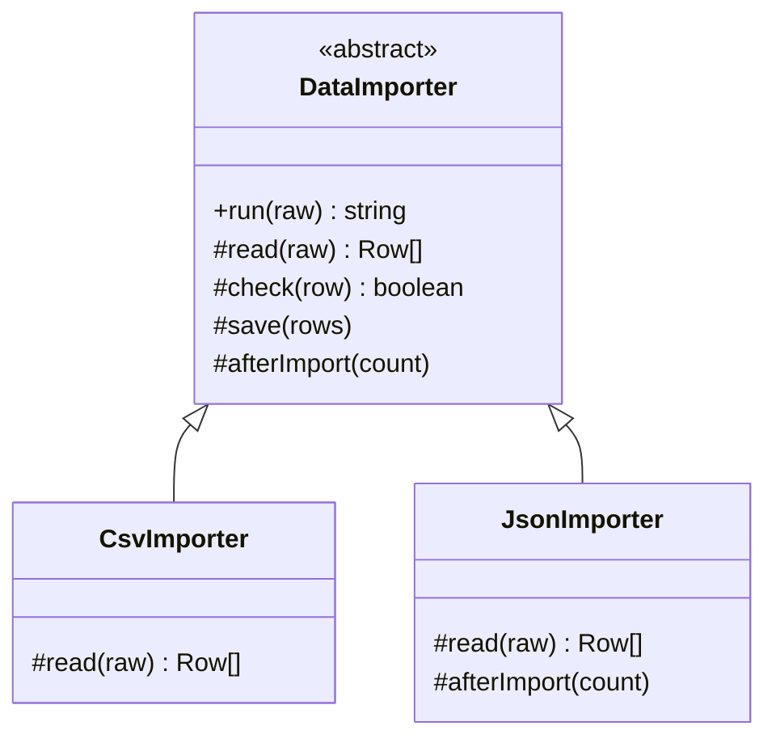
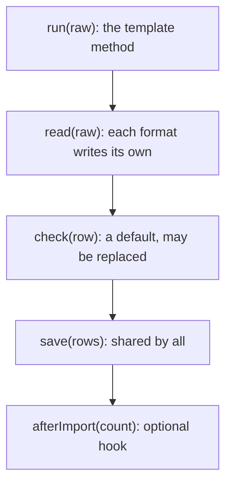

**Intent:** a base class fixes the steps and their order; subclasses fill in only the steps that change.
**Group:** Behavioral (patterns about how objects share work).

## The idea

A cake shop uses **one recipe card** for every cake:

1. make the batter;
2. bake it;
3. decorate it;
4. put it in a box.

The steps and their order never change. Only some steps change from cake to cake: chocolate or lemon batter, cream or icing on top. Baking and boxing are the same for every cake.

In the **Template Method** pattern, the **base class** holds the recipe card: one method (the **template method**) that calls smaller **step methods** in a fixed order. Subclasses fill in the steps that change. The base class does the rest.

## The problem

Two importers read users from a CSV file and from JSON. Each one copies the whole flow. First the CSV importer:

```js
class CsvImporter {
    run(raw) {
        // 1. Read: one row per line. Start at 1 to skip the header line.
        const lines = raw.trim().split("\n");
        const rows = [];
        for (let i = 1; i < lines.length; i++) {
            const parts = lines[i].split(",");
            rows.push({ name: parts[0], email: parts[1] });
        }

        // 2. Check: keep rows with a name and an email that has "@".
        const good = rows.filter((row) => {
            return row.name && row.email && row.email.includes("@");
        });

        // 3. Save.
        for (const row of good) {
            console.log(`Saved ${row.name}`);
        }

        return `Imported ${good.length} of ${rows.length} rows`;
    }
}
```

Then the JSON importer, which copies the same flow and gets one step wrong:

```js
class JsonImporter {
    run(raw) {
        // 1. Read.
        const rows = JSON.parse(raw);

        // 2. Check: it forgot the email check!
        const good = rows.filter((row) => row.name);

        // 3. Save.
        for (const row of good) {
            console.log(`Saved ${row.name}`);
        }

        return `Imported ${good.length} of ${rows.length} rows`;
    }
}

const jsonImporter = new JsonImporter();
console.log(jsonImporter.run('[{"name":"Ravi","email":"oops"}]'));
// Saved Ravi
// Imported 1 of 1 rows   <- a bad email got in
```

Why it hurts:

- The flow is **copied** into every importer. Fix a bug in one, and the others keep it. Here, the JSON importer forgot the email check.
- Nothing **forces the order**. A new importer could save before it checks.
- A new format (XML) means copying the whole flow again. See [DRY, KISS and YAGNI](../design-principles/dry-kiss-yagni.mdx).

## The pattern

The base class owns `run()`, the recipe. It calls `read`, `check`, `save` and `afterImport` in that order.



The `#` in the diagram means **protected**: "meant for subclasses". JavaScript has no protected, so in code these are normal methods with a comment.



The code comes in three small steps. Paste them in order into one file to run it.

**Step 1: the base class.** `run()` is the template method. It calls the other steps in a fixed order.

```js
// The base class. Don't create it directly: create a CsvImporter or a JsonImporter.
class DataImporter {
    // The template method: the same steps, in the same order, for every format.
    // Subclasses must not override it.
    run(raw) {
        const rows = this.read(raw);
        const good = rows.filter((row) => this.check(row));
        this.save(good);
        this.afterImport(good.length);

        return `Imported ${good.length} of ${rows.length} rows`;
    }

    // Abstract step: each format must fill this in.
    read(raw) {
        throw new Error("not implemented");
    }

    // Default step: a row needs a name and an email with "@". A subclass may replace it.
    check(row) {
        if (!row.name || !row.email) {
            return false;
        }

        return row.email.includes("@");
    }

    // Shared step: the same for every format.
    save(rows) {
        for (const row of rows) {
            console.log(`Saved ${row.name}`);
        }
    }

    // Hook: does nothing unless a subclass adds extra work here.
    afterImport(count) {
        // Empty on purpose.
    }
}
```

**Step 2: the two importers.** Each one fills in only the steps that are different for its format.

```js
// CSV: one row per line, like "Asha,asha@mail.com".
class CsvImporter extends DataImporter {
    read(raw) {
        const lines = raw.trim().split("\n");
        const rows = [];

        // Start at 1 to skip the header line.
        for (let i = 1; i < lines.length; i++) {
            const parts = lines[i].split(",");
            rows.push({ name: parts[0], email: parts[1] });
        }

        return rows;
    }
}

// JSON: the text already holds the rows. It also sends a report at the end.
class JsonImporter extends DataImporter {
    read(raw) {
        return JSON.parse(raw);
    }

    afterImport(count) {
        console.log(`Report sent: ${count} imported`);
    }
}
```

**Step 3: use them.**

```js
const csvImporter = new CsvImporter();
const csv = "name,email\nAsha,asha@mail.com\nBen,no-email";
console.log(csvImporter.run(csv));
// Saved Asha
// Imported 1 of 2 rows

const jsonImporter = new JsonImporter();
const json = '[{"name":"Ravi","email":"oops"},{"name":"Mia","email":"mia@mail.com"}]';
console.log(jsonImporter.run(json));
// Saved Mia
// Report sent: 1 imported
// Imported 1 of 2 rows
```

The template method and the kinds of steps it calls:

| Step | What the base class gives | What a subclass does |
| --- | --- | --- |
| `run()`, the template method | The fixed order | Must **not** override it |
| `read()`, an abstract step | Nothing; it throws | **Must** fill it in |
| `check()`, a default step | A sensible default | **May** replace it |
| `save()`, a shared step | The full code | Leaves it alone |
| `afterImport()`, a hook | An empty method | **May** add extra work |

A **hook** is an optional step with an empty default: a place where a subclass *can* plug in, but doesn't have to.

Notice who calls whom: the base class calls the subclass steps, never the other way round. This is the "Hollywood principle": *don't call us, we'll call you*.

In Java, the template method is marked `final` so no subclass can override it, and the steps are `protected abstract`. JavaScript has neither, so say it in a comment.

### The JavaScript way: pass the step in as a function

Instead of a subclass, pass the step that changes as a function:

```js
// The same idea with functions: the fixed steps live in one function,
// and the step that changes is passed in (this is Strategy).
function hasEmail(row) {
    if (!row.name || !row.email) {
        return false;
    }

    return row.email.includes("@");
}

// If no check is passed in, it uses hasEmail.
function runImport(raw, read, check = hasEmail) {
    const rows = read(raw);
    const good = rows.filter(check);

    for (const row of good) {
        console.log(`Saved ${row.name}`);
    }

    return `Imported ${good.length} of ${rows.length} rows`;
}

// JSON.parse is the read step here.
const json = '[{"name":"Mia","email":"mia@mail.com"}]';
console.log(runImport(json, JSON.parse));
// Saved Mia
// Imported 1 of 1 rows
```

This is really the [Strategy](./strategy.mdx) pattern. Many JavaScript developers prefer it, because it avoids inheritance. See [Composition vs Inheritance](../oop-basics/composition-vs-inheritance.mdx).

## When to use it

- Several classes do **the same steps in the same order**, and only a few steps differ: importers, report generators, payment flows (check, charge, send a receipt).
- You must **force an order**: always check before saving, always log at the end.
- You are writing a **framework**: it runs the flow, and calls the user's code at fixed points.

## When not to use it

- The classes share **no real skeleton**: their steps differ a lot.
- You need to **mix and match** steps, like CSV reading with strict checks and saving to a file. Each subclass is one fixed mix; use Strategy for each step instead.
- It would grow a **deep class tree**: `CsvImporter`, then `BigCsvImporter`, then `BigCsvWithLogsImporter`.

## Common mistakes

- **Overriding the template method** in a subclass. That breaks the fixed order the pattern exists for.
- **Too many abstract steps.** If every subclass must write eight methods, give the base class more defaults.
- **Using `#private` for the steps.** In JavaScript a subclass can't see or override a `#read` method. Use normal methods.

## In the real world

- **Node.js streams:** to make your own readable stream, you extend `Readable` and write `_read()`. For a transform stream, you write `_transform()`. Node's stream code does the rest: buffering, backpressure and events.
- **Java's `HttpServlet`:** its `service()` method receives each request and calls `doGet()` or `doPost()`, which you override.
- **React class components** (older React): React decides when to call `render()`, `componentDidMount()` and `componentDidUpdate()`. You only write those methods.
- **Test runners** like Jest and Mocha fix the order (`beforeEach`, the test, `afterEach`), and you fill in the steps. They use functions, not inheritance, but it is the same idea.

## In the interview

Template Method fits when several kinds of one thing follow the same steps: file importers, reports in PDF or CSV, notifications (build the message, send it, log it), or a [Logger](../problems/logger.mdx) whose outputs share the formatting but each write to a different place.

> "Every importer follows the same steps: read, check, save. I'll put that flow in `DataImporter.run()`, the template method, and make `read()` abstract. `CsvImporter` and `JsonImporter` only fill in `read()`. Nobody can break the order, and a new XML format is one small class."

**Likely follow-up:** "Template Method or Strategy?"

**Answer:** "Template Method when the classes share a fixed flow and differ in one or two steps, and the choice is made when the object is created. Strategy when I need to swap behavior at run time, or combine steps freely. In JavaScript I often lean to Strategy, because passing functions is easy and avoids inheritance."

<Callout title="Remember this" type="success">
  - **Template Method = one recipe card.** The base class fixes the steps in `run()`; subclasses fill in the steps that change.
  - Steps can be **abstract** (must fill in), **default** (may replace) or a **hook** (empty, optional).
  - Never override the template method. JavaScript has no `final`, so **say it in a comment**.
  - Don't use `#private` for steps: subclasses can't override them.
  - Inheritance suits a **fixed flow**; use Strategy (functions) when steps must be **swapped or mixed**.
</Callout>
