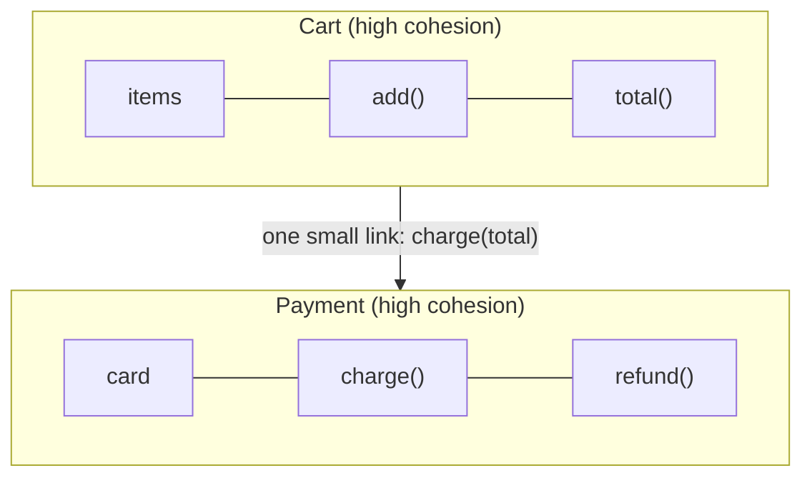
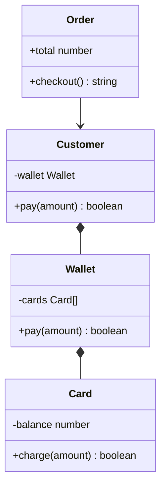

## The idea

Open two kitchen drawers.

- The **cutlery drawer** holds only spoons, forks and knives. Everything in it belongs together. That is **high cohesion**.
- The **junk drawer** holds batteries, tape, old menus and a key nobody knows. Nothing belongs together. That is **low cohesion**.

Now think of **old Christmas lights**. One bulb dies and the whole string goes dark, because every bulb depends on every other. That is **tight coupling**. A **power strip** is the opposite: unplug the lamp, and the TV keeps working. That is **loose coupling**.

| Word | Plain meaning | Good level |
| --- | --- | --- |
| **Coupling** | How much one class depends on, or knows about, another | **Low** (loose) |
| **Cohesion** | How well the parts **inside** one class belong together | **High** |

**Memory hook:** Tight inside, loose between.

Why it matters: with low coupling, a change in one class doesn't ripple into others. With high cohesion, everything about one job is in one place, so you know where to look.



Many links **inside** each box, one small link **between** the boxes. That is the shape to aim for.

## Coupling: the bad version

An `Order` that reaches deep into the customer to pay:

```js
class Card {
  #balance = 100;
  charge(amount) {
    if (amount > this.#balance) return false;
    this.#balance -= amount;
    return true;
  }
}
class Wallet { cards = [new Card()]; }
class Customer { wallet = new Wallet(); }

class Order {
  constructor(customer, total) {
    this.customer = customer;
    this.total = total;
  }
  checkout() {
    // Order knows Customer, Wallet, Card, AND how cards are stored.
    const ok = this.customer.wallet.cards[0].charge(this.total);
    return ok ? 'Paid' : 'Payment failed';
  }
}

console.log(new Order(new Customer(), 40).checkout()); // Paid
```

`Order` is coupled to **three** classes and to their insides. If `Wallet` stores cards in a `Map`, or picks a default card differently, `Order` breaks, even though nothing about orders changed.

A quick sign: **a long chain of dots**, like `a.b.c[0].d()`. This is the **Law of Demeter**, also called "don't talk to strangers": only call methods on things you hold directly.

## Coupling: the fixed version

Each class talks only to its direct neighbour, and hides its insides with `#private` fields:



```js
class Card {
  #balance = 100;
  charge(amount) {
    if (amount > this.#balance) return false;
    this.#balance -= amount;
    return true;
  }
}
class Wallet {
  #cards = [new Card()];
  pay(amount) { return this.#cards.some((card) => card.charge(amount)); }
}
class Customer {
  #wallet = new Wallet();
  pay(amount) { return this.#wallet.pay(amount); }
}

class Order {
  constructor(customer, total) {
    this.customer = customer;
    this.total = total;
  }
  checkout() {
    return this.customer.pay(this.total) ? 'Paid' : 'Payment failed'; // one dot
  }
}

const asha = new Customer();
console.log(new Order(asha, 40).checkout()); // Paid
console.log(new Order(asha, 90).checkout()); // Payment failed
```

Now `Order` knows only one method: `customer.pay()`. The wallet can change how it stores or picks cards, and `Order` never notices.

## From tight to loose

Not all coupling is equal. From worst to best:

| Kind of coupling | Example |
| --- | --- |
| Reaching into another class's insides | `order.customer.wallet.cards[0]` |
| Sharing a global object that many classes change | Every class reads and writes one global `settings` object |
| Depending on a concrete class | `new StripeClient()` inside `Checkout` |
| Depending on an interface | `Checkout` takes any `PaymentMethod` |
| Passing plain data or events | `pay({ amount: 40 })`, or emitting an `orderPaid` event |

Moving down the table is what [Dependency Inversion](./dependency-inversion.mdx) and the [Observer](../design-patterns/observer.mdx) pattern do.

## Cohesion: a quick check

Look at a class and ask: **do most methods use most fields?** Here is a low-cohesion `ShopHelper`:

| Method | Fields it uses |
| --- | --- |
| `addToCart(item)` | `cart` |
| `cartTotal()` | `cart` |
| `formatPrice(n)` | none |
| `sendEmail(to, text)` | `mailServer` |

There are three separate groups, so it is really three classes: a `Cart`, a `PriceFormatter` and an `EmailSender`. Each one is small and highly cohesive.

High cohesion is the [Single Responsibility Principle](./single-responsibility.mdx) seen from the inside: one job, so everything in the class belongs together.

## Common mistakes

- **Aiming for zero coupling.** Classes must work together. The goal is **few, simple, stable** links, through small interfaces.
- **"Fixing" a chain by copying it.** Writing `customer.getWallet().getCard().charge()` with getters is the same coupling with more typing.
- **The `Utils` or `Helpers` junk drawer.** Unrelated functions in one class is the textbook case of low cohesion.

## In the real world

- **Microservices** aim for exactly this: each service owns its own data and job (high cohesion) and talks to others only through an API or events (low coupling).
- **React components** get everything they need through props. A component can rewrite its insides freely, as long as it accepts the same props.
- **Node.js `EventEmitter`.** The emitter doesn't know who is listening. Listeners can be added or removed without changing it.
- **The `left-pad` story (2016).** A developer removed a tiny 11-line package from npm. Thousands of projects depended on it, directly or through other packages, and their builds broke at once. That is what tight coupling to something you don't control looks like.

## In the interview

"Low coupling, high cohesion" is a short way to sum up all of SOLID. Use the words when you explain your class diagram.

> "Each class owns one job and its own data, so cohesion is high. Classes talk through a few small methods, like `customer.pay()`, and never reach into each other's fields. That keeps coupling low, so changing the wallet doesn't touch orders."

**Likely follow-up:** "How would you tell if two classes are too tightly coupled?"

**Answer:** "I ask: if I change one, how many others must change? Long dot chains, shared global state and `new` of concrete classes inside business code are the usual signs. I fix them by hiding details behind a method or an interface."

<Callout title="Remember this" type="success">
  - **Tight inside, loose between.**
  - **Coupling** = how much classes depend on each other. Keep it **low**.
  - **Cohesion** = how well a class's parts belong together. Keep it **high**.
  - Smell of tight coupling: long chains like `a.b.c.d()`. Talk only to your direct neighbours.
  - Smell of low cohesion: methods that use **different** fields, and `Utils` classes.
</Callout>
