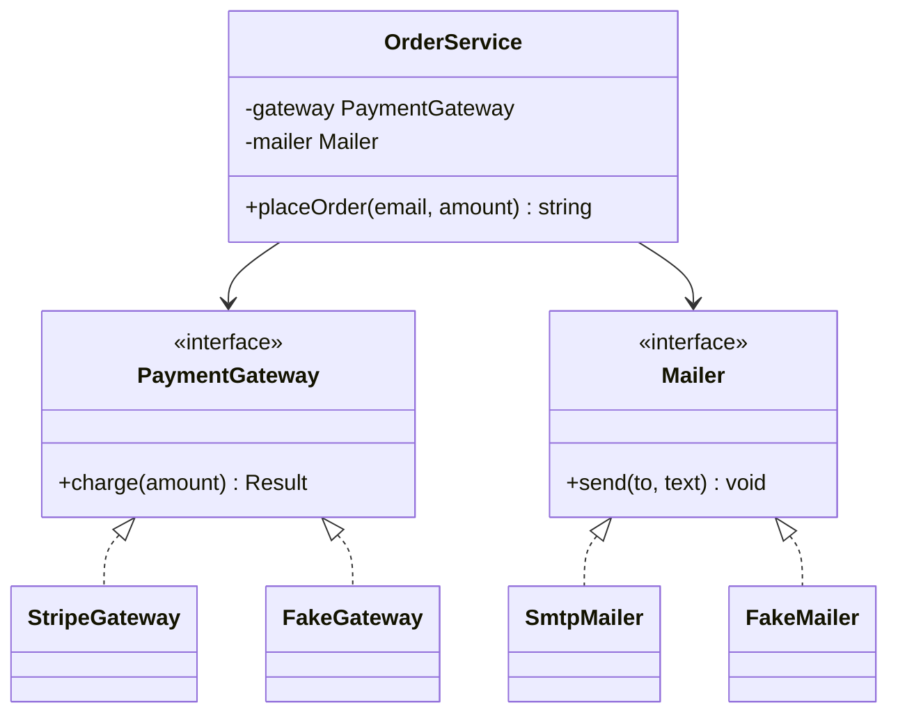

## The idea

A **toy car doesn't make its own batteries**. It has a slot, and you put batteries in. Cheap ones for play, rechargeable ones for long trips, or no batteries at all while you test the wheels.

**Dependency injection** (DI) works the same way:

> An object gets the things it needs **from outside**, instead of creating them itself.

Two words to know:

- **Dependency:** something a class needs to do its job. An `OrderService` needs a payment gateway and a mailer.
- **Inject:** pass it in, usually through the **constructor**.

**Memory hook:** Don't build it, receive it.

## The bad version

An `OrderService` that creates its own payment gateway:

```js
class StripeGateway {
    charge(amount) {
        // Imagine a real network call here that charges a real card.
        return { ok: true };
    }
}

class OrderService {
    constructor() {
        // Builds its own dependency.
        this.gateway = new StripeGateway();
    }

    placeOrder(amount) {
        const result = this.gateway.charge(amount);

        if (result.ok) {
            return "Order placed";
        }

        return "Payment failed";
    }
}

const service = new OrderService();
console.log(service.placeOrder(30)); // Order placed
```

What is wrong?

- **You can't test it safely.** Every test charges a real card through Stripe.
- **You can't test the failure path.** How do you make Stripe say "no" on demand?
- **You can't switch** to PayPal without editing `OrderService`.
- **The need is hidden.** From the outside, `new OrderService()` doesn't tell you it talks to Stripe.

## The fixed version: constructor injection

The service **asks** for what it needs. A test can now pass in **fakes**: small stand-in objects that behave the way the test wants.

**Step 1: the service.** Its constructor takes a gateway and a mailer:

```js
class OrderService {
    // The dependencies come in from outside, through the constructor.
    constructor(gateway, mailer) {
        this.gateway = gateway;
        this.mailer = mailer;
    }

    placeOrder(email, amount) {
        const result = this.gateway.charge(amount);

        if (!result.ok) {
            return "Payment failed";
        }

        this.mailer.send(email, `Thanks! You paid ${amount}`);
        return "Order placed";
    }
}
```

**Step 2: the fakes.** No network, no real money:

```js
// A fake gateway that says yes or no, whichever the test asks for.
class FakeGateway {
    constructor(ok) {
        this.ok = ok;
    }

    charge(amount) {
        return { ok: this.ok };
    }
}

// A fake mailer that only writes down the emails it was asked to send.
class FakeMailer {
    constructor() {
        this.sent = [];
    }

    send(to, text) {
        this.sent.push({ to: to, text: text });
    }
}
```

**Step 3: the tests.** Each test passes in the fakes it needs:

```js
// Node's built-in assert. assert.equal(a, b) throws an error if a and b differ.
import assert from "node:assert/strict";

// Test 1: the payment goes through, so one email is sent.
const mailer = new FakeMailer();
const service = new OrderService(new FakeGateway(true), mailer);
const result = service.placeOrder("asha@example.com", 30);
assert.equal(result, "Order placed");
assert.equal(mailer.sent.length, 1);

// Test 2: the payment is declined.
const declined = new OrderService(new FakeGateway(false), new FakeMailer());
const declinedResult = declined.placeOrder("asha@example.com", 30);
assert.equal(declinedResult, "Payment failed");

console.log("All tests passed"); // All tests passed
```

`OrderService` doesn't know or care whether it got Stripe or a fake. It just calls `charge()` and `send()`.



## Who creates the real objects?

Someone still has to call `new StripeGateway()`. Do it in **one place**, at the start of the program, often called the **composition root**. It is the only place that knows which real classes are used:

```js
// main.js (not runnable on its own: StripeGateway and SmtpMailer are not defined here)
const gateway = new StripeGateway(process.env.STRIPE_KEY);
const mailer = new SmtpMailer("mail.example.com");

// Wire it all together, once.
const orders = new OrderService(gateway, mailer);
startServer(orders);
```

In plain JavaScript, wiring things by hand like this is normal and enough. Big frameworks do it for you with a **DI container**, a tool that creates objects and passes in what they need.

## Three ways to inject

| Way | How it looks | Use it when |
| --- | --- | --- |
| **Constructor** | `new OrderService(gateway, mailer)` | The default. The object needs it for its whole life |
| **Setter** | `service.setLogger(logger)` | Something optional that can change later |
| **Method** | `report.print(printer)` | It is needed for one call only |

In JavaScript you can also inject a **function**. A classic is the clock: pass `now = () => Date.now()` in, and a test can pass a fixed time instead.

## Injection vs inversion

DI is often mixed up with the [Dependency Inversion Principle](./dependency-inversion.mdx). They are different things that work well together:

| | Dependency Injection (DI) | Dependency Inversion (DIP) |
| --- | --- | --- |
| What it is | A **coding technique** | A **design principle** |
| The question | **How** does my class get its dependencies? | **What** should my class depend on? |
| The answer | They are passed in from outside | An interface, not a concrete class |

In one line: **inversion** decides the socket shape; **injection** is someone else plugging the device in.

You can inject a concrete class (DI without DIP). And a class can look up an interface from a registry instead of receiving it (DIP without DI). You get the full benefit with both: depend on an interface, **and** receive it.

## Common mistakes

- **A default that builds the real thing:** `constructor(gateway = new StripeGateway())`. Handy, but the class still imports and depends on Stripe. Fine for small scripts only.
- **Too many constructor parameters.** Six or more usually means the class does too much. See [Single Responsibility](./single-responsibility.mdx).
- **A global lookup instead:** `Registry.get('gateway')` inside the class. It hides what the class needs. This is called a "service locator".
- **Injecting everything.** A pure helper like `formatPrice()` that never changes doesn't need injecting. Inject things that talk to the **outside world** or that you want to **swap**.

## In the real world

- **Angular** (a front-end framework) has DI built in. A component lists the services it needs in its constructor, and Angular passes them in.
- **NestJS** (a Node.js framework) does the same for server code. **Spring** does it in Java.
- **React Context** works in a similar way. A parent provides a value, like the theme or the logged-in user, and child components use it without creating it.

## In the interview

In LLD code, write constructors that **take** their collaborators. It shows you think about testing and swapping parts.

> "`ParkingLot` gets its `FeeCalculator` through the constructor. In production I pass the hourly calculator. In a test I pass a fake with a fixed price, so the test is fast and always gives the same answer."

**Likely follow-up:** "How would you test `placeOrder` without charging a real card?"

**Answer:** "I inject a fake gateway that returns 'ok' or 'declined' on demand, and a fake mailer that just records messages. Then I check the result and what the mailer recorded. No network needed."

<Callout title="Remember this" type="success">
  - **Don't build it, receive it.** Dependencies come in from outside.
  - **Constructor injection** is the default.
  - The big win: tests can pass **fakes**. No network, no real money.
  - Create the real objects in **one place**, at program start (the composition root).
  - **Injection** = how it arrives. **Inversion** = depend on an interface.
</Callout>
