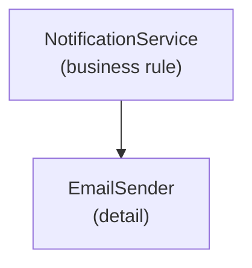
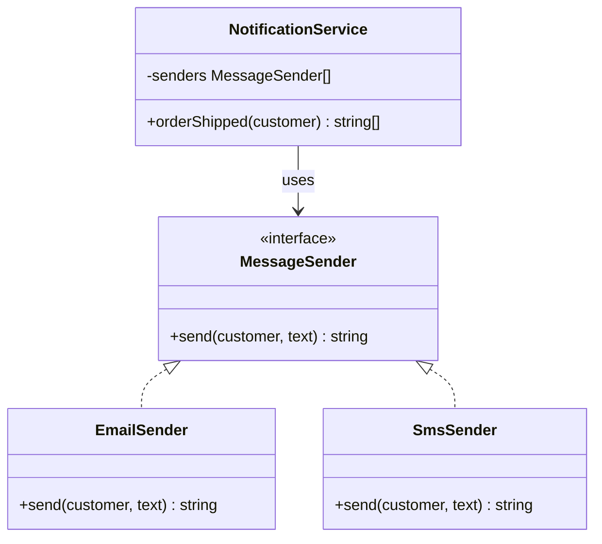

## The idea

Your lamp is not wired straight into the power station. The lamp has a standard **plug**. The wall has a standard **socket**. The power company can switch from coal to solar, and your lamp never knows. Both sides follow the socket shape, not each other.

The **Dependency Inversion Principle** (DIP) says two things:

1. **High-level code should not depend on low-level code.** Both should depend on an **interface**.
2. **Abstractions should not depend on details. Details should depend on abstractions.** In plain words: the interface is shaped by what the high-level code needs, and the low-level classes follow it.

Three words to know:

- **High-level code:** the business rule, the "what". _"When an order ships, tell the customer."_
- **Low-level code:** the detail, the "how". _"Send an email through this mail server."_
- **Abstraction:** an interface between them, like `MessageSender` with `send(customer, text)`.

It is the "D" in SOLID.

**Memory hook:** Depend on the socket, not the power station.

## The bad version

A `NotificationService` that tells customers their order has shipped:

```js
class EmailSender {
    sendEmail(address, subject, body) {
        return `Email to ${address}: [${subject}] ${body}`;
    }
}

class NotificationService {
    constructor() {
        // Tied to one low-level class: it builds its own EmailSender.
        this.emailSender = new EmailSender();
    }

    orderShipped(customer) {
        return this.emailSender.sendEmail(
            customer.email,
            "Shipped",
            "Your order is on the way"
        );
    }
}

const service = new NotificationService();
const asha = { email: "asha@example.com" };

console.log(service.orderShipped(asha));
// Email to asha@example.com: [Shipped] Your order is on the way
```

The arrow goes straight from the business rule down to the detail:



Why does it hurt?

- **Want SMS too?** You must edit `NotificationService`, the business rule, to add a detail.
- **The business rule knows email details:** the method name, the subject line, the address field.
- **Hard to test.** In real code, every test would send a real email. You can't swap in a fake.

## The fixed version

The business rule says what it needs: "something that can **send a customer a text**". That becomes the `MessageSender` interface. The senders follow it.



**Step 1: the interface and the senders.** Each sender follows the `MessageSender` shape:

```js
// The interface, shaped by what the business rule needs: "send this customer a text".
// JavaScript has no "interface" keyword, so a base class that throws stands in for one.
class MessageSender {
    send(customer, text) {
        throw new Error("not implemented");
    }
}

class EmailSender extends MessageSender {
    send(customer, text) {
        return `Email to ${customer.email}: ${text}`;
    }
}

class SmsSender extends MessageSender {
    send(customer, text) {
        return `SMS to ${customer.phone}: ${text}`;
    }
}
```

**Step 2: the business rule.** `NotificationService` gets a list of senders and never asks what kind they are:

```js
class NotificationService {
    // Any list of MessageSenders works.
    constructor(senders) {
        this.senders = senders;
    }

    // Sends the message through every sender. Gives back one line per sender.
    orderShipped(customer) {
        const results = [];

        for (const sender of this.senders) {
            const result = sender.send(customer, "Your order is on the way");
            results.push(result);
        }

        return results;
    }
}
```

**Step 3: use it.** Pass in the senders you want:

```js
const asha = { email: "asha@example.com", phone: "555-0101" };
const service = new NotificationService([new EmailSender(), new SmsSender()]);

for (const line of service.orderShipped(asha)) {
    console.log(line);
}
// Email to asha@example.com: Your order is on the way
// SMS to 555-0101: Your order is on the way
```

Now:

- `NotificationService` knows only `MessageSender`. It never mentions email or SMS.
- **Adding WhatsApp** is a new class. The business rule does not change ([Open/Closed](./open-closed.mdx)).
- **In a test**, you pass a fake sender that just records messages.

**Why "inversion"?** Before, the arrow went from the business rule **down** to the email code. Now the email code points **up** to an interface that belongs to the business side (the `<|..` arrows). The detail now depends on the rule, not the other way round.

## Inversion vs injection

These two names sound alike, but they answer different questions.

| | Dependency Inversion (DIP) | Dependency Injection (DI) |
| --- | --- | --- |
| What it is | A **design principle** | A **coding technique** |
| The question | **What** should my class depend on? | **How** does my class get it? |
| The answer | An interface, not a concrete class | Someone outside passes it in, usually through the constructor |
| In the code above | `NotificationService` only knows `MessageSender` | `new NotificationService([new EmailSender(), new SmsSender()])` |

In one line: **inversion** says "depend on the socket shape"; **injection** is someone else plugging the device in. They usually go together, but not always. See [Dependency Injection](./dependency-injection.mdx).

A third name sounds alike too: **Inversion of Control** (IoC). It means a framework runs the flow and calls **your** code, not the other way round. It is a different idea from DIP. Dependency injection is one kind of IoC.

## How an interviewer spots a violation

- **`new` of a low-level class inside business code**, like `new MySqlDatabase()` or `new StripeClient()` inside `OrderService`.
- **Business classes that import outside tools** directly: a database driver, an SMS provider's SDK, the file system.
- **You can't test the class** without a network, a database or a real email account.
- **Interface methods named after one detail**, like `sendEmail()` or `saveToMySql()`. The interface was shaped by the detail.

## In the real world

- **Java's JDBC.** Java code talks to databases through interfaces like `Connection` and `Statement`. The MySQL or PostgreSQL driver supplies the real classes. Your code mostly doesn't change when the driver does.
- **winston (a Node.js logging library).** Your code calls `logger.info()`. Where the log goes, the console, a file or a server, is a "transport" you plug in.
- **Express template engines.** Express renders pages through any engine that offers a function of the shape it expects. Pug and EJS both plug in this way, and Express has no code written for either one.

## In the interview

Use DIP for anything that talks to the **outside world**: payments, email, SMS, databases, the clock. Put an interface in front of it.

> "`NotificationService` shouldn't know how SMS works. It depends on a `MessageSender` interface, and I pass in `EmailSender` and `SmsSender`. Adding WhatsApp later is one new class, and in tests I pass a fake sender."

**Likely follow-up:** "Isn't an interface with only one class behind it overkill?"

**Answer:** "Inside the app, often yes. But for things that talk to the outside world, like email or payments, I add one even with a single class, because tests need a fake and those providers do get swapped."

<Callout title="Remember this" type="success">
  - **Depend on the socket, not the power station.**
  - High-level code (the rule) and low-level code (the detail) both depend on an **interface**.
  - The interface is shaped by the **rule's** needs: `send(customer, text)`, not `sendEmail()`.
  - The smell: `new SomeDatabase()` or an outside SDK inside business code.
  - **Inversion** = what to depend on. **Injection** = how it gets passed in.
</Callout>
