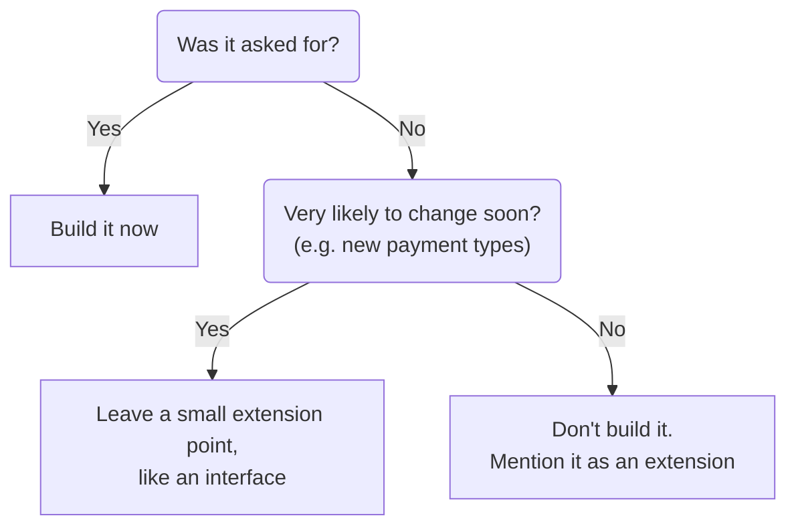

## The idea

Three short rules, each with an everyday picture:

| Rule | Stands for | Everyday picture |
| --- | --- | --- |
| **DRY** | Don't Repeat Yourself | A shop keeps each price in **one** system. If the price is hand-written on three signs, one day the signs disagree. |
| **KISS** | Keep It Simple, Stupid | A toy with one big button that always works beats a toy with ten modes that nobody can figure out. |
| **YAGNI** | You Aren't Gonna Need It | Don't pack snow boots for a beach trip "just in case". |

They are not part of SOLID, but interviewers use them all the time to judge a design: Is there one place for each rule? Is it easy to read? Did you build only what was asked?

**Memory hook:** Say it once. Keep it plain. Build it when it's needed.

## DRY: don't repeat yourself

> Every piece of knowledge should live in **one** place.

This rule comes from the book _The Pragmatic Programmer_ (1999). The key word is **knowledge**, like a tax rate or a rule about who can borrow books.

**Bad:** the tax rate is written in three places.

```js
function cartTotal(items) {
    let sum = 0;
    for (const item of items) {
        sum = sum + item.price;
    }

    // Tax, copy 1
    return sum + sum * 0.18;
}

function invoiceTax(amount) {
    // Tax, copy 2
    return amount * 0.18;
}

function priceLabel(price) {
    // Tax, copy 3, hidden as 1.18
    const priceWithTax = price * 1.18;
    return `${priceWithTax.toFixed(2)} incl. tax`;
}

console.log(cartTotal([{ price: 100 }, { price: 50 }])); // 177
console.log(priceLabel(10)); // 11.80 incl. tax
```

When the tax becomes 20%, you must find every copy. A search for `0.18` even misses the `1.18` hiding in `priceLabel()`.

**Fixed:** one name for the rate, one function for the rule.

```js
const TAX_RATE = 0.18;

// The one place that knows how to add tax.
function withTax(amount) {
    return amount * (1 + TAX_RATE);
}

function cartTotal(items) {
    let sum = 0;
    for (const item of items) {
        sum = sum + item.price;
    }

    return withTax(sum);
}

function priceLabel(price) {
    const priceWithTax = withTax(price);
    return `${priceWithTax.toFixed(2)} incl. tax`;
}

console.log(cartTotal([{ price: 100 }, { price: 50 }])); // 177
console.log(priceLabel(10)); // 11.80 incl. tax
```

**Careful:** code that only **looks** the same is not always repeated knowledge.

```js
// The law's rule
function isAdult(age) {
    return age >= 18;
}

// The rental company's rule
function canRentCar(age) {
    return age >= 18;
}

console.log(isAdult(19), canRentCar(19)); // true true
```

They look the same today, but they change for different reasons. If the rental company moves to 21, only `canRentCar` should change. Merging them would tie two unrelated rules together.

A handy habit, the **rule of three**: the first time, write it. The second time, notice the copy. The third time, pull it into one place.

## KISS: keep it simple

> The simplest design that works is usually the best one.

The phrase is often credited to Kelly Johnson, an aircraft engineer at Lockheed, who wanted planes that a mechanic could fix in the field with basic tools.

```js
// Too clever: it works, but you have to stop and decode it.
function isWeekendClever(date) {
    return !!((1 << date.getDay()) & 0b1000001);
}

// Simple: anyone can read it.
function isWeekend(date) {
    // getDay() gives 0 for Sunday and 6 for Saturday.
    const day = date.getDay();
    return day === 0 || day === 6;
}

// 21 November 2026. Months start at 0, so 10 means November.
const saturday = new Date(2026, 10, 21);
console.log(isWeekendClever(saturday), isWeekend(saturday)); // true true
```

Both work. Only one can be read at a glance.

KISS also applies to **design**. Three classes that solve the problem beat twelve classes and four patterns. Use a pattern when it fixes a real problem in front of you, not to show you know it.

## YAGNI: you aren't gonna need it

> Don't build a feature until it is really needed.

YAGNI comes from Extreme Programming, a way of working made popular in the late 1990s. Code written "for later" costs time now, must be tested and kept working, and is often wrong when "later" comes.

An interview example. The question is "Design a parking lot":

| Asked for | Built "just in case" (YAGNI) |
| --- | --- |
| Park and unpark cars | Payments in many currencies |
| Find a free spot by size | An electric-car charging scheduler |
| Work out the fee | A plugin system for custom fee rules |

The extras use up your interview time and add bugs. Instead, **mention** them at the end, when you talk about extensions: "If we need EV charging, I'd add a `ChargingSpot` type."

A quick way to decide:



```js
// Asked for: "log messages with a label". This is enough for today.
class Logger {
    log(level, message) {
        console.log(`[${level}] ${message}`);
    }
}

const logger = new Logger();
logger.log("INFO", "Server started"); // [INFO] Server started

// Not built yet: log rotation, cloud upload, colours, plugins.
```

## When the rules pull against each other

| Pull | What to do |
| --- | --- |
| DRY vs KISS | A clever shared helper with five flags is worse than two simple copies. Repeat twice, merge on the third time. |
| [Open/Closed](./open-closed.mdx) vs YAGNI | Add an interface where change is **likely or asked for** (payment methods, vehicle types). Don't add one "just in case". |
| KISS vs "show off" | In an interview, a clean simple design plus "here is how I'd extend it" beats a heavy design built up front. |

## Common mistakes

- **DRY taken too far:** merging code that only looks alike (see `isAdult` and `canRentCar` above).
- **KISS read as "no structure":** one giant function is not simple. It is just short on classes. Simple means **easy to understand**.
- **YAGNI used as an excuse** to skip things that were asked for, like checking wrong input.

## In the real world

- **CSS variables.** Big websites keep each brand colour in one variable, like `--brand-blue`, and use it everywhere. Changing the colour is a one-line change. That is DRY.
- **Database tables.** A well-designed database stores a customer's address once and links to it, instead of copying it into every order. That is DRY for data.
- **Unix tools** are a classic of KISS: small programs that each do one plain job and can be chained together.

## In the interview

Interviewers mark down **over-engineering** as much as messy code. Build what was asked, keep it readable, and show where the design **could** grow.

> "I'll keep one `Logger` class that writes to the console, since that's all we need. If we need files later, I'd put the writing behind a small interface, so the callers don't change. I won't build rotation or cloud upload now."

**Likely follow-up:** "How do you decide what to build now and what to leave?"

**Answer:** "I build what's in the requirements. For things very likely to change, like payment types, I leave an extension point such as an interface. Everything else I mention as a possible extension instead of building it." See [The LLD Interview Framework](../interview-framework.mdx).

<Callout title="Remember this" type="success">
  - **Say it once. Keep it plain. Build it when it's needed.**
  - **DRY** is about **knowledge**, not text. Code that changes for different reasons is not a copy.
  - **Rule of three:** merge copies on the third time, not the first.
  - **KISS:** easy to read beats clever. Few classes beat many patterns.
  - **YAGNI:** mention extras as extensions; don't build them.
</Callout>
