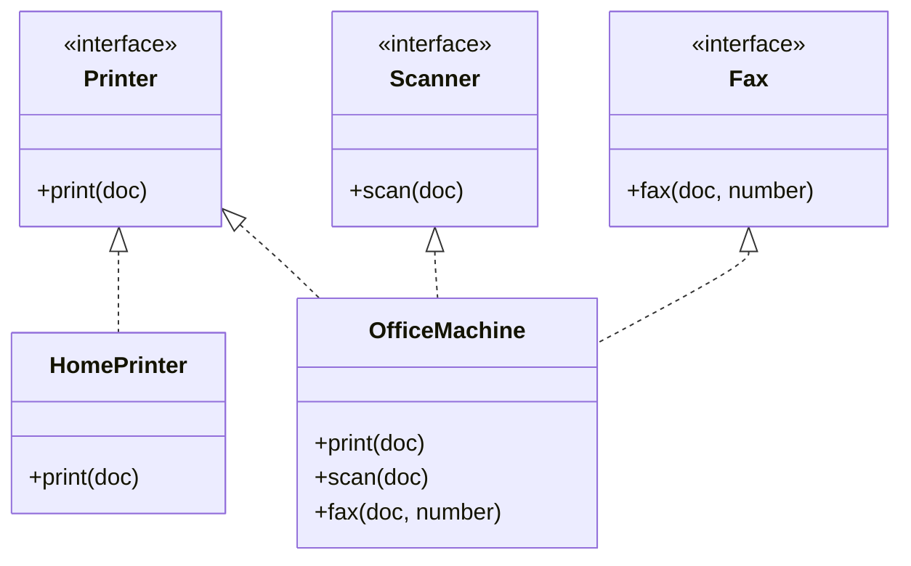

## The idea

Grandma's TV only needs three things: on/off, volume and channel. Now give her a **universal remote with 60 buttons**. Half of them do nothing on her TV. She presses one, nothing happens, and she thinks the TV is broken.

A small remote with only the buttons her TV supports is better.

The **Interface Segregation Principle** (ISP) says:

> No class should be forced to have, or depend on, methods it does not use.

So: **many small interfaces** are better than one big "do everything" interface. "Segregation" just means "splitting apart".

It is the "I" in SOLID. Fun fact: Robert C. Martin came up with it while helping Xerox with software for their printers.

**Memory hook:** Small interfaces. Only promise what you can do.

## The bad version

One big `Machine` interface for every office machine.

**Step 1: the big interface.** Every machine must have all three methods:

```js
// The interface: one big "do everything" role.
// JavaScript has no "interface" keyword, so a base class that throws stands in for one.
class Machine {
    print(doc) {
        throw new Error("not implemented");
    }

    scan(doc) {
        throw new Error("not implemented");
    }

    fax(doc, number) {
        throw new Error("not implemented");
    }
}
```

**Step 2: two machines.** The office machine can do everything. The home printer can only print:

```js
class OfficeMachine extends Machine {
    print(doc) {
        return `Printed ${doc}`;
    }

    scan(doc) {
        return `Scanned ${doc}`;
    }

    fax(doc, number) {
        return `Faxed ${doc} to ${number}`;
    }
}

class HomePrinter extends Machine {
    print(doc) {
        return `Printed ${doc}`;
    }

    // It can't scan or fax, but the interface forces it to have these methods.
    scan(doc) {
        throw new Error("HomePrinter cannot scan");
    }

    fax(doc, number) {
        throw new Error("HomePrinter cannot fax");
    }
}
```

**Step 3: use the home printer.** Printing works. Faxing crashes:

```js
const printer = new HomePrinter();
console.log(printer.print("report.pdf")); // Printed report.pdf

try {
    printer.fax("report.pdf", "555-0100");
} catch (error) {
    console.log(error.message); // HomePrinter cannot fax
}
```

What is wrong?

- **Fake methods.** `HomePrinter` must write `scan()` and `fax()` just to throw.
- **Lies to the caller.** Code holding a `Machine` thinks it can fax. It finds out only when the program crashes. That also breaks the [Liskov Substitution Principle](./liskov-substitution.mdx).
- **Changes hit everyone.** Add `staple()` to `Machine`, and every machine class must change, even ones that never staple.

## The fixed version

Split the big interface into small **roles**: `Printer`, `Scanner` and `Fax`. Each class takes only the roles it can really do.



**Step 1: three small interfaces.** Each one is a single role:

```js
// Interface: something that can print.
class Printer {
    print(doc) {
        throw new Error("not implemented");
    }
}

// Interface: something that can scan.
class Scanner {
    scan(doc) {
        throw new Error("not implemented");
    }
}

// Interface: something that can fax.
class Fax {
    fax(doc, number) {
        throw new Error("not implemented");
    }
}
```

**Step 2: the machines.** Each one takes only the roles it can really do:

```js
class HomePrinter extends Printer {
    print(doc) {
        return `Printed ${doc}`;
    }
}

// A JavaScript class can extend only one class. So the all-in-one machine
// simply has all three methods (duck typing): it can act as each role.
class OfficeMachine {
    print(doc) {
        return `Printed ${doc}`;
    }

    scan(doc) {
        return `Scanned ${doc}`;
    }

    fax(doc, number) {
        return `Faxed ${doc} to ${number}`;
    }
}
```

**Step 3: use them.** Each function asks only for the role it needs:

```js
function printReport(printer) {
    return printer.print("report.pdf");
}

function scanPassport(scanner) {
    return scanner.scan("passport.jpg");
}

console.log(printReport(new HomePrinter()));    // Printed report.pdf
console.log(printReport(new OfficeMachine()));  // Printed report.pdf
console.log(scanPassport(new OfficeMachine())); // Scanned passport.jpg
```

Now `HomePrinter` has no fake methods. `printReport()` needs only a `Printer`, so a home printer and an office machine both work.

**Java in one line:** Java writes `class OfficeMachine implements Printer, Scanner, Fax`. A Java class can implement many interfaces, but extend only one class, just like JavaScript.

In JavaScript, the "interface" a function really needs is **just the methods it calls**. `printReport()` only calls `print()`, so any object with `print()` works.

## Another classic: the Worker

The same problem, in a shape interviewers like:

| Before | After |
| --- | --- |
| One `Worker` interface: `work()` and `eat()` | `Workable`: `work()` |
| | `Eater`: `eat()` |
| A `Robot` worker must fake `eat()` | `Robot` is only `Workable`. `Human` is both |

## How an interviewer spots a violation

- **Methods that throw "not supported"**, or are left empty, in a class that implements an interface.
- **A "fat" interface** with 10 methods, where each user only calls one or two.
- **A small change** to one method forces changes in classes that never use it.

## Common mistakes

- **Going too far.** One interface per method, everywhere, is just noise. Split by **who uses it** (the role), not by method count.
- **Splitting the class but not the callers.** If `printReport()` still asks for a whole `Machine`, nothing improved. Callers should ask for the small role.

## In the real world

- **Java's standard interfaces are tiny.** `Runnable` has one method, `run()`. `Comparable` has one, `compareTo()`. `AutoCloseable` has one, `close()`. A class picks only the roles it needs.
- **Node.js streams.** A `Readable` stream is for reading, a `Writable` is for writing. A `Duplex` stream, like a network socket, is both. Code that only reads asks for a `Readable`.
- **JavaScript's iteration.** An object needs only one method, `[Symbol.iterator]()`, to work with `for...of` and the spread `...`. Nothing else is required.

## In the interview

When one class would need a method it can't do, split the interface into roles. Say it out loud:

> "Not every machine can scan or fax, so I'll split the big interface into `Printer`, `Scanner` and `Fax`. A home printer only implements `Printer`. An office machine implements all three. No class has fake methods that throw."

**Likely follow-up:** "Isn't that more interfaces to manage?"

**Answer:** "A few more names, yes. But each class only promises what it can do, and nobody can call a method that would crash. I split by role, by who uses it, not one interface per method."

<Callout title="Remember this" type="success">
  - **Small interfaces. Only promise what you can do.**
  - No class should be forced to have methods it can't use.
  - The smell: methods that **throw "not supported"** or are **empty**.
  - Split by **role** (who uses it), not one interface per method.
  - Callers should ask for the **small role** they need, like `Printer`, not the whole `Machine`.
</Callout>
