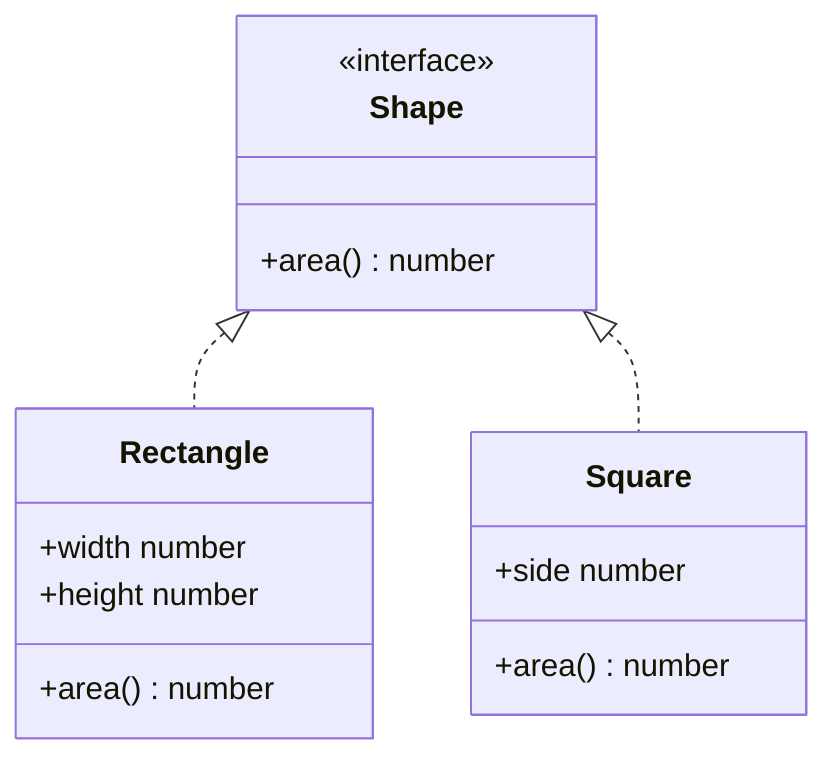
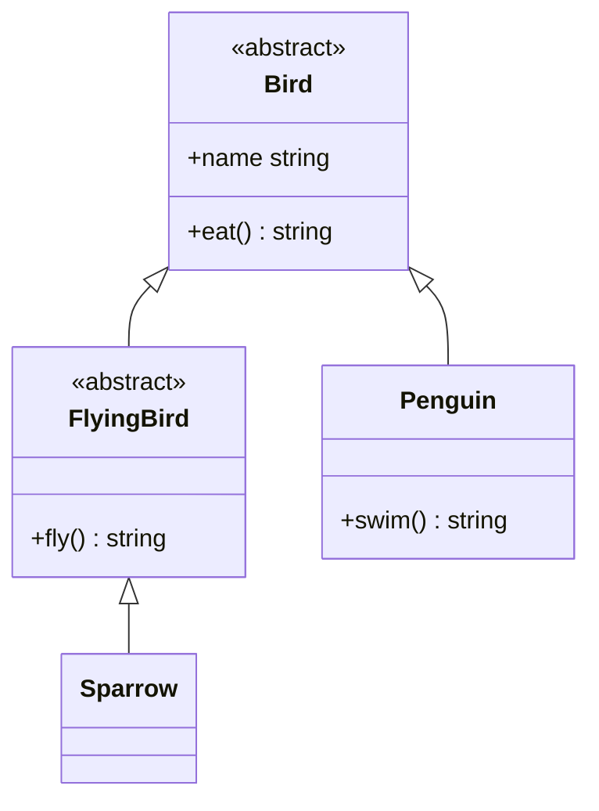

## The idea

You book "**a car**" from a rental company. At the desk they hand you a small car, or a big one. You don't mind. Every car keeps the same promises: the wheel turns it, the brake stops it.

Now imagine a "car" where the brake pedal opens the boot. It is still called a car, but you crash on the first corner.

The **Liskov Substitution Principle** (LSP) says:

> If code works with a parent class, it must also work with **any subclass**, without knowing which one it got.

It is the "L" in SOLID. It is named after Barbara Liskov, a computer scientist who described the idea in 1987.

**Memory hook:** A child keeps the parent's promises.

## Square extends Rectangle

In maths, every square is a rectangle. So `Square extends Rectangle` feels right. Watch what happens.

**Step 1: a rectangle.** Its width and height can be set one at a time:

```js
class Rectangle {
    constructor(width, height) {
        this.width = width;
        this.height = height;
    }

    setWidth(width) {
        this.width = width;
    }

    setHeight(height) {
        this.height = height;
    }

    area() {
        return this.width * this.height;
    }
}
```

**Step 2: a square that extends it.** A square must keep both sides equal, so each setter changes both:

```js
class Square extends Rectangle {
    constructor(side) {
        super(side, side);
    }

    setWidth(width) {
        this.width = width;
        this.height = width;
    }

    setHeight(height) {
        this.width = height;
        this.height = height;
    }
}
```

**Step 3: code written for rectangles.** `resize()` trusts that `setWidth()` doesn't change the height:

```js
function resize(rect) {
    rect.setWidth(5);
    rect.setHeight(4);
    return rect.area();
}

console.log(resize(new Rectangle(2, 3))); // 20
console.log(resize(new Square(2)));       // 16  (surprise! expected 20)
```

`resize()` worked for every rectangle. Then it got a `Square`, and it broke, even though `resize()` did nothing wrong.

`Rectangle` made a quiet promise: "setting the width leaves the height alone." `Square` broke that promise. That is an LSP violation.

The lesson: "a square **is a** rectangle" in real life is not enough. Ask: **does it behave like one, everywhere the parent is used?**

## The fix

Don't make `Square` a child of `Rectangle`. Give both a common parent that promises only what **both** can keep: "I can tell you my area."



```js
// The interface: every shape can tell you its area.
// JavaScript has no "interface" keyword, so a base class that throws stands in for one.
class Shape {
    area() {
        throw new Error("not implemented");
    }
}

class Rectangle extends Shape {
    constructor(width, height) {
        super();
        this.width = width;
        this.height = height;
    }

    area() {
        return this.width * this.height;
    }
}

class Square extends Shape {
    constructor(side) {
        super();
        this.side = side;
    }

    area() {
        return this.side * this.side;
    }
}
```

Any list of shapes can now be handled the same way:

```js
const shapes = [new Rectangle(5, 4), new Square(4)];

for (const shape of shapes) {
    // constructor.name is the name of the object's class, like "Rectangle".
    console.log(shape.constructor.name, shape.area());
}
// Rectangle 20
// Square 16
```

Any code that takes a `Shape` only calls `area()`, and every shape keeps that promise. No surprises. To "resize", you make a new shape instead of changing an old one.

## A second example: the penguin

```js
class Bird {
    fly() {
        return "Flying high";
    }
}

// A sparrow is a bird with nothing extra.
class Sparrow extends Bird {}

class Penguin extends Bird {
    fly() {
        throw new Error("Penguins can't fly");
    }
}

// Makes every bird in the list fly.
function startMigration(birds) {
    return birds.map((bird) => bird.fly());
}

console.log(startMigration([new Sparrow()])); // [ 'Flying high' ]

try {
    startMigration([new Sparrow(), new Penguin()]);
} catch (error) {
    console.log(error.message); // Penguins can't fly
}
```

`Bird` promised "every bird can fly". `Penguin` can't keep that promise, so it throws. The fix is to put `fly()` only where it is true:



**Step 1: the two parent classes.** Every bird can eat. Only a `FlyingBird` can fly:

```js
class Bird {
    constructor(name) {
        // Bird and FlyingBird are abstract: you can't create one directly.
        // new.target is the class that "new" was called with.
        if (new.target === Bird || new.target === FlyingBird) {
            throw new Error("abstract class");
        }

        this.name = name;
    }

    eat() {
        return `${this.name} is eating`;
    }
}

class FlyingBird extends Bird {
    fly() {
        return `${this.name} is flying`;
    }
}
```

**Step 2: the real birds.** A sparrow is a flying bird. A penguin is a bird that swims. `startMigration()` now asks only for flying birds:

```js
class Sparrow extends FlyingBird {}

class Penguin extends Bird {
    swim() {
        return `${this.name} is swimming`;
    }
}

// Only takes FlyingBirds now.
function startMigration(flyingBirds) {
    return flyingBirds.map((bird) => bird.fly());
}

const pingu = new Penguin("Pingu");

console.log(startMigration([new Sparrow("Sparrow")])); // [ 'Sparrow is flying' ]
console.log(pingu.swim());                             // Pingu is swimming
console.log(pingu.eat());                              // Pingu is eating
```

Another fix is to make flying an ability, a small `Flyer` interface that only flying birds have. See [Interface Segregation Principle](./interface-segregation.mdx).

## How to spot a bad subclass

A subclass breaks LSP when it does one of these:

| Smell | Example |
| --- | --- |
| Throws for a method the parent supports | `Penguin.fly()` throws |
| Overrides a method to do nothing | `fly() {}` |
| Breaks a promise the parent made | `Square.setWidth()` also changes the height |
| Asks for more than the parent | Parent takes any amount, child only amounts over 100 |
| Gives back less than the parent | Parent returns a number, child returns `null` |

There is also a sign in the **calling** code: `instanceof` checks like `if (bird instanceof Penguin) continue;`. The caller had to learn about one child, so swapping children did not work.

**The formal names.** Interviewers sometimes describe LSP as a **contract** that every method keeps. A child must follow three rules:

- **Preconditions** (what the method needs from the caller): the child can't ask for **more**. The "over 100" row above breaks this.
- **Postconditions** (what the method promises when it is done): the child can't give back **less**. Returning `null`, throwing a new error, or `Square.setWidth()` changing the height all break this.
- **Invariants** (what is always true about the object, like "the balance is never negative"): the child must keep every one.

## In the real world

- **Java's `List`** has an `add()` method. But `Collections.unmodifiableList(...)` and `List.of(...)` return lists whose `add()` throws `UnsupportedOperationException`. Code that trusts "every List can add" breaks. It is a well-known LSP trap in a standard library.
- **JavaScript's `for...of`** works with an Array, a string, a `Map` or a `Set`. Each one keeps the same "iterable" promise, so the loop does not care which one it gets.
- **Node.js streams.** A file stream from `fs.createReadStream()` and an incoming HTTP request are both readable streams. Code that reads a stream works with either one.

## In the interview

Use inheritance only when the child can **truly** stand in for the parent. When it can't, say so and pick a smaller interface or [composition](../oop-basics/composition-vs-inheritance.mdx).

> "I won't put `fly()` on `Bird`, because a `Penguin` would have to throw, and any code that makes all birds fly would crash. I'll move `fly()` into `FlyingBird`, so every subclass keeps its parent's promises."

**Likely follow-up:** "How do you decide if inheritance is right here?"

**Answer:** "I check if the child can be used everywhere the parent is used, with no surprises: no throwing, no empty overrides, no `instanceof` checks in callers. If it can't, I use a smaller interface or composition instead."

<Callout title="Remember this" type="success">
  - **A child keeps the parent's promises.** Swap in any subclass and the code still works.
  - "Is-a" in real life is not enough. Ask "does it **behave** like one?"
  - Classic breaks: **Square extends Rectangle**, **Penguin extends Bird**.
  - Smells: a child that **throws**, does **nothing**, or callers that use **`instanceof`**.
  - Fix: a smaller parent or interface that **every** child can honour.
</Callout>
