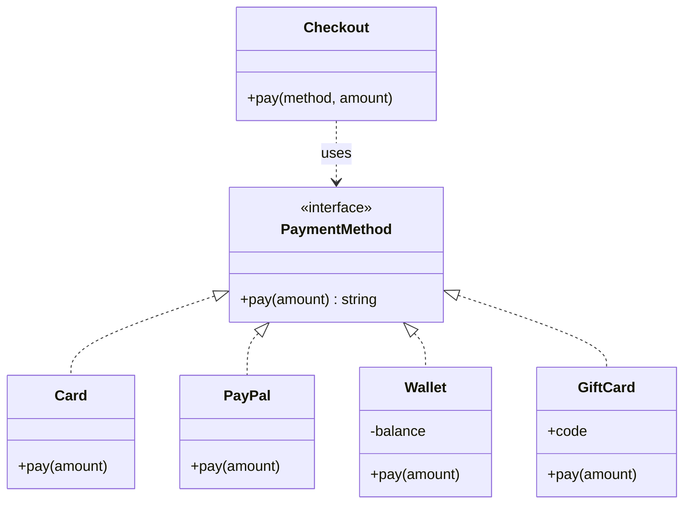

## The idea

Think of a **power strip**. When you buy a new lamp, you plug it in. You don't open the wall and rewire the house. The strip is **open** to new devices, but its wiring is **closed**: nobody touches it.

The **Open/Closed Principle** (OCP) says:

> Code should be **open for extension** but **closed for modification**.

- **Open for extension:** you can add new behaviour.
- **Closed for modification:** you add it by writing **new** code, not by editing old code that already works.

It is the "O" in SOLID. Bertrand Meyer first wrote it down in 1988.

**Memory hook:** Add new code, don't edit old code.

## The bad version

A shop checkout that takes card, PayPal and wallet payments:

```js
class Checkout {
    pay(method, amount) {
        if (method === "card") {
            return `Charged ${amount} to the card`;
        } else if (method === "paypal") {
            return `Sent to PayPal for ${amount}`;
        } else if (method === "wallet") {
            return `Paid ${amount} from the wallet`;
        }

        throw new Error(`Unknown payment method: ${method}`);
    }
}

const checkout = new Checkout();
console.log(checkout.pay("card", 50));   // Charged 50 to the card
console.log(checkout.pay("wallet", 20)); // Paid 20 from the wallet
```

Now the shop wants **gift cards**. Why does this hurt?

- **You must edit `pay()`**, a method that already works. One wrong bracket and card payments break too.
- **The chain only grows.** Real code also has refunds, fees and limits. Each gets its own `if/else` on the same strings, in other files.
- **Everything must be tested again**, even card payments, because their code changed.

## The fixed version

Make "payment method" a role, an **interface**. Each method becomes its own class. `Checkout` only talks to the role.



**Step 1: the role and two simple methods.** `PaymentMethod` names the role. `Card` and `PayPal` fill it in:

```js
// The interface. JavaScript has no "interface" keyword,
// so a base class whose method throws stands in for one.
class PaymentMethod {
    pay(amount) {
        throw new Error("not implemented");
    }
}

class Card extends PaymentMethod {
    pay(amount) {
        return `Charged ${amount} to the card`;
    }
}

class PayPal extends PaymentMethod {
    pay(amount) {
        return `Sent to PayPal for ${amount}`;
    }
}
```

**Step 2: a wallet.** It is a payment method too, with its own balance and its own rule:

```js
class Wallet extends PaymentMethod {
    constructor(balance) {
        // A child class must call super() before it can use "this".
        super();
        this.balance = balance;
    }

    pay(amount) {
        if (amount > this.balance) {
            throw new Error("Not enough money in the wallet");
        }

        this.balance = this.balance - amount;
        return `Paid ${amount} from the wallet, ${this.balance} left`;
    }
}
```

**Step 3: the checkout.** It just calls `pay()` on whatever method it gets:

```js
class Checkout {
    pay(method, amount) {
        // No if/else: this works for any PaymentMethod.
        return method.pay(amount);
    }
}

const checkout = new Checkout();
console.log(checkout.pay(new Card(), 50));      // Charged 50 to the card
console.log(checkout.pay(new Wallet(100), 30)); // Paid 30 from the wallet, 70 left
```

**Step 4: next year, gift cards.** One new class. `Checkout` and the old classes don't change:

```js
class GiftCard extends PaymentMethod {
    constructor(code) {
        super();
        this.code = code;
    }

    pay(amount) {
        return `Used gift card ${this.code} for ${amount}`;
    }
}

console.log(checkout.pay(new GiftCard("BDAY-25"), 25)); // Used gift card BDAY-25 for 25
```

`Checkout` is now **closed**: it never changes when a payment method is added. The design is **open**: anyone can add a new `PaymentMethod`.

In JavaScript, `Checkout` would also accept **any object with a `pay` method**, even one that doesn't extend `PaymentMethod` (duck typing). The base class just names the role. Java does this with `interface PaymentMethod` and `class Card implements PaymentMethod`.

This trick, "swap the behaviour by passing a different object", is the [Strategy](../design-patterns/strategy.mdx) pattern. It works because of [Polymorphism](../oop-basics/polymorphism.mdx): the same call, `method.pay()`, does different things.

## Where does the choice go?

The user still picks "card" from a menu, so some code must turn the word `'card'` into a `Card` object. That is fine. Keep that choice in **one place**, at the edge of the program: a small map of names to classes, or a [Factory](../design-patterns/factory.mdx).

Adding gift cards then means one new class plus one new line in that map. The business code never changes.

## How an interviewer spots a violation

- **An `if/else` or `switch` on a type**, like `type === 'card'`, especially when the same switch appears in several places.
- **`instanceof` checks** in business code: `if (shape instanceof Circle) ... else if (shape instanceof Square) ...`.
- **Every new feature edits the same old file.**
- When they ask "**How would you add X?**" and your answer is "I'd add another `else if`".

## Common mistakes

- **Making everything pluggable "just in case".** Add the interface where change is **likely or asked for**, like payment methods or vehicle types. See [DRY, KISS and YAGNI](./dry-kiss-yagni.mdx).
- **Thinking "closed" means "never touch the file".** Bug fixes are fine. "Closed" means you don't have to edit working code to **add** a feature.
- **Hiding the `if/else` in many places.** One small factory at the edge is fine. Ten copies of the same switch are not.

## In the real world

- **`Array.prototype.sort`** takes a compare function. You change how it sorts, `(a, b) => a.price - b.price`, without editing `sort` itself.
- **Express middleware.** `app.use(fn)` adds logging, login checks or JSON parsing to an app without changing Express's own code.
- **Plugins.** ESLint rules, Babel plugins and VS Code extensions all add new behaviour to a tool without editing the tool.

## In the interview

OCP is what the interviewer checks in the last step of the [LLD Interview Framework](../interview-framework.mdx): "How would you add a new feature?" A good design takes it as **a new class**, not a new `else if`.

> "Payment methods will grow, so I'll make `PaymentMethod` an interface with `pay(amount)`. `Checkout` only calls `pay()`. Adding Apple Pay later is one new class. `Checkout` and the old methods don't change."

**Likely follow-up:** "But your code still needs a switch to create the right payment method. Doesn't that break OCP?"

**Answer:** "A little, but it's in one place, a small factory at the edge. All the business logic stays closed. If even that bothers us, each method can register itself in a map, so adding one never edits old code."

<Callout title="Remember this" type="success">
  - **Add new code, don't edit old code.**
  - Open for **extension**, closed for **modification**.
  - The tool: an **interface** plus one class per kind ([Strategy](../design-patterns/strategy.mdx)).
  - The smell: a growing `if/else` or `switch` on a type.
  - Keep the "which class?" choice in **one** place, like a factory.
</Callout>
