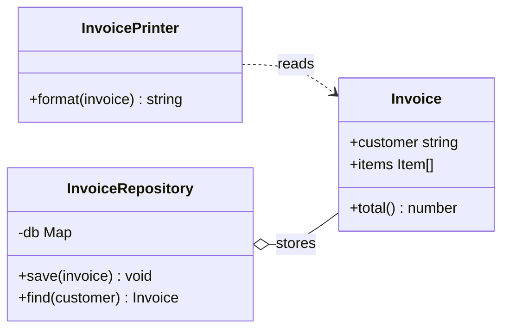

## The idea

Think of a **restaurant**. The chef cooks. The cashier takes the money. The waiter brings the food. When the tax rules change, only the cashier learns something new. The chef keeps cooking.

Now picture one person who cooks, takes the money and serves. Every new rule, about food, money or service, lands on that one person. They get slow, and they make mistakes.

The **Single Responsibility Principle** (SRP) says:

> A class should have **one reason to change**.

It is the "S" in **SOLID**, five design rules made popular by Robert C. Martin ("Uncle Bob").

**Memory hook:** One class, one job.

## What "one job" really means

"One job" does **not** mean "one method". A class can have many methods, as long as they all serve the same job.

A good test is to ask: **who would ask me to change this code?**

- The accounts team asks for a new tax rule.
- The design team asks for a new invoice layout.
- The tech team asks to save invoices in a database instead of a file.

Three different people means three reasons to change. That is three jobs, so three classes.

## The bad version

A shop `Invoice` that adds up the total, **and** prints itself, **and** saves itself:

```js
class Invoice {
    constructor(customer, items) {
        this.customer = customer;
        // Each item looks like { name, price, qty }
        this.items = items;
    }

    // Job 1: work out the total
    total() {
        let sum = 0;
        for (const item of this.items) {
            sum = sum + item.price * item.qty;
        }
        return sum;
    }

    // Job 2: print the invoice
    print() {
        const lines = [`Invoice for ${this.customer}`];
        for (const item of this.items) {
            const lineTotal = item.price * item.qty;
            lines.push(`${item.name} x${item.qty} = ${lineTotal}`);
        }
        lines.push(`Total: ${this.total()}`);

        console.log(lines.join("\n"));
    }

    // Job 3: save the invoice
    save(db) {
        const record = { items: this.items, total: this.total() };
        db.set(this.customer, record);
        console.log(`Saved invoice for ${this.customer}`);
    }
}
```

Now print and save one invoice:

```js
const invoice = new Invoice("Asha", [
    { name: "Pen", price: 2, qty: 3 },
    { name: "Notebook", price: 5, qty: 2 },
]);

invoice.print();
// Invoice for Asha
// Pen x3 = 6
// Notebook x2 = 10
// Total: 16

invoice.save(new Map()); // Saved invoice for Asha
```

It works. So what is wrong?

- **Three reasons to change live in one class.** A new layout, a new tax rule and a new database all edit `Invoice`.
- **One change can break another job.** A mistake while editing `print()` can break the money maths in the same file.
- **Hard to test.** To test `total()`, you also load the printing and saving code.
- **It keeps growing.** Want to email the invoice as a PDF? You add `emailPdf()` to `Invoice` too.

## The fixed version

Split the class by job. Each new class has one reason to change:

| Class | Its one job | Who asks for changes |
| --- | --- | --- |
| `Invoice` | Hold the items and work out the total | Accounts team |
| `InvoicePrinter` | Turn an invoice into text | Design team |
| `InvoiceRepository` | Save and find invoices | Tech team |



The dashed arrow means "uses for a moment". The hollow diamond means "holds, but doesn't own". All the arrows are explained in [Association, Aggregation and Composition](../modeling-uml/relationships.mdx).

**Step 1: the invoice.** It only holds the items and works out the total:

```js
class Invoice {
    constructor(customer, items) {
        this.customer = customer;
        this.items = items;
    }

    total() {
        let sum = 0;
        for (const item of this.items) {
            sum = sum + item.price * item.qty;
        }
        return sum;
    }
}
```

**Step 2: the printer.** It turns an invoice into text, and does nothing else:

```js
class InvoicePrinter {
    format(invoice) {
        const lines = [`Invoice for ${invoice.customer}`];
        for (const item of invoice.items) {
            const lineTotal = item.price * item.qty;
            lines.push(`${item.name} x${item.qty} = ${lineTotal}`);
        }
        lines.push(`Total: ${invoice.total()}`);

        return lines.join("\n");
    }
}
```

**Step 3: the repository.** It saves and finds invoices. Here a `Map` stands in for a real database:

```js
class InvoiceRepository {
    constructor() {
        this.db = new Map();
    }

    save(invoice) {
        this.db.set(invoice.customer, invoice);
    }

    find(customer) {
        return this.db.get(customer);
    }
}
```

**Step 4: use them together.** Each class does its own part:

```js
const invoice = new Invoice("Asha", [
    { name: "Pen", price: 2, qty: 3 },
    { name: "Notebook", price: 5, qty: 2 },
]);

const repo = new InvoiceRepository();
repo.save(invoice);

const savedInvoice = repo.find("Asha");
console.log(savedInvoice.total()); // 16

const printer = new InvoicePrinter();
console.log(printer.format(invoice));
// Invoice for Asha
// Pen x3 = 6
// Notebook x2 = 10
// Total: 16
```

Now each change has one home:

- **A new layout?** Add an `HtmlInvoicePrinter`. `Invoice` does not change.
- **A real database?** Change `InvoiceRepository` only.
- **Testing `total()`** needs only `Invoice`. No printer, no database.

## How an interviewer spots a violation

- **The "and" test.** You describe the class and need "and": "It works out the total **and** prints **and** saves."
- **Vague names** like `InvoiceManager`, `OrderHelper` or `Utils`. They tend to collect everything.
- **Mixed worlds in one class:** money maths next to `console.log`, database calls or emails.
- **Groups of methods that never touch the same fields.** That usually means two classes are hiding in one. See [Coupling and Cohesion](./coupling-cohesion.mdx).

## Common mistakes

- **Going too far.** One class per method gives you 50 tiny classes that are hard to follow. Group by **reason to change**, not by method.
- **Thinking it is only about classes.** The same idea works for functions and files. A function should do one thing too.
- **Splitting by technical layer only.** A `Validator`, a `Calculator` and a `Formatter` that all change together for one feature are really one job.

## In the real world

- **Unix tools.** `cat` reads files, `grep` finds lines, `sort` sorts them. Each does one job, and you chain them: `cat app.log | grep ERROR | sort`.
- **Node.js APIs** are often split into routes, services and repositories. The route reads the HTTP request, the service holds the business rules, and the repository talks to the database. Moving to a new database does not touch the routes.
- **React** teams often move data loading into a custom hook (like `useInvoice()`), so the component only draws the screen.

## In the interview

Interviewers look for SRP in every LLD answer. When you list your classes, say what each one is **for**, in one short sentence. If a sentence needs "and", split the class.

> "I'll keep `Invoice` for the items and the total. Printing goes into an `InvoicePrinter`, and saving into an `InvoiceRepository`. Then a new layout or a new database changes only one class."

**Likely follow-up:** "Isn't that too many classes for something so small?"

**Answer:** "For a tiny script, one class is fine. But printing and saving change for different reasons, and they are often swapped, for PDF, email or a real database. Splitting them costs little and keeps each class small and easy to test."

<Callout title="Remember this" type="success">
  - **One class, one job.** One job = one reason to change.
  - Ask "**who** would ask me to change this?" Different people means different classes.
  - The "**and**" test: if you need "and" to describe a class, it may do too much.
  - It is not "one method per class". Group by reason to change.
  - A classic split: **data and rules** / **formatting** / **saving**.
</Callout>
