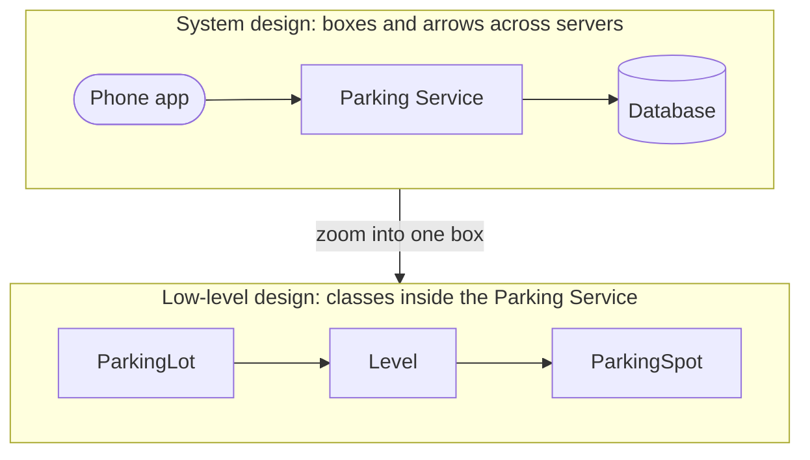
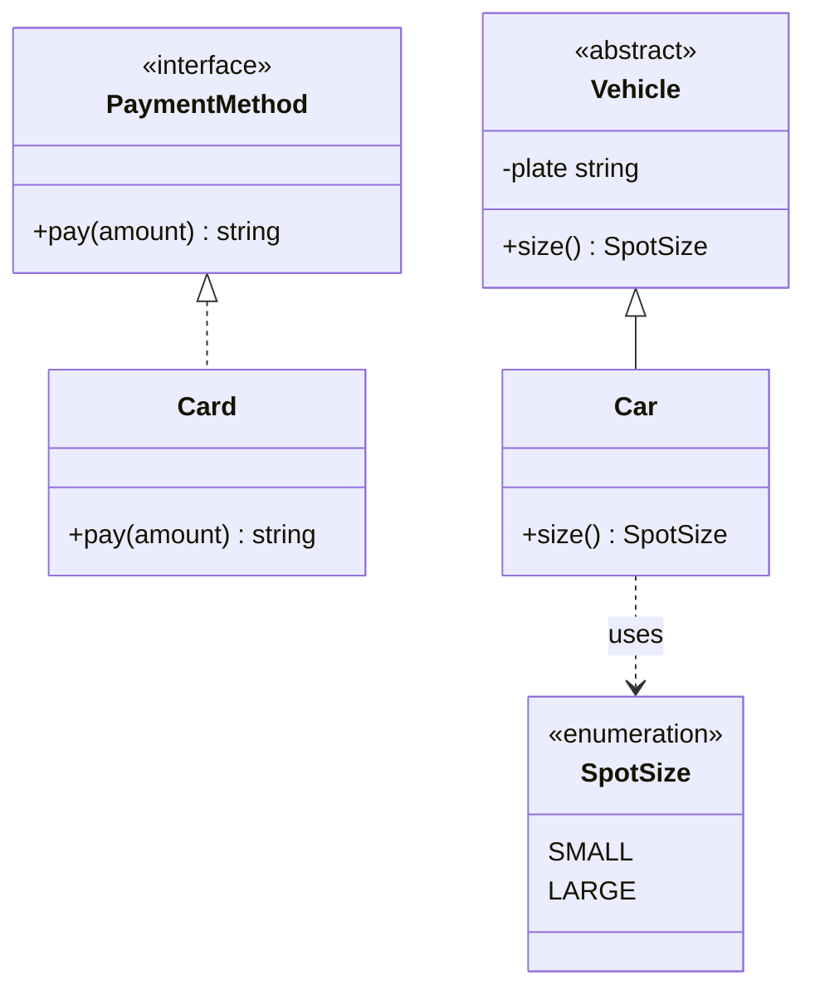

## What is a low-level design interview?

In a low-level design (**LLD**) interview, you design the **classes and code** for one small program. For example:

- "Design the classes for a parking lot."
- "Design a vending machine."
- "Design an elevator system."

You get about **45 to 60 minutes**. You ask questions, pick the classes, draw how they connect, and write the main code.

Think of building a house. Before anyone lays a brick, someone plans **which rooms** the house needs, **what each room is for**, and **which doors connect them**. LLD is that plan for a program: which classes, what each one does, and how they talk to each other.

Some companies call this round **object-oriented design** (OOD). A **machine coding** round is the same idea, with more focus on fully working code.

There is **no single right answer**. The interviewer wants to see how you think, and how clean and easy to change your design is.

## LLD vs system design (HLD)

System design is also called **high-level design** (HLD). Both are design, at different zoom levels:

- **HLD** is a city map: the buildings and the roads between them. In software: servers, databases and caches, with arrows between them.
- **LLD** is the floor plan of one building: its rooms and doors. In software: the classes and methods **inside one program**.



| | System design (HLD) | Low-level design (LLD) |
| --- | --- | --- |
| Example question | "Design a URL shortener like bit.ly" | "Design a parking lot" |
| Zoom level | The whole system, many servers | One program, inside one server |
| Building blocks | Servers, databases, caches, queues | Classes, methods, interfaces, enums |
| What you draw | Boxes and arrows | Class diagrams |
| Main worries | Scale, speed, staying up | Clean classes, easy to change, correct logic |
| Code | Almost none | Yes, the core classes |

Some interviews mix both: you draw the big picture, then the interviewer asks you to zoom into one service and design its classes. For the big-picture side, see [System Design](/learn/system-design).

## What interviewers look for

| They check | What good looks like |
| --- | --- |
| **Clear requirements** | You ask questions first, and agree on what to build and what to leave out. |
| **Good classes** | Each class has one clear job. No "god class": one huge class that does everything. See [Single Responsibility Principle](./design-principles/single-responsibility.mdx). |
| **Right relationships** | You know when something **is a** kind of another thing (inheritance) and when it **has a** part (composition). |
| **Easy to extend** | A new feature, like a new vehicle type, means adding a class, not rewriting old ones. See [Open/Closed Principle](./design-principles/open-closed.mdx). |
| **Working code** | Clean, readable code for the main flow. |
| **Edge cases** | Wrong input, a full parking lot, two people booking the same seat at once. |
| **Talking out loud** | You explain each choice and its **tradeoff**: what you gain and what you give up. |

**Design patterns** are proven answers to common design problems, like [Strategy](./design-patterns/strategy.mdx) or [Observer](./design-patterns/observer.mdx). Use one when it solves a real problem in front of you, and say its name. Patterns added "just because" count against you.

## LLD in JavaScript

Most LLD books and answers use Java. Here everything is written in plain, modern **JavaScript**. JavaScript has classes, but it lacks a few things Java has, so we use the same simple habits everywhere:

| Java has | In JavaScript we write | Example |
| --- | --- | --- |
| `interface` | A base class named after the role, marked `// interface`, whose methods throw "not implemented" | `class PaymentMethod` |
| `abstract class` | A base class whose constructor blocks direct use with a `new.target` check | `class Vehicle` |
| `private` fields | Real private fields, with `#` | `#balance` |
| `protected` | Nothing: JavaScript has no protected. `_name` is only a naming habit | none |
| `enum` | A frozen object | `Object.freeze({ SMALL: 'SMALL' })` |

All of them in one small example. The parts below run together as one file.

**Step 1: An enum and an interface.** The enum is a fixed list of sizes. The interface says every payment can `pay()`:

```js
// enum: Object.freeze locks the object, so no one can add or change a size
const SpotSize = Object.freeze({
    SMALL: "SMALL",
    LARGE: "LARGE",
});

// interface: every method throws until a child class writes its own
class PaymentMethod {
    pay(amount) {
        throw new Error("not implemented");
    }
}

class Card extends PaymentMethod {
    pay(amount) {
        return `Paid ${amount} by card`;
    }
}
```

**Step 2: An abstract class with a private field.** `Vehicle` can't be made directly, and its plate is private:

```js
// abstract: you can't make a plain Vehicle, only a child like Car
class Vehicle {
    // private field: the # means only Vehicle's own code can use it
    #plate;

    constructor(plate) {
        // new.target is the class that `new` was called with
        if (new.target === Vehicle) {
            throw new Error("Vehicle is abstract");
        }

        this.#plate = plate;
    }

    getPlate() {
        return this.#plate;
    }

    // Each vehicle must say its own size
    size() {
        throw new Error("not implemented");
    }
}
```

**Step 3: A child class, and use it.** `Car` fills in `size()`:

```js
class Car extends Vehicle {
    size() {
        return SpotSize.SMALL;
    }
}

const car = new Car("KA-01-1234");
console.log(car.getPlate(), car.size()); // KA-01-1234 SMALL

const card = new Card();
console.log(card.pay(50)); // Paid 50 by card

// This line would throw "Vehicle is abstract":
// new Vehicle("X-1");
```

In class diagrams, each kind of class has its own color: green for interfaces, purple for abstract classes, blue for normal classes, and orange for enums.



See [Interfaces and Abstract Classes in JavaScript](./oop-basics/interfaces-abstract-classes.mdx) and [Encapsulation](./oop-basics/encapsulation.mdx) for the details.

Java interviews also ask about threads. In JavaScript the same problems show up as **async races**: two requests that interleave while one of them waits. See [Concurrency in JavaScript](./concurrency/concurrency-in-javascript.mdx).

Every practice answer follows the same 6 steps: see [The LLD Interview Framework](./interview-framework.mdx).

<Callout title="Remember this" type="success">
  - **LLD** = the classes and methods inside one program. **HLD** = boxes and arrows across servers.
  - Interviewers want **clear classes with one job each**, designs that are **easy to extend**, and **reasoning out loud**.
  - Requirements first, code later: follow the 6-step framework.
  - JavaScript habits: a base class for an **interface**, `new.target` for an **abstract class**, `#` for **private**, `Object.freeze` for **enums**.
</Callout>
