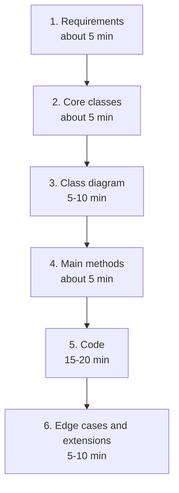
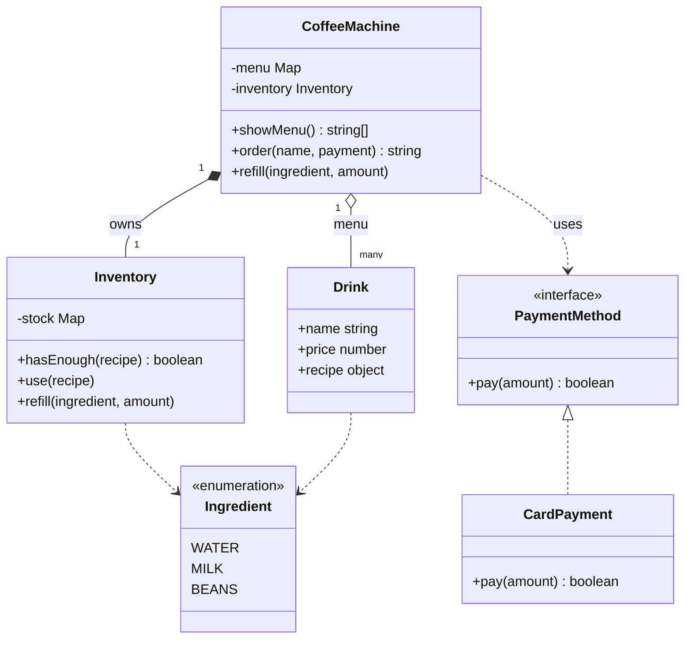
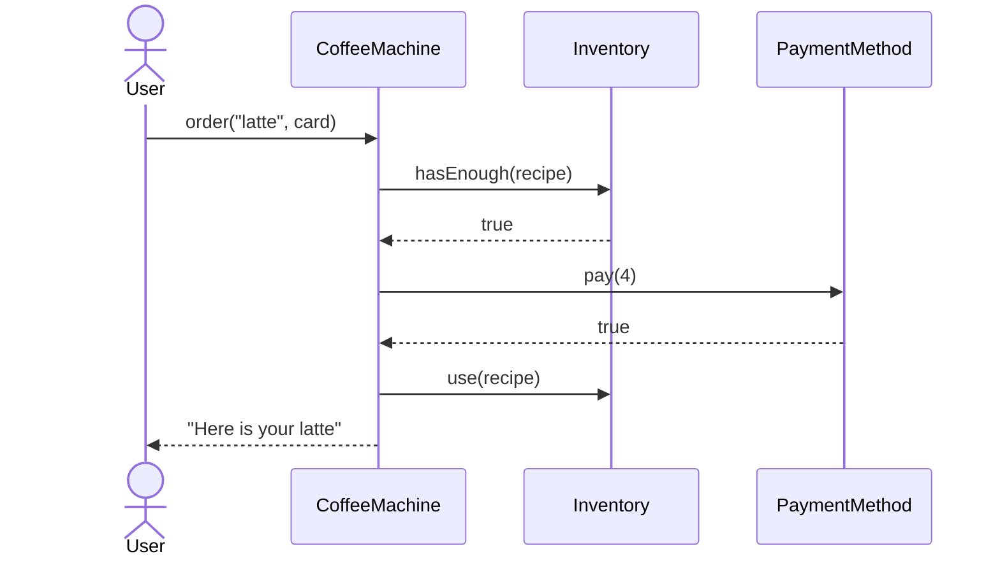

Think of cooking a new dish. You read the recipe, get the ingredients ready, and only then start cooking. If you start cooking first, you find out halfway that there are no eggs.

An LLD interview works the same way. If you start coding right away, you may build the wrong thing, or end up with one huge, messy class. A **framework** is a fixed plan you follow every time. It helps you in three ways:

- You stay calm, because you always know what comes next.
- You don't forget an important part.
- The interviewer sees that you work in an organized way.

On this page we use one small example the whole way: **"Design a coffee machine."** It's an office machine that makes espresso, latte and cappuccino.

## The 6 steps at a glance



| Step | What you do | Time |
| --- | --- | --- |
| 1. Requirements | Ask questions. List what it must do, and what is out of scope. | about 5 min |
| 2. Core classes | Nouns become classes, verbs become methods, fixed choices become enums. | about 5 min |
| 3. Class diagram | Draw how the classes relate (is-a, has-a, uses), and how many of each. | 5 to 10 min |
| 4. Main methods | Write the public methods of the key classes, and walk through the main flow. | about 5 min |
| 5. Code | Write the core classes and the main flow in clean, runnable code. | 15 to 20 min |
| 6. Edge cases and extensions | Wrong input, two requests at once, and adding a feature without changing old code. | 5 to 10 min |

Total: about **45 to 60 minutes**. Interviewers mostly judge four things: **clear classes**, **one job per class**, **easy to extend**, and **reasoning out loud**.

## Step 1: Requirements

**Time:** about 5 minutes.

Don't design yet. "Design a coffee machine" is vague on purpose. The interviewer wants to see you make it clear.

Write the features as "Users should be able to...":

1. Users should be able to see the menu: each drink and its price.
2. Users should be able to choose a drink and pay for it.
3. The machine should make the drink only if it has enough ingredients.
4. Staff should be able to refill the ingredients.

**Out of scope** (say it out loud): cup sizes, sugar, user accounts, a phone app.

Ask a few questions, and say the answer you'll assume:

| Question | Our assumption |
| --- | --- |
| Which drinks? | Espresso, latte and cappuccino. More may come later. |
| How do people pay? | By card for now. Other ways may come later. |
| What if an ingredient runs out? | Say sorry **before** taking any money. |
| Can two people order at once? | One screen for now, but card payments are slow, so keep it in mind. |

Then sum it up:

> "So the machine shows a menu, takes a card, and makes the drink if it has enough water, milk and beans. Staff can refill it. No sizes or sugar for now. Does that sound right?"

## Step 2: Core classes

**Time:** about 5 minutes.

Read your requirements and look at the words:

- **Nouns** (things) become **classes**: machine, drink, inventory, payment.
- **Verbs** (actions) become **methods**: show the menu, order, pay, refill.
- **Fixed choices** become **enums**: the ingredients are always water, milk and beans.

An **enum** is a fixed list of named values. In JavaScript it's a frozen object: `Object.freeze({ WATER: 'WATER', ... })`.

| Class | What it is | Key data | Key actions |
| --- | --- | --- | --- |
| `CoffeeMachine` | The main class people talk to | menu, inventory | `showMenu()`, `order()`, `refill()` |
| `Drink` | One item on the menu | name, price, recipe | none: it's just data |
| `Inventory` | The ingredients inside the machine | amount of each ingredient | `hasEnough()`, `use()`, `refill()` |
| `PaymentMethod` | Interface: any way to pay | none | `pay(amount)` |
| `CardPayment` | Pay by card | none | `pay(amount)` |
| `Ingredient` | Enum: `WATER`, `MILK`, `BEANS` | none | none |

Not every noun becomes a class. "Menu" is just a list of drinks inside the machine. "Staff" is just whoever calls `refill()`. See [Finding Classes from Requirements](./modeling-uml/finding-classes.mdx).

## Step 3: Class diagram

**Time:** 5 to 10 minutes.

Now decide how the classes connect. There are three main kinds of link:

- **is-a** (inheritance or implements): `CardPayment` **is a** `PaymentMethod`.
- **has-a** (composition or aggregation): the machine **has an** inventory and **has** drinks.
- **uses** (dependency): the machine **uses** a payment method only while it takes an order.

Also write **multiplicity**, meaning how many: one machine has **one** inventory and **many** drinks.



Say **why** for each choice:

- **Inventory is composition** (`*--`, filled diamond): the machine creates it and owns it. No machine, no inventory.
- **Drinks are aggregation** (`o--`, hollow diamond): they are made outside and handed to the machine.
- **PaymentMethod is an interface:** card today, phone or cash tomorrow, and the machine doesn't care.

See [Class Diagrams](./modeling-uml/class-diagrams.mdx) and [Association, Aggregation and Composition](./modeling-uml/relationships.mdx).

## Step 4: Main methods

**Time:** about 5 minutes.

List the **public** methods of the key classes, one line each:

| Method | What it does |
| --- | --- |
| `CoffeeMachine.showMenu()` | Returns each drink with its price. |
| `CoffeeMachine.order(name, payment)` | Checks stock, takes payment, makes the drink. |
| `CoffeeMachine.refill(ingredient, amount)` | Staff adds stock. |
| `Inventory.hasEnough(recipe)` | `true` if every ingredient is there. |
| `Inventory.use(recipe)` | Takes the ingredients out. |
| `PaymentMethod.pay(amount)` | Charges the money; returns `true` if it worked. |

Then walk through the **main flow**. Order matters here: check the stock **before** you take the money.



See [Sequence Diagrams](./modeling-uml/sequence-diagrams.mdx).

## Step 5: Code

**Time:** 15 to 20 minutes.

Write the core classes and the main flow. Not every getter, not a UI. Write small, clean methods, and talk while you type. The parts below run together as one file.

**Part 1: the enum and the drink.** A drink is just data: a name, a price and a recipe.

```js
// enum: Object.freeze locks the object, so no one can change the list
const Ingredient = Object.freeze({
    WATER: "WATER",
    MILK: "MILK",
    BEANS: "BEANS",
});

class Drink {
    constructor(name, price, recipe) {
        this.name = name;
        this.price = price;

        // How much of each ingredient the drink needs, like { MILK: 150 }
        this.recipe = recipe;
    }
}
```

**Part 2: the inventory.** It keeps track of how much of each ingredient is left.

```js
class Inventory {
    // Private (#). A Map from each ingredient to the amount left.
    #stock = new Map();

    refill(ingredient, amount) {
        const knownIngredients = Object.values(Ingredient);
        if (!knownIngredients.includes(ingredient)) {
            throw new Error(`Unknown ingredient: ${ingredient}`);
        }

        if (amount <= 0) {
            throw new Error("Amount must be positive");
        }

        const newAmount = this.#amountOf(ingredient) + amount;
        this.#stock.set(ingredient, newAmount);
    }

    // true only if there is enough of every ingredient in the recipe
    hasEnough(recipe) {
        for (const ingredient of Object.keys(recipe)) {
            const needed = recipe[ingredient];
            if (this.#amountOf(ingredient) < needed) {
                return false;
            }
        }

        return true;
    }

    use(recipe) {
        for (const ingredient of Object.keys(recipe)) {
            const needed = recipe[ingredient];
            const newAmount = this.#amountOf(ingredient) - needed;
            this.#stock.set(ingredient, newAmount);
        }
    }

    // How much of one ingredient is left (0 if it was never added)
    #amountOf(ingredient) {
        if (this.#stock.has(ingredient)) {
            return this.#stock.get(ingredient);
        }

        return 0;
    }
}
```

**Part 3: the payment interface.** The machine only knows "it can pay".

```js
// interface
class PaymentMethod {
    pay(amount) {
        throw new Error("not implemented");
    }
}

class CardPayment extends PaymentMethod {
    pay(amount) {
        // A real one would ask the bank
        console.log(`Card charged ${amount}`);
        return true;
    }
}
```

**Part 4: the coffee machine.** The main class. It checks the stock **before** it takes the money.

```js
class CoffeeMachine {
    // Private (#). A Map from drink name to Drink.
    #menu = new Map();

    // The machine creates and owns its inventory
    #inventory = new Inventory();

    constructor(drinks) {
        for (const drink of drinks) {
            this.#menu.set(drink.name, drink);
        }
    }

    // One line per drink, like "latte: 4"
    showMenu() {
        const lines = [];
        for (const drink of this.#menu.values()) {
            lines.push(`${drink.name}: ${drink.price}`);
        }

        return lines;
    }

    refill(ingredient, amount) {
        this.#inventory.refill(ingredient, amount);
    }

    order(name, payment) {
        const drink = this.#menu.get(name);
        if (!drink) {
            throw new Error(`Unknown drink: ${name}`);
        }

        if (!this.#inventory.hasEnough(drink.recipe)) {
            return `Sorry, not enough ingredients for ${name}`;
        }

        const paid = payment.pay(drink.price);
        if (!paid) {
            return "Payment failed";
        }

        this.#inventory.use(drink.recipe);
        return `Here is your ${name}`;
    }
}
```

**Part 5: try it.** Fill the machine, then order three drinks.

```js
// Each recipe uses the Ingredient names as keys
const espresso = new Drink("espresso", 2, { WATER: 30, BEANS: 10 });
const latte = new Drink("latte", 4, { WATER: 30, MILK: 150, BEANS: 10 });
const cappuccino = new Drink("cappuccino", 3, { WATER: 30, MILK: 100, BEANS: 10 });

const machine = new CoffeeMachine([espresso, latte, cappuccino]);
machine.refill(Ingredient.WATER, 500);
machine.refill(Ingredient.MILK, 200);
machine.refill(Ingredient.BEANS, 100);

const card = new CardPayment();
console.log(machine.showMenu()); // [ 'espresso: 2', 'latte: 4', 'cappuccino: 3' ]

console.log(machine.order("latte", card));
// Card charged 4
// Here is your latte

console.log(machine.order("latte", card)); // Sorry, not enough ingredients for latte

console.log(machine.order("espresso", card));
// Card charged 2
// Here is your espresso
```

The second latte fails because only 50 milk is left, and the card is **not** charged for it.

## Step 6: Edge cases and extensions

**Time:** 5 to 10 minutes.

### Edge cases

| Case | What happens |
| --- | --- |
| Unknown drink name | `order()` throws "Unknown drink". |
| Not enough milk | We say sorry **before** charging the card. |
| Payment declined | `pay()` returns `false`, so no ingredients are used. |
| Refill with 0, a negative amount, or an unknown ingredient | `refill()` throws. |
| Two orders for the last latte at once | See below. |

### Two requests at once

JavaScript runs one piece of code at a time, so the `order()` above is safe. But a real card payment is slow and **async**: `await payment.pay(price)`. While one order waits for the bank, a second order can run.

Both orders check the stock and both see 200 milk. Both pay. Both use 150 milk. The stock goes to **-100**.

The fix: check and take the ingredients with **no `await` in between**. Reserve the milk first, then pay, and put the milk back if the payment fails. A small lock around `order()` also works. See [Race Conditions and Locks](./concurrency/race-conditions-locks.mdx).

### Adding features

| New feature | How the design takes it | Pattern |
| --- | --- | --- |
| A new drink, like mocha | Add one `Drink` to the menu list. No code changes. | none: it's data |
| Pay by phone or cash | Add a class that extends `PaymentMethod`. `CoffeeMachine` doesn't change. | [Strategy](./design-patterns/strategy.mdx) |
| Extra shot or syrup | Wrap a drink in an add-on that adds price and ingredients. | [Decorator](./design-patterns/decorator.mdx) |
| Modes: ready, brewing, out of order | Give each mode its own class with its own rules. | [State](./design-patterns/state.mdx) |
| Tell staff when milk is low | The inventory notifies whoever listens. | [Observer](./design-patterns/observer.mdx) |

Say it like this:

> "To add phone payments, I add a `PhonePayment` class that extends `PaymentMethod`. `CoffeeMachine` doesn't change. That's the Open/Closed Principle: open to new code, closed to edits."

See [Open/Closed Principle](./design-principles/open-closed.mdx).

## Common mistakes

- **Jumping into code.** Coding before the requirements are clear. You build the wrong thing and have no time left to fix it.
- **A god class.** One `CoffeeMachine` class that tracks stock, charges cards and knows every recipe. Split it: one job per class. See [Single Responsibility Principle](./design-principles/single-responsibility.mdx).
- **Ignoring extension.** `if (name === 'latte') ... else if (name === 'mocha') ...` means editing old code for every new drink. Design so new things are **added**, not edited.
- **Too many classes.** A `Cup`, a `Button` and a `CoffeeBean` class with no real job. Every class must earn its place. See [DRY, KISS and YAGNI](./design-principles/dry-kiss-yagni.mdx).
- **Staying silent.** The interviewer can't give credit for thinking they don't hear. Think out loud.
- **Running out of time.** 20 minutes on the diagram leaves no time for code. Watch the clock.

## What changes by level

- **Mid-level:** clear classes and working code for the main flow. The interviewer may guide you through the steps.
- **Senior:** lead every step yourself. Explain each choice and its tradeoff, and bring up edge cases and two requests at once without being asked.
- **Staff:** all of that, faster, plus how the design grows over time, and knowing when **not** to add more classes or patterns.

<Callout title="Remember this" type="success">
  - **6 steps:** Requirements → Core classes → Class diagram → Main methods → Code → Edge cases and extensions.
  - **Requirements first:** features, out of scope, and your assumptions, said out loud.
  - **Nouns → classes, verbs → methods, fixed choices → enums.**
  - **One job per class.** A new feature should be a new class, not an edit to an old one.
  - **Code the main flow first**, then cover wrong input, two requests at once, and the patterns that help it grow.
</Callout>

See all six steps in full answers: [Design a Parking Lot](./problems/parking-lot.mdx) and [Design a Vending Machine](./problems/vending-machine.mdx).
