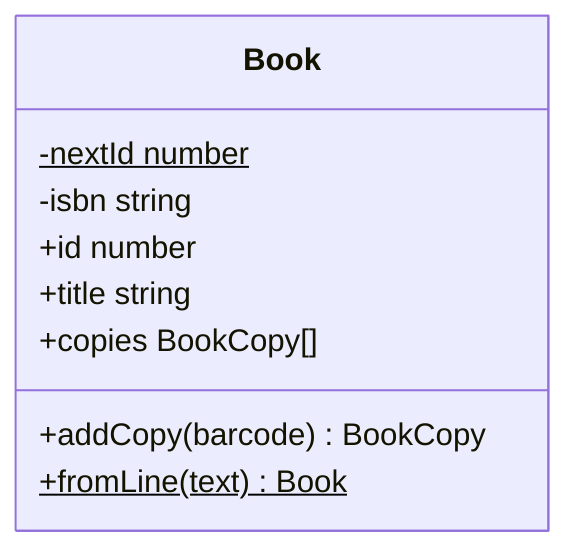
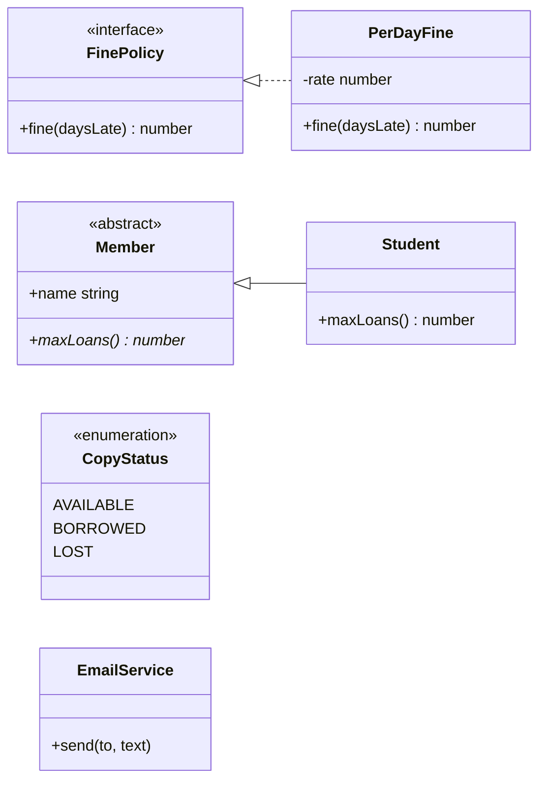
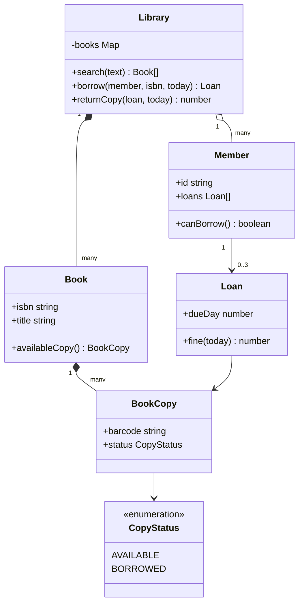

## The idea

A **house plan** shows the rooms, the doors and how the rooms connect. It does not show the paint colour or where the sofa goes. Anyone who knows how to read a plan understands it at once.

A **class diagram** is the plan for your code. It shows:

- the **classes** (as boxes);
- what each one **holds** (fields) and **does** (methods);
- how the classes **connect** (arrows).

It uses **UML** (Unified Modeling Language), a standard way to draw software, so every interviewer reads it the same way.

**Memory hook:** Name on top, data in the middle, actions at the bottom.

## The box

Each class is a box with three parts:

1. **Name** at the top.
2. **Fields** in the middle: `visibility name type`.
3. **Methods** at the bottom: `visibility name(params) returnType`.

Here is a JavaScript `Book` and its box, side by side. The comments show how each line is drawn:

```js
class Book {
  static #nextId = 1; // static + private -> -nextId number$ (underlined)
  #isbn;              // private          -> -isbn string
  title;              // public           -> +title string
  copies = [];        // public           -> +copies BookCopy[]

  constructor(isbn, title) {
    this.id = Book.#nextId++;
    this.#isbn = isbn;
    this.title = title;
  }
  addCopy(barcode) {  // public method    -> +addCopy(barcode) BookCopy
    const copy = { barcode, book: this };
    this.copies.push(copy);
    return copy;
  }
  static fromLine(text) { // static method -> +fromLine(text)$ Book (underlined)
    const [isbn, title] = text.split(';');
    return new Book(isbn, title);
  }
}

const hobbit = Book.fromLine('978-0;The Hobbit');
console.log(hobbit.title, hobbit.id);      // The Hobbit 1
console.log(hobbit.addCopy('C1').barcode); // C1
```

The Mermaid text for the box:

```txt
classDiagram
  class Book:::concrete {
    -nextId number$
    -isbn string
    +id number
    +title string
    +copies BookCopy[]
    +addCopy(barcode) BookCopy
    +fromLine(text)$ Book
  }
```

And how it draws:



Mermaid puts fields in the middle part and anything with `()` in the bottom part. A `$` at the end means **static** (drawn underlined). A `*` after the `()` means **abstract** (drawn in italics). The constructor is not drawn.

## Visibility: who can see it

| Symbol | Meaning | In JavaScript | In Java |
| --- | --- | --- | --- |
| `+` | **Public:** anyone can use it | A normal field or method | `public` |
| `-` | **Private:** only this class | A `#name` field or method | `private` |
| `#` | **Protected:** this class and its children | No real version. `_name` is only a naming habit | `protected` |
| `~` | **Package:** classes in the same folder | No version | No keyword (the default) |

<Callout title="Careful: # means two different things" type="warn">
  In **UML**, `#` means **protected**. In **JavaScript**, `#` means **private**. So a JavaScript field `#isbn` is drawn as `-isbn` in a class diagram, not `#isbn`.
</Callout>

## Kinds of class, and their colours

Not every box is a normal class. A **stereotype** is a label in double angle brackets above the name, like `<<interface>>`, that says what kind of box it is. On top of that, each kind gets its own colour, the same on every diagram:

| Kind | Stereotype | Mermaid | Colour |
| --- | --- | --- | --- |
| Interface | `<<interface>>` | `class FinePolicy:::iface` | Green |
| Abstract class | `<<abstract>>` | `class Member:::abstract` | Purple |
| Normal class | none | `class PerDayFine:::concrete` | Blue |
| Enum | `<<enumeration>>` | `class CopyStatus:::enum` | Amber |
| Outside code | none | `class EmailService:::external` | Grey, dashed border |

"Outside code" means something you use but don't write, like an email provider or a payment company. For what interfaces and abstract classes are, see [Interfaces and Abstract Classes in JavaScript](../oop-basics/interfaces-abstract-classes.mdx).

Here are all five kinds from the library example:

```txt
classDiagram
  direction LR
  class FinePolicy:::iface {
    <<interface>>
    +fine(daysLate) number
  }
  class PerDayFine:::concrete {
    -rate number
    +fine(daysLate) number
  }
  class Member:::abstract {
    <<abstract>>
    +name string
    +maxLoans()* number
  }
  class Student:::concrete {
    +maxLoans() number
  }
  class CopyStatus:::enum {
    <<enumeration>>
    AVAILABLE
    BORROWED
    LOST
  }
  class EmailService:::external {
    +send(to, text)
  }
  FinePolicy <|.. PerDayFine
  Member <|-- Student
```



Notice `maxLoans()` is in italics on `Member`: it is abstract, so each kind of member must fill it in. An enum lists its values with no `+` or `-`.

## The arrows, in short

Boxes connect with arrows. Each arrow type has a meaning:

| Mermaid | Meaning | Says |
| --- | --- | --- |
| `<\|--` | Inheritance | "is a" |
| `<\|..` | Implements an interface | "can do" |
| `*--` | Composition | "owns, and the part dies with it" |
| `o--` | Aggregation | "has, but the part can live alone" |
| `-->` | Association | "knows about" (keeps it in a field) |
| `..>` | Dependency | "uses for a moment" |

Numbers at the ends, like `"1"` and `"many"`, are the **multiplicity**: how many of each. All of this is explained in [Association, Aggregation and Composition](./relationships.mdx).

## How much to draw in an interview

You have about 5–10 minutes for the diagram (step 3 of the [LLD Interview Framework](../interview-framework.mdx)). Draw what helps the conversation, and nothing more:

| Draw | Skip |
| --- | --- |
| The 5–8 **key classes** | Small helper and utility classes |
| **Key fields:** ids, status, links to other classes | Every field, like `createdAt` and `updatedAt` |
| **Main public methods**, the ones that do the work | Getters, setters, constructors and `toString()` |
| Interfaces and enums | Private helper methods |
| Arrows and multiplicity | Types that are obvious from the name |

Here is the library at interview size. Six boxes, only the methods that matter:



A good order to draw in:

1. **Boxes with names only.** Get the classes agreed first.
2. **Arrows and multiplicity.** Show how they connect.
3. **Key fields**, then **main methods**. Methods often get filled in during step 4.

If you are typing in a plain text editor instead of drawing, a box can just be a few lines:

```txt
Loan
  - copy: BookCopy
  - member: Member
  - dueDay: number
  + fine(today): number
```

## Common mistakes

- **Drawing everything.** Twenty boxes with getters and setters hide the design. Fewer boxes, clearer story.
- **Mixing up `#`.** In a diagram, `#` is protected. A JavaScript `#private` field is drawn with `-`.
- **No stereotypes.** Without `<<interface>>` or the colour, the reader can't tell an interface from a normal class.
- **Boxes with no arrows.** The connections are half the point of the diagram.

## In the real world

- **UML** was created in the mid-1990s by Grady Booch, James Rumbaugh and Ivar Jacobson at Rational Software. It became an official standard of the Object Management Group (OMG) in 1997.
- **Mermaid** draws diagrams from plain text. GitHub shows Mermaid blocks in Markdown files as real diagrams, so teams keep class diagrams right next to their code.
- **PlantUML** is another popular tool that turns text into UML diagrams.

## In the interview

Talk while you draw. Say what each box is for and why it connects the way it does.

> "Here are my core classes: `Library`, `Book`, `BookCopy`, `Member` and `Loan`, plus a `CopyStatus` enum. A book owns its copies, so that's composition. I'm only showing the main methods: `search`, `borrow` and `returnCopy` on `Library`."

**Likely follow-up:** "Why didn't you draw getters and setters?"

**Answer:** "They don't change the design. Leaving them out keeps the diagram small enough to discuss. I can add them in the code if we need them."

<Callout title="Remember this" type="success">
  - **Name on top, data in the middle, actions at the bottom.**
  - Visibility: `+` public, `-` private, `#` protected. JavaScript's `#field` is drawn as `-field`.
  - Mark the kind: `<<interface>>`, `<<abstract>>`, `<<enumeration>>`, plus the colour.
  - Static is underlined (`$`), abstract is in italics (`*`).
  - In an interview: **key classes and main methods only**. Skip getters, setters and constructors.
</Callout>
