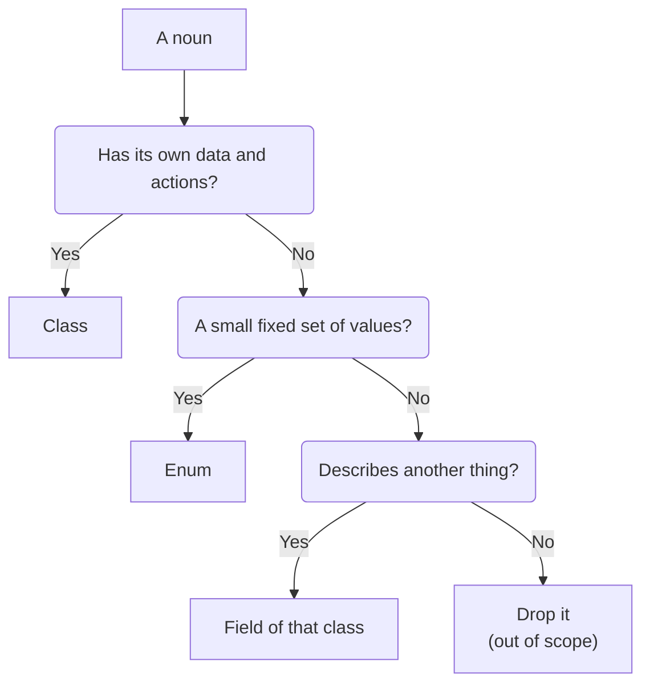
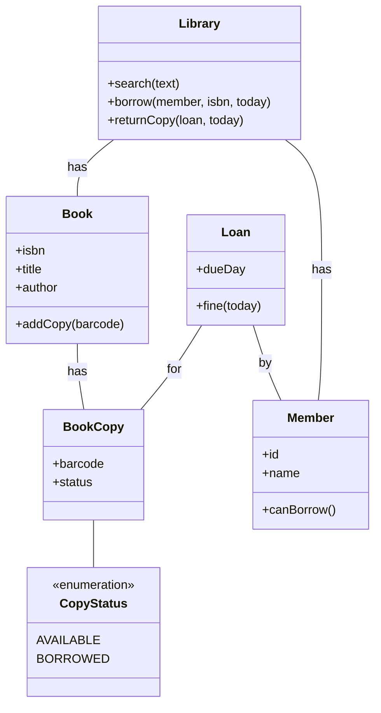

## The idea

Before you cook from a recipe, you read it twice. The first time, you pick out the **things** you need: flour, eggs, a bowl. That is your shopping list. The second time, you pick out the **actions**: mix, bake, cool. Those are your steps.

Finding classes works the same way:

- **Nouns** (things) become **classes**, or fields of a class.
- **Verbs** (actions) become **methods**.
- **Fixed choices** (like "available" or "borrowed") become **enums**, a small fixed set of values.

This is step 2 of the [LLD Interview Framework](../interview-framework.mdx), and it takes about 5 minutes.

**Memory hook:** Nouns are things, verbs are actions.

## The problem statement

Here is a short problem, like one you might get in an interview. The **nouns are in bold**, and the _verbs are in italics_:

> A town **library** _has_ many **books**. Each **book** can _have_ several **copies** on the **shelves**. **Members** can _search_ books by **title** or **author**. A **member** can _borrow_ a **copy** and must _return_ it within **14 days**. A member can _hold_ at most **3 copies** at a time. If a copy comes back late, the member _pays_ a **fine** of $1 for each late **day**. A **librarian** _adds_ new books and copies.

## Step 1: Sort the nouns

Not every noun is a class. For each one, ask: **does it have its own data and its own actions?**

| Noun | Decision | Why |
| --- | --- | --- |
| library | Class `Library` | Holds the books and members, and runs borrow and return |
| book | Class `Book` | Has its own data (ISBN, title, author) and many copies |
| copy | Class `BookCopy` | Each copy is a separate thing, with its own barcode and status |
| member | Class `Member` | Has data (id, name) and a rule (at most 3 copies) |
| title, author | Fields of `Book` | Just values that describe a book |
| 14 days, 3 copies, $1 | Constants | Fixed numbers in the rules, not things |
| fine | A method on `Loan` | Just a number worked out from dates |
| shelf | Drop it | Nothing in the requirements uses it |
| librarian | Drop it | A person who **uses** the system, not something it stores |

Two hidden things are not written as nouns at all:

- **Loan.** The verb _borrow_ creates a record with its own data: which copy, which member, the due date. **A verb that leaves a record behind becomes a class.**
- **CopyStatus.** "Available" and "borrowed" are a fixed set of values, so they become an **enum**.



## Step 2: Turn verbs into methods

Each verb becomes a method. The hard part is **which class** gets it. A good rule: **put the method on the class that has the data it needs.**

| Verb | Method | On which class | Why there |
| --- | --- | --- | --- |
| search | `search(text)` | `Library` | The library holds all the books |
| borrow | `borrow(member, isbn, today)` | `Library` | Needs a member, a book and a copy. The library holds them all |
| return | `returnCopy(loan, today)` | `Library` | Same reason |
| hold at most 3 | `canBorrow()` | `Member` | The member knows its own loans |
| pay a fine | `fine(today)` | `Loan` | The loan knows the due date |
| add | `addBook(book)`, `addCopy(barcode)` | `Library`, `Book` | Each adds to its own list |

Some verbs are not methods. "Has" and "have" are **relationships**: a library has books. They become lines on the class diagram.

## Step 3: The first draft

Put it together as a rough diagram. This is only the first draft. The exact arrows come later.



And the same draft as running code. Days are plain numbers (day 1, day 18) to keep it short. The parts below run together as one file.

**Part 1: The enum and the rules.** The fixed values and numbers from the problem statement:

```js
// The enum: a copy is either on the shelf or borrowed
const CopyStatus = {
    AVAILABLE: "AVAILABLE",
    BORROWED: "BORROWED",
};

// The fixed numbers from the rules
const LOAN_DAYS = 14;
const MAX_LOANS = 3;
const FINE_PER_DAY = 1;
```

**Part 2: A book and its copies.** A `Book` is the description, a `BookCopy` is one real item on the shelf:

```js
class BookCopy {
    // Every new copy starts on the shelf
    status = CopyStatus.AVAILABLE;

    constructor(barcode, book) {
        this.barcode = barcode;
        this.book = book;
    }
}

class Book {
    copies = [];

    constructor(isbn, title, author) {
        this.isbn = isbn;
        this.title = title;
        this.author = author;
    }

    addCopy(barcode) {
        const copy = new BookCopy(barcode, this);
        this.copies.push(copy);
    }

    // The first copy on the shelf, or undefined if every copy is out
    availableCopy() {
        return this.copies.find((copy) => copy.status === CopyStatus.AVAILABLE);
    }
}
```

**Part 3: A member and a loan.** The member knows its own loans, and the loan knows its due day:

```js
class Member {
    loans = [];

    constructor(id, name) {
        this.id = id;
        this.name = name;
    }

    canBorrow() {
        return this.loans.length < MAX_LOANS;
    }
}

class Loan {
    constructor(copy, member, today) {
        this.copy = copy;
        this.member = member;
        this.dueDay = today + LOAN_DAYS;
    }

    fine(today) {
        const daysLate = today - this.dueDay;

        // Back on time or early: no fine
        if (daysLate <= 0) {
            return 0;
        }

        return daysLate * FINE_PER_DAY;
    }
}
```

**Part 4: The library.** It holds all the books and runs search, borrow and return:

```js
class Library {
    // A Map from isbn to Book, so we can find a book by its isbn
    books = new Map();

    addBook(book) {
        this.books.set(book.isbn, book);
    }

    search(text) {
        const allBooks = Array.from(this.books.values());

        return allBooks.filter((book) => {
            return book.title.includes(text) || book.author.includes(text);
        });
    }

    borrow(member, isbn, today) {
        const book = this.books.get(isbn);
        if (!book) {
            return null;
        }

        // Stop if every copy is out, or the member already has too many loans
        const copy = book.availableCopy();
        if (!copy || !member.canBorrow()) {
            return null;
        }

        copy.status = CopyStatus.BORROWED;

        const loan = new Loan(copy, member, today);
        member.loans.push(loan);
        return loan;
    }

    returnCopy(loan, today) {
        loan.copy.status = CopyStatus.AVAILABLE;

        // Keep every loan except this one
        const member = loan.member;
        member.loans = member.loans.filter((memberLoan) => memberLoan !== loan);

        return loan.fine(today);
    }
}
```

**Part 5: Try it.** Add a book, borrow it on day 1, and bring it back late on day 18:

```js
const library = new Library();

const hobbit = new Book("978-0", "The Hobbit", "Tolkien");
hobbit.addCopy("C1");
library.addBook(hobbit);

const results = library.search("Tolkien");
console.log(results.length); // 1

const ana = new Member("M1", "Ana");
const loan = library.borrow(ana, "978-0", 1);
console.log(loan.dueDay); // 15

// Due on day 15, back on day 18: 3 days late
console.log(library.returnCopy(loan, 18)); // 3
```

## Book vs BookCopy: the "type vs item" split

The most useful trick here: **a book is not the same as a copy.**

- `Book` is the **description**: title, author, ISBN. There is one per title.
- `BookCopy` is the **real item** on a shelf, with its own barcode. There can be many per title.

Real libraries work this way. An ISBN names a book's edition, and each copy gets its own barcode sticker.

The same split shows up in many LLD problems:

| Description (one) | Real items (many) |
| --- | --- |
| `Movie` | `Show` (one screening at a time and place) |
| `Product` | `Item` in the warehouse |
| `RoomType` | `Room` (number 204) |
| `Book` | `BookCopy` |

## Common mistakes

- **Every noun becomes a class.** A `Title` class with one string inside is just a field.
- **Missing the hidden record.** Borrow, book, rent and order usually create a `Loan`, `Booking`, `Rental` or `Order`. Look for verbs that leave something behind.
- **A "System" or "Manager" class that does everything.** "The system" is the whole design, not one class.
- **Mixing up the description and the item**, like using `Book` where you need `BookCopy`.

## In the real world

- **Noun and verb analysis** is an old idea. Russell Abbott described it in 1983 as a way to go from plain English to program design.
- **Database design** does the same thing. In an entity diagram, the tables (entities) are the nouns, and the links between them are the "has" verbs.
- **Online shops** keep the type-and-item split: one product page, many units in stock, each tracked on its own.

## In the interview

Read the problem out loud, list the nouns and verbs, and say your decisions as you go. Keep it to about 5 minutes.

> "The nouns are library, book, copy and member, so those are classes. Title and author are just fields of Book. 'Borrow' creates a record with a due date, so I'll add a Loan class. And a copy's status is a fixed set of values, so that's a CopyStatus enum."

**Likely follow-up:** "Why is fine a method and not a class?"

**Answer:** "Right now a fine is just a number worked out from the due date, so a `fine(today)` method on `Loan` is enough. If fines had to be stored, paid in parts or waived, I'd make it a `Fine` class with its own status."

<Callout title="Remember this" type="success">
  - **Nouns are things, verbs are actions.** Nouns become classes or fields, verbs become methods.
  - A noun is a **class** if it has its own data **and** actions. Values that describe something are **fields**.
  - A **verb that leaves a record** (borrow, book, rent) becomes a class: `Loan`, `Booking`.
  - Put each method on the class that **has the data** it needs.
  - Split the **description** from the **item**: `Book` vs `BookCopy`.
</Callout>
