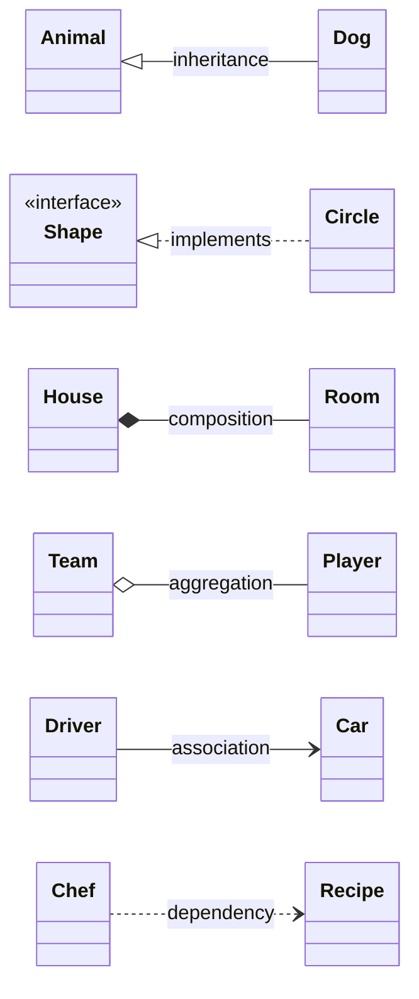
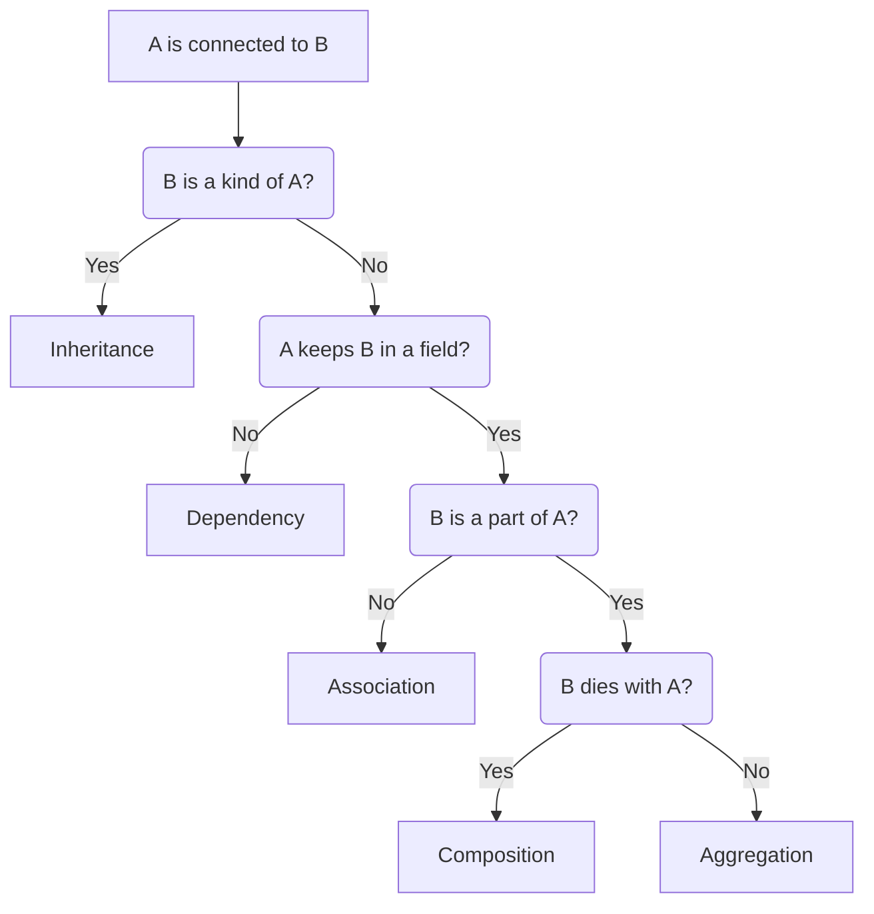
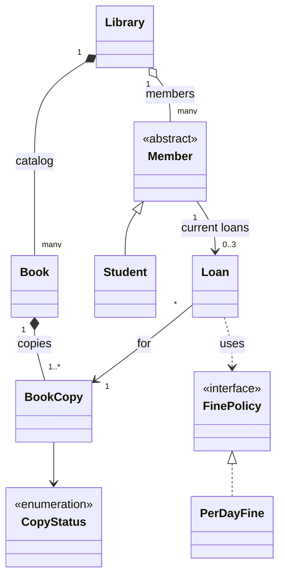

## The idea

Think about a **toy robot**:

- Its **arms** came in the box with it. Throw the robot away, and the arms go too. The robot **owns** them. That is **composition**.
- It lives in a **toy box** with other toys. Throw the box away, and the toys are still fine. The box only **holds** them. That is **aggregation**.
- It has a **remote control** that knows which robot to talk to. Both exist on their own. That is **association**.
- Sometimes you **use** a screwdriver to fix it, then put the screwdriver back. That is **dependency**.

Every arrow in a class diagram is one of these, or "is a kind of" (inheritance).

**Memory hook:** Does the part die with the whole?

## All the arrows at a glance

Each pair shows one kind of arrow, with an everyday example:



| Relationship | Meaning | Arrow | Example | Lifetime |
| --- | --- | --- | --- | --- |
| **Dependency** | Uses it for a moment, as a parameter or local variable | `..>` dashed line, open arrow | `Loan ..> FinePolicy` | Not kept at all |
| **Association** | Knows about it, keeps it in a field | `-->` solid line, open arrow | `Loan --> Member` | Both live on their own |
| **Aggregation** | Has it, but the part can live alone or be shared | `o--` hollow diamond on the whole | `Library o-- Member` | The part lives on after the whole |
| **Composition** | Owns it. The part belongs to one whole only | `*--` filled diamond on the whole | `Book *-- BookCopy` | The part dies with the whole |
| **Inheritance** | Is a kind of | `<\|--` hollow triangle on the parent | `Member <\|-- Student` | Not about lifetime: one object |
| **Implements** | Can play the role of an interface | `<\|..` dashed line, hollow triangle | `FinePolicy <\|.. PerDayFine` | Not about lifetime |

The diamond always sits on the **whole** (the owner), and the triangle always points at the **parent**.

## Association: "knows about"

A `Loan` keeps the member and the copy in its fields for as long as the loan exists. It didn't create them, and they don't belong to it. The member and the copy were there before the loan, and they stay after it ends.

If both sides keep a link to each other, draw a plain line with no arrowhead (`--`). Most of the time one direction is enough.

## Aggregation: "has, but can live alone"

A library **has** members. But a member is a person with a card, made outside the library. The same person can join the city library **and** the school library. If one library closes, the person is still a member of the other.

The clue in code: the part is **passed in** from outside and may be **shared**.

## Composition: "owns, and the part dies with it"

A book **owns** its copies. The book creates them, nobody else holds them, and a copy makes no sense without its book. Remove the book from the catalogue, and its copies go too.

The clue in code: the whole does `new Part()` **itself**, keeps it private, and never hands it out to be kept.

## Dependency: "uses for a moment"

A `Loan` works out a fine with a `FinePolicy`, but only during the `fine()` call. It does not store the policy. When the call ends, the link is gone.

## The four in JavaScript

**Step 1: Composition.** A book makes its own copies and keeps them private (`#` means private in JavaScript):

```js
class BookCopy {
    constructor(barcode) {
        this.barcode = barcode;
    }
}

class Book {
    #copies = [];

    constructor(title) {
        this.title = title;
    }

    // Composition: the book makes its own copies
    addCopy(barcode) {
        const copy = new BookCopy(barcode);
        this.#copies.push(copy);
        return copy;
    }
}
```

**Step 2: Aggregation.** A library makes its own books, but members are made outside and passed in:

```js
class Member {
    constructor(name) {
        this.name = name;
    }
}

class Library {
    #books = [];
    #members = [];

    // Composition: the library makes its own books
    addBook(title) {
        const book = new Book(title);
        this.#books.push(book);
        return book;
    }

    // Aggregation: the member is made outside and passed in
    join(member) {
        this.#members.push(member);
    }
}
```

**Step 3: Association and dependency.** A loan keeps the member and the copy, but only borrows the fine policy for one call:

```js
class PerDayFine {
    fine(daysLate) {
        return daysLate * 1;
    }
}

class Loan {
    // Association: the loan keeps both in its fields
    constructor(member, copy) {
        this.member = member;
        this.copy = copy;
    }

    // Dependency: the policy is only a parameter. The loan does not keep it.
    fine(daysLate, policy) {
        return policy.fine(daysLate);
    }
}
```

**Step 4: Use them.** One member joins two libraries, then borrows a copy:

```js
// Ana exists before any library
const ana = new Member("Ana");

const city = new Library();
const school = new Library();

// Shared: one member, two libraries
city.join(ana);
school.join(ana);

const book = city.addBook("The Hobbit");
const copy = book.addCopy("C1");

const loan = new Loan(ana, copy);
console.log(loan.member.name, loan.copy.barcode); // Ana C1

const policy = new PerDayFine();
console.log(loan.fine(3, policy)); // 3
```

## The "does the part die with the whole?" test

When you are not sure which arrow to use, walk through these questions:



"B dies with A" means A makes B itself and nobody else shares it. If B can live alone or be shared, it is aggregation.

## Multiplicity: how many

The numbers at each end of a line say **how many** objects take part:

| Mermaid | Meaning | Library example |
| --- | --- | --- |
| `"1"` | Exactly one | A copy belongs to exactly 1 book |
| `"0..1"` | Zero or one | A copy has 0 or 1 active loan |
| `"many"` or `"*"` | Any number, maybe none | A library has many members |
| `"1..*"` | At least one | A book has at least 1 copy |
| `"0..3"` | From zero up to three | A member holds 0 to 3 loans |

To read a line, put each number next to its own class. `Library "1" *-- "many" Book` reads as: "**One** library has **many** books."

## The full library model

Here is the running library example with every arrow and number in place:



The key choices:

- **`Book *-- BookCopy`:** a copy can't exist without its book, so composition.
- **`Library o-- Member`:** a member can belong to more than one library, so aggregation.
- **`Loan --> BookCopy`:** the loan points at a copy but doesn't own it. The copy stays on the shelf after the loan ends.
- **`Loan ..> FinePolicy`:** the policy is only passed in to work out a fine, so a dependency.

## Common mistakes

- **Diamond on the wrong end.** The diamond goes on the **whole** (Library), not the part (Member).
- **Using inheritance for "has a".** A `Library` is not a kind of `Book`. Ask "is it a kind of?" first.
- **Composition everywhere.** If the part is passed in from outside or shared, it is aggregation or association.
- **Forgetting multiplicity.** "One or many?" is often the most useful thing on the line.

## In the real world

- **Databases:** in SQL, a foreign key with `ON DELETE CASCADE` means "delete the order, and its order lines are deleted too". That is composition, kept by the database.
- **Playlists:** delete a Spotify playlist, and the songs are still on Spotify. The playlist only aggregated them.
- **React:** a component's state lives and dies with the component. When it leaves the screen, its state is gone. That is composition. The props it gets come from its parent, and it does not own them.

## In the interview

Say the relationship **and the reason** when you draw each line. The reason matters more than the exact shape of the diamond.

> "A `Book` owns its `BookCopy` objects. It creates them and they can't exist without it, so that's composition. A `Member` can join more than one library, so `Library` to `Member` is aggregation. A `Loan` just points at a member and a copy, so that's association."

**Likely follow-up:** "What is the real difference between aggregation and composition in code?"

**Answer:** "Who creates the part and who else can hold it. In composition, the whole makes the part itself and never shares it, so the part goes away with the whole. In aggregation, the part is made outside, passed in, and can be shared, so it lives on."

<Callout title="Remember this" type="success">
  - **Does the part die with the whole?** Yes = composition (filled diamond), No = aggregation (hollow diamond).
  - **Association** (`-->`) = keeps it in a field. **Dependency** (`..>`) = uses it for a moment.
  - **Inheritance** (`<|--`) = is a kind of. **Implements** (`<|..`) = plays an interface's role.
  - The diamond sits on the **whole**. The triangle points at the **parent**.
  - Multiplicity: `1`, `0..1`, `many`, `1..*`. Read each number next to its own class.
</Callout>
