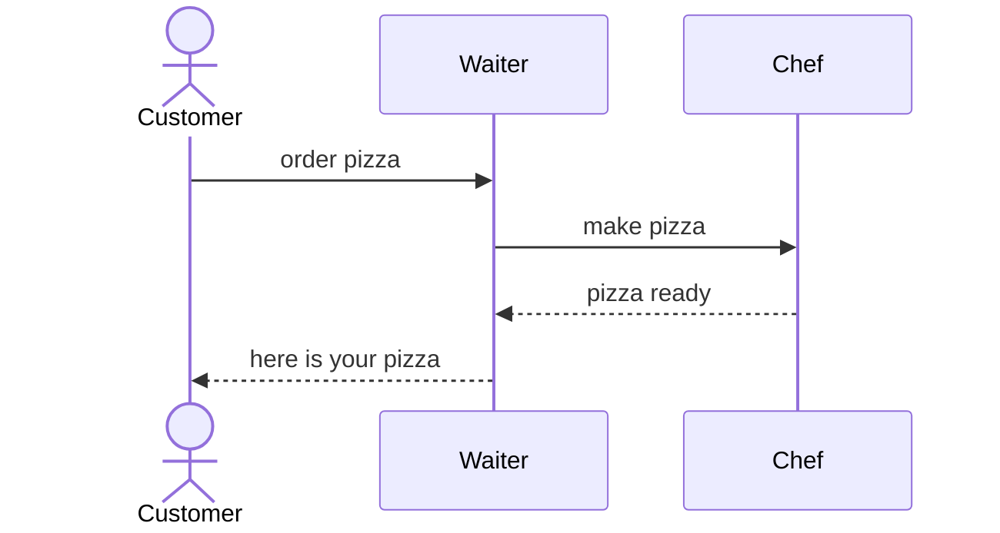
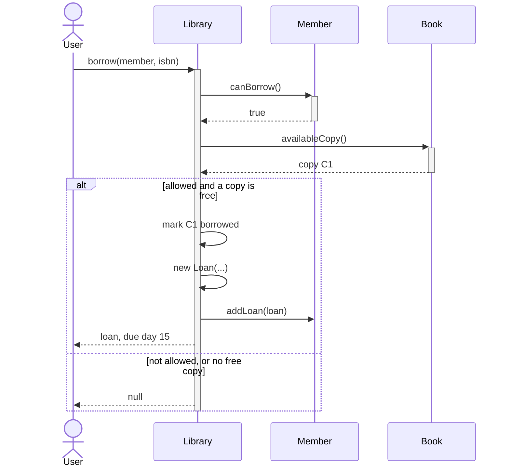
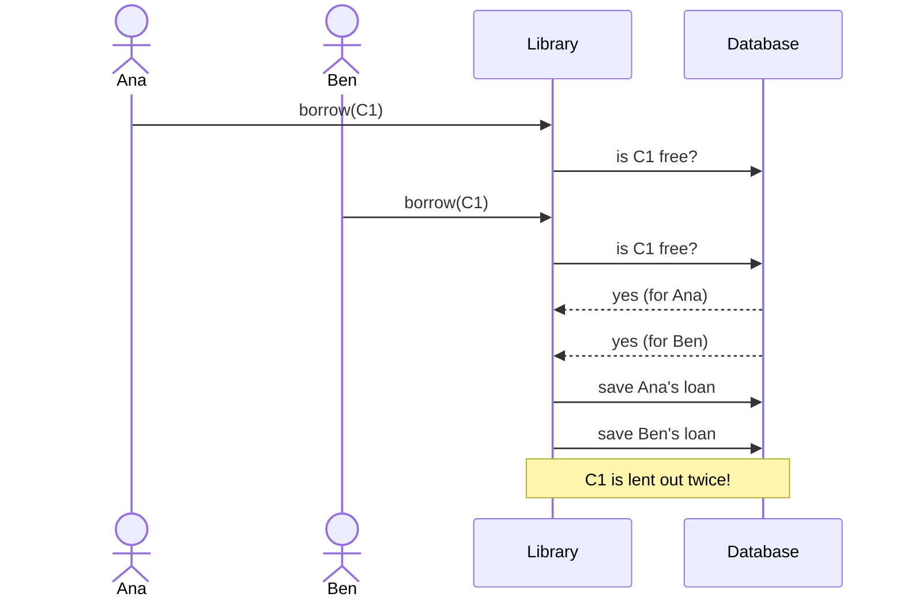

## The idea

At a **restaurant**, you tell the waiter what you want. The waiter tells the chef. The chef cooks and hands the plate to the waiter, who brings it to you. Who talks to whom, and in what order, is the whole story.

A **sequence diagram** draws exactly that story for your objects:

- The **objects** stand in a row across the top.
- **Time goes down** the page.
- Each **arrow** is one message, usually a method call.



A [class diagram](./class-diagrams.mdx) shows **what** the classes are. A sequence diagram shows **what happens**, step by step, in one flow.

**Memory hook:** Objects across, time down.

## The parts

| Part | How it looks | Mermaid | What it means |
| --- | --- | --- | --- |
| **Participant** | A box at the top, with a dashed line going down (its **lifeline**) | `participant L as Library` | One object that takes part |
| **Actor** | A stick figure | `actor U as User` | A person or outside system that starts the flow |
| **Call** | Solid line, filled arrowhead | `L->>M: canBorrow()` | One object calls a method on another |
| **Return** | Dashed line | `M-->>L: true` | The answer coming back |
| **Self-call** | An arrow that loops back | `L->>L: markBorrowed()` | An object calls its own method |
| **Activation** | A thin bar on the lifeline | `+` or `-` after the arrow | The object is busy with a call |
| **alt / else** | A box split into parts | `alt ...` `else ...` `end` | An if/else |
| **opt** | A box | `opt ...` `end` | An "if" with no else |
| **loop** | A box | `loop ...` `end` | Repeat |
| **Note** | A yellow note | `Note over L: text` | A comment |

## Drawing one flow: borrow a book

This is the main flow of the library example from [Finding Classes from Requirements](./finding-classes.mdx): a member borrows a book. The Mermaid text:

```txt
sequenceDiagram
  actor U as User
  participant L as Library
  participant M as Member
  participant B as Book
  U->>+L: borrow(member, isbn)
  L->>+M: canBorrow()
  M-->>-L: true
  L->>+B: availableCopy()
  B-->>-L: copy C1
  alt allowed and a copy is free
    L->>L: mark C1 borrowed
    L->>L: new Loan(...)
    L->>M: addLoan(loan)
    L-->>U: loan, due day 15
  else not allowed, or no free copy
    L-->>U: null
  end
  deactivate L
```

And how it draws:



How to read it: start at the top-left and follow the arrows down. `Library` is in charge. It asks `Member` and `Book` for what it needs, then creates the `Loan` and hands it to the member.

To keep the diagram narrow, creating the `Loan` is drawn as a self-call on `Library`, and the `today` argument is left off the first arrow. With more room, `Loan` can get its own lifeline.

## The same flow in code

Each arrow is one line of code. This version prints a line for every call between objects, so you can match the output to the arrows:

```js
const CopyStatus = Object.freeze({ AVAILABLE: 'AVAILABLE', BORROWED: 'BORROWED' });
const log = (line) => console.log(line);

class Member {
  loans = [];
  canBorrow() {
    log('Library -> Member: canBorrow()');
    return this.loans.length < 3;
  }
  addLoan(loan) {
    log('Library -> Member: addLoan()');
    this.loans.push(loan);
  }
}
class Book {
  copies = [{ barcode: 'C1', status: CopyStatus.AVAILABLE }];
  availableCopy() {
    log('Library -> Book: availableCopy()');
    return this.copies.find((c) => c.status === CopyStatus.AVAILABLE);
  }
}
class Loan {
  constructor(copy, member, today) {
    log('Library: new Loan()');
    Object.assign(this, { copy, member, dueDay: today + 14 });
  }
}
class Library {
  books = new Map([['978-0', new Book()]]);
  borrow(member, isbn, today) {
    log('User -> Library: borrow()');
    const allowed = member.canBorrow();
    const copy = this.books.get(isbn)?.availableCopy();
    if (!allowed || !copy) return null;
    copy.status = CopyStatus.BORROWED;
    const loan = new Loan(copy, member, today);
    member.addLoan(loan);
    return loan;
  }
}

const loan = new Library().borrow(new Member(), '978-0', 1);
// User -> Library: borrow()
// Library -> Member: canBorrow()
// Library -> Book: availableCopy()
// Library: new Loan()
// Library -> Member: addLoan()
console.log(loan.copy.barcode, loan.dueDay); // C1 15
```

## Showing two requests at once

Sequence diagrams are great for showing **timing problems**. Say Ana and Ben try to borrow the last copy at the same moment, and the library checks the database with an `await` before saving:



The picture makes the bug easy to see: both checks happen **before** either save. Ways to fix it are in [Race Conditions and Locks](../concurrency/race-conditions-locks.mdx).

## When a sequence diagram helps in an interview

Use one when:

- You reach **step 4** of the [LLD Interview Framework](../interview-framework.mdx) (main methods and the main flow). One diagram of the main flow is plenty.
- The flow passes through **three or more objects**, like borrow, park a car or book a seat.
- The interviewer asks "**walk me through what happens when...**"
- You need to show **two requests at once**, like the race above.

Skip it when the flow stays inside one class, or for simple getters.

Tips to keep it readable:

- **Five participants or fewer.** Leave out small helpers.
- **The happy path plus one `alt`** for the main failure. Not every error.
- **Short messages:** method names like `canBorrow()`, not sentences.

## Common mistakes

- **Too many participants.** Ten lifelines don't fit on a whiteboard. Draw the key objects only.
- **Drawing every flow.** One main flow is enough. Describe the others in words.
- **Arrows that don't match your classes.** If `Library` calls `availableCopy()` on `Book`, then `Book` must have that method in your class diagram.
- **Forgetting the failure path.** One `alt` for "no copy free" shows you thought about it.

## In the real world

- **Login flows.** OAuth 2.0 is the standard that lets one app use your account on another site without your password. Its docs usually explain the steps as a picture of who sends what to whom, in order: the user, the app and the login server.
- **Tracing tools** like Jaeger and Zipkin show one request as a timeline of calls between services. It is the same idea, drawn from real data.
- **Mermaid and PlantUML** turn plain text into sequence diagrams, so teams keep them next to their code.

## In the interview

After the class diagram, walk through the main flow out loud while you draw it.

> "Here's what happens when a member borrows a book. The `Library` asks the `Member` if it can borrow, then asks the `Book` for a free copy. If both are fine, it marks the copy borrowed, creates a `Loan` and returns it. Otherwise it returns null."

**Likely follow-up:** "What happens if two members try to borrow the last copy at the same time?"

**Answer:** "If there's an `await` between checking the copy and saving the loan, both could see it as free. I'd make the check and the update one step: a lock around them in one process, or a database rule like 'only one active loan per copy' when there are many servers."

<Callout title="Remember this" type="success">
  - **Objects across, time down.** Each arrow is one call.
  - Solid arrow = **call**, dashed arrow = **return**.
  - `alt`/`else` for if/else, `opt` for "if", `loop` for repeats.
  - Draw **one main flow**, with **five participants or fewer** and short method names.
  - Great for showing **two requests at once** and where they clash.
</Callout>
