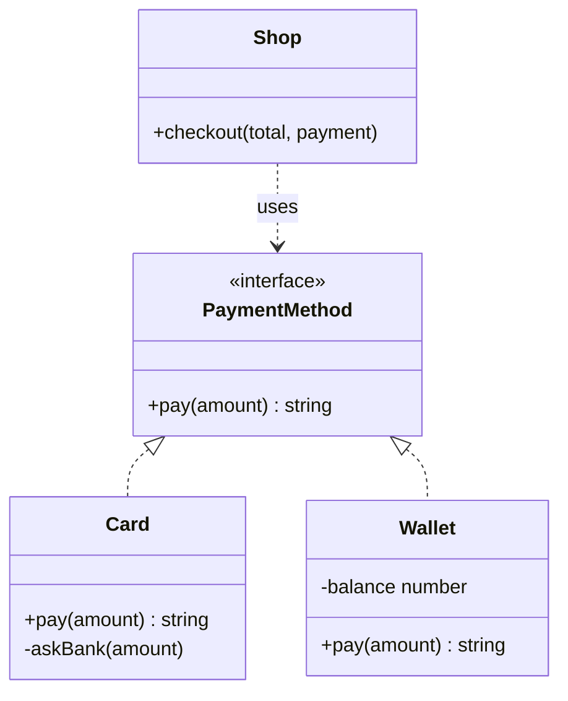

## The idea

Think of a **remote-control toy car**. You press "forward" and the car drives. You don't think about the battery, the motor or the radio signal. One simple button hides a lot of busy work inside.

A real car is the same: you press the pedal, and you don't need to know how fuel reaches the engine.

**Abstraction** means giving a class a **simple outside**: a few clear public methods that say **what** it does. The **how**, all the inside steps, stays hidden. Code that uses the class thinks only about what it does.

## Simple outside, busy inside

The car below has one public method, `start()`. The steps it takes are private methods (the `#` makes them private):

```js
class Car {
  start() {
    this.#checkFuel();
    this.#startEngine();
    console.log('Car is ready to drive.');
  }

  #checkFuel() { // private method: a hidden step
    console.log('Fuel is OK');
  }

  #startEngine() {
    console.log('Engine started');
  }
}

const car = new Car();
car.start();
// Fuel is OK
// Engine started
// Car is ready to drive.
```

The driver calls one method. Tomorrow you can add a `#checkBattery()` step, and no code that calls `start()` has to change.

## Abstraction with a payment method

Abstraction also works at the design level. A shop's checkout only needs to know that a payment method **can pay**. It doesn't care whether it's a card or a wallet, or how each one works.

```js
class PaymentMethod { // interface: WHAT a payment can do
  pay(amount) { throw new Error('not implemented'); }
}

class Card extends PaymentMethod { // HOW a card pays
  pay(amount) {
    this.#askBank(amount);
    return `Paid ${amount} by card`;
  }

  #askBank(amount) { /* check the card, talk to the bank... */ }
}

class Wallet extends PaymentMethod { // HOW a wallet pays
  #balance = 100;

  pay(amount) {
    this.#balance -= amount;
    return `Paid ${amount} from wallet, ${this.#balance} left`;
  }
}

class Shop {
  checkout(total, payment) {
    console.log(payment.pay(total)); // only knows "it can pay"
  }
}

const shop = new Shop();
shop.checkout(40, new Card()); // Paid 40 by card
shop.checkout(40, new Wallet()); // Paid 40 from wallet, 60 left
```

`PaymentMethod` is an **interface**: a promise of methods, with no code. JavaScript has no `interface` keyword, so we write a base class whose methods throw. See [Interfaces and Abstract Classes in JavaScript](./interfaces-abstract-classes.mdx).



`Shop` points only at `PaymentMethod`, never at `Card` or `Wallet`. That's abstraction in a diagram. Each class doing `pay` its own way is [Polymorphism](./polymorphism.mdx); the two ideas often work together.

## Abstraction vs encapsulation

They are easy to mix up. The one-line difference:

**Abstraction hides complexity (how it works). Encapsulation hides and guards data (who can touch it).**

| | Abstraction | Encapsulation |
| --- | --- | --- |
| Question it answers | What does the user of this class need to see? | Who is allowed to change this data? |
| Toy example | The remote's "forward" button | The screwed-shut battery box |
| JavaScript tools | Simple public methods, interfaces | `#private` fields, getters and setters |
| Goal | Easy to use, easy to change inside | Data can't be broken |

They help each other: private methods (an encapsulation tool) are how you keep the inside steps hidden behind a simple outside. See [Encapsulation](./encapsulation.mdx).

## Common mistakes

- **A leaky abstraction.** The caller must know the inside steps and their order: `car.checkFuel()`, then `car.startEngine()`, then `car.turnOnLights()`. Forget one and it breaks. Give one method, `start()`, that does all of them.
- **Names that tell how, not what.** `saveToMySql(user)` leaks the database. `save(user)` lets you change it later.
- **Too many layers.** A class that only passes the call to another class, which passes it to another, adds nothing. Abstract only what is really complex. See [DRY, KISS and YAGNI](../design-principles/dry-kiss-yagni.mdx).

## In the real world

- **`fetch(url)`** is one call. Behind it, the browser finds the server's address (DNS), opens a connection, sets up HTTPS, sends the request and reads the reply.
- **`array.sort()`** hides its sorting algorithm. V8, the JavaScript engine in Chrome and Node.js, switched `sort` to an algorithm called TimSort in 2018, and code that called `sort()` didn't change.
- **Java's `List`** is an interface. Code that takes a `List` works the same with an `ArrayList` or a `LinkedList`.

## In the interview

> "Callers of `ParkingLot` only see `park(vehicle)` and `leave(ticket)`. How a spot is found, which level and which size, stays hidden inside. So I can change the spot-finding rule later without touching any caller."

**Likely follow-up:** "What's the difference between abstraction and encapsulation?"

Abstraction decides **what to show**: a small, simple set of methods, and it hides how the work is done. Encapsulation decides **who can touch the data**: it keeps fields private and changes them only through methods that check the rules. A class usually does both.

<Callout title="Remember this" type="success">
  - **Abstraction:** show what it does, hide how it does it.
  - Give a class a few simple public methods; keep the inside steps private.
  - An **interface** is abstraction at the design level: callers depend on "can pay", not on "card".
  - Abstraction hides **complexity**; encapsulation hides and guards **data**.
  - Good abstraction lets you change the inside without changing the callers.
</Callout>
