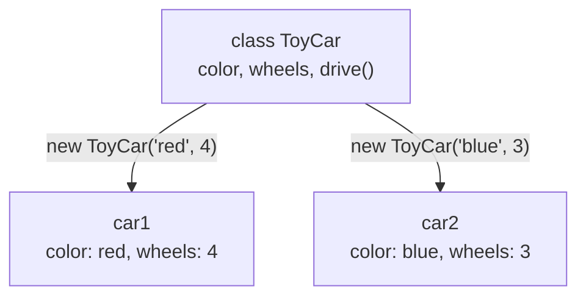
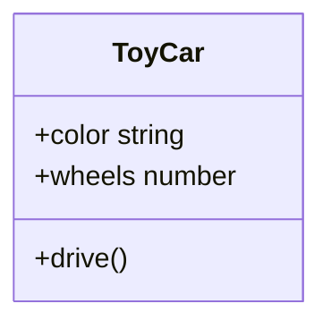

## The idea

Think of **toys**. Every toy is a thing: a car, a doll, a robot. Each toy has:

- **properties**: facts about it, like its color and size;
- **actions**: things it can do, like move or talk.

A toy factory makes toys from a **mold**. The mold is not a toy, and you can't play with it. But from one mold you can make many toy cars, and paint each one a different color.

In code:

- a **class** is the mold, a blueprint. It says which properties and actions every object will have;
- an **object** is one toy made from it. It is also called an **instance** of the class.

**Object-Oriented Programming** (OOP) means building a program from objects, where each object keeps its own data and its own actions together.

## An object: one toy

Here is one red toy car, written as a plain JavaScript object:

```js
const toyCar = {
    color: "red",
    wheels: 4,

    drive() {
        console.log("Vroom! The car is driving.");
    },
};

toyCar.drive(); // Vroom! The car is driving.
```

This works for one car. But for 50 cars, you don't want to copy this 50 times. You want a mold.

## A class: the blueprint

```js
class ToyCar {
    // The constructor sets the properties: the data each car keeps
    constructor(color, wheels) {
        this.color = color;
        this.wheels = wheels;
    }

    // An action (a method)
    drive() {
        console.log(`Vroom! The ${this.color} car is driving.`);
    }
}

// Make two toy cars from the same blueprint
const car1 = new ToyCar("red", 4);
const car2 = new ToyCar("blue", 3);

console.log(car1.color); // red
console.log(car2.color); // blue

car1.drive(); // Vroom! The red car is driving.
car2.drive(); // Vroom! The blue car is driving.
```

| In the code | What it is |
| --- | --- |
| `ToyCar` | the **class** (the blueprint) |
| `car1`, `car2` | **objects** (instances) of `ToyCar` |
| `new` | makes a new object from the class |
| `constructor()` | sets up a new object's starting values |
| `color`, `wheels` | **properties**, also called fields: the object's data |
| `drive()` | a **method**: a function that belongs to the class |
| `this` | the object the code is working on right now |

One blueprint, many objects, each with its own data:



In a class diagram, a class is a box with three parts: the name, the fields and the methods. `+` means public (anyone can use it). See [Class Diagrams](../modeling-uml/class-diagrams.mdx).



## The constructor

The **constructor** is a special method. It runs once, when you write `new`, and gives the new object its starting values.

When you write `new ToyCar('red', 4)`, JavaScript:

1. makes a new, empty object;
2. runs the constructor, with `this` pointing to that new object;
3. gives the finished object back to you.

You can also give a property a starting value with a **class field**, written at the top of the class:

```js
class ToyCar {
    // A class field: every car starts with 4 wheels
    wheels = 4;

    constructor(color) {
        this.color = color;
    }
}

const car = new ToyCar("green");
console.log(car.wheels, car.color); // 4 green
```

If a class has no constructor, JavaScript gives it an empty one.

## `this`: the current object

Inside a method, `this` means "the object this method was called on".

- `car1.drive()`: inside `drive`, `this` is `car1`, so `this.color` is `'red'`.
- `car2.drive()`: now `this` is `car2`, so `this.color` is `'blue'`.

There is only one `drive` method, shared by all cars. `this` tells it whose data to use.

<Callout title="Under the hood" type="info">
  JavaScript classes are built on **prototypes**. Methods are stored once, on `ToyCar.prototype`, and every car
  shares them: `car1.drive === car2.drive` is `true`. Only the data (`color`, `wheels`) lives on each object.
</Callout>

## Instance vs static

Most things belong to **each object**: every toy car has its own color. These are **instance** properties and methods.

Some things belong to the **class itself**. Think of the counter on the factory wall that shows how many cars were made. No single car owns that number. These are **static** properties and methods. You use them on the class name, not on an object.

```js
class ToyCar {
    // Static: belongs to the class, the counter on the factory wall
    static made = 0;

    constructor(color) {
        // Instance: belongs to this one car
        this.color = color;

        // Count every car the factory makes
        ToyCar.made++;
    }

    // A static method that builds a red car
    static red() {
        return new ToyCar("red");
    }
}

// Make one car with new, and one with the static method
const blueCar = new ToyCar("blue");
const redCar = ToyCar.red();

console.log(ToyCar.made); // 2
console.log(redCar.color); // red
console.log(redCar.made); // undefined (static is not on the objects)
```

A method that needs no object's data at all is a good fit for `static`:

```js
class Calculator {
    static add(firstNumber, secondNumber) {
        return firstNumber + secondNumber;
    }
}

console.log(Calculator.add(5, 7)); // 12
```

| | Instance | Static |
| --- | --- | --- |
| Belongs to | each object | the class itself |
| You call it on | an object: `car1.drive()` | the class: `Calculator.add(5, 7)` |
| Can it read `this.color`? | yes | no, there is no single object |
| Built-in examples | `[3, 1].sort()`, `'hi'.toUpperCase()` | `Math.max(3, 1)`, `Array.isArray(x)`, `Date.now()` |

Java uses `static` the same way. `Math.max(3, 1)` is a static method in Java too.

## The big OOP ideas

Classes and objects are the base. Four big ideas sit on top of them. Interviewers often call them the **four pillars of OOP**: encapsulation, abstraction, inheritance and polymorphism.

| Concept | In one line | Learn more |
| --- | --- | --- |
| **Class** | A blueprint for making objects. | [A class: the blueprint](#a-class-the-blueprint) |
| **Object** | One thing made from a class (an instance). | [An object: one toy](#an-object-one-toy) |
| **Constructor** | Sets up a new object's starting values. | [The constructor](#the-constructor) |
| **Method** | A function that belongs to a class. | [A class: the blueprint](#a-class-the-blueprint) |
| **`this`** | The object the code is working on right now. | [this: the current object](#this-the-current-object) |
| **Static** | Belongs to the class, not to one object. | [Instance vs static](#instance-vs-static) |
| **Encapsulation** | Keep data private, and change it only through methods. | [Encapsulation](./encapsulation.mdx) |
| **Abstraction** | Show what it does, hide how it does it. | [Abstraction](./abstraction.mdx) |
| **Inheritance** | A class builds on another class. | [Inheritance](./inheritance.mdx) |
| **Polymorphism** | One call, different behavior for each object. | [Polymorphism](./polymorphism.mdx) |
| **Interface** | A promise of methods, with no code. | [Interfaces and Abstract Classes in JavaScript](./interfaces-abstract-classes.mdx) |
| **Composition** | Build an object from smaller parts. | [Composition vs Inheritance](./composition-vs-inheritance.mdx) |

## Common mistakes

- **Forgetting `new`.** `ToyCar('red')` throws `TypeError: Class constructor ToyCar cannot be invoked without 'new'`.
- **Losing `this`.** `const drive = car1.drive; drive();` throws a `TypeError`, because `drive` is no longer called on `car1`, so `this` is `undefined`. When you pass a method somewhere, wrap it: `setTimeout(() => car1.drive(), 100)`.
- **Static for data that differs per object.** If each car has its own value, it is an instance property, not a static one.

## In the real world

- **JavaScript's built-ins are classes.** `new Map()`, `new Date()` and `new Error('oops')` all make objects from a class. Each `Map` keeps its own entries but shares methods like `get` and `set`.
- **`Date` has both kinds.** `Date.now()` is static: it needs no date object. `new Date().getFullYear()` is an instance method: it reads one date's data.
- **`Math`** is only static things: `Math.max`, `Math.PI`. You never write `new Math()`.

## In the interview

In an LLD interview, the main "things" in the problem become classes: `ParkingLot`, `ParkingSpot`, `Ticket`. When you add a class, say what data it holds and what it does:

> "I'll make `ParkingSpot` a class. Each spot object holds its own data: its id, its size, and whether it's taken. Its actions are `park(vehicle)` and `leave()`. The parking lot creates one object for each real spot."

See [Finding Classes from Requirements](../modeling-uml/finding-classes.mdx) for how to pick them.

**Likely follow-up:** "When would you make a method static?"

When it needs no single object's data. For example, a helper like `Calculator.add(5, 7)`, or a method that builds objects, like `ToyCar.red()`. If it reads `this.something`, it should be an instance method.

<Callout title="Remember this" type="success">
  - A **class** is the blueprint; an **object** is one thing made from it with `new`.
  - The **constructor** sets the starting values. `this` is the current object.
  - Methods are shared by all objects; each object keeps its own data.
  - **Static** members belong to the class, not to any object: `Math.max`, `Date.now`.
  - The four pillars: encapsulation, abstraction, inheritance, polymorphism.
</Callout>
