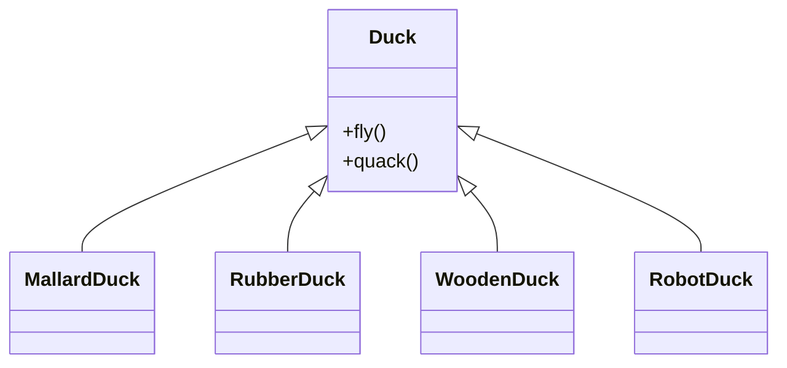
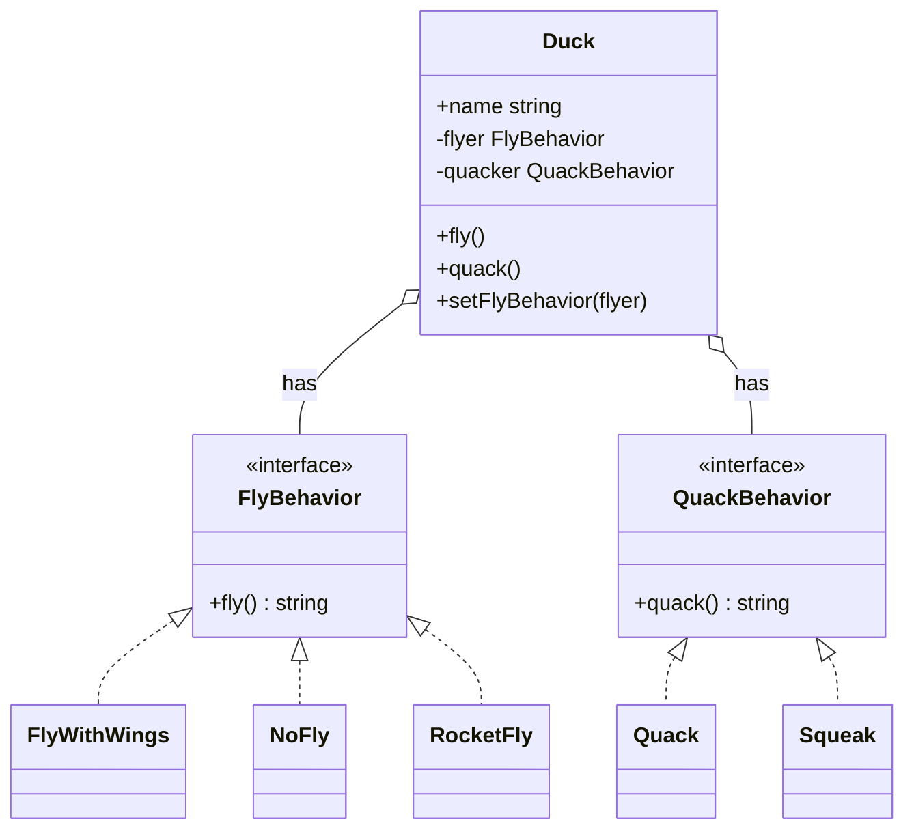

## The idea

Think of two toy robots:

- A **plastic robot from a mold**. Want a robot that flies? You need a whole new mold.
- A **LEGO robot**. Want it to fly? Take off the legs and click on a jetpack. You can even swap parts while you play.

**Inheritance** is the mold: a new kind of thing means a new child class. **Composition** is LEGO: you build an object from **small parts**, and each part does one job. The object **has** its parts and asks them to do the work.

## "Is-a" vs "has-a"

| Sentence | Relationship | In code |
| --- | --- | --- |
| A Car **is a** Vehicle | is-a: inheritance | `class Car extends Vehicle` |
| A Car **has an** Engine | has-a: composition | `this.engine = new Engine()` |
| A Duck **has a** way of flying | has-a: composition | `this.flyer = new FlyWithWings()` |

If "is a" sounds wrong, or only half true, the answer is composition.

## The problem with family trees

Let's model ducks with inheritance. A normal duck flies and quacks. A rubber duck squeaks and can't fly. A wooden duck can't do either.

**Step 1: The parent.** A normal duck flies and quacks:

```js
class Duck {
    fly() {
        return "flaps its wings";
    }

    quack() {
        return "Quack!";
    }
}
```

**Step 2: The children.** Each one overrides what it can't do:

```js
class RubberDuck extends Duck {
    // Override fly() just to switch it off
    fly() {
        return "can't fly";
    }

    quack() {
        return "Squeak!";
    }
}

class WoodenDuck extends Duck {
    // The same code, copied again
    fly() {
        return "can't fly";
    }

    quack() {
        return "...";
    }
}

const rubberDuck = new RubberDuck();
console.log(rubberDuck.fly()); // can't fly
```



It gets worse quickly:

- **Copied code.** "can't fly" is written in two classes already.
- **Too many classes.** 3 ways to fly × 3 ways to quack = 9 possible classes, one for each mix.
- **Fixed forever.** A rubber duck can never get a rocket while the program runs. Its class was decided when the code was written.

## The fix: a duck that has parts

Pull each behavior out into its own small part, behind an interface. The duck **has** a fly part and a quack part, and asks them to do the work.

**Step 1: The fly parts.** One interface, and one small class for each way of flying:

```js
// interface
class FlyBehavior {
    fly() {
        throw new Error("not implemented");
    }
}

class FlyWithWings extends FlyBehavior {
    fly() {
        return "flaps its wings";
    }
}

class NoFly extends FlyBehavior {
    fly() {
        return "can't fly";
    }
}

class RocketFly extends FlyBehavior {
    fly() {
        return "zooms with a rocket!";
    }
}
```

**Step 2: The quack parts.** The same idea for quacking:

```js
// interface
class QuackBehavior {
    quack() {
        throw new Error("not implemented");
    }
}

class Quack extends QuackBehavior {
    quack() {
        return "Quack!";
    }
}

class Squeak extends QuackBehavior {
    quack() {
        return "Squeak!";
    }
}
```

**Step 3: The duck.** It holds one fly part and one quack part, and asks them to do the work:

```js
class Duck {
    // The # makes these fields private: only Duck's own code can use them
    #flyer;
    #quacker;

    constructor(name, flyer, quacker) {
        this.name = name;

        // The duck HAS a way of flying and a way of quacking
        this.#flyer = flyer;
        this.#quacker = quacker;
    }

    fly() {
        const flyText = this.#flyer.fly();
        console.log(`${this.name} ${flyText}`);
    }

    quack() {
        const quackText = this.#quacker.quack();
        console.log(`${this.name} says ${quackText}`);
    }

    // Swap the fly part while the program runs
    setFlyBehavior(flyer) {
        this.#flyer = flyer;
    }
}
```

**Step 4: Use it.** Build each duck from the parts it needs:

```js
const mallard = new Duck("Mallard", new FlyWithWings(), new Quack());
const rubber = new Duck("Rubber duck", new NoFly(), new Squeak());

mallard.fly(); // Mallard flaps its wings
rubber.fly(); // Rubber duck can't fly
rubber.quack(); // Rubber duck says Squeak!

// Give the rubber duck a rocket while the program runs
rubber.setFlyBehavior(new RocketFly());
rubber.fly(); // Rubber duck zooms with a rocket!
```



Now there is **one** `Duck` class. A new way of flying is one small new class, and any duck can use it. With 3 ways to fly and 3 ways to quack, you need 6 small part classes instead of 9 duck classes. Each behavior here is a [Strategy](../design-patterns/strategy.mdx).

<Callout title="Two meanings of 'composition'" type="info">
  "Composition over inheritance" means building objects from parts, in general. In UML class diagrams,
  "composition" (`*--`) is a stricter has-a, where the part lives and dies with its owner. Here the ducks get
  their parts from outside, so the diagram uses the looser has-a, aggregation (`o--`). See
  [Association, Aggregation and Composition](../modeling-uml/relationships.mdx).
</Callout>

## Why interviewers like composition

| | Inheritance | Composition |
| --- | --- | --- |
| Relationship | is-a | has-a |
| Decided | When you write the code | Can change while the program runs |
| Many mixes | One class per mix (they multiply) | One class per part (they add up) |
| Coupling | The child depends on the parent's insides | The object depends only on the part's public methods |
| Testing | Hard to test a child without its parent | Swap in a fake part for the test |

**Coupling** means how much one class depends on another. Less is better. See [Coupling and Cohesion](../design-principles/coupling-cohesion.mdx).

The famous *Design Patterns* book (1994) put it in one line: "Favor object composition over class inheritance."

## When inheritance is still right

"Favor" means "prefer", not "never". Inheritance is a good fit when:

- it's a true **is-a**, and the child can be used anywhere the parent is;
- the tree stays **shallow**, one or two levels;
- there is **real shared code**, like an abstract `Vehicle` with a shared `receipt()`;
- the platform asks for it: `class NotFoundError extends Error`, `class MyButton extends HTMLElement`.

A quick rule: **is-a, and it will stay that way?** Inheritance. **Has-a, or the behavior may change or mix?** Composition.

## Common mistakes

- **Inheriting just to reuse code.** `class Stack extends Array` gives your stack `splice()` and `shift()`, which break the stack's rules. Hold an array instead: `#items = [];`.
- **Overriding a method to switch it off,** like `fly()` that does nothing. It's a sign that this should be a part, not a parent.
- **Splitting everything into parts,** even when there is only one way to do it. Start simple, and pull out a part when a second way appears. See [DRY, KISS and YAGNI](../design-principles/dry-kiss-yagni.mdx).

## In the real world

- **React** is built on composition. The original React docs recommend composition instead of inheritance to reuse code between components. The React team wrote that across thousands of components, they had not found a case where they'd recommend component inheritance trees. A `Dialog` is built by putting other components inside it (`children`), not by extending a base class.
- **Unity**, the game engine, builds game objects from parts called components: add a `Rigidbody` for physics, a `Collider` for hits.
- **Express** builds an app by adding middleware functions with `app.use()`, not by extending a base app class.

## In the interview

> "I'll give `Duck` a `FlyBehavior` part instead of making a subclass for each kind of duck. A new way of flying is one new small class, and I can even swap it while the program runs. That's composition, and here it's the Strategy pattern."

**Likely follow-up:** "So should you never use inheritance?"

No. Use it for a true, stable is-a with real shared code and a shallow tree, like `Car extends Vehicle`, or custom `Error` classes. Use composition when the behavior varies, mixes, or might change at runtime.

<Callout title="Remember this" type="success">
  - **Inheritance = is-a. Composition = has-a.**
  - Composition builds an object from small parts that can be swapped, even while the program runs.
  - Inheritance trees grow fast: every mix needs a class, and parent changes break children.
  - **"Favor composition over inheritance"**: prefer it, but inheritance is fine for a true, shallow is-a.
  - A swappable part behind an interface, like `FlyBehavior`, is the **Strategy** pattern.
</Callout>
