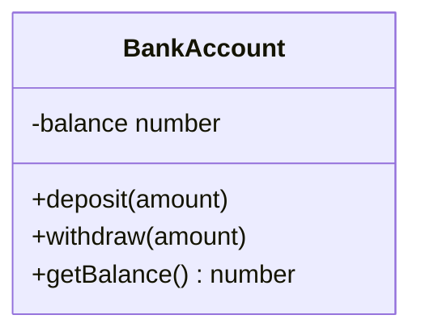

## The idea

Think of a **toy piggy bank**. You can drop coins in through the slot, and you can shake it. But you can't reach inside and change the coins with your fingers. To take money out, you use the key, the one proper way.

**Encapsulation** works the same way. An object keeps its data **inside** itself. Other code can't change that data directly. It must ask the object, through its **methods**, and those methods keep the rules.

## Private fields with `#`

In JavaScript, a field whose name starts with `#` is **private**. Only code written inside the class can read or change it.

```js
class SecretToy {
  #secretCode; // private field: hidden inside the class

  constructor(code) {
    this.#secretCode = code;
  }

  showSecret() {
    console.log(`The secret code is ${this.#secretCode}`);
  }
}

const toy = new SecretToy('12345');
toy.showSecret(); // The secret code is 12345
console.log(toy.secretCode); // undefined (there is no public field with that name)
// console.log(toy.#secretCode); // SyntaxError: the whole file won't run
```

Methods can be private too: `#checkCode() { ... }` can only be called from inside the class.

<Callout title="An early error, not a runtime error" type="warn">
  Writing `toy.#secretCode` outside the class is a **SyntaxError**. JavaScript finds it while it reads the
  file, **before** running any line. So the whole file fails to run, not just that one line. That's why the
  line above is shown as a comment.
</Callout>

## Keep the rules inside

Here is a bank account with a **public** balance. Any code can set it to anything:

```js
class BankAccount {
  constructor() {
    this.balance = 0;
  }
}

const account = new BankAccount();
account.balance = -500; // nothing stops this!
console.log(account.balance); // -500
```

Now the same account, encapsulated. The balance is private, and the only ways to change it are `deposit()` and `withdraw()`, which check the rules:

```js
class BankAccount {
  #balance = 0; // private: only code in this class can touch it

  deposit(amount) {
    if (amount <= 0) throw new Error('Deposit must be positive');
    this.#balance += amount;
  }

  withdraw(amount) {
    if (amount <= 0) throw new Error('Amount must be positive');
    if (amount > this.#balance) throw new Error('Not enough money');
    this.#balance -= amount;
  }

  getBalance() {
    return this.#balance;
  }
}

const account = new BankAccount();
account.deposit(100);
account.withdraw(30);
console.log(account.getBalance()); // 70

try {
  account.withdraw(500);
} catch (err) {
  console.log(err.message); // Not enough money
}

account.balance = -500; // only adds a new, unrelated public field
console.log(account.getBalance()); // 70 (the real balance is safe)
```

The balance can never go negative now, because every change goes through code that checks it.

In a class diagram, `-` marks a private member and `+` a public one:



Careful: in UML diagrams `#` means **protected**, not private. In JavaScript code, `#` means **private**.

## Public, private and protected

Many languages have three access levels. JavaScript has two.

| Level | Who can use it | In JavaScript | In Java |
| --- | --- | --- | --- |
| **public** | Any code | The default: `name` | `public` |
| **private** | Only code inside the class | `#name` | `private` |
| **protected** | The class and its child classes | **Does not exist** | `protected` |

You will often see `_name` in older JavaScript. The underscore is only a **naming habit** that means "please don't touch". It is not private: anyone can still read and change `obj._name`.

What happens to private fields in a child class? Be precise here:

- The child **object** does carry the parent's `#` fields, and the parent's own methods can still use them.
- But code **written in the child class** can't read them. Use a method from the parent instead.

```js
class Person {
  name; // public (the default)
  #age; // private

  constructor(name, age) {
    this.name = name;
    this.#age = age;
  }

  getAge() {
    return this.#age;
  }
}

class Employee extends Person {
  describe() {
    // return this.#age; // SyntaxError: #age belongs to Person, not Employee
    return `${this.name} is ${this.getAge()}`; // ask the parent's method
  }
}

const p = new Person('Rohit', 27);
console.log(p.name); // Rohit
console.log(p.getAge()); // 27
console.log(new Employee('Asha', 31).describe()); // Asha is 31
```

## Getters and setters

A **getter** controls how a property is **read**. A **setter** controls how it is **changed**. From the outside, they look like a normal property: `p.name` and `p.name = 'Alex'`.

```js
class Person {
  #name; // private

  constructor(name) {
    this.#name = name;
  }

  get name() { // runs when you read p.name
    return this.#name.toUpperCase();
  }

  set name(newName) { // runs when you write p.name = ...
    if (newName.length > 2) {
      this.#name = newName;
    } else {
      console.log('Name too short');
    }
  }
}

const p = new Person('Rohit');
console.log(p.name); // ROHIT

p.name = 'Al'; // Name too short
p.name = 'Alex'; // valid
console.log(p.name); // ALEX
```

A getter with no setter makes a **read-only** property. `BankAccount` could use `get balance()` instead of `getBalance()` in the same way.

## Common mistakes

- **Thinking `_name` is private.** It is only a habit, not a lock.
- **A getter and a setter for every field, with no rules.** That's a public field with extra steps. Prefer action methods that say what happens, like `deposit()`, over `setBalance()`.
- **Handing out a private array.** `getItems() { return this.#items; }` lets callers `push` into your array. Return a copy: `return [...this.#items];`.
- **Mixing up `#` in diagrams and in code.** In UML `#` is protected; in JavaScript `#` is private.

## In the real world

- **JavaScript's `Map`** hides how it stores its entries. You only use `get`, `set`, `has` and `delete`. Its `size` is a getter with no setter, so you can read it but not change it.
- **Node.js's `EventEmitter`** keeps its listeners in a field called `_events`. The underscore says "internal", but it's still reachable: the old naming habit in real code.
- **Java** code usually makes fields `private` and adds `getX()` and `setX()` methods. Java also has a real `protected`.

## In the interview

> "I'll keep `balance` private with `#balance`. The only way to change it is `deposit()` and `withdraw()`, and they check the rules, so the balance can never go negative. Other classes ask the account to do things. They don't edit its data."

**Likely follow-up:** "JavaScript has no `protected`. What do you do when a child class needs the parent's data?"

Keep the field `#private` in the parent, and give the parent a method the child can call, like `getAge()` above. If the child must change the data, add a parent method that changes it and keeps the rules. `_name` also works, but it's only a habit, and any code can touch it. Java or C# would use `protected` here.

<Callout title="Remember this" type="success">
  - **Encapsulation:** keep data inside the object; change it only through methods that keep the rules.
  - `#field` is truly private. `_field` is only a naming habit.
  - JavaScript has **no protected**. A child class can't read the parent's `#` fields; it uses the parent's methods.
  - **Getters and setters** control how a property is read and changed.
  - `obj.#field` outside the class is a SyntaxError that stops the **whole file**.
</Callout>
