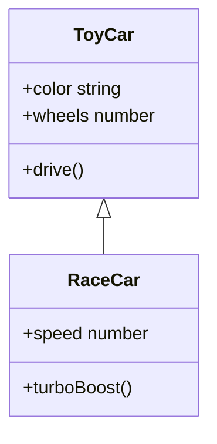

## The idea

A **race car** toy is a toy car with extras. It drives like any toy car, and it also has a turbo boost. You don't build it from nothing; you start from the toy car and add the new parts.

**Inheritance** means one class (the **child**) builds on another class (the **parent**). The child gets all the parent's properties and methods, and can add its own or change some.

The parent is also called the **base class** or **superclass**. The child is also called the **subclass**.

## `extends`: build on a parent

```js
class ToyCar {
  constructor(color, wheels) {
    this.color = color;
    this.wheels = wheels;
  }

  drive() {
    console.log(`Vroom! The ${this.color} car is driving.`);
  }
}

class RaceCar extends ToyCar {
  constructor(color, wheels, speed) {
    super(color, wheels); // run ToyCar's constructor first
    this.speed = speed; // new property
  }

  turboBoost() { // new action
    console.log(`Turbo boost at speed ${this.speed}!`);
  }
}

const myRaceCar = new RaceCar('yellow', 4, 200);
myRaceCar.drive(); // Vroom! The yellow car is driving.  (from ToyCar)
myRaceCar.turboBoost(); // Turbo boost at speed 200!  (new in RaceCar)
console.log(myRaceCar instanceof ToyCar); // true
```

In a class diagram, the arrow with a hollow triangle points from the child to the parent:



Java uses `extends` too. In both languages, a class can extend **only one** class.

## `super`: talk to the parent

`super` has two jobs:

- `super(...)` inside the constructor runs the **parent's constructor**;
- `super.method()` calls the **parent's version** of a method.

```js
class Animal {
  constructor(name) {
    this.name = name;
  }

  speak() {
    console.log(`${this.name} makes a sound`);
  }
}

class Dog extends Animal {
  constructor(name, breed) {
    super(name); // must come first
    this.breed = breed;
  }

  speak() { // override: replace the parent's speak()...
    super.speak(); // ...but still run the parent's version first
    console.log(`${this.name} the ${this.breed} barks`);
  }
}

const dog = new Dog('Rex', 'Labrador');
dog.speak();
// Rex makes a sound
// Rex the Labrador barks
```

When a child writes its own version of a parent method, that is called **overriding**. It's the base of [Polymorphism](./polymorphism.mdx).

## The default constructor

If the child has **no constructor**, JavaScript adds one for you. It passes every argument straight to the parent:

```js
class Animal {
  constructor(name) {
    this.name = name;
  }
}

class Cat extends Animal {
  // No constructor here. JavaScript adds this one for you:
  // constructor(...args) { super(...args); }

  meow() {
    console.log(`${this.name} says meow`);
  }
}

new Cat('Tom').meow(); // Tom says meow
```

So you only write a constructor in the child when it needs something extra, like `breed`.

## Call `super()` before using `this`

If the child **does** have a constructor, it must call `super()` before it touches `this`:

```js
class Animal {
  constructor(name) {
    this.name = name;
  }
}

class Bird extends Animal {
  constructor(name) {
    this.canFly = true; // wrong: uses `this` before super()
    super(name);
  }
}

try {
  new Bird('Tweety');
} catch (err) {
  console.log(err.message);
  // Must call super constructor in derived class before accessing 'this' or returning from derived constructor
}
```

Why? In a child class, the **parent's constructor creates the object**. Until `super()` runs, there is no `this` yet. A child constructor that never calls `super()` fails with the same error. This error happens when `new Bird()` runs, so the code above can catch it.

## The "is-a" test

Before you write `extends`, say the sentence out loud: "A child **is a** parent."

| Sentence | True? | Use |
| --- | --- | --- |
| A RaceCar **is a** ToyCar | yes | inheritance |
| A Dog **is an** Animal | yes | inheritance |
| A Car **is an** Engine | no: a car **has an** engine | composition |
| A Stack **is an** Array | no: an array lets you remove from the middle, a stack must not | composition |

If the sentence is "has a", the class should **hold** the other object as a part. See [Composition vs Inheritance](./composition-vs-inheritance.mdx).

## When inheritance goes wrong

**1. Deep trees.** `Toy → Vehicle → Car → ElectricCar → SelfDrivingCar`. To understand the bottom class you must read five classes, and a change at the top ripples all the way down. Keep trees one or two levels deep.

**2. Fragile parents.** A child can break because of a hidden detail inside its parent:

```js
class Basket {
  #items = [];

  add(item) {
    this.#items.push(item);
  }

  addMany(items) {
    for (const item of items) this.add(item); // calls this.add()
  }
}

class CountingBasket extends Basket {
  count = 0;

  add(item) {
    this.count++;
    super.add(item);
  }

  addMany(items) {
    this.count += items.length;
    super.addMany(items);
  }
}

const basket = new CountingBasket();
basket.addMany(['apple', 'milk']);
console.log(basket.count); // 4 (we expected 2!)
```

`Basket`'s `addMany` calls `this.add()`, and `this` is a `CountingBasket`. So the child's `add` runs and counts each item a second time. The child depended on how the parent works inside. This is called the **fragile base class** problem.

**3. Methods that don't fit.** The child gets every parent method, even ones that make no sense for it, like a `Penguin` that inherits `fly()`. See [Liskov Substitution Principle](../design-principles/liskov-substitution.mdx).

## In the real world

- **Custom errors:** `class NotFoundError extends Error` is very common in Node.js apps.
- **Web components:** `class MyButton extends HTMLElement` makes a new HTML tag.
- **Node.js streams:** you make your own stream with `class Upper extends Transform`.
- **Older React:** `class App extends React.Component`. React now prefers function components and composition.

## In the interview

> "A `Car` is a `Vehicle`, and every vehicle has a plate and a parking fee, so `Car extends Vehicle` makes sense. I'll keep the tree one level deep. For things a car **has**, like an engine, I'll use composition instead."

**Likely follow-up:** "Does JavaScript support multiple inheritance?"

No. A class can extend only one class, in JavaScript and in Java. To get behavior from several places, give the class several parts (composition). Java also lets a class implement many interfaces.

<Callout title="Remember this" type="success">
  - `class Child extends Parent`: the child gets the parent's properties and methods, and can add or override.
  - `super(...)` runs the parent's constructor and must come **before** any `this`. `super.method()` calls the parent's version.
  - No constructor in the child? JavaScript passes all arguments to the parent for you.
  - Use inheritance only for a true **"is-a"**, and keep trees shallow.
  - Parent changes can break children (fragile base class). When in doubt, prefer composition.
</Callout>
