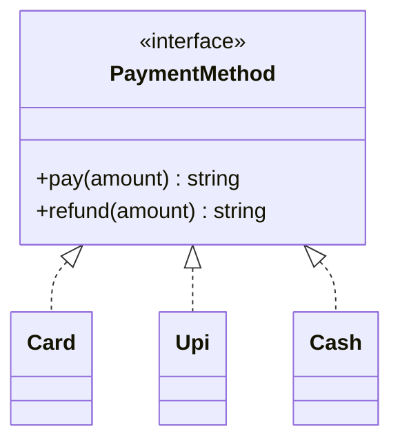
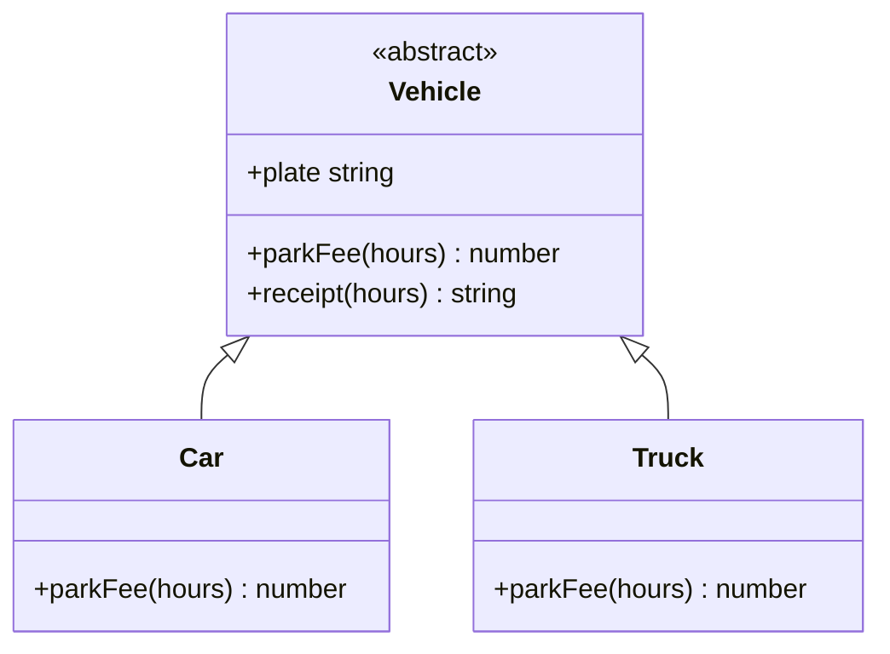
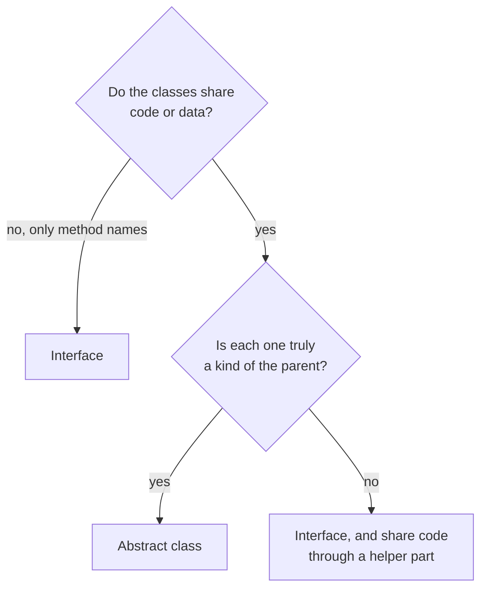

## The idea

Think of two toys:

- A **toy remote** has a battery slot that takes **any AA battery**. The slot's shape is a promise: any brand that fits will work. The slot has no battery inside; it only says what's needed. That's an **interface**.
- A **model car kit** comes with the body already built, but you must add the wheels yourself. You can't sell the kit as a finished toy until the wheels are on. That's an **abstract class**: partly built, never used as it is.

So:

- an **interface** is a list of methods a class promises to have, with **no code**;
- an **abstract class** is a parent class that has **some shared code**, leaves some methods for the children to fill in, and can't be created with `new` by itself.

Java and TypeScript have both as keywords. Plain JavaScript has **neither**, so we write them with normal classes.

## An interface in JavaScript

Write a base class named after the **role**, mark it with an `// interface` comment, and make every method throw:

```js
class PaymentMethod { // interface
  pay(amount) { throw new Error('not implemented'); }
  refund(amount) { throw new Error('not implemented'); }
}

class Card extends PaymentMethod {
  pay(amount) { return `Paid ${amount} by card`; }
  refund(amount) { return `Refunded ${amount} to card`; }
}

class Upi extends PaymentMethod {
  pay(amount) { return `Paid ${amount} by UPI`; }
  refund(amount) { return `Refunded ${amount} by UPI`; }
}

class Cash extends PaymentMethod { // forgot refund()!
  pay(amount) { return `Paid ${amount} in cash`; }
}

for (const method of [new Card(), new Upi()]) {
  console.log(method.pay(10));
}
// Paid 10 by card
// Paid 10 by UPI

try {
  new Cash().refund(10);
} catch (err) {
  console.log(err.message); // not implemented
}
```

In class diagrams, a class that keeps this promise gets a **dashed** arrow ("implements"), even though the code says `extends`:



**Duck typing also works:** JavaScript will happily call `pay()` on any object that has one, no `extends` needed. The base class still helps, because it gives you:

- a **name** for the role, which you can draw and talk about;
- a clear "not implemented" error when a method is missing;
- `instanceof PaymentMethod` checks;
- one place to read the full list of methods.

In Java you write `interface PaymentMethod { String pay(int amount); }` and `class Card implements PaymentMethod`. Java refuses to compile a class that misses a method. In JavaScript you find out only when the method is called.

## An abstract class in JavaScript

Block direct use in the constructor with `new.target`, and make the abstract methods throw. Shared methods have real code:

```js
class Vehicle { // abstract
  constructor(plate) {
    if (new.target === Vehicle) throw new Error('Vehicle is abstract');
    this.plate = plate;
  }

  parkFee(hours) { throw new Error('not implemented'); } // abstract method

  receipt(hours) { // shared code: every vehicle gets it
    return `${this.plate}: ${hours}h = ${this.parkFee(hours)}`;
  }
}

class Car extends Vehicle {
  parkFee(hours) { return hours * 20; }
}

class Truck extends Vehicle {
  parkFee(hours) { return hours * 50; }
}

console.log(new Car('KA-01-1234').receipt(3)); // KA-01-1234: 3h = 60
console.log(new Truck('MH-02-9876').receipt(2)); // MH-02-9876: 2h = 100

try {
  new Vehicle('X-1');
} catch (err) {
  console.log(err.message); // Vehicle is abstract
}
```

**What is `new.target`?** Inside a constructor, it's the class that `new` was called with.

- `new Car(...)` runs `Vehicle`'s constructor through `super`, but `new.target` is `Car`, so the check passes.
- `new Vehicle(...)` makes `new.target` equal to `Vehicle`, so it throws.

Notice that `receipt()` in the parent calls `parkFee()`, which each child fills in. That is the [Template Method](../design-patterns/template-method.mdx) pattern.



## Interface vs abstract class

| | Interface | Abstract class |
| --- | --- | --- |
| What it is | A promise: "I can do these things" | A half-built parent class |
| Has code? | No, only method names | Yes: shared methods, plus abstract ones to fill in |
| Has data? | No | Yes, like `plate` |
| Can you `new` it? | No | No |
| Relationship | "can do" (a role) | "is a" (a family) |
| Good for | Unrelated classes with one role: `Card` and `Upi` can pay | Close classes that share code: `Car` and `Truck` |
| In Java | `interface` and `implements`; a class can have many | `abstract class` and `extends`; only one parent |
| In JavaScript | Base class whose methods throw | Base class with a `new.target` check |

One JavaScript limit: our interface uses `extends`, and a class can extend only one class. If a class needs two roles, extend the main one, and rely on duck typing for the other, or split the roles into separate parts ([Composition vs Inheritance](./composition-vs-inheritance.mdx)).

How to choose:



## Common mistakes

- **Forgetting the `new.target` check.** Then anyone can create a plain `Vehicle` with no fee rule.
- **Putting code or data in an "interface".** Once it has shared code, it's an abstract class. Call it one.
- **One big interface.** A `Machine` interface with `print()`, `scan()` and `fax()` forces a simple printer to fake `fax()`. Split it. See [Interface Segregation Principle](../design-principles/interface-segregation.mdx).
- **An abstract class with only one child.** It adds a layer for nothing. Wait until a second kind appears.

## In the real world

- **Node.js streams** use this exact idea. To make your own readable stream, you extend `Readable` and write `_read()`. If you don't, Node reports the error "The `_read()` method is not implemented".
- **The iteration protocol** is an interface by duck typing: any object with a `[Symbol.iterator]()` method works with `for...of`.
- **Java** has interfaces like `Comparable` and `Runnable`, and abstract classes like `AbstractList`, which gives you a working read-only `List` once you write just `get()` and `size()`.
- **TypeScript** has `interface` and `abstract class` keywords, but they only exist while compiling. The JavaScript that runs has no interfaces.

## In the interview

> "`PaymentMethod` is an interface: card, UPI and cash share no code, only the promise to `pay()`. For vehicles I'll use an abstract `Vehicle` class, because every vehicle has a plate and the same receipt logic. Only `parkFee()` is different."

**Likely follow-up:** "JavaScript has no interfaces. How do you make sure a class has the right methods?"

The base class throws "not implemented", so a missing method fails loudly the first time it's called, and a quick test catches it. For data from outside, you can also check `typeof obj.pay === 'function'`. If the team uses TypeScript, its `implements` checks it before the code runs.

<Callout title="Remember this" type="success">
  - **Interface:** a promise of methods, no code. In JavaScript: a base class marked `// interface` whose methods throw.
  - **Abstract class:** shared code plus methods to fill in; can't be created. In JavaScript: a `new.target` check in the constructor.
  - Interface = a role ("can pay"). Abstract class = a family that shares code ("is a vehicle").
  - In diagrams: `<|..` dashed for implements, `<|--` solid for extends.
  - Duck typing also works in JavaScript; the base class adds a name and clear errors.
</Callout>
