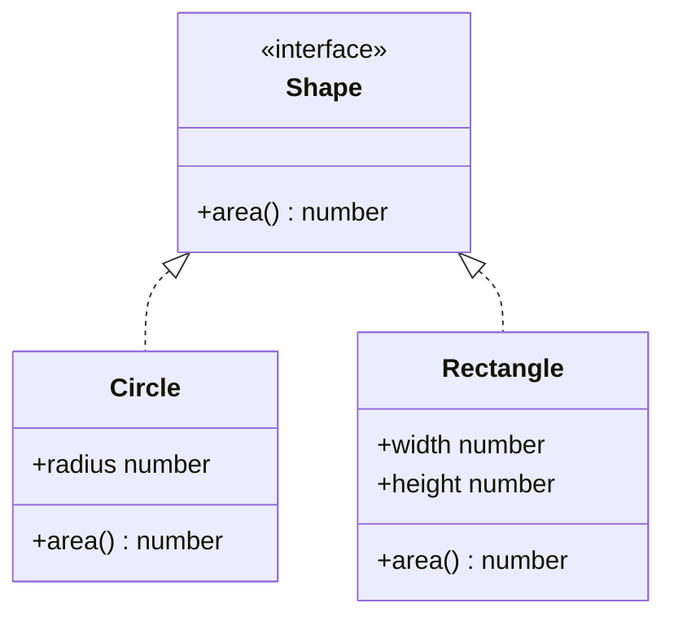

## The idea

Line up your **toys** and press the "move" button on each one. The toy car drives. The robot walks. The plane flies. Same button, different action, because each toy knows how **it** moves.

**Polymorphism** means "many forms". You make the **same call** on different objects, and each object does it **its own way**. The code that makes the call doesn't need to know which kind of object it has.

## Method overriding

Each child class writes its own version of a parent's method. This is called **overriding**:

```js
class Toy {
  move() {
    console.log('The toy moves');
  }
}

class ToyCar extends Toy {
  move() {
    console.log('The car drives fast!');
  }
}

class Robot extends Toy {
  move() {
    console.log('The robot walks!');
  }
}

const toys = [new ToyCar(), new Robot(), new Toy()];
for (const toy of toys) toy.move();
// The car drives fast!
// The robot walks!
// The toy moves
```

The loop calls `toy.move()` and never asks "what kind of toy is this?". JavaScript picks the right `move` **while the program runs**, by looking at the object's class.

In Java, an override must keep the same parameters, and its return type must match the parent's (or be a narrower type).

## One call, many shapes

Here is the problem polymorphism solves. Without it, code checks the type by hand:

```js
// Without polymorphism: every new shape means editing this function
function area(shape) {
  if (shape.type === 'circle') return Math.PI * shape.radius ** 2;
  if (shape.type === 'rectangle') return shape.width * shape.height;
  throw new Error('Unknown shape');
}
```

Add a triangle, and you must open this function and add another `if`. With polymorphism, each shape knows its own area:

```js
class Shape { // interface
  area() { throw new Error('not implemented'); }
}

class Circle extends Shape {
  constructor(radius) {
    super();
    this.radius = radius;
  }
  area() { return Math.PI * this.radius ** 2; }
}

class Rectangle extends Shape {
  constructor(width, height) {
    super();
    this.width = width;
    this.height = height;
  }
  area() { return this.width * this.height; }
}

function totalArea(shapes) {
  // No "if circle... else if rectangle...". Each shape knows its own area.
  return shapes.reduce((sum, shape) => sum + shape.area(), 0);
}

console.log(totalArea([new Circle(1), new Rectangle(2, 3)]).toFixed(2)); // 9.14
```



A new `Triangle` class needs **no change** to `totalArea`. That's the [Open/Closed Principle](../design-principles/open-closed.mdx): add new code, don't edit old code.

## Duck typing

"If it walks like a duck and quacks like a duck, it's a duck."

JavaScript doesn't check classes before it calls a method. **Any** object that has an `area()` method works, even a plain object:

```js
function totalArea(shapes) {
  return shapes.reduce((sum, shape) => sum + shape.area(), 0);
}

const square = { area: () => 4 }; // a plain object, no class at all
const triangle = { area: () => (3 * 4) / 2 };
console.log(totalArea([square, triangle])); // 10

try {
  totalArea([{ name: 'blob' }]); // no area() method
} catch (err) {
  console.log(err.message); // shape.area is not a function
}
```

The good part: it's flexible. The risk: a missing method is found only when the code runs. Java checks this before running: a class must say `implements Shape`.

## Method overloading

**Overloading** means several methods with the **same name** but **different parameters** in one class. Java has it. **Plain JavaScript does not**: a second method with the same name simply **replaces** the first.

```js
class Greeter {
  greet(name) {
    return `Hello, ${name}`;
  }

  greet(age) { // same name: this REPLACES the greet() above
    return `You are ${age} years old`;
  }
}

console.log(new Greeter().greet('Rohit')); // You are Rohit years old
```

The JavaScript way: write **one** method that checks its arguments, and use default values for optional ones:

```js
class Greeter {
  greet(value, greeting = 'Hello') { // default value for an optional argument
    if (typeof value === 'number') return `You are ${value} years old`;
    return `${greeting}, ${value}`;
  }
}

const g = new Greeter();
console.log(g.greet('Rohit')); // Hello, Rohit
console.log(g.greet('Rohit', 'Hi')); // Hi, Rohit
console.log(g.greet(27)); // You are 27 years old
```

In Java, `greet(String name)` and `greet(int age)` can both exist; you can't overload by return type alone. TypeScript lets you write overload signatures, but there is still one body that checks the arguments, like above.

| | Overriding | Overloading |
| --- | --- | --- |
| What | A child redefines a parent's method | Same name, different parameters |
| Where | Parent and child classes | One class |
| Which one runs | Picked while running, by the object's class | Picked when compiling, by the arguments (Java) |
| In JavaScript | Yes | No. Write one method that checks its arguments |
| Java name | Runtime polymorphism | Compile-time polymorphism |

## Common mistakes

- **Type checks instead of polymorphism.** `if (shape instanceof Circle) ... else if (shape instanceof Rectangle) ...` Move that code into the classes.
- **An override that breaks the promise.** A `Penguin.fly()` that throws, or a `Square` whose `setWidth()` also changes the height. Callers get surprised. See [Liskov Substitution Principle](../design-principles/liskov-substitution.mdx).
- **Expecting overloading in JavaScript.** The second method with the same name silently wins.

## In the real world

- **`for...of`** works on arrays, strings, `Map`s and `Set`s. Each type has its own `[Symbol.iterator]()` method, and the loop just calls it.
- **`toString()`**: every object has one, and many types override it. `String([1, 2])` gives `'1,2'`, and `String(new Error('oops'))` gives `'Error: oops'`.
- **Java:** `List<String> names = new ArrayList<>();` The code uses the `List` type; the real object could be an `ArrayList` or a `LinkedList`.

## In the interview

> "The parking lot calls `vehicle.parkFee(hours)` on any vehicle. `Car`, `Bike` and `Truck` each override it with their own price. To add a bus, I add a `Bus` class, and the parking lot code doesn't change."

**Likely follow-up:** "Does JavaScript have method overloading?"

No. A second method with the same name replaces the first. You write one method that checks the type or number of its arguments, or uses default values. Java has real overloading, chosen when the code compiles. Overriding, chosen while the code runs, works the same in both.

<Callout title="Remember this" type="success">
  - **Polymorphism:** one call, and each object does it its own way.
  - **Overriding:** a child redefines a parent's method. This is the main kind in JavaScript.
  - Call `shape.area()` without knowing the shape. No `if`/`else` on types.
  - **Duck typing:** in JavaScript, any object with the method works.
  - **No overloading** in JavaScript: one method that checks its arguments, or default values.
</Callout>
