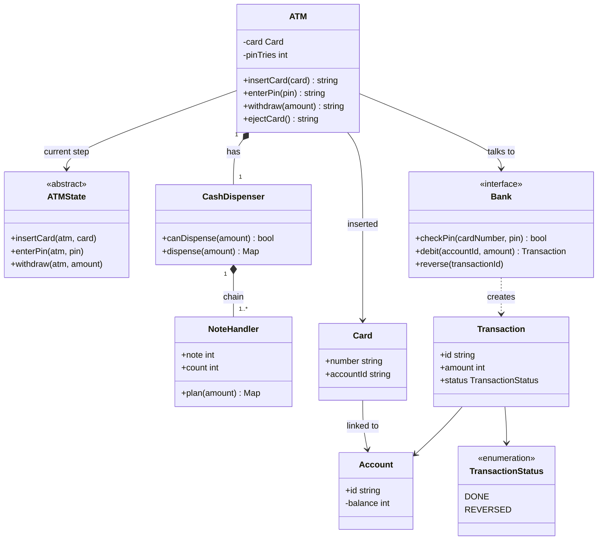
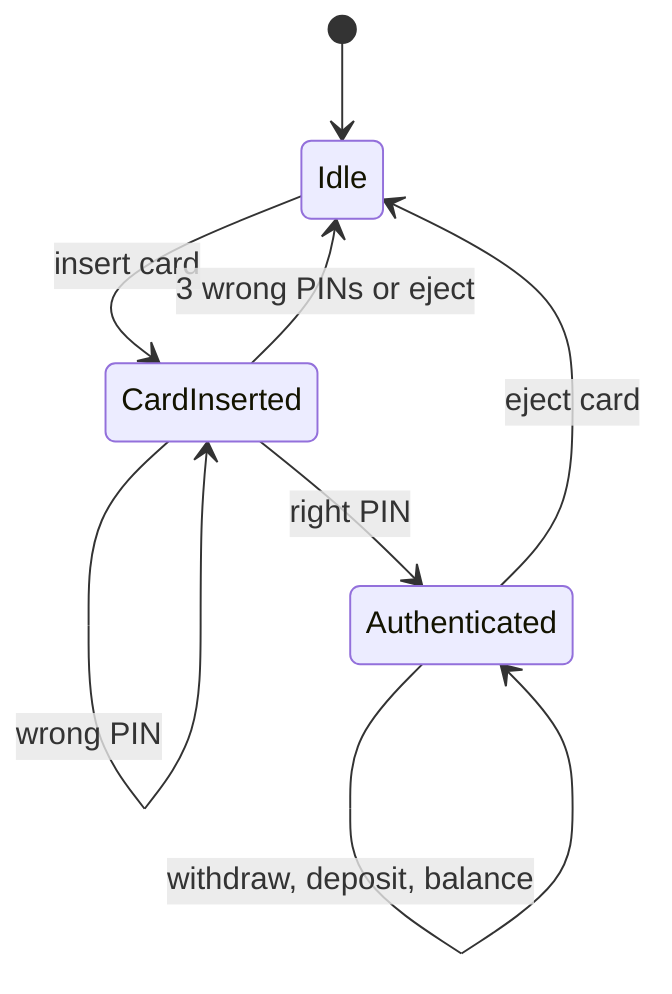
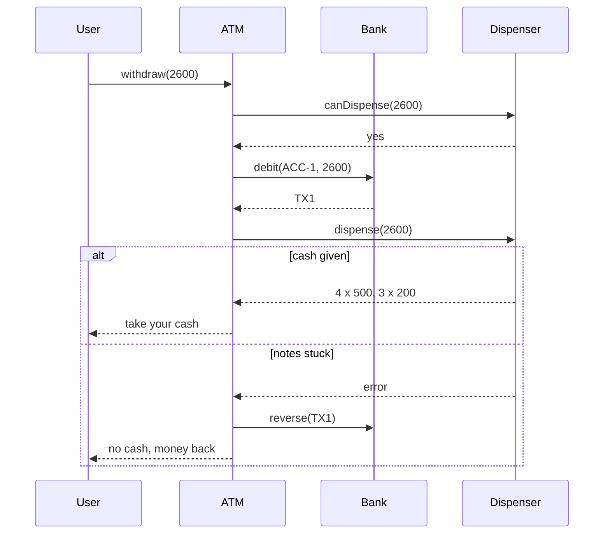

<Callout title="About this question">
  - **Difficulty:** Medium.
  - **Patterns used:** [State](../design-patterns/state.mdx) (the ATM steps), [Chain of Responsibility](../design-patterns/chain-of-responsibility.mdx) (giving out notes), [Dependency Inversion](../design-principles/dependency-inversion.mdx) (the bank behind an interface).
  - **Also asked as:** "Design a cash machine", "Design an ATM system", "Design the software of a bank ATM".
</Callout>

## Understand the problem

Think of taking cash out of an ATM. You put in your card. It asks for your PIN. You type ₹2,600. The machine checks with your bank, the bank takes the money from your account, and the machine counts out the notes.

What makes it interesting:

- **Steps in order.** You can't withdraw before your PIN is right, and you can't type a PIN with no card inside. The same button does different things at each step. This is the [State](../design-patterns/state.mdx) pattern.
- **Which notes?** ₹2,600 could be 4 × ₹500 + 3 × ₹200, or 26 × ₹100. And the machine only has the notes inside it.
- **Money and machines both fail.** The bank takes your money, and then the notes get stuck. Now what? You must never lose money that you didn't get.

## Step 1: Requirements

### Functional requirements

1. Users should be able to insert a card and enter a PIN. After 3 wrong PINs, the ATM keeps the card and the card is blocked.
2. Users should be able to withdraw cash in multiples of ₹100, if the account has the money and the ATM has the notes.
3. Users should get the fewest notes possible from ₹500, ₹200 and ₹100 notes.
4. Users should be able to deposit money and check their balance.
5. If the cash can't be given after the account was charged, the money must go back to the account.

### Out of scope

- The bank's own systems and the card network. We talk to the bank through an interface.
- Receipts, PIN change, transfers between accounts.
- The real hardware: card reader, keypad, and note counter.

### Questions to ask the interviewer

| Question | What we assume |
| --- | --- |
| One currency or many? | Indian rupees only, with ₹500, ₹200 and ₹100 notes. |
| Who checks the PIN and the balance? | The bank. The ATM never stores PINs or balances. |
| How many PIN tries? | 3. Then the ATM keeps the card and the bank blocks it. |
| What if the notes jam after the bank took the money? | The ATM asks the bank to reverse the transaction. |
| Many users at once? | One user per machine, but one account can be used from many machines at once. |

## Step 2: Core classes

| Class | What it is | Key data | Key actions |
| --- | --- | --- | --- |
| `Card` | The plastic card | `number`, `accountId` | — |
| `Account` | Money at the bank | `id`, balance | `debit`, `credit` |
| `Transaction` | A record of one money move | `id`, `type`, `amount`, `status` | — |
| `Bank` (interface) | The bank's side. `InMemoryBank` is a fake one for tests. | — | `checkPin`, `debit`, `credit`, `reverse`, `blockCard` |
| `NoteHandler` | One link in the note chain: one kind of note | `note`, `count`, next handler | `plan(amount)`, `take(notes)` |
| `CashDispenser` | The cash box, made of a chain of note handlers | the first handler | `canDispense`, `dispense` |
| `ATMState` (abstract) | The current step: `IdleState`, `CardInsertedState`, `AuthenticatedState` | — | one method per button |
| `ATM` | The main service. Every button goes through it. | `bank`, `dispenser`, `state`, `card`, `pinTries` | `insertCard`, `enterPin`, `withdraw`, `deposit`, `checkBalance`, `ejectCard` |

**Enums:**

- `TransactionType`: `WITHDRAW`, `DEPOSIT`.
- `TransactionStatus`: `DONE`, `REVERSED`.

## Step 3: Class diagram



`IdleState`, `CardInsertedState` and `AuthenticatedState` extend `ATMState`. `InMemoryBank` implements `Bank`. They are left out of the picture to keep it small.

- **The bank is an interface.** The ATM only knows "something that checks PINs and moves money". Tests use a fake bank. The real one talks over the network.
- **The ATM never keeps balances or PINs.** Those belong to the bank. The ATM only has the card for one session.
- **Composition for the cash box.** The dispenser and its note handlers are part of the machine.
- **Each step is a state object.** The base class says "not now" to every button. Each state allows only its own buttons.

## Step 4: Main methods

- `ATM.insertCard(card)` → message. Only in `Idle`. Refuses a blocked card.
- `ATM.enterPin(pin)` → message. Only in `CardInserted`. Counts wrong tries, and keeps the card after 3.
- `ATM.withdraw(amount)` → message. Only in `Authenticated`. Checks the amount and the notes, debits the bank, gives the cash, and reverses if the cash fails.
- `ATM.deposit(amount)` / `ATM.checkBalance()` → message. Only in `Authenticated`.
- `ATM.ejectCard()` → message. Ends the session and goes back to `Idle`.
- `CashDispenser.dispense(amount)` → the notes given, like `{ 500 → 4, 200 → 3 }`.
- `Bank.reverse(transactionId)`. Puts a withdrawal back. Safe to call twice.

The steps of the ATM:



The main flow, a withdrawal:



## Step 5: Code

The code comes in small parts. Paste them together in order, and they run as one file. Money is in whole rupees, so there are no decimal problems.

### Part 1: The enums

Fixed lists of choices are plain objects. `rupees` turns `2600` into `"₹2600"` for messages.

```js
const TransactionType = {
    WITHDRAW: "WITHDRAW",
    DEPOSIT: "DEPOSIT",
};

const TransactionStatus = {
    DONE: "DONE",
    REVERSED: "REVERSED",
};

const MAX_PIN_TRIES = 3;

function rupees(amount) {
    return `₹${amount}`;
}
```

### Part 2: Cards and accounts

An account lives at the bank, never in the ATM. It refuses to go below 0.

```js
class Card {
    constructor(number, accountId) {
        this.number = number;
        this.accountId = accountId;
    }
}

// Lives at the bank, never in the ATM.
class Account {
    constructor(id, balance) {
        this.id = id;
        this.balance = balance;
    }

    debit(amount) {
        if (amount > this.balance) {
            throw new Error("Not enough money in the account");
        }

        this.balance -= amount;
    }

    credit(amount) {
        this.balance += amount;
    }
}
```

### Part 3: A transaction

A record of one money move. Each new transaction gets the next id: TX1, TX2, TX3.

```js
// The number for the next transaction id.
let nextTransactionNumber = 1;

class Transaction {
    constructor(type, accountId, amount) {
        this.id = `TX${nextTransactionNumber}`;
        nextTransactionNumber += 1;

        this.type = type;
        this.accountId = accountId;
        this.amount = amount;
        this.status = TransactionStatus.DONE;
    }
}
```

### Part 4: The bank interface

The ATM only knows "something that checks PINs and moves money". This base class lists the methods, and each one only throws.

```js
// Interface: the bank's side, reached over the network.
class Bank {
    checkPin(cardNumber, pin) {
        throw new Error("not implemented");
    }

    isBlocked(cardNumber) {
        throw new Error("not implemented");
    }

    blockCard(cardNumber) {
        throw new Error("not implemented");
    }

    balance(accountId) {
        throw new Error("not implemented");
    }

    debit(accountId, amount) {
        throw new Error("not implemented");
    }

    credit(accountId, amount) {
        throw new Error("not implemented");
    }

    reverse(transactionId) {
        throw new Error("not implemented");
    }
}
```

### Part 5: A fake bank

`InMemoryBank` is a fake bank for tests. A real one would call the bank's servers. The class goes on over the next three blocks.

```js
class InMemoryBank extends Bank {
    constructor() {
        super();
        // account id -> Account
        this.accounts = new Map();
        // card number -> PIN (a real bank keeps only a hash of the PIN)
        this.pins = new Map();
        // The card numbers that are blocked.
        this.blocked = new Set();
        // transaction id -> Transaction
        this.transactions = new Map();
    }

    addAccount(account) {
        this.accounts.set(account.id, account);
    }

    issueCard(card, pin) {
        this.pins.set(card.number, pin);
    }

    findAccount(id) {
        const account = this.accounts.get(id);
        if (!account) {
            throw new Error(`Unknown account ${id}`);
        }
        return account;
    }
```

**Cards and balances.** Small lookups in the maps above.

```js
    checkPin(cardNumber, pin) {
        return this.pins.get(cardNumber) === pin;
    }

    isBlocked(cardNumber) {
        return this.blocked.has(cardNumber);
    }

    blockCard(cardNumber) {
        this.blocked.add(cardNumber);
    }

    balance(accountId) {
        const account = this.findAccount(accountId);
        return account.balance;
    }
```

**Moving money.** Every debit and credit is saved as a transaction.

```js
    record(transaction) {
        this.transactions.set(transaction.id, transaction);
        return transaction;
    }

    // Check and take the money with no `await` in between.
    debit(accountId, amount) {
        const account = this.findAccount(accountId);
        account.debit(amount);

        const transaction = new Transaction(TransactionType.WITHDRAW, accountId, amount);
        return this.record(transaction);
    }

    credit(accountId, amount) {
        const account = this.findAccount(accountId);
        account.credit(amount);

        const transaction = new Transaction(TransactionType.DEPOSIT, accountId, amount);
        return this.record(transaction);
    }
```

**Reversing a withdrawal.** It puts the money back. Calling it twice is safe: the second call does nothing.

```js
    reverse(transactionId) {
        const transaction = this.transactions.get(transactionId);
        if (!transaction || transaction.type !== TransactionType.WITHDRAW) {
            throw new Error(`Can't reverse ${transactionId}`);
        }

        // Already reversed: nothing to do.
        if (transaction.status === TransactionStatus.REVERSED) {
            return;
        }

        const account = this.findAccount(transaction.accountId);
        account.credit(transaction.amount);
        transaction.status = TransactionStatus.REVERSED;
    }
}
```

### Part 6: One note handler

The cash box is a Chain of Responsibility. Each handler holds one kind of note. It gives as many of its notes as it can, and passes the rest to the next handler. The class goes on over the next two blocks.

```js
class NoteHandler {
    constructor(note, count) {
        // 500, 200 or 100
        this.note = note;
        // How many of these notes are inside.
        this.count = count;
        // The next handler in the chain, or null at the end.
        this.next = null;
    }

    setNext(handler) {
        this.next = handler;
    }
```

**Planning the notes.** `plan` only works out which notes to give. It doesn't take them yet. It returns a `Map` of note → how many, or `null` if the amount can't be made.

```js
    plan(amount, notes = new Map()) {
        // Use as many of this note as we can, but not more than we have.
        const wanted = Math.floor(amount / this.note);
        const used = Math.min(wanted, this.count);
        if (used > 0) {
            notes.set(this.note, used);
        }

        const rest = amount - used * this.note;
        if (rest === 0) {
            return notes;
        }

        // Pass the rest on. With no next handler, the amount can't be made.
        if (this.next === null) {
            return null;
        }
        return this.next.plan(rest, notes);
    }
```

**Taking the notes.** Each handler takes out its own notes, then tells the next one.

```js
    take(notes) {
        if (notes.has(this.note)) {
            this.count -= notes.get(this.note);
        }

        if (this.next !== null) {
            this.next.take(notes);
        }
    }
}
```

### Part 7: The cash dispenser

The dispenser builds the chain, biggest note first: ₹500 → ₹200 → ₹100. The class goes on in the next block.

```js
class CashDispenser {
    // stock: [note, count] pairs, for example [[500, 10], [200, 10], [100, 20]]
    constructor(stock) {
        const handlers = [];
        for (const [note, count] of stock) {
            handlers.push(new NoteHandler(note, count));
        }

        // Biggest note first.
        handlers.sort((first, second) => second.note - first.note);

        // Link each handler to the one after it.
        for (let i = 0; i < handlers.length - 1; i++) {
            handlers[i].setNext(handlers[i + 1]);
        }

        this.first = handlers[0];
    }
```

**Giving out cash.** Plan first. Take the notes only if the plan works.

```js
    canDispense(amount) {
        const notes = this.first.plan(amount);
        return notes !== null;
    }

    // The real machine pushes the notes out here.
    dispense(amount) {
        const notes = this.first.plan(amount);
        if (notes === null) {
            throw new Error(`Can't make ${rupees(amount)} from the notes inside`);
        }

        this.first.take(notes);
        return notes;
    }
}

// Turns the notes into text like "4 x ₹500, 3 x ₹200".
function formatNotes(notes) {
    const parts = [];
    for (const [note, howMany] of notes) {
        parts.push(`${howMany} x ${rupees(note)}`);
    }
    return parts.join(", ");
}
```

### Part 8: The base state

Each ATM step is a state object (the State pattern). The base class says "not now" to every button. The class goes on in the next block.

```js
// Abstract: we only make the states below, never a plain ATMState.
class ATMState {
    constructor(name) {
        // this.constructor is the class that `new` was called with.
        if (this.constructor === ATMState) {
            throw new Error("ATMState is abstract");
        }

        this.name = name;
    }

    notNow(action) {
        throw new Error(`You can't ${action} now (${this.name})`);
    }
```

**Every button says "not now".** Each state below replaces only the buttons it allows.

```js
    insertCard(atm, card) {
        this.notNow("insert a card");
    }

    enterPin(atm, pin) {
        this.notNow("enter a PIN");
    }

    withdraw(atm, amount) {
        this.notNow("withdraw");
    }

    deposit(atm, amount) {
        this.notNow("deposit");
    }

    checkBalance(atm) {
        this.notNow("check the balance");
    }

    ejectCard(atm) {
        this.notNow("eject a card");
    }
}
```

### Part 9: The idle state

With no card inside, the only button that works is "insert card".

```js
class IdleState extends ATMState {
    constructor() {
        super("Idle");
    }

    insertCard(atm, card) {
        if (atm.bank.isBlocked(card.number)) {
            throw new Error("This card is blocked. Please call your bank.");
        }

        atm.startSession(card);
        atm.setState(new CardInsertedState());
        return "Enter your PIN";
    }
}
```

### Part 10: The card-inserted state

Now the user can type a PIN or take the card back. After 3 wrong PINs, the bank blocks the card and the machine keeps it.

```js
class CardInsertedState extends ATMState {
    constructor() {
        super("CardInserted");
    }

    enterPin(atm, pin) {
        if (atm.bank.checkPin(atm.card.number, pin)) {
            atm.setState(new AuthenticatedState());
            return "PIN OK";
        }

        // A wrong PIN: count it.
        atm.pinTries += 1;
        const triesLeft = MAX_PIN_TRIES - atm.pinTries;
        if (triesLeft > 1) {
            return `Wrong PIN. ${triesLeft} tries left.`;
        }
        if (triesLeft === 1) {
            return "Wrong PIN. 1 try left.";
        }

        // No tries left. The machine keeps the card.
        atm.bank.blockCard(atm.card.number);
        atm.endSession();
        return "Wrong PIN 3 times. The card is kept. Please call your bank.";
    }

    ejectCard(atm) {
        atm.endSession();
        return "Take your card";
    }
}
```

### Part 11: The authenticated state

The PIN was right, so the money buttons work. The class goes on in the next block with `withdraw`.

```js
// Amounts must be a whole multiple of ₹100, above 0.
function checkAmount(amount) {
    if (!Number.isInteger(amount) || amount <= 0 || amount % 100 !== 0) {
        throw new Error("Amount must be a multiple of ₹100");
    }
}

class AuthenticatedState extends ATMState {
    constructor() {
        super("Authenticated");
    }

    checkBalance(atm) {
        const balance = atm.bank.balance(atm.card.accountId);
        return `Balance: ${rupees(balance)}`;
    }

    deposit(atm, amount) {
        checkAmount(amount);
        atm.bank.credit(atm.card.accountId, amount);
        return `Deposited ${rupees(amount)}`;
    }

    ejectCard(atm) {
        atm.endSession();
        return "Take your card";
    }
```

**Withdrawing.** Check the notes, debit the bank, then give the cash. If the cash fails, put the money back.

```js
    withdraw(atm, amount) {
        checkAmount(amount);

        // Check the notes first, so the account is never touched if the ATM can't pay.
        if (!atm.dispenser.canDispense(amount)) {
            throw new Error(`This ATM can't give ${rupees(amount)} right now`);
        }

        // 1. Take the money from the account.
        const transaction = atm.bank.debit(atm.card.accountId, amount);

        // 2. Give out the cash.
        try {
            const notes = atm.dispenser.dispense(amount);
            return `Take your cash: ${formatNotes(notes)}`;
        } catch (error) {
            // 3. The cash failed: put the money back.
            atm.bank.reverse(transaction.id);
            return `Sorry, no cash was given (${error.message}). ${rupees(amount)} is back in your account.`;
        }
    }
}
```

### Part 12: The ATM

`ATM` is the main service. It keeps the card and the PIN tries for one session. The class goes on in the next block.

```js
class ATM {
    constructor(bank, dispenser) {
        this.bank = bank;
        this.dispenser = dispenser;
        this.state = new IdleState();
        // The card inside, for this session only.
        this.card = null;
        this.pinTries = 0;
    }

    setState(state) {
        this.state = state;
    }

    startSession(card) {
        this.card = card;
        this.pinTries = 0;
    }

    endSession() {
        this.card = null;
        this.pinTries = 0;
        this.setState(new IdleState());
    }
```

**The buttons.** Every button just asks the current state, and passes the ATM itself along.

```js
    insertCard(card) {
        return this.state.insertCard(this, card);
    }

    enterPin(pin) {
        return this.state.enterPin(this, pin);
    }

    withdraw(amount) {
        return this.state.withdraw(this, amount);
    }

    deposit(amount) {
        return this.state.deposit(this, amount);
    }

    checkBalance() {
        return this.state.checkBalance(this);
    }

    ejectCard() {
        return this.state.ejectCard(this);
    }
}
```

### Part 13: Try it

One account with ₹3,000, and an ATM with four ₹500, five ₹200 and ten ₹100 notes. `show` presses one button and prints the message, or the error if the button was refused.

```js
function show(pressButton) {
    try {
        const message = pressButton();
        console.log(message);
    } catch (error) {
        console.log(error.message);
    }
}

const bank = new InMemoryBank();
bank.addAccount(new Account("ACC-1", 3000));

const card = new Card("4000-1234", "ACC-1");
bank.issueCard(card, "1234");

const dispenser = new CashDispenser([[500, 4], [200, 5], [100, 10]]);
const atm = new ATM(bank, dispenser);
```

One full visit: a button at the wrong step, a wrong PIN, then cash, a deposit and the balance.

```js
show(() => atm.withdraw(500)); // You can't withdraw now (Idle)
show(() => atm.insertCard(card)); // Enter your PIN
show(() => atm.enterPin("0000")); // Wrong PIN. 2 tries left.
show(() => atm.enterPin("1234")); // PIN OK
show(() => atm.withdraw(2600)); // Take your cash: 4 x ₹500, 3 x ₹200
show(() => atm.withdraw(250)); // Amount must be a multiple of ₹100
show(() => atm.withdraw(1000)); // Not enough money in the account
show(() => atm.deposit(500)); // Deposited ₹500
show(() => atm.checkBalance()); // Balance: ₹900
show(() => atm.ejectCard()); // Take your card
```

Now a cash box whose notes always get stuck. The money goes back to the account.

```js
// A test double: a cash box whose notes always get stuck.
class JammedDispenser extends CashDispenser {
    dispense(amount) {
        throw new Error("notes stuck");
    }
}

const brokenAtm = new ATM(bank, new JammedDispenser([[100, 50]]));
brokenAtm.insertCard(card);
brokenAtm.enterPin("1234");
show(() => brokenAtm.withdraw(300)); // Sorry, no cash was given (notes stuck). ₹300 is back in your account.
show(() => brokenAtm.checkBalance()); // Balance: ₹900

for (const transaction of bank.transactions.values()) {
    console.log(transaction.id, transaction.type, transaction.amount, transaction.status);
}
// TX1 WITHDRAW 2600 DONE
// TX2 DEPOSIT 500 DONE
// TX3 WITHDRAW 300 REVERSED
```

Last, three wrong PINs. The card is kept and blocked.

```js
atm.insertCard(card);
atm.enterPin("1111");
atm.enterPin("2222");
show(() => atm.enterPin("3333")); // Wrong PIN 3 times. The card is kept. Please call your bank.
show(() => atm.insertCard(card)); // This card is blocked. Please call your bank.
```

## Step 6: Edge cases and extensions

### Edge cases

| Case | What happens |
| --- | --- |
| A button pressed at the wrong step | The state says "You can't ... now". |
| A wrong PIN | "2 tries left". After the 3rd, the card is kept and blocked. |
| A blocked card | Refused at `insertCard`. |
| ₹250, ₹0 or a negative amount | Refused: must be a multiple of ₹100. |
| Not enough money in the account | The bank refuses the debit. No cash moves. |
| The ATM doesn't have the notes | Refused **before** asking the bank, so the account is never touched. |
| The notes jam after the debit | The ATM reverses the transaction. The user sees "money back". |
| The power goes off after the debit, before the cash | The ATM writes each step to a log on its disk. On restart, it finds the unfinished withdrawal and asks the bank to reverse it. |
| The greedy plan fails but another mix works | ₹600 with one ₹500 and three ₹200 notes: greedy takes ₹500 and is stuck. Fix: if the plan fails, try again with one fewer big note. |
| The user walks away | Extension: a timeout ejects the card, and keeps it if no one takes it. |

### Two requests at once

One ATM serves one person at a time. But **one account** can be used from two places at once: a joint account with two cards at two ATMs, or an ATM and an online payment.

The danger is at the bank, if it reads the balance, waits, and then writes:

```js
// NOT SAFE. A fragment, not runnable on its own.
async debit(accountId, amount) {
    // Both ATMs read ₹3,000.
    const balance = await db.getBalance(accountId);
    if (balance < amount) {
        throw new Error("Not enough money");
    }

    // Both take ₹2,000, so ₹4,000 left the account.
    await db.setBalance(accountId, balance - amount);
}
```

How to make it safe:

- **One process:** check and take in one method with no `await` in between, as `InMemoryBank.debit` does.
- **Many servers:** one conditional update, so the database checks and takes in one step:

```sql
UPDATE accounts SET balance = balance - 2000
WHERE id = 'ACC-1' AND balance >= 2000;
-- 1 row changed: done. 0 rows changed: not enough money.
```

In Java, you would use a database transaction that locks the account row, or `synchronized` in a single process. See [Race Conditions and Locks](../concurrency/race-conditions-locks.mdx).

### Adding features

- **A new step**, like "Do you want a receipt?": add a `ReceiptState`. The other states don't change. This is [State](../design-patterns/state.mdx).
- **A new note**, like ₹50: add one more handler to the chain. `CashDispenser` and the states don't change. This is [Chain of Responsibility](../design-patterns/chain-of-responsibility.mdx).
- **More menu options** (mini statement, PIN change, transfer): make each option a small object with `execute(atm)`, so the menu is a list of commands. This is [Command](../design-patterns/command.mdx).
- **Cards from other banks:** another `Bank` class that talks to the card network, and changes its messages into our `Bank` methods. This is [Adapter](../design-patterns/adapter.mdx).

## Patterns used

| Pattern | Where | Why |
| --- | --- | --- |
| [State](../design-patterns/state.mdx) | `ATMState`: `IdleState`, `CardInsertedState`, `AuthenticatedState` | Each step allows only its own buttons. No `if (step === ...)` in every method. |
| [Chain of Responsibility](../design-patterns/chain-of-responsibility.mdx) | `NoteHandler` chain in `CashDispenser` | Each note type gives what it can and passes the rest on, like Express middleware calling `next()`. |
| [Dependency Inversion](../design-principles/dependency-inversion.mdx) | `Bank` interface, `InMemoryBank` | The ATM depends on "a bank", not on one network API. Tests use a fake. |
| Test double | `JammedDispenser` | Shows that the "money back" path works, without a real jam. |

## Follow-up questions

<Accordions>
<Accordion title="Why debit first and then give the cash? Why not the other way?">

If the ATM gives the cash first and the debit then fails (for example, the network drops), the bank has lost money and has no record of it. If it debits first and the cash fails, the ATM sends a **reverse**. That is a normal, logged transaction, and the customer gets the money back. Real systems often go one step further: first **hold** the money, then **confirm** it only after the notes are out.

</Accordion>
<Accordion title="Why a chain of handlers and not one loop over the notes?">

For three notes, a loop works fine, so say so. The chain gives each cash box its own count and rule, and adding or removing a note type only changes how the chain is built. It is the same idea as Express middleware: each step does its part and passes the rest on.

</Accordion>
<Accordion title="Where should the PIN tries be counted?">

The ATM counts them in the session to show "2 tries left". But the **bank** must count them too, per card. The session count starts again at 0 for each new card insert. So without a bank count, someone could take the card out after 2 wrong PINs and put it back in, or try 2 PINs at each of many ATMs. In real cards, the chip and the bank both keep a count.

</Accordion>
<Accordion title="How does the ATM keep the PIN safe?">

The ATM never stores the PIN. The PIN pad encrypts it right away, and only the bank can check it. The bank keeps a hash, never the PIN itself. In our design, this hides behind `Bank.checkPin`, so the ATM code doesn't change.

</Accordion>
</Accordions>

## What the interviewer expects

<Tabs items={['Mid-level', 'Senior', 'Staff']}>
<Tab value="Mid-level">

- Clear classes: `Card`, `Account`, `ATM`, `CashDispenser`, `Transaction`.
- A working card → PIN → withdraw flow with PIN tries.
- Giving out the fewest notes.

</Tab>
<Tab value="Senior">

- The State pattern for the steps, and the bank behind an interface.
- "Debit, then dispense, and reverse if it fails", without being asked.
- The race on one account from two places, and the conditional `UPDATE`.

</Tab>
<Tab value="Staff">

- Everything from senior, but faster.
- Hold-then-confirm, a log on the ATM's disk for power cuts, and retries that are safe to repeat.
- PIN security, and talking to many banks through the card network.

</Tab>
</Tabs>

<Callout title="Remember this" type="success">
  - The steps are states: Idle → CardInserted → Authenticated. The base state says "not now" to every button.
  - The ATM never stores balances or PINs. It asks the bank through a `Bank` interface.
  - Notes come from a chain: ₹500 → ₹200 → ₹100. Each gives what it can and passes the rest on.
  - Check the notes first, then debit, then dispense. If the cash fails, reverse the transaction.
  - One account, two ATMs: the bank must check and take the money in one step.
</Callout>
