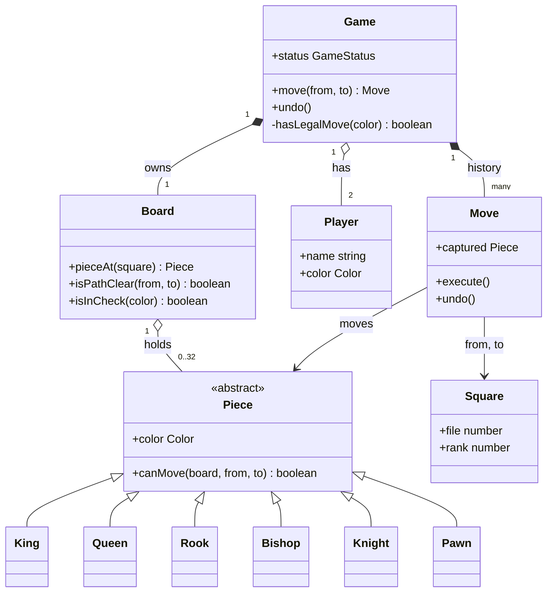
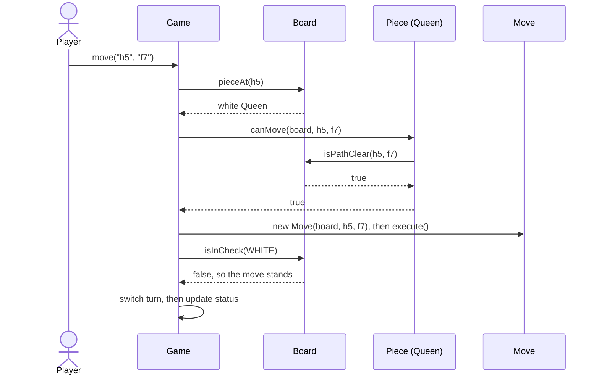
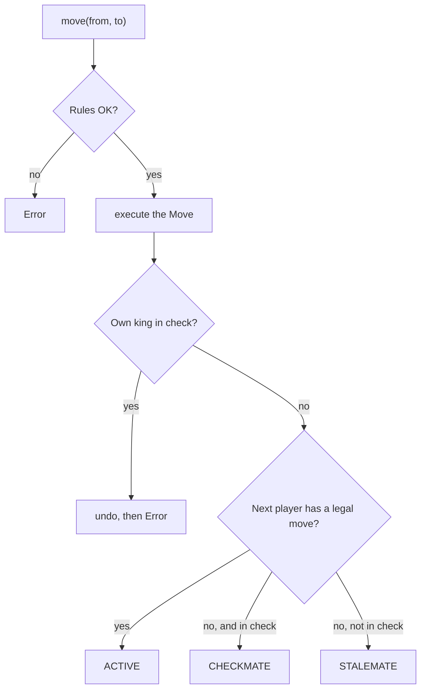

<Callout title="About this question">
  **Difficulty:** Hard. **Patterns used:** [Polymorphism](../oop-basics/polymorphism.mdx) with an
  [abstract class](../oop-basics/interfaces-abstract-classes.mdx), [Command](../design-patterns/command.mdx) for
  undo, [Factory](../design-patterns/factory.mdx) for the starting board.
  **Also asked as:** "Design a chess game", "Design an online chess board", "Design a board game engine".
</Callout>

## Understand the problem

Think of a box of chess toys. Every toy follows its own rule. The knight jumps in an L. The rook slides in straight
lines. The bishop slides on diagonals. Nobody needs a big rule book that says "if it is a knight, do this; if it is
a rook, do that". You just ask each toy: "can you go there?"

What makes it interesting:

- **Six kinds of pieces, one question.** Each piece answers `canMove` in its own way. That is
  [polymorphism](../oop-basics/polymorphism.mdx).
- **Blocked paths.** A rook can't slide through other pieces. A knight can.
- **Check.** A move is not allowed if it leaves your own king under attack, even if the piece could move there.
- **Checkmate.** The game must notice when a player is in check and has no way out.
- **Undo.** Taking a move back must restore the captured piece too.

## Step 1: Requirements

### Functional requirements

1. Two players should be able to play on a standard 8×8 board, White first, taking turns.
2. Users should be able to move a piece from one square to another, like `e2` to `e4`.
3. The system should reject moves that break a piece's rule, go through other pieces, take your own piece, or
   leave your king in check.
4. Users should be able to capture an enemy piece by moving onto its square.
5. The system should detect checkmate (and stalemate) and end the game.
6. Users should be able to undo moves, one at a time.

### Out of scope

- Castling, en passant and pawn promotion (see "Adding features").
- Draws by repetition or the 50-move rule, chess clocks, and a computer opponent.
- The screen that draws the board.

### Questions to ask the interviewer

| Question | What we assume |
| --- | --- |
| Do we need every chess rule? | No. The core moves, capture, check and checkmate. The special moves come later. |
| How are moves given? | As two square names, like `move('e2', 'e4')`. |
| Do we need undo? | Yes, any number of moves back. |
| Is it played over a network? | Not in the core design. We discuss two requests at once at the end. |

## Step 2: Core classes

| Class | What it is | Key data | Key actions |
| --- | --- | --- | --- |
| `Square` | One spot on the board, like `e4` | file (a–h), rank (1–8) | `Square.at('e4')`, `toString` |
| `Board` | The 8×8 grid of pieces | the grid | `pieceAt`, `place`, `isPathClear`, `isInCheck` |
| `Piece` (abstract) | Any chess piece | color | `canMove(board, from, to)` |
| `King`, `Queen`, `Rook`, `Bishop`, `Knight`, `Pawn` | The six kinds of piece | – | their own `canMove` |
| `Player` | A person playing one color | name, color | – |
| `Move` | One move, which can undo itself | piece, from, to, captured piece | `execute`, `undo` |
| `Game` | The match: turns, rules and status | players, board, history, status | `move`, `undo` |

**Enums:**

- `Color`: `WHITE`, `BLACK`.
- `GameStatus`: `ACTIVE`, `CHECKMATE`, `STALEMATE`.

## Step 3: Class diagram



Key choices:

- **`Piece` is abstract, and each piece has its own `canMove`.** `Game` never asks "what kind of piece is this?".
  In Java, `Piece` would be an `abstract class` with `abstract boolean canMove(...)`.
- **`canMove` holds only the piece's own rule.** Rules shared by every piece (whose turn, don't take your own piece,
  don't leave your king in check) live once in `Game`.
- **`Square` is a small value: file and rank.** The `Board` keeps an 8×8 grid of pieces.
- **`Move` is a Command.** It remembers the captured piece, so `undo` can put it back. See
  [Command](../design-patterns/command.mdx).
- **Composition for Game → Board.** The board lives and dies with the game.

## Step 4: Main methods

| Method | What it does |
| --- | --- |
| `Game.move(from, to)` | Checks every rule, makes the move, switches turn, and updates the status. Returns the `Move`. |
| `Game.undo()` | Takes back the last move and gives the turn back. |
| `Piece.canMove(board, from, to)` | True if this piece's own rule allows it (shape and path). |
| `Board.isPathClear(from, to)` | True if every square between `from` and `to` is empty. Used by rook, bishop and queen. |
| `Board.isInCheck(color)` | True if any enemy piece can reach this color's king. |
| `Move.execute()` / `Move.undo()` | Moves the piece, or puts the piece and any captured piece back. |

The main flow, one move:



**How check and checkmate work:**

1. **Check:** find the king. Ask every enemy piece "can you move to the king's square?". This reuses `canMove`, so
   there is no extra rule per piece. (A pawn's `canMove` already allows a diagonal step only onto an enemy piece,
   and the king is an enemy piece.)
2. **A legal move:** the piece's rule allows it, and after making it, your own king is not in check. We find out by
   doing the move, checking, and undoing it if needed.
3. **Checkmate:** the player to move is in check and has **no** legal move. We try every move of every piece of
   theirs, and undo each one.
4. **Stalemate:** no legal move, but **not** in check. The game is a draw.



## Step 5: Code

Run all the parts together as one `.mjs` file.

**Part 1: enums and small classes.** `Square` turns `"e2"` into numbers and back.

```js
const Color = Object.freeze({ WHITE: 'WHITE', BLACK: 'BLACK' });
const GameStatus = Object.freeze({ ACTIVE: 'ACTIVE', CHECKMATE: 'CHECKMATE', STALEMATE: 'STALEMATE' });

class Square { // file 0-7 is a-h, rank 0-7 is 1-8
  constructor(file, rank) {
    this.file = file;
    this.rank = rank;
  }
  static at(name) { // "e2" -> Square
    if (!/^[a-h][1-8]$/.test(name)) throw new Error(`Bad square: ${name}`);
    return new Square(name.charCodeAt(0) - 97, Number(name[1]) - 1);
  }
  static all() {
    const squares = [];
    for (let rank = 0; rank < 8; rank++) for (let file = 0; file < 8; file++) squares.push(new Square(file, rank));
    return squares;
  }
  toString() { return String.fromCharCode(97 + this.file) + (this.rank + 1); }
}

class Player {
  constructor(name, color) {
    this.name = name;
    this.color = color;
  }
}
```

**Part 2: the pieces.** One abstract class and six small ones. Each `canMove` is only the piece's own rule.

```js
class Piece {
  constructor(color) {
    if (new.target === Piece) throw new Error('Piece is abstract');
    this.color = color;
  }
  get letter() { throw new Error('not implemented'); } // "K", "Q", ... and "" for a pawn
  // The piece's own movement rule. The Game checks turns, own pieces and check.
  canMove(board, from, to) { throw new Error('not implemented'); }
}

const steps = (from, to) => ({ df: to.file - from.file, dr: to.rank - from.rank });

class King extends Piece {
  get letter() { return 'K'; }
  canMove(board, from, to) {
    const { df, dr } = steps(from, to);
    return Math.max(Math.abs(df), Math.abs(dr)) === 1; // one square, any way
  }
}

class Queen extends Piece {
  get letter() { return 'Q'; }
  canMove(board, from, to) {
    const { df, dr } = steps(from, to);
    const line = df === 0 || dr === 0 || Math.abs(df) === Math.abs(dr);
    return line && board.isPathClear(from, to);
  }
}

class Rook extends Piece {
  get letter() { return 'R'; }
  canMove(board, from, to) {
    const { df, dr } = steps(from, to);
    return (df === 0 || dr === 0) && board.isPathClear(from, to);
  }
}

class Bishop extends Piece {
  get letter() { return 'B'; }
  canMove(board, from, to) {
    const { df, dr } = steps(from, to);
    return Math.abs(df) === Math.abs(dr) && board.isPathClear(from, to);
  }
}

class Knight extends Piece {
  get letter() { return 'N'; }
  canMove(board, from, to) {
    const { df, dr } = steps(from, to);
    return Math.abs(df * dr) === 2; // an L: 1 x 2 or 2 x 1, and it jumps
  }
}

class Pawn extends Piece {
  get letter() { return ''; }
  canMove(board, from, to) {
    const { df, dr } = steps(from, to);
    const dir = this.color === Color.WHITE ? 1 : -1; // white goes up, black goes down
    const startRank = this.color === Color.WHITE ? 1 : 6;
    const target = board.pieceAt(to);
    if (df === 0 && dr === dir) return !target; // one step forward
    if (df === 0 && dr === 2 * dir && from.rank === startRank) { // two steps from the start
      return !target && !board.pieceAt(new Square(from.file, from.rank + dir));
    }
    if (Math.abs(df) === 1 && dr === dir) return target !== null && target.color !== this.color; // capture
    return false;
  }
}
```

**Part 3: the board, the move and the game.** `Board` answers "is the path clear?" and "is this king in check?".
`Move` can undo itself. `Game` holds the shared rules.

```js
class Board {
  #grid = Array.from({ length: 8 }, () => Array(8).fill(null)); // [rank][file]

  static standard() { // a factory method: the starting position
    const board = new Board();
    const back = [Rook, Knight, Bishop, Queen, King, Bishop, Knight, Rook];
    for (let file = 0; file < 8; file++) {
      board.place(new Square(file, 0), new back[file](Color.WHITE));
      board.place(new Square(file, 1), new Pawn(Color.WHITE));
      board.place(new Square(file, 6), new Pawn(Color.BLACK));
      board.place(new Square(file, 7), new back[file](Color.BLACK));
    }
    return board;
  }
  pieceAt(sq) { return this.#grid[sq.rank][sq.file]; }
  place(sq, piece) { this.#grid[sq.rank][sq.file] = piece; }

  isPathClear(from, to) { // the squares between from and to are empty
    const df = Math.sign(to.file - from.file);
    const dr = Math.sign(to.rank - from.rank);
    let file = from.file + df;
    let rank = from.rank + dr;
    while (file !== to.file || rank !== to.rank) {
      if (this.#grid[rank][file]) return false;
      file += df;
      rank += dr;
    }
    return true;
  }

  isInCheck(color) { // can any enemy piece reach this king?
    const squares = Square.all();
    const kingSq = squares.find((sq) => {
      const p = this.pieceAt(sq);
      return p instanceof King && p.color === color;
    });
    return squares.some((sq) => {
      const p = this.pieceAt(sq);
      return p !== null && p.color !== color && p.canMove(this, sq, kingSq);
    });
  }
}

class Move { // a Command: it can do itself and undo itself
  constructor(board, from, to) {
    this.board = board;
    this.from = from;
    this.to = to;
    this.piece = board.pieceAt(from);
    this.captured = board.pieceAt(to); // null if the square was empty
  }
  execute() {
    this.board.place(this.to, this.piece);
    this.board.place(this.from, null);
  }
  undo() {
    this.board.place(this.from, this.piece);
    this.board.place(this.to, this.captured);
  }
  toString() { return `${this.piece.letter}${this.from}${this.captured ? 'x' : '-'}${this.to}`; }
}

class Game {
  #history = []; // executed moves, for undo
  #turn = 0; // index into players

  constructor(white, black, board = Board.standard()) {
    this.players = [white, black];
    this.board = board;
    this.status = GameStatus.ACTIVE;
  }
  get current() { return this.players[this.#turn]; }
  get history() { return this.#history.map(String); }

  move(fromName, toName) {
    if (this.status !== GameStatus.ACTIVE) throw new Error(`Game over: ${this.status}`);
    const from = Square.at(fromName);
    const to = Square.at(toName);
    const piece = this.board.pieceAt(from);
    if (!piece) throw new Error(`No piece on ${from}`);
    if (piece.color !== this.current.color) throw new Error(`It is ${this.current.name}'s turn`);
    if (this.board.pieceAt(to)?.color === piece.color) throw new Error('You cannot take your own piece');
    if (!piece.canMove(this.board, from, to)) {
      throw new Error(`${piece.constructor.name} can't move from ${from} to ${to}`);
    }
    const move = new Move(this.board, from, to);
    move.execute();
    if (this.board.isInCheck(piece.color)) {
      move.undo(); // try it, and take it back if it leaves our king in check
      throw new Error('That move leaves your king in check');
    }
    this.#history.push(move);
    this.#turn = 1 - this.#turn;
    this.#updateStatus();
    return move;
  }

  undo() {
    const move = this.#history.pop();
    if (!move) throw new Error('Nothing to undo');
    move.undo();
    this.#turn = 1 - this.#turn;
    this.status = GameStatus.ACTIVE;
  }

  #updateStatus() { // the player to move: in check with no way out = checkmate
    const color = this.current.color;
    if (this.#hasLegalMove(color)) return;
    this.status = this.board.isInCheck(color) ? GameStatus.CHECKMATE : GameStatus.STALEMATE;
  }

  #hasLegalMove(color) { // try every move of every piece, and undo it
    const squares = Square.all();
    for (const from of squares) {
      const piece = this.board.pieceAt(from);
      if (!piece || piece.color !== color) continue;
      for (const to of squares) {
        if (this.board.pieceAt(to)?.color === color || !piece.canMove(this.board, from, to)) continue;
        const move = new Move(this.board, from, to);
        move.execute();
        const safe = !this.board.isInCheck(color);
        move.undo();
        if (safe) return true;
      }
    }
    return false;
  }
}
```

**Part 4: try it.** Some moves that break the rules, then "Scholar's mate", a famous four-move checkmate, then undo.

```js
const game = new Game(new Player('Asha', Color.WHITE), new Player('Ben', Color.BLACK));
const tryMove = (from, to) => {
  try {
    game.move(from, to);
  } catch (e) {
    console.log(e.message);
  }
};

// 1. Moves the rules don't allow. (The rook is blocked by its own pawn on a2.)
tryMove('a1', 'a3'); // Rook can't move from a1 to a3
tryMove('e7', 'e5'); // It is Asha's turn
tryMove('g1', 'g3'); // Knight can't move from g1 to g3

// 2. Scholar's mate. Moves that work print nothing.
tryMove('e2', 'e4');
tryMove('e7', 'e5');
tryMove('d1', 'h5');
tryMove('f7', 'f6'); // That move leaves your king in check
tryMove('b8', 'c6'); // (a knight jumps over pieces)
tryMove('f1', 'c4');
tryMove('g8', 'f6');
tryMove('h5', 'f7'); // (the queen takes the pawn on f7)
console.log(game.history.join(' ')); // e2-e4 e7-e5 Qd1-h5 Nb8-c6 Bf1-c4 Ng8-f6 Qh5xf7
console.log(game.status, game.board.isInCheck(Color.BLACK)); // CHECKMATE true

// 3. Undo the last move: the queen goes back, the pawn comes back.
game.undo();
console.log(game.status, game.current.name, game.board.pieceAt(Square.at('f7')).constructor.name); // ACTIVE Asha Pawn
```

- **Why is `f7` to `f6` refused?** The pawn on f7 is the only thing between the queen on h5 and the black king on
  e8. If it moves, the king is in check. The pawn is **pinned**.
- **Why is the last move checkmate?** The queen on f7 attacks the king. The king can't take her, because the bishop
  on c4 guards f7. Every square next to the king is blocked or attacked, and no black piece can take the queen.

## Step 6: Edge cases and extensions

### Edge cases

| Case | What happens |
| --- | --- |
| A bad square name like `z9` | `Square.at` throws `Bad square: z9`. |
| No piece on the "from" square | `No piece on e5`. |
| Moving the other player's piece | `It is Asha's turn`. |
| Landing on your own piece | `You cannot take your own piece`. |
| A rook, bishop or queen with a piece in the way | `canMove` returns false, because `isPathClear` fails. |
| A pawn moving straight onto a piece | Refused. Pawns capture only diagonally. |
| A pinned piece moves, or the king steps into check | Done, checked, undone: `That move leaves your king in check`. |
| A move after checkmate | `Game over: CHECKMATE`. Undo still works. |
| Undo with no moves | `Nothing to undo`. |

### Two requests at once

On one computer, `move` is a single synchronous call, and the turn check stops a player from moving twice.

Online, a server might save each move to a database. If it does "check the turn, `await` the save, switch the
turn", a double-click can send two moves that both pass the turn check during the `await`. Two fixes:

1. **Switch the turn before the `await`.** Update the game in memory first (no `await` between the check and the
   write), then save. The second click now sees the wrong turn.
2. **Many servers: a version number.** Every move request says which move number it was made on, like "move 7". The
   database accepts it only if the game is still at move 7:
   `UPDATE games SET moves = moves || 'Qh5xf7', move_no = 8 WHERE id = 42 AND move_no = 7`. The second request
   changes 0 rows and is refused. This is called **optimistic locking**.

See [Race Conditions and Locks](../concurrency/race-conditions-locks.mdx).

### Adding features

**1. Pawn promotion.** A pawn that reaches the last rank becomes a queen. Add a new kind of `Move`, a new
[Command](../design-patterns/command.mdx). The pieces and the board don't change. `Game` only needs one small
factory method that picks which `Move` class to create.

```js
// Builds on the Step 5 code.
class PromotionMove extends Move { // the pawn becomes a queen
  #queen = null;
  execute() {
    super.execute();
    this.#queen ??= new Queen(this.piece.color);
    this.board.place(this.to, this.#queen);
  }
  // undo() from Move already puts the pawn back on "from", and any captured piece back on "to".
}
const board = new Board();
board.place(Square.at('a7'), new Pawn(Color.WHITE));
const promo = new PromotionMove(board, Square.at('a7'), Square.at('a8'));
promo.execute();
console.log(board.pieceAt(Square.at('a8')).constructor.name); // Queen
promo.undo();
console.log(board.pieceAt(Square.at('a7')).constructor.name, board.pieceAt(Square.at('a8'))); // Pawn null
```

**2. Castling.** The king moves two squares and the rook jumps over it. Add a `CastleMove` command that moves both
pieces, and undoes both. Give each piece a `moveCount` (raised in `execute`, lowered in `undo`), because castling is
allowed only if neither piece has moved. The king must not be in check, or pass over an attacked square.

**3. En passant.** A pawn can capture an enemy pawn that just moved two squares past it. The rule needs the **last
move**, which `Game` already keeps in its history. Add an `EnPassantMove` command whose captured pawn is not on the
"to" square.

Saving and replaying a game is free: the history is a list of commands. Replay them on a fresh board.

## Patterns used

| Pattern | Where | Why |
| --- | --- | --- |
| [Polymorphism](../oop-basics/polymorphism.mdx) with an abstract class | `Piece` and its six subclasses | Each piece owns its movement rule. `Game` never checks the piece type. |
| [Command](../design-patterns/command.mdx) | `Move` with `execute` and `undo` | Undo, "try and take back" for check tests, and replay. |
| [Factory](../design-patterns/factory.mdx) | `Board.standard()` | One place builds the starting position. |
| [Open-Closed Principle](../design-principles/open-closed.mdx) | New pieces and new move types | Added as new classes, not new `if`s. |

## Follow-up questions

<Accordions>
<Accordion title="Why not put the check test inside each piece's canMove?">

Because it is the same for every piece. If each piece did it, the code would repeat six times, and `canMove` would
call `isInCheck`, which calls `canMove` again, forever. Keep `canMove` as the simple shape-and-path rule, and do the
"does this leave my king in check?" test once, in `Game`.

</Accordion>
<Accordion title="Trying every move to find checkmate sounds slow. Is it?">

Not for one game: at most 16 pieces × 64 squares, each with a quick check. Real chess engines need millions of
positions per second, so they use **bitboards**: each kind of piece is stored as a 64-bit number, one bit per
square, and moves are found with fast bit operations. Stockfish works this way.

</Accordion>
<Accordion title="How would you add a computer player?">

Make `Player` choose moves through a `MoveChooser` interface. A human player waits for a click. A computer player
searches possible moves and scores them. That is a [Strategy](../design-patterns/strategy.mdx), and `Game` stays the
same.

</Accordion>
<Accordion title="How would you support undo and redo?">

Keep two stacks. `undo` pops from the history stack, calls `undo()`, and pushes the move onto a redo stack. `redo`
pops from the redo stack and calls `execute()` again. Any new move clears the redo stack. This is the usual way
text editors do it too.

</Accordion>
</Accordions>

## What the interviewer expects

<Tabs items={['Mid-level', 'Senior', 'Staff']}>
<Tab value="Mid-level">

- An abstract `Piece` with one subclass per piece, each with its own `canMove`.
- A board, turns, capture, and blocked paths for sliding pieces.
- A clear `move` method that rejects bad moves with good messages.

</Tab>
<Tab value="Senior">

- Shared rules in `Game`, piece rules in `Piece`, and a clear reason for the split.
- Check by reusing `canMove`. Checkmate as "in check and no legal move".
- `Move` as a Command with undo, and "try, test, undo" for legal moves.
- A plan for castling, en passant and promotion.

</Tab>
<Tab value="Staff">

- Everything from senior, quickly.
- Online play: turn races, version numbers, saving games as move lists.
- Speed trade-offs (bitboards), and draws by repetition (keep a count of positions).
- Keeps the design small and says what to leave out.

</Tab>
</Tabs>

<Callout title="Remember this" type="success">
  - **Ask each piece** `canMove`. An abstract `Piece` and six subclasses: no `if (piece is a knight)`.
  - Rook, bishop and queen also need **`isPathClear`**. The knight jumps.
  - **Check:** can any enemy piece reach my king? **Legal move:** do it, check, undo if needed.
  - **Checkmate:** in check and no legal move. **Stalemate:** no legal move and not in check.
  - **`Move` is a Command** with `undo`. It remembers the captured piece.
</Callout>
