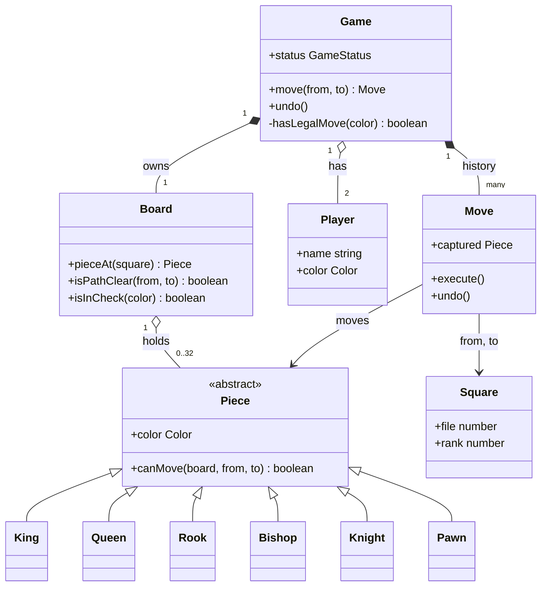
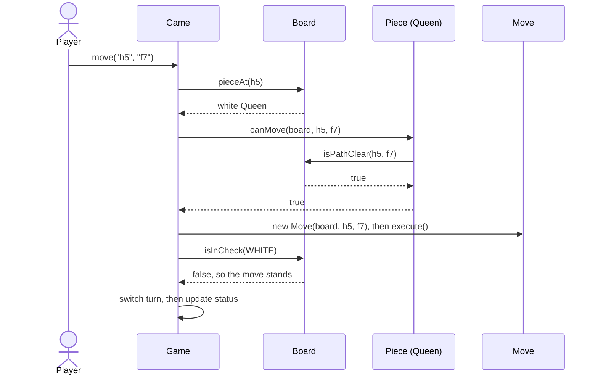
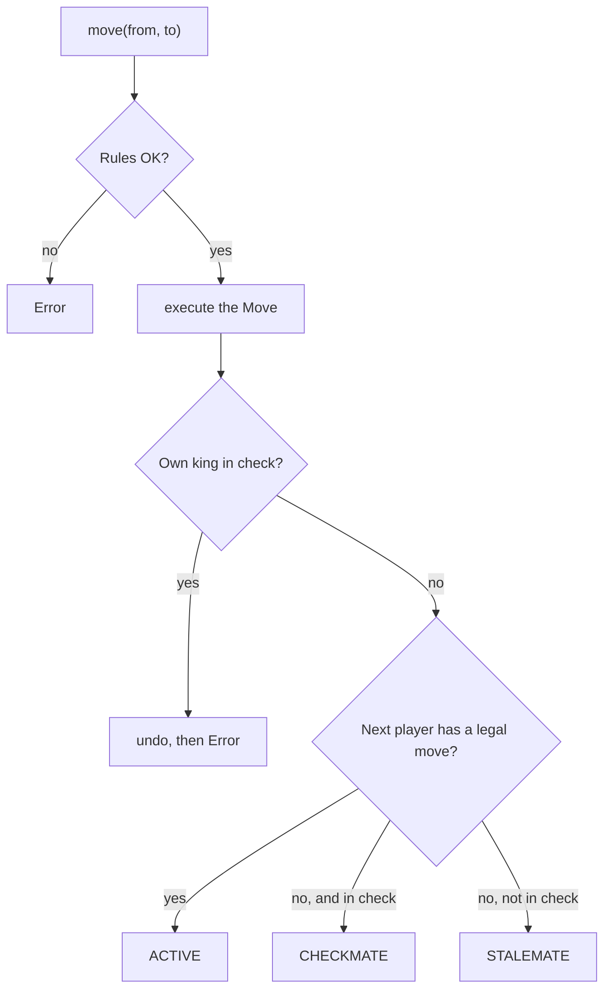

<Callout title="About this question">
  **Difficulty:** Hard. **Patterns used:** [Polymorphism](../oop-basics/polymorphism.mdx) with an
  [abstract class](../oop-basics/interfaces-abstract-classes.mdx), [Command](../design-patterns/command.mdx) for
  undo, [Factory](../design-patterns/factory.mdx) for the starting board.
  **Also asked as:** "Design a chess game", "Design an online chess board", "Design a board game engine".
</Callout>

## Understand the problem

Think of a box of chess toys. Every toy follows its own rule. The knight jumps in an L. The rook slides in straight
lines. The bishop slides on diagonals. Nobody needs a big rule book that says "if it is a knight, do this; if it is
a rook, do that". You just ask each toy: "can you go there?"

What makes it interesting:

- **Six kinds of pieces, one question.** Each piece answers `canMove` in its own way. That is
  [polymorphism](../oop-basics/polymorphism.mdx).
- **Blocked paths.** A rook can't slide through other pieces. A knight can.
- **Check.** A move is not allowed if it leaves your own king under attack, even if the piece could move there.
- **Checkmate.** The game must notice when a player is in check and has no way out.
- **Undo.** Taking a move back must restore the captured piece too.

## Step 1: Requirements

### Functional requirements

1. Two players should be able to play on a standard 8×8 board, White first, taking turns.
2. Users should be able to move a piece from one square to another, like `e2` to `e4`.
3. The system should reject moves that break a piece's rule, go through other pieces, take your own piece, or
   leave your king in check.
4. Users should be able to capture an enemy piece by moving onto its square.
5. The system should detect checkmate (and stalemate) and end the game.
6. Users should be able to undo moves, one at a time.

### Out of scope

- Castling, en passant and pawn promotion (see "Adding features").
- Draws by repetition or the 50-move rule, chess clocks, and a computer opponent.
- The screen that draws the board.

### Questions to ask the interviewer

| Question | What we assume |
| --- | --- |
| Do we need every chess rule? | No. The core moves, capture, check and checkmate. The special moves come later. |
| How are moves given? | As two square names, like `move('e2', 'e4')`. |
| Do we need undo? | Yes, any number of moves back. |
| Is it played over a network? | Not in the core design. We discuss two requests at once at the end. |

## Step 2: Core classes

| Class | What it is | Key data | Key actions |
| --- | --- | --- | --- |
| `Square` | One spot on the board, like `e4` | file (a–h), rank (1–8) | `Square.at('e4')`, `toString` |
| `Board` | The 8×8 grid of pieces | the grid | `pieceAt`, `place`, `isPathClear`, `isInCheck` |
| `Piece` (abstract) | Any chess piece | color | `canMove(board, from, to)` |
| `King`, `Queen`, `Rook`, `Bishop`, `Knight`, `Pawn` | The six kinds of piece | – | their own `canMove` |
| `Player` | A person playing one color | name, color | – |
| `Move` | One move, which can undo itself | piece, from, to, captured piece | `execute`, `undo` |
| `Game` | The match: turns, rules and status | players, board, history, status | `move`, `undo` |

**Enums:**

- `Color`: `WHITE`, `BLACK`.
- `GameStatus`: `ACTIVE`, `CHECKMATE`, `STALEMATE`.

## Step 3: Class diagram



Key choices:

- **`Piece` is abstract, and each piece has its own `canMove`.** `Game` never asks "what kind of piece is this?".
  In Java, `Piece` would be an `abstract class` with `abstract boolean canMove(...)`.
- **`canMove` holds only the piece's own rule.** Rules shared by every piece (whose turn, don't take your own piece,
  don't leave your king in check) live once in `Game`.
- **`Square` is a small value: file and rank.** The `Board` keeps an 8×8 grid of pieces.
- **`Move` is a Command.** It remembers the captured piece, so `undo` can put it back. See
  [Command](../design-patterns/command.mdx).
- **Composition for Game → Board.** The board lives and dies with the game.

## Step 4: Main methods

| Method | What it does |
| --- | --- |
| `Game.move(from, to)` | Checks every rule, makes the move, switches turn, and updates the status. Returns the `Move`. |
| `Game.undo()` | Takes back the last move and gives the turn back. |
| `Piece.canMove(board, from, to)` | True if this piece's own rule allows it (shape and path). |
| `Board.isPathClear(from, to)` | True if every square between `from` and `to` is empty. Used by rook, bishop and queen. |
| `Board.isInCheck(color)` | True if any enemy piece can reach this color's king. |
| `Move.execute()` / `Move.undo()` | Moves the piece, or puts the piece and any captured piece back. |

The main flow, one move:



**How check and checkmate work:**

1. **Check:** find the king. Ask every enemy piece "can you move to the king's square?". This reuses `canMove`, so
   there is no extra rule per piece. (A pawn's `canMove` already allows a diagonal step only onto an enemy piece,
   and the king is an enemy piece.)
2. **A legal move:** the piece's rule allows it, and after making it, your own king is not in check. We find out by
   doing the move, checking, and undoing it if needed.
3. **Checkmate:** the player to move is in check and has **no** legal move. We try every move of every piece of
   theirs, and undo each one.
4. **Stalemate:** no legal move, but **not** in check. The game is a draw.



## Step 5: Code

The code is split into small parts. Run all of them together, in order, as one `.mjs` file.

### Part 1: Enums, squares and players

The enums are plain objects with fixed values.

```js
const Color = {
    WHITE: "WHITE",
    BLACK: "BLACK",
};

const GameStatus = {
    ACTIVE: "ACTIVE",
    CHECKMATE: "CHECKMATE",
    STALEMATE: "STALEMATE",
};
```

`Square` turns `"e2"` into two numbers. `static` means you call the method on the class itself: `Square.at("e2")`.

```js
// One spot on the board.
// file 0-7 means the columns a-h. rank 0-7 means the rows 1-8.
class Square {
    constructor(file, rank) {
        this.file = file;
        this.rank = rank;
    }

    // Turn a name like "e2" into a Square.
    static at(name) {
        // A letter from a to h, then a digit from 1 to 8.
        if (!/^[a-h][1-8]$/.test(name)) {
            throw new Error(`Bad square: ${name}`);
        }

        // "a" becomes 0, "b" becomes 1, and so on. 97 is the code of "a".
        const file = name.charCodeAt(0) - 97;
        // "1" becomes 0, "2" becomes 1, and so on.
        const rank = Number(name[1]) - 1;
        return new Square(file, rank);
    }
```

The rest of `Square` lists all 64 squares and turns a square back into its name. Then a small `Player` class.

```js
    // All 64 squares, row by row.
    static all() {
        const squares = [];
        for (let rank = 0; rank < 8; rank++) {
            for (let file = 0; file < 8; file++) {
                squares.push(new Square(file, rank));
            }
        }
        return squares;
    }

    // Turn the square back into a name like "e2".
    // JavaScript calls this when a square is put in a string, like `${square}`.
    toString() {
        const letter = String.fromCharCode(97 + this.file);
        const number = this.rank + 1;
        return letter + number;
    }
}

class Player {
    constructor(name, color) {
        this.name = name;
        this.color = color;
    }
}
```

### Part 2: The pieces

One abstract class and six small ones. Each `canMove` is only the piece's own rule.

```js
// The base for all pieces. "Abstract": you only make the six real pieces.
class Piece {
    constructor(color) {
        if (this.constructor === Piece) {
            throw new Error("Piece is abstract");
        }
        this.color = color;
    }

    // The letter used in move names: "K", "Q", ... and "" for a pawn.
    getLetter() {
        throw new Error("not implemented");
    }

    // The piece's own movement rule.
    // The Game checks turns, own pieces and check.
    canMove(board, from, to) {
        throw new Error("not implemented");
    }
}

// How far a move goes.
// files: steps left (-) or right (+). ranks: steps down (-) or up (+).
function getDistance(from, to) {
    return {
        files: to.file - from.file,
        ranks: to.rank - from.rank,
    };
}
```

The king and the knight only care about the shape of the move. The knight jumps, so pieces in the way don't matter.

```js
class King extends Piece {
    getLetter() {
        return "K";
    }

    // One square in any direction.
    canMove(board, from, to) {
        const distance = getDistance(from, to);
        const filesMoved = Math.abs(distance.files);
        const ranksMoved = Math.abs(distance.ranks);
        return Math.max(filesMoved, ranksMoved) === 1;
    }
}

class Knight extends Piece {
    getLetter() {
        return "N";
    }

    // An L shape: 1 by 2, or 2 by 1.
    canMove(board, from, to) {
        const distance = getDistance(from, to);
        const filesMoved = Math.abs(distance.files);
        const ranksMoved = Math.abs(distance.ranks);
        return filesMoved * ranksMoved === 2;
    }
}
```

The rook and the bishop slide, so the path must be clear. The shape is checked first, because `isPathClear` only works on straight lines and diagonals.

```js
class Rook extends Piece {
    getLetter() {
        return "R";
    }

    // A straight line, with nothing in the way.
    canMove(board, from, to) {
        const distance = getDistance(from, to);
        const straight = distance.files === 0 || distance.ranks === 0;
        if (!straight) {
            return false;
        }
        return board.isPathClear(from, to);
    }
}

class Bishop extends Piece {
    getLetter() {
        return "B";
    }

    // A diagonal, with nothing in the way.
    canMove(board, from, to) {
        const distance = getDistance(from, to);
        const diagonal = Math.abs(distance.files) === Math.abs(distance.ranks);
        if (!diagonal) {
            return false;
        }
        return board.isPathClear(from, to);
    }
}
```

The queen moves like a rook or a bishop:

```js
class Queen extends Piece {
    getLetter() {
        return "Q";
    }

    // A straight line or a diagonal, with nothing in the way.
    canMove(board, from, to) {
        const distance = getDistance(from, to);
        const straight = distance.files === 0 || distance.ranks === 0;
        const diagonal = Math.abs(distance.files) === Math.abs(distance.ranks);
        if (!straight && !diagonal) {
            return false;
        }
        return board.isPathClear(from, to);
    }
}
```

The pawn has the most rules. It moves forward, but captures diagonally.

```js
class Pawn extends Piece {
    getLetter() {
        return "";
    }

    canMove(board, from, to) {
        const distance = getDistance(from, to);
        const target = board.pieceAt(to);

        // White moves up the board (+1) and starts on rank 1.
        // Black moves down (-1) and starts on rank 6.
        let forward = -1;
        let startRank = 6;
        if (this.color === Color.WHITE) {
            forward = 1;
            startRank = 1;
        }

        // One step forward, onto an empty square.
        if (distance.files === 0 && distance.ranks === forward) {
            return target === null;
        }

        // Two steps forward from the start. Both squares must be empty.
        if (distance.files === 0 && distance.ranks === 2 * forward && from.rank === startRank) {
            const middle = new Square(from.file, from.rank + forward);
            return target === null && board.pieceAt(middle) === null;
        }

        // A capture: one step diagonally forward, onto an enemy piece.
        if (Math.abs(distance.files) === 1 && distance.ranks === forward) {
            return target !== null && target.color !== this.color;
        }

        return false;
    }
}
```

### Part 3: The board

`Board` holds an 8×8 grid. It answers "is the path clear?" and "is this king in check?". First, the grid itself:

```js
// The 8×8 grid of pieces. Each cell is a Piece or null.
class Board {
    constructor() {
        // grid[rank][file]: 8 rows of 8 empty cells.
        this.grid = [];
        for (let rank = 0; rank < 8; rank++) {
            const row = new Array(8).fill(null);
            this.grid.push(row);
        }
    }

    pieceAt(square) {
        return this.grid[square.rank][square.file];
    }

    place(square, piece) {
        this.grid[square.rank][square.file] = piece;
    }
```

`standard()` is a factory method. It builds the starting position in one place.

```js
    static standard() {
        const board = new Board();

        // The back row, from file a to file h.
        const backRow = [Rook, Knight, Bishop, Queen, King, Bishop, Knight, Rook];

        for (let file = 0; file < 8; file++) {
            // backRow[file] is a class, so "new PieceClass(...)" makes that kind of piece.
            const PieceClass = backRow[file];

            board.place(new Square(file, 0), new PieceClass(Color.WHITE));
            board.place(new Square(file, 1), new Pawn(Color.WHITE));
            board.place(new Square(file, 6), new Pawn(Color.BLACK));
            board.place(new Square(file, 7), new PieceClass(Color.BLACK));
        }

        return board;
    }
```

`isPathClear` walks one square at a time from `from` towards `to`. It stops just before `to`.

```js
    // True if every square between "from" and "to" is empty.
    isPathClear(from, to) {
        // The direction of one step: -1, 0 or +1 for each.
        const fileStep = Math.sign(to.file - from.file);
        const rankStep = Math.sign(to.rank - from.rank);

        // Start one step after "from".
        let file = from.file + fileStep;
        let rank = from.rank + rankStep;

        while (file !== to.file || rank !== to.rank) {
            if (this.grid[rank][file] !== null) {
                return false;
            }
            file += fileStep;
            rank += rankStep;
        }

        return true;
    }
```

`isInCheck` finds the king, then asks every enemy piece "can you move to the king's square?". It reuses `canMove`, so there is no extra rule per piece.

```js
    isInCheck(color) {
        const squares = Square.all();

        // First, find this color's king. "instanceof King" means "is it a King?".
        let kingSquare;
        for (const square of squares) {
            const piece = this.pieceAt(square);
            if (piece instanceof King && piece.color === color) {
                kingSquare = square;
                break;
            }
        }

        // Then ask every enemy piece if it can reach the king.
        for (const square of squares) {
            const piece = this.pieceAt(square);
            const isEnemy = piece !== null && piece.color !== color;
            if (isEnemy && piece.canMove(this, square, kingSquare)) {
                return true;
            }
        }

        return false;
    }
}
```

### Part 4: The move

`Move` is a [Command](../design-patterns/command.mdx). It remembers the captured piece, so it can undo itself.

```js
class Move {
    constructor(board, from, to) {
        this.board = board;
        this.from = from;
        this.to = to;
        this.piece = board.pieceAt(from);

        // The piece that was on "to", or null if the square was empty.
        this.captured = board.pieceAt(to);
    }

    execute() {
        this.board.place(this.to, this.piece);
        this.board.place(this.from, null);
    }

    // Put the piece back, and put back any captured piece.
    undo() {
        this.board.place(this.from, this.piece);
        this.board.place(this.to, this.captured);
    }

    // The move as text, like "Qh5xf7". "x" means a capture.
    toString() {
        let separator = "-";
        if (this.captured !== null) {
            separator = "x";
        }
        return `${this.piece.getLetter()}${this.from}${separator}${this.to}`;
    }
}
```

### Part 5: The game

`Game` holds the turns, the history and the rules shared by every piece.

```js
class Game {
    // If no board is given, the game starts from the normal position.
    constructor(white, black, board = Board.standard()) {
        this.players = [white, black];
        this.board = board;
        this.status = GameStatus.ACTIVE;

        // The moves made so far, so we can undo them.
        this.history = [];

        // Whose turn it is: 0 is white, 1 is black.
        this.turn = 0;
    }

    getCurrentPlayer() {
        return this.players[this.turn];
    }

    // The moves as text, like ["e2-e4", "e7-e5"].
    getMoveNames() {
        const names = [];
        for (const move of this.history) {
            names.push(move.toString());
        }
        return names;
    }
```

`move` checks the rules, then tries the move. If the move leaves your own king in check, it takes it back.

```js
    move(fromName, toName) {
        if (this.status !== GameStatus.ACTIVE) {
            throw new Error(`Game over: ${this.status}`);
        }

        const from = Square.at(fromName);
        const to = Square.at(toName);
        const piece = this.board.pieceAt(from);
        this.checkRules(piece, from, to);

        // Try the move, and take it back if it leaves our king in check.
        const move = new Move(this.board, from, to);
        move.execute();
        if (this.board.isInCheck(piece.color)) {
            move.undo();
            throw new Error("That move leaves your king in check");
        }

        this.history.push(move);

        // Switch the turn: 0 becomes 1, and 1 becomes 0.
        this.turn = 1 - this.turn;
        this.updateStatus();
        return move;
    }
```

`checkRules` holds the rules before a move. Only the last one depends on the piece.

```js
    checkRules(piece, from, to) {
        if (!piece) {
            throw new Error(`No piece on ${from}`);
        }

        const player = this.getCurrentPlayer();
        if (piece.color !== player.color) {
            throw new Error(`It is ${player.name}'s turn`);
        }

        const target = this.board.pieceAt(to);
        if (target !== null && target.color === piece.color) {
            throw new Error("You cannot take your own piece");
        }

        // The piece's own rule. "constructor.name" is the class name, like "Rook".
        if (!piece.canMove(this.board, from, to)) {
            throw new Error(`${piece.constructor.name} can't move from ${from} to ${to}`);
        }
    }
```

`undo` takes back the last move. `updateStatus` runs after every move and looks for checkmate or stalemate.

```js
    undo() {
        const move = this.history.pop();
        if (!move) {
            throw new Error("Nothing to undo");
        }

        move.undo();
        this.turn = 1 - this.turn;
        this.status = GameStatus.ACTIVE;
    }

    updateStatus() {
        const color = this.getCurrentPlayer().color;
        if (this.hasLegalMove(color)) {
            return;
        }

        // No legal move. In check: checkmate. Not in check: stalemate (a draw).
        if (this.board.isInCheck(color)) {
            this.status = GameStatus.CHECKMATE;
        } else {
            this.status = GameStatus.STALEMATE;
        }
    }
```

`hasLegalMove` tries every move of every piece of one color. It stops at the first move that keeps the king safe.

```js
    hasLegalMove(color) {
        const squares = Square.all();

        for (const from of squares) {
            // Skip empty squares and the other player's pieces.
            const piece = this.board.pieceAt(from);
            const isOurs = piece !== null && piece.color === color;
            if (!isOurs) {
                continue;
            }

            for (const to of squares) {
                if (this.isSafeMove(piece, from, to)) {
                    return true;
                }
            }
        }

        return false;
    }
```

Last, `isSafeMove` checks one move: do it, look for check, then undo it.

```js
    isSafeMove(piece, from, to) {
        const target = this.board.pieceAt(to);
        if (target !== null && target.color === piece.color) {
            return false;
        }
        if (!piece.canMove(this.board, from, to)) {
            return false;
        }

        const move = new Move(this.board, from, to);
        move.execute();
        const kingIsSafe = !this.board.isInCheck(piece.color);
        move.undo();
        return kingIsSafe;
    }
}
```

### Part 6: Try it

Some moves that break the rules, then "Scholar's mate", a famous four-move checkmate, then undo. `tryMove` prints the error message when a move is refused.

```js
const asha = new Player("Asha", Color.WHITE);
const ben = new Player("Ben", Color.BLACK);
const game = new Game(asha, ben);

function tryMove(from, to) {
    try {
        game.move(from, to);
    } catch (error) {
        console.log(error.message);
    }
}
```

First, moves the rules don't allow:

```js
// The rook is blocked by its own pawn on a2.
tryMove("a1", "a3"); // Rook can't move from a1 to a3

// White moves first.
tryMove("e7", "e5"); // It is Asha's turn

// Not an L shape.
tryMove("g1", "g3"); // Knight can't move from g1 to g3
```

Then Scholar's mate. Moves that work print nothing.

```js
tryMove("e2", "e4");
tryMove("e7", "e5");
tryMove("d1", "h5");

// The pawn on f7 is pinned (see below).
tryMove("f7", "f6"); // That move leaves your king in check

// A knight jumps over pieces.
tryMove("b8", "c6");
tryMove("f1", "c4");
tryMove("g8", "f6");

// The queen takes the pawn on f7.
tryMove("h5", "f7");

const moveNames = game.getMoveNames();
console.log(moveNames.join(" ")); // e2-e4 e7-e5 Qd1-h5 Nb8-c6 Bf1-c4 Ng8-f6 Qh5xf7
console.log(game.status, game.board.isInCheck(Color.BLACK)); // CHECKMATE true
```

Last, undo the final move. The queen goes back, and the pawn comes back.

```js
game.undo();

const player = game.getCurrentPlayer();
const pieceOnF7 = game.board.pieceAt(Square.at("f7"));
console.log(game.status, player.name, pieceOnF7.constructor.name); // ACTIVE Asha Pawn
```

- **Why is `f7` to `f6` refused?** The pawn on f7 is the only thing between the queen on h5 and the black king on
  e8. If it moves, the king is in check. The pawn is **pinned**.
- **Why is the last move checkmate?** The queen on f7 attacks the king. The king can't take her, because the bishop
  on c4 guards f7. Every square next to the king is blocked or attacked, and no black piece can take the queen.

## Step 6: Edge cases and extensions

### Edge cases

| Case | What happens |
| --- | --- |
| A bad square name like `z9` | `Square.at` throws `Bad square: z9`. |
| No piece on the "from" square | `No piece on e5`. |
| Moving the other player's piece | `It is Asha's turn`. |
| Landing on your own piece | `You cannot take your own piece`. |
| A rook, bishop or queen with a piece in the way | `canMove` returns false, because `isPathClear` fails. |
| A pawn moving straight onto a piece | Refused. Pawns capture only diagonally. |
| A pinned piece moves, or the king steps into check | Done, checked, undone: `That move leaves your king in check`. |
| A move after checkmate | `Game over: CHECKMATE`. Undo still works. |
| Undo with no moves | `Nothing to undo`. |

### Two requests at once

On one computer, `move` is a single synchronous call, and the turn check stops a player from moving twice.

Online, a server might save each move to a database. If it does "check the turn, `await` the save, switch the
turn", a double-click can send two moves that both pass the turn check during the `await`. Two fixes:

1. **Switch the turn before the `await`.** Update the game in memory first (no `await` between the check and the
   write), then save. The second click now sees the wrong turn.
2. **Many servers: a version number.** Every move request says which move number it was made on, like "move 7". The
   database accepts it only if the game is still at move 7:
   `UPDATE games SET moves = moves || 'Qh5xf7', move_no = 8 WHERE id = 42 AND move_no = 7`. The second request
   changes 0 rows and is refused. This is called **optimistic locking**.

See [Race Conditions and Locks](../concurrency/race-conditions-locks.mdx).

### Adding features

**1. Pawn promotion.** A pawn that reaches the last rank becomes a queen. Add a new kind of `Move`, a new
[Command](../design-patterns/command.mdx). The pieces and the board don't change. `Game` only needs one small
factory method that picks which `Move` class to create.

```js
// Builds on the Step 5 code.
// A move where the pawn becomes a queen.
class PromotionMove extends Move {
    constructor(board, from, to) {
        super(board, from, to);
        this.queen = null;
    }

    execute() {
        // First, a normal move: the pawn goes to "to".
        super.execute();

        // Make the queen only once. If the move is done again
        // after an undo, the same queen comes back.
        if (this.queen === null) {
            this.queen = new Queen(this.piece.color);
        }

        // Swap the pawn for the queen.
        this.board.place(this.to, this.queen);
    }

    // undo() comes from Move. It already puts the pawn back on "from",
    // and any captured piece back on "to".
}
```

Try it on an empty board with one white pawn:

```js
const board = new Board();
board.place(Square.at("a7"), new Pawn(Color.WHITE));

const promotion = new PromotionMove(board, Square.at("a7"), Square.at("a8"));
promotion.execute();
console.log(board.pieceAt(Square.at("a8")).constructor.name); // Queen

promotion.undo();
const onA7 = board.pieceAt(Square.at("a7"));
const onA8 = board.pieceAt(Square.at("a8"));
console.log(onA7.constructor.name, onA8); // Pawn null
```

**2. Castling.** The king moves two squares and the rook jumps over it. Add a `CastleMove` command that moves both
pieces, and undoes both. Give each piece a `moveCount` (raised in `execute`, lowered in `undo`), because castling is
allowed only if neither piece has moved. The king must not be in check, or pass over an attacked square.

**3. En passant.** A pawn can capture an enemy pawn that just moved two squares past it. The rule needs the **last
move**, which `Game` already keeps in its history. Add an `EnPassantMove` command whose captured pawn is not on the
"to" square.

Saving and replaying a game is free: the history is a list of commands. Replay them on a fresh board.

## Patterns used

| Pattern | Where | Why |
| --- | --- | --- |
| [Polymorphism](../oop-basics/polymorphism.mdx) with an abstract class | `Piece` and its six subclasses | Each piece owns its movement rule. `Game` never checks the piece type. |
| [Command](../design-patterns/command.mdx) | `Move` with `execute` and `undo` | Undo, "try and take back" for check tests, and replay. |
| [Factory](../design-patterns/factory.mdx) | `Board.standard()` | One place builds the starting position. |
| [Open-Closed Principle](../design-principles/open-closed.mdx) | New pieces and new move types | Added as new classes, not new `if`s. |

## Follow-up questions

<Accordions>
<Accordion title="Why not put the check test inside each piece's canMove?">

Because it is the same for every piece. If each piece did it, the code would repeat six times, and `canMove` would
call `isInCheck`, which calls `canMove` again, forever. Keep `canMove` as the simple shape-and-path rule, and do the
"does this leave my king in check?" test once, in `Game`.

</Accordion>
<Accordion title="Trying every move to find checkmate sounds slow. Is it?">

Not for one game: at most 16 pieces × 64 squares, each with a quick check. Real chess engines need millions of
positions per second, so they use **bitboards**: each kind of piece is stored as a 64-bit number, one bit per
square, and moves are found with fast bit operations. Stockfish works this way.

</Accordion>
<Accordion title="How would you add a computer player?">

Make `Player` choose moves through a `MoveChooser` interface. A human player waits for a click. A computer player
searches possible moves and scores them. That is a [Strategy](../design-patterns/strategy.mdx), and `Game` stays the
same.

</Accordion>
<Accordion title="How would you support undo and redo?">

Keep two stacks. `undo` pops from the history stack, calls `undo()`, and pushes the move onto a redo stack. `redo`
pops from the redo stack and calls `execute()` again. Any new move clears the redo stack. This is the usual way
text editors do it too.

</Accordion>
</Accordions>

## What the interviewer expects

<Tabs items={['Mid-level', 'Senior', 'Staff']}>
<Tab value="Mid-level">

- An abstract `Piece` with one subclass per piece, each with its own `canMove`.
- A board, turns, capture, and blocked paths for sliding pieces.
- A clear `move` method that rejects bad moves with good messages.

</Tab>
<Tab value="Senior">

- Shared rules in `Game`, piece rules in `Piece`, and a clear reason for the split.
- Check by reusing `canMove`. Checkmate as "in check and no legal move".
- `Move` as a Command with undo, and "try, test, undo" for legal moves.
- A plan for castling, en passant and promotion.

</Tab>
<Tab value="Staff">

- Everything from senior, quickly.
- Online play: turn races, version numbers, saving games as move lists.
- Speed trade-offs (bitboards), and draws by repetition (keep a count of positions).
- Keeps the design small and says what to leave out.

</Tab>
</Tabs>

<Callout title="Remember this" type="success">
  - **Ask each piece** `canMove`. An abstract `Piece` and six subclasses: no `if (piece is a knight)`.
  - Rook, bishop and queen also need **`isPathClear`**. The knight jumps.
  - **Check:** can any enemy piece reach my king? **Legal move:** do it, check, undo if needed.
  - **Checkmate:** in check and no legal move. **Stalemate:** no legal move and not in check.
  - **`Move` is a Command** with `undo`. It remembers the captured piece.
</Callout>
