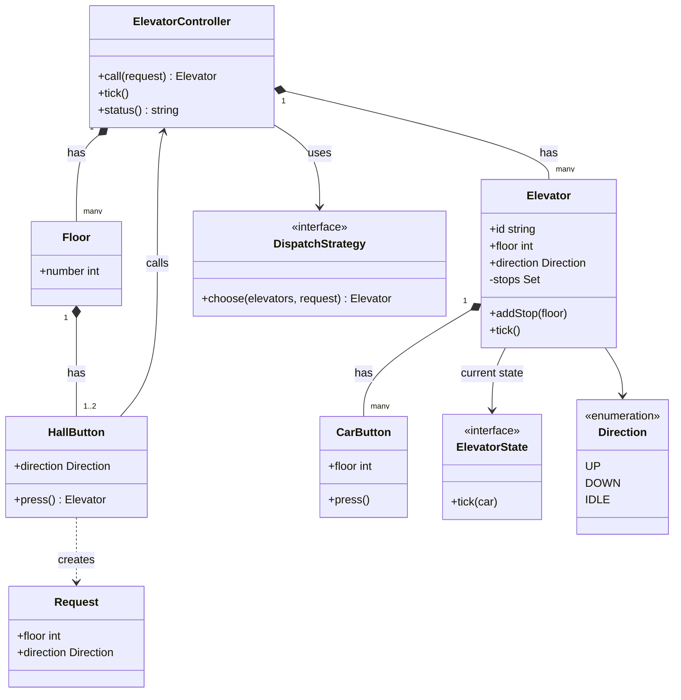
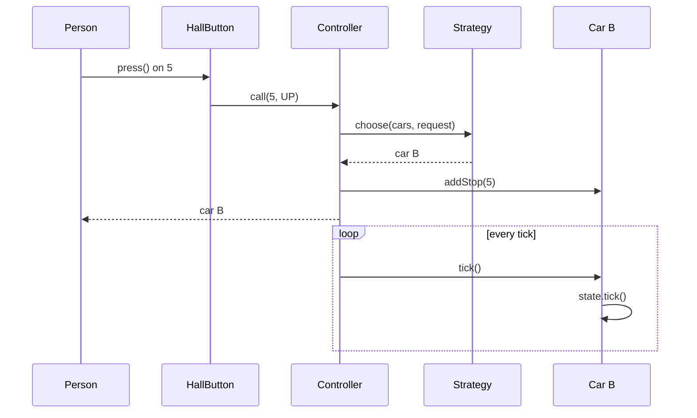
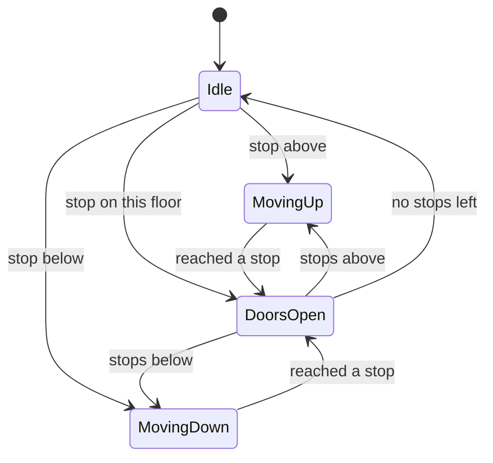

<Callout title="About this question">
  - **Difficulty:** Medium.
  - **Patterns used:** [State](../design-patterns/state.mdx) (what a car is doing now), [Strategy](../design-patterns/strategy.mdx) (which car answers a call).
  - **Also asked as:** "Design a lift system", "Design an elevator controller", "Elevators for a 50-floor office".
</Callout>

## Understand the problem

Think of an office building with two lifts. You stand on floor 5 and press **up**. One lift is picked and comes to you. You get in and press **9**. On the way, it stops for anyone else who wants to go up.

Three things make it interesting:

- **Two kinds of buttons.** A **hall button** is outside, on each floor: "I am on floor 5 and want to go up". The building must **choose a car** for it. A **car button** is inside a car: "take me to 9". It goes to that car only.
- **A car behaves differently in each state.** An idle car can start moving. A moving car can't open its doors. A car with open doors must close them first. This is the [State](../design-patterns/state.mdx) pattern.
- **The nearest car is not always the best.** A car 2 floors away that is going the other way can take longer than a car 3 floors away that is free. The choosing rule must be easy to swap: [Strategy](../design-patterns/strategy.mdx).

A car going up stops at every requested floor on the way, then turns around. This is called **SCAN**, or the "elevator algorithm". Hard disks use the same idea to order their reads. **LOOK** is a small improvement: turn around at the last request, not at the top floor.

## Step 1: Requirements

### Functional requirements

1. Users should be able to call a car from any floor with the **up** or **down** hall button.
2. Users should be able to choose a floor with the buttons inside a car.
3. The system should choose which car answers a hall call. The rule should be easy to change.
4. A car should stop at every requested floor in its direction before it turns around.
5. Users should be able to see each car's floor and what it is doing.

### Out of scope

- Weight limits, door sensors, fire and emergency modes.
- Real time and motors. Time moves in steps with `tick()`. One tick = move one floor, or open the doors, or close them.
- Button lights and floor displays (an extension later).

### Questions to ask the interviewer

| Question | What we assume |
| --- | --- |
| How many floors and cars? | 10 floors (0 to 9) and 2 cars. Both are settings. |
| Does every car go to every floor? | Yes. Zones (for example "floors 20 to 40 only") are an extension. |
| How do we choose a car for a hall call? | A rule we can swap. Start with "nearest car", then improve it. |
| Can a car turn around with people inside? | Only after it has served every stop in its current direction. |
| Do we model real time? | No. `tick()` moves the simulation one step, so tests are simple and give the same result every time. |

## Step 2: Core classes

| Class | What it is | Key data | Key actions |
| --- | --- | --- | --- |
| `Request` | A hall call: "someone on floor 5 wants to go up" | `floor`, `direction` | — |
| `HallButton` | The up or down button on a floor | `floor`, `direction` | `press()` |
| `CarButton` | A floor button inside one car | `floor`, its car | `press()` |
| `Floor` | One floor of the building | `number`, `upButton`, `downButton` | — |
| `Elevator` | One car | `id`, `floor`, `direction`, stops, `state` | `addStop(floor)`, `tick()` |
| `ElevatorState` (interface) | What the car is doing now: `IdleState`, `MovingUpState`, `MovingDownState`, `DoorsOpenState` | — | `tick(car)` |
| `DispatchStrategy` (interface) | The rule for choosing a car: `NearestCarStrategy`, `LookStrategy` | — | `choose(elevators, request)` |
| `ElevatorController` | The main service, the "brain" of the building | floors, cars, strategy | `call(request)`, `tick()`, `status()` |

**Enum:** `Direction`: `UP`, `DOWN`, `IDLE`.

Only hall calls become a `Request`. A car button already knows its car, so there is nothing to choose.

## Step 3: Class diagram



The four state classes implement `ElevatorState`. `NearestCarStrategy` and `LookStrategy` implement `DispatchStrategy`. They are left out of the picture to keep it small.

- **Composition for floors, cars and buttons.** They are created with the building and don't exist without it.
- **The state is an object, not a big `switch`.** `Elevator.tick()` just calls `this.state.tick(this)`. Each state class holds only its own rules.
- **The choosing rule is an interface.** The controller asks "which car?" and doesn't know how the answer is found.
- **Two jobs, two places.** The controller decides **which car** answers a call. The car decides **in what order** it visits its stops. Each class has one job.

## Step 4: Main methods

- `HallButton.press()` → `Elevator`. Makes a `Request`, sends it to the controller, and returns the car that will come.
- `CarButton.press()`. Adds a stop to its own car.
- `ElevatorController.call(request)` → `Elevator`. Asks the strategy for the best car and gives that car the stop.
- `ElevatorController.tick()`. Moves time one step for every car.
- `Elevator.addStop(floor)`. Adds a floor to the car's stops. Throws for a floor that doesn't exist.
- `Elevator.tick()`. Asks the current state what to do: move one floor, open the doors, or close them.
- `DispatchStrategy.choose(elevators, request)` → the car that should answer.

The main flow, from a hall call to the car moving:



How a car moves between its states:



## Step 5: Code

Run all the parts together as one `.mjs` file. Long classes come in a few pieces. Paste the pieces in order and they make the whole class.

### Part 1: The enum and small classes

**The direction and the request.** A request is a hall call: "someone on this floor wants to go this way".

```js
const Direction = {
    UP: "UP",
    DOWN: "DOWN",
    IDLE: "IDLE",
};

class Request {
    constructor(floor, direction) {
        this.floor = floor;
        this.direction = direction;
    }
}
```

**The buttons.** A hall button asks the controller to choose a car. A car button talks to its own car.

```js
// On a floor: the controller must choose a car.
class HallButton {
    constructor(floor, direction, controller) {
        this.floor = floor;
        this.direction = direction;
        this.controller = controller;
    }

    // Returns the car that will come.
    press() {
        const request = new Request(this.floor, this.direction);
        return this.controller.call(request);
    }
}

// Inside a car: goes straight to that car.
class CarButton {
    constructor(floor, car) {
        this.floor = floor;
        this.car = car;
    }

    press() {
        this.car.addStop(this.floor);
    }
}
```

**A floor.** Each floor has an up button and a down button, except at the ends.

```js
class Floor {
    constructor(number, topFloor, controller) {
        this.number = number;

        // The top floor has no up button.
        this.upButton = null;
        if (number < topFloor) {
            this.upButton = new HallButton(number, Direction.UP, controller);
        }

        // The ground floor has no down button.
        this.downButton = null;
        if (number > 0) {
            this.downButton = new HallButton(number, Direction.DOWN, controller);
        }
    }
}
```

### Part 2: The car and its states

Each state decides what one `tick()` does. The car only keeps its data and its stops.

**The state interface.** Every state has a name and a `tick(car)` method.

```js
class ElevatorState {
    constructor(name) {
        this.name = name;
    }

    tick(car) {
        throw new Error("not implemented");
    }
}
```

**Idle.** The car waits. When it gets a stop, it opens its doors here or starts moving.

```js
class IdleState extends ElevatorState {
    constructor() {
        super("Idle");
    }

    tick(car) {
        // Someone called it to this floor: open the doors.
        if (car.hasStop(car.floor)) {
            car.arrive();
            return;
        }

        // No stops anywhere: nothing to do.
        const next = car.nextMove();
        if (next instanceof IdleState) {
            return;
        }

        car.setState(next);
        // Start moving in this same step.
        next.tick(car);
    }
}
```

**Moving up and moving down.** Move one floor. If that floor is a stop, arrive.

```js
class MovingUpState extends ElevatorState {
    constructor() {
        super("MovingUp");
    }

    tick(car) {
        car.floor += 1;
        if (car.hasStop(car.floor)) {
            car.arrive();
        }
    }
}

class MovingDownState extends ElevatorState {
    constructor() {
        super("MovingDown");
    }

    tick(car) {
        car.floor -= 1;
        if (car.hasStop(car.floor)) {
            car.arrive();
        }
    }
}
```

**Doors open.** Close the doors, then decide where to go next.

```js
class DoorsOpenState extends ElevatorState {
    constructor() {
        super("DoorsOpen");
    }

    tick(car) {
        const next = car.nextMove();
        car.setState(next);
    }
}
```

**The `Elevator`, piece 1: its data and its stops.**

```js
class Elevator {
    constructor(id, floorCount, startFloor = 0) {
        this.id = id;
        this.floor = startFloor;
        this.direction = Direction.IDLE;
        this.state = new IdleState();
        // A Set: pressing 7 twice adds it once.
        this.stops = new Set();

        // One button inside the car for each floor.
        this.buttons = [];
        for (let floor = 0; floor < floorCount; floor++) {
            this.buttons.push(new CarButton(floor, this));
        }
    }

    addStop(floor) {
        if (floor < 0 || floor >= this.buttons.length) {
            throw new Error(`No floor ${floor}`);
        }

        // The doors are already open on this floor.
        if (floor === this.floor && this.state instanceof DoorsOpenState) {
            return;
        }

        this.stops.add(floor);
    }
```

**The `Elevator`, piece 2: changing state.** The states call these methods.

```js
    hasStop(floor) {
        return this.stops.has(floor);
    }

    // Change the state, and keep `direction` in step with it.
    // DoorsOpen keeps the old direction, so the car still knows which way it was going.
    setState(state) {
        this.state = state;

        if (state instanceof MovingUpState) {
            this.direction = Direction.UP;
        }
        if (state instanceof MovingDownState) {
            this.direction = Direction.DOWN;
        }
        if (state instanceof IdleState) {
            this.direction = Direction.IDLE;
        }
    }

    // Reached a stop: cross it off and open the doors.
    arrive() {
        this.stops.delete(this.floor);
        this.setState(new DoorsOpenState());
    }
```

**The `Elevator`, piece 3: where to go next.** This is LOOK: keep going the same way while there are stops ahead, then turn around.

```js
    nextMove() {
        let stopsAbove = false;
        let stopsBelow = false;
        for (const stop of this.stops) {
            if (stop > this.floor) {
                stopsAbove = true;
            }
            if (stop < this.floor) {
                stopsBelow = true;
            }
        }

        // Stops above, and not going down: go up, or keep going up.
        if (stopsAbove && this.direction !== Direction.DOWN) {
            return new MovingUpState();
        }

        // Stops below: go down. If we were going down, this keeps the direction.
        if (stopsBelow) {
            return new MovingDownState();
        }

        // Only stops above, but we were going down: turn around.
        if (stopsAbove) {
            return new MovingUpState();
        }

        return new IdleState();
    }
```

**The `Elevator`, piece 4: the end of the run, and `tick`.** These finish the `Elevator` class.

```js
    // Where this run ends: the highest stop going up, the lowest stop otherwise.
    lastStopAhead() {
        if (this.stops.size === 0) {
            return this.floor;
        }

        // Sort the stops as numbers, lowest first.
        // Without the compare function, sort() would compare them as text.
        const sorted = Array.from(this.stops);
        sorted.sort((first, second) => first - second);

        if (this.direction === Direction.UP) {
            return sorted[sorted.length - 1];
        }

        return sorted[0];
    }

    tick() {
        // Let the current state decide what this step does.
        this.state.tick(this);
    }

    toString() {
        return `${this.id}: floor ${this.floor}, ${this.state.name}`;
    }
}
```

### Part 3: Choosing a car

Two strategies. "Nearest" only counts floors. "LOOK" counts how many steps until the car really reaches you.

**The interface, a helper, and "nearest car".** Both strategies give each car a score, and pick the car with the lowest one.

```js
// The interface: a strategy picks one car for a request.
class DispatchStrategy {
    choose(elevators, request) {
        throw new Error("not implemented");
    }
}

// scoreOf is a function that gives a car a score.
// On a tie, the first car in the list wins.
function pickLowest(elevators, scoreOf) {
    let bestCar = elevators[0];
    for (const car of elevators) {
        if (scoreOf(car) < scoreOf(bestCar)) {
            bestCar = car;
        }
    }

    return bestCar;
}

class NearestCarStrategy extends DispatchStrategy {
    choose(elevators, request) {
        // The score is how many floors away the car is.
        return pickLowest(elevators, (car) => Math.abs(car.floor - request.floor));
    }
}
```

**LOOK.** The score is the number of steps until the car reaches the caller.

```js
class LookStrategy extends DispatchStrategy {
    choose(elevators, request) {
        return pickLowest(elevators, (car) => this.cost(car, request));
    }

    cost(car, request) {
        const distance = Math.abs(car.floor - request.floor);

        // A free car comes straight here.
        if (car.direction === Direction.IDLE) {
            return distance;
        }

        // Is the caller ahead of the car, in the way it is going?
        let isAhead;
        if (car.direction === Direction.UP) {
            isAhead = request.floor >= car.floor;
        } else {
            isAhead = request.floor <= car.floor;
        }

        // Ahead, and going the caller's way: it picks them up on the way.
        if (isAhead && car.direction === request.direction) {
            return distance;
        }

        // Otherwise it must finish its run first, then come back.
        const end = car.lastStopAhead();
        const toEnd = Math.abs(car.floor - end);
        const endToCaller = Math.abs(end - request.floor);
        return toEnd + endToCaller;
    }
}
```

### Part 4: The main service

The controller owns the floors and cars, and gets its strategy from outside.

**Piece 1: building the floors and cars.**

```js
class ElevatorController {
    constructor(floorCount, strategy) {
        this.strategy = strategy;
        this.elevators = [];

        // Floors 0 to floorCount - 1. The top floor is floorCount - 1.
        this.floors = [];
        for (let number = 0; number < floorCount; number++) {
            this.floors.push(new Floor(number, floorCount - 1, this));
        }
    }

    addElevator(id, startFloor = 0) {
        const car = new Elevator(id, this.floors.length, startFloor);
        this.elevators.push(car);
        return car;
    }
```

**Piece 2: calls, ticks and status.** These finish the `ElevatorController` class.

```js
    // A hall button was pressed.
    // No await between choosing the car and adding the stop.
    call(request) {
        const car = this.strategy.choose(this.elevators, request);
        car.addStop(request.floor);
        return car;
    }

    // Move time one step for every car.
    tick() {
        for (const car of this.elevators) {
            car.tick();
        }
    }

    // One line about every car, like "A: floor 3, MovingDown | B: floor 8, Idle".
    status() {
        const parts = this.elevators.map((car) => car.toString());
        return parts.join(" | ");
    }
}
```

### Part 5: Try it

Car A is at floor 4 and car B is at floor 8.

**A rider in car A goes down.**

```js
// Floors 0 to 9, using the LOOK rule.
const building = new ElevatorController(10, new LookStrategy());
const carA = building.addElevator("A", 4);
const carB = building.addElevator("B", 8);

// A rider in car A wants the ground floor.
carA.buttons[0].press();
building.tick();
console.log(building.status()); // A: floor 3, MovingDown | B: floor 8, Idle
```

**Someone on floor 5 wants to go up.** Which car should come?

```js
const request = new Request(5, Direction.UP);
const nearestRule = new NearestCarStrategy();
const nearestCar = nearestRule.choose(building.elevators, request);
console.log(nearestCar.id); // A

// The building uses LOOK when the real button is pressed.
const chosenCar = building.floors[5].upButton.press();
console.log(chosenCar.id); // B
```

"Nearest car" picks A: it is only 2 floors from floor 5. But A is going **down** to floor 0, so the rider waits 3 + 5 = 8 steps. LOOK picks B: it is free and 3 steps away.

**Let time run.**

```js
building.tick();
console.log(building.status()); // A: floor 2, MovingDown | B: floor 7, MovingDown

building.tick();
building.tick();
console.log(building.status()); // A: floor 0, DoorsOpen | B: floor 5, DoorsOpen

// The new rider in B wants floor 9.
carB.buttons[9].press();
building.tick();
console.log(building.status()); // A: floor 0, Idle | B: floor 5, MovingUp

for (let i = 0; i < 4; i++) {
    building.tick();
}
console.log(building.status()); // A: floor 0, Idle | B: floor 9, DoorsOpen
```

**A floor that doesn't exist, and a new rule.** Swapping the rule changes nothing else.

```js
try {
    carA.addStop(12);
} catch (error) {
    console.log(error.message); // No floor 12
}

building.strategy = new NearestCarStrategy();
const carForFloor1 = building.floors[1].upButton.press();
console.log(carForFloor1.id); // A
```

## Step 6: Edge cases and extensions

### Edge cases

| Case | What happens |
| --- | --- |
| A floor that doesn't exist | `addStop` throws "No floor 12". |
| The same button pressed 5 times | The stops are a `Set`, so the floor is added once. |
| A call on the floor where a car stands with open doors | Ignored. The doors are already open there. |
| A call on the floor where an idle car waits | Its cost is 0, so it is chosen. It opens its doors on the next tick. |
| A rider presses a floor behind the car | Added. The car serves it after it turns around (LOOK). |
| Two cars have the same cost | The first one in the list wins. To share the wear, rotate the order. |
| Up on the top floor, down on the ground floor | These buttons don't exist (`null`). |
| A car is broken | Extension: a `MaintenanceState`, and the strategies skip cars in it. |

### Two requests at once

Two people on different floors press their buttons at the same moment.

In JavaScript, each button press is one event, and the event loop runs one event at a time. `call()` has no `await`, so a press always finishes before the next one starts. The danger is an `await` between **choosing** a car and **giving it the stop**:

```js
// NOT SAFE. A fragment, not runnable on its own.
async call(request) {
    // Chosen from where the cars are now.
    const car = this.strategy.choose(this.elevators, request);

    // Ticks run while we wait, and the cars move on.
    await this.log.save(request);

    // The choice may be out of date.
    car.addStop(request.floor);
}
```

The fix: add the stop first, then do slow work like logging. Better still, keep one queue of events (button presses and ticks), and let the controller handle them one by one. See [Producer-Consumer](../concurrency/producer-consumer.mdx).

In Java, the controller would mark `call` and `tick` as `synchronized`, or run them all on one control thread. See [Race Conditions and Locks](../concurrency/race-conditions-locks.mdx).

### Adding features

- **Maintenance or fire mode:** add a `MaintenanceState` whose `tick()` does nothing. The strategies skip cars in that state. The other states don't change. This is [State](../design-patterns/state.mdx) and the [Open-Closed Principle](../design-principles/open-closed.mdx).
- **Express cars or zones** ("car C serves floors 20 to 40 only"): a new `DispatchStrategy` that filters cars first. The controller doesn't change. This is [Strategy](../design-patterns/strategy.mdx).
- **Floor displays** ("car B: floor 7, going up"): each car sends a "moved" event, and every display listens, like Node's `EventEmitter`. This is [Observer](../design-patterns/observer.mdx).

## Patterns used

| Pattern | Where | Why |
| --- | --- | --- |
| [State](../design-patterns/state.mdx) | `ElevatorState`: `IdleState`, `MovingUpState`, `MovingDownState`, `DoorsOpenState` | Each state has its own rules for a tick. No big `switch`. |
| [Strategy](../design-patterns/strategy.mdx) | `DispatchStrategy`: `NearestCarStrategy`, `LookStrategy` | Swap the car-choosing rule without touching the controller. |
| [Dependency Injection](../design-principles/dependency-injection.mdx) | `new ElevatorController(10, strategy)` | Tests and new buildings pass in the rule they need. |
| [Observer](../design-patterns/observer.mdx) (extension) | Floor displays | Cars don't need to know who is watching them. |

## Follow-up questions

<Accordions>
<Accordion title="Why state classes and not a status field with a switch?">

A `switch` works for four states. But every new state (maintenance, fire, overload) adds a case to every method, and one change can break another state. With state classes, each state's rules live in one small class. A new state is a new class.

</Accordion>
<Accordion title="What is the difference between SCAN and LOOK?">

Both keep going in one direction and serve the stops on the way. **SCAN** goes all the way to the top or bottom floor before it turns. **LOOK** turns around at the last requested floor. LOOK saves empty trips, so real lifts work like LOOK. `Elevator.nextMove()` above is LOOK.

</Accordion>
<Accordion title="How would you handle rush hour in a 50-floor tower?">

Two common ideas. **Zones:** some cars serve only low floors, some only high floors. **Destination dispatch:** riders type their floor in the lobby, and the system groups people going to nearby floors into the same car. Many new office towers use it. Both are new `DispatchStrategy` classes.

</Accordion>
<Accordion title="How do you test this?">

Time is a step (`tick()`), not a real clock. A test builds a controller, presses buttons, calls `tick()` a few times, and checks `status()`. There are no timers, so the test is fast and gives the same result every time.

</Accordion>
</Accordions>

## What the interviewer expects

<Tabs items={['Mid-level', 'Senior', 'Staff']}>
<Tab value="Mid-level">

- Clear classes: `Elevator`, `Floor`, buttons, `Request`, `ElevatorController`.
- Hall calls and car calls handled differently.
- A car that moves, stops at its floors, and goes idle.

</Tab>
<Tab value="Senior">

- The State pattern for the car, without being asked.
- A swappable dispatch strategy, and why "nearest" is not enough.
- LOOK for the order of stops, plus edge cases and a testable `tick()`.

</Tab>
<Tab value="Staff">

- Everything from senior, but faster.
- Rush hour: zones, destination dispatch, and how to measure wait time.
- One event queue for the controller, and what happens when a car breaks down mid-run.

</Tab>
</Tabs>

<Callout title="Remember this" type="success">
  - Hall button = "choose a car for me". Car button = "this car, take me there".
  - The controller picks **which** car (Strategy). The car picks the **order** of its stops (LOOK).
  - Car states are classes: Idle, MovingUp, MovingDown, DoorsOpen. `tick()` asks the current state what to do.
  - "Nearest car" can pick a car that is going away. Count the steps until it really reaches you.
  - Use `tick()` instead of real time, so the design is easy to test.
</Callout>
