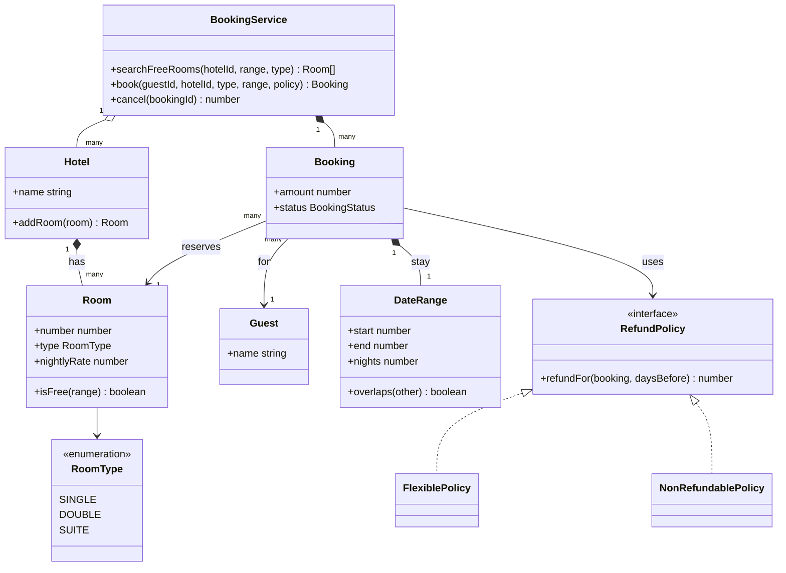
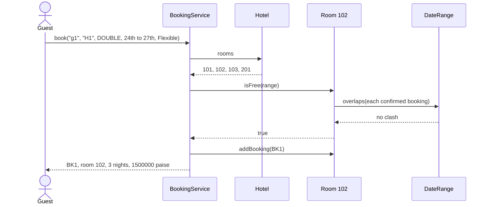

<Callout title="About this question">
  **Difficulty:** Hard. **Patterns used:** [Strategy](../design-patterns/strategy.mdx),
  [Facade](../design-patterns/facade.mdx), [Dependency Injection](../design-principles/dependency-injection.mdx),
  plus an atomic booking from [Race Conditions and Locks](../concurrency/race-conditions-locks.mdx).
  **Also asked as:** "Design a hotel reservation system", "Design Booking.com / Airbnb (the class design)".
</Callout>

## Understand the problem

Think of the big diary at a hotel front desk. Each room has a row, and each night has a column. When you book room
102 from the 24th to the 27th, the clerk writes your name in three boxes: the nights of the 24th, 25th and 26th. The
next guest can take room 102 from the 27th, because you leave that morning.

What makes it interesting:

- **Date ranges, not single slots.** A movie seat is taken for one show. A room is taken for a **range** of nights,
  and two ranges can overlap in part.
- **Cancellation rules differ.** A "free cancellation" booking gets money back. A cheaper "non-refundable" one gets
  nothing. The rule is picked when the guest books.
- **The last room.** Two guests click "Book" on the last free double room at the same moment. Only one may get it.

## Step 1: Requirements

### Functional requirements

1. Users should be able to search the free rooms of a hotel for a date range, with an optional room type.
2. Users should be able to book a room of a chosen type for a date range.
3. Users should be able to cancel a booking before check-in and get a refund based on its policy.
4. The system should never give one room to two guests for the same night.
5. Admins should be able to add hotels and rooms, each room with a type and a nightly rate.

### Out of scope

- Payment itself (we work out the amount and the refund, and assume a gateway moves the money).
- Searching many hotels by city, reviews, photos, and loyalty points.
- Check-in and check-out at the desk, and seasonal prices (see "Adding features").

### Questions to ask the interviewer

| Question | What we assume |
| --- | --- |
| Does the guest pick a room number, or a room type? | A type. The system picks a free room of that type. |
| Is check-out day a night of the stay? | No. 24th to 27th is 3 nights, and the room is free again on the 27th. |
| Is the price the same every night? | Yes, one nightly rate per room for now. |
| What refund rules exist? | "Flexible": full refund up to 2 days before check-in, after that the first night is kept. "Non-refundable": no money back. |
| One server or many? | One process first. Then the database rule for many servers. |

## Step 2: Core classes

| Class | What it is | Key data | Key actions |
| --- | --- | --- | --- |
| `Hotel` | One hotel building | name, city, rooms | `addRoom`, `rooms` |
| `Room` | One room to sleep in | number, type, nightly rate, its bookings | `isFree(range)`, `addBooking` |
| `Guest` | The person staying | id, name | – |
| `DateRange` | Check-in day to check-out day | start day, end day | `nights`, `overlaps(other)` |
| `Booking` | One guest's stay in one room | guest, room, range, amount, policy, status | – |
| `RefundPolicy` | The cancellation rule | – | `refundFor(booking, daysBefore)` |
| `BookingService` | The front door for the app | hotels, guests, bookings, clock | `searchFreeRooms`, `book`, `cancel` |

**Enums:**

- `RoomType`: `SINGLE`, `DOUBLE`, `SUITE`.
- `BookingStatus`: `CONFIRMED`, `CANCELLED`.

`DateRange` is a small class, not two loose dates. The overlap rule is easy to get wrong, so it lives in one place
and gets tested once.

## Step 3: Class diagram



Key choices:

- **Composition for Hotel → Room.** A room doesn't exist without its hotel.
- **Each `Room` also keeps a list of its own bookings.** Then the room can answer "am I free from the 24th to the
  27th?" by itself. The data and the check sit together.
- **`RefundPolicy` is an interface, chosen per booking.** The guest picks "flexible" or "non-refundable" at booking
  time, so the policy is stored on the `Booking`. See [Strategy](../design-patterns/strategy.mdx).
- **Cancelled bookings stay in the list** with status `CANCELLED`. `isFree` skips them. We keep the history, and
  the room is free again.
- **A clock is passed in.** "Is check-in in the past?" and "how many days before check-in?" both need today's date.

## Step 4: Main methods

| Method | What it does |
| --- | --- |
| `BookingService.searchFreeRooms(hotelId, range, type)` | Returns the rooms free for every night of the range. `type` is optional. |
| `BookingService.book(guestId, hotelId, type, range, policy)` | Finds a free room of that type and books it, in one synchronous call. |
| `BookingService.cancel(bookingId)` | Works out the refund with the booking's policy, then frees the room. Returns the refund in paise. |
| `Room.isFree(range)` | True if no confirmed booking of this room overlaps the range. |
| `DateRange.overlaps(other)` | `this.start < other.end && other.start < this.end`. |
| `RefundPolicy.refundFor(booking, daysBefore)` | Returns how much money goes back, in paise. |

**The overlap rule.** Ranges include the check-in day but not the check-out day. Two stays clash only if each starts
before the other ends:

| Stay | Nights | Clashes with Asha (24th to 27th)? |
| --- | --- | --- |
| Ben, 26th to 28th | 26th, 27th | Yes, the night of the 26th. |
| Dev, 27th to 29th | 27th, 28th | No. Asha leaves the morning Dev arrives. |
| Chen, 20th to 24th | 20th to 23rd | No. Chen leaves the morning Asha arrives. |

The main flow, booking a room:



## Step 5: Code

Money is in whole **paise** (₹1 = 100 paise). Dates are turned into whole **day numbers** (days since 1 Jan 1970),
so "how many nights?" is a simple subtraction. Run all the parts together as one `.mjs` file. Long classes come in a
few pieces. Paste the pieces in order and they make the whole class.

### Part 1: Enums and small classes

**The enums and helpers.**

```js
const RoomType = {
    SINGLE: "SINGLE",
    DOUBLE: "DOUBLE",
    SUITE: "SUITE",
};

const BookingStatus = {
    CONFIRMED: "CONFIRMED",
    CANCELLED: "CANCELLED",
};

// One day in milliseconds.
const DAY_MS = 24 * 60 * 60 * 1000;

// Whole days since 1 Jan 1970 (UTC).
function dayNumber(ms) {
    return Math.floor(ms / DAY_MS);
}

// Only for printing: 1500000 paise becomes "₹15000.00".
function rupees(paise) {
    const amount = paise / 100;
    return `₹${amount.toFixed(2)}`;
}
```

**`DateRange`: the overlap rule.** A stay counts the check-in day, but not the check-out day.

```js
class DateRange {
    // checkIn and checkOut are strings like "2026-12-24".
    constructor(checkIn, checkOut) {
        this.checkIn = checkIn;
        this.checkOut = checkOut;
        this.start = dayNumber(Date.parse(checkIn));
        this.end = dayNumber(Date.parse(checkOut));

        // Date.parse gives NaN ("not a number") for a date it can't read.
        if (Number.isNaN(this.start) || Number.isNaN(this.end)) {
            throw new Error("Use dates like 2026-12-24");
        }

        if (this.end <= this.start) {
            throw new Error("Check-out must be after check-in");
        }

        this.nights = this.end - this.start;
    }

    // Two stays clash only if each one starts before the other ends.
    overlaps(other) {
        return this.start < other.end && other.start < this.end;
    }

    // JavaScript calls this when a range is put in a string, like `${range}`.
    toString() {
        return `${this.checkIn} to ${this.checkOut}`;
    }
}
```

**Guest and Room.** A room keeps its own bookings, so it can answer "am I free?" by itself.

```js
class Guest {
    constructor(id, name) {
        this.id = id;
        this.name = name;
    }
}

class Room {
    constructor(number, type, nightlyRate) {
        this.number = number;
        // A RoomType.
        this.type = type;
        // Whole paise.
        this.nightlyRate = nightlyRate;
        this.bookings = [];
    }

    // Free if no confirmed booking overlaps the range. Cancelled bookings don't count.
    isFree(range) {
        for (const booking of this.bookings) {
            if (booking.status === BookingStatus.CONFIRMED && booking.range.overlaps(range)) {
                return false;
            }
        }

        return true;
    }

    addBooking(booking) {
        this.bookings.push(booking);
    }
}
```

**Hotel and a fake clock.** Tests use the fake clock to set "today" and jump forward.

```js
class Hotel {
    constructor(id, name, city) {
        this.id = id;
        this.name = name;
        this.city = city;
        this.rooms = [];
    }

    addRoom(room) {
        this.rooms.push(room);
        return room;
    }
}

class FakeClock {
    constructor(ms) {
        this.ms = ms;
    }

    now() {
        return this.ms;
    }

    advanceDays(days) {
        this.ms += days * DAY_MS;
    }
}
```

### Part 2: The core classes

**The refund rules.** This is the Strategy pattern: each rule is its own class with the same `refundFor` method.

```js
// The interface: every refund rule has refundFor(booking, daysBefore).
class RefundPolicy {
    refundFor(booking, daysBefore) {
        throw new Error("not implemented");
    }
}

class FlexiblePolicy extends RefundPolicy {
    refundFor(booking, daysBefore) {
        // Two or more days before check-in: full refund.
        if (daysBefore >= 2) {
            return booking.amount;
        }

        // Late: keep the first night.
        return booking.amount - booking.room.nightlyRate;
    }
}

class NonRefundablePolicy extends RefundPolicy {
    refundFor(booking, daysBefore) {
        return 0;
    }
}
```

**The `Booking`.** One guest's stay in one room. The price is worked out once, when it is made.

```js
class Booking {
    constructor(id, guest, room, range, policy) {
        this.id = id;
        this.guest = guest;
        this.room = room;
        this.range = range;
        // A RefundPolicy, picked when booking.
        this.policy = policy;
        // Whole paise.
        this.amount = range.nights * room.nightlyRate;
        this.status = BookingStatus.CONFIRMED;
        // Set when the booking is cancelled.
        this.refund = 0;
    }
}
```

### Part 3: The main service

`book` searches and saves in one synchronous call, so nothing can slip in between.

**Piece 1: the data, and adding hotels and guests.**

```js
class BookingService {
    constructor(clock) {
        this.clock = clock;
        // Id -> Hotel, id -> Guest, and id -> Booking.
        this.hotels = new Map();
        this.guests = new Map();
        this.bookings = new Map();
        // Used to make booking ids: BK1, BK2, and so on.
        this.nextId = 1;
    }

    addHotel(hotel) {
        this.hotels.set(hotel.id, hotel);
        return hotel;
    }

    addGuest(guest) {
        this.guests.set(guest.id, guest);
        return guest;
    }
```

**Piece 2: search.** It returns the rooms that are free for every night of the range. Leave out `type` to get every
type.

```js
    searchFreeRooms(hotelId, range, type = null) {
        const today = dayNumber(this.clock.now());
        if (range.start < today) {
            throw new Error("Check-in is in the past");
        }

        const hotel = this.find(this.hotels, hotelId);
        const freeRooms = [];
        for (const room of hotel.rooms) {
            const typeMatches = type === null || room.type === type;
            if (typeMatches && room.isFree(range)) {
                freeRooms.push(room);
            }
        }

        return freeRooms;
    }
```

**Piece 3: `book`.** It searches and saves in one call with no `await`, so two guests can't both get the last room.

```js
    book(guestId, hotelId, type, range, policy) {
        const guest = this.find(this.guests, guestId);

        // Search again here. Never trust an older search.
        const freeRooms = this.searchFreeRooms(hotelId, range, type);
        if (freeRooms.length === 0) {
            throw new Error(`No ${type} room free from ${range}`);
        }

        // Take the first free room.
        const room = freeRooms[0];
        const bookingId = `BK${this.nextId}`;
        this.nextId++;

        const booking = new Booking(bookingId, guest, room, range, policy);
        room.addBooking(booking);
        this.bookings.set(bookingId, booking);
        return booking;
    }
```

**Piece 4: `cancel`, and a lookup helper.** `cancel` returns the refund in paise. This finishes the `BookingService`
class.

```js
    cancel(bookingId) {
        const booking = this.find(this.bookings, bookingId);
        if (booking.status !== BookingStatus.CONFIRMED) {
            throw new Error(`${bookingId} is already ${booking.status}`);
        }

        const today = dayNumber(this.clock.now());
        const daysBefore = booking.range.start - today;
        if (daysBefore <= 0) {
            throw new Error(`Too late to cancel ${bookingId}: the stay has started`);
        }

        // The booking's own policy decides the refund.
        booking.refund = booking.policy.refundFor(booking, daysBefore);
        // Now the room is free again for these dates, because isFree skips cancelled bookings.
        booking.status = BookingStatus.CANCELLED;
        return booking.refund;
    }

    // Looks up an id in one of the Maps. Throws if it is not there.
    find(map, id) {
        const item = map.get(id);
        if (!item) {
            throw new Error(`Not found: ${id}`);
        }

        return item;
    }
}
```

### Part 4: Try it

One hotel with four rooms, overlapping stays, cancellations, and a race for the last suite.

**Set up the hotel.**

```js
// 1 Dec 2026. Months start at 0 in JavaScript, so 11 is December.
const clock = new FakeClock(Date.UTC(2026, 11, 1));
const service = new BookingService(clock);

const hotel = service.addHotel(new Hotel("H1", "Sea View", "Goa"));
// ₹3,000 a night, in paise.
hotel.addRoom(new Room(101, RoomType.SINGLE, 300000));
hotel.addRoom(new Room(102, RoomType.DOUBLE, 500000));
hotel.addRoom(new Room(103, RoomType.DOUBLE, 500000));
hotel.addRoom(new Room(201, RoomType.SUITE, 1200000));

service.addGuest(new Guest("g1", "Asha"));
service.addGuest(new Guest("g2", "Ben"));
service.addGuest(new Guest("g3", "Chen"));
service.addGuest(new Guest("g4", "Dev"));
```

**Cases 1 and 2: Asha books a double, and Ben's dates overlap hers.**

```js
// 1. Search, then book a double for Christmas (3 nights).
const xmas = new DateRange("2026-12-24", "2026-12-27");
const freeAtXmas = service.searchFreeRooms("H1", xmas);
console.log(freeAtXmas.map((room) => room.number)); // [ 101, 102, 103, 201 ]

const ashaBooking = service.book("g1", "H1", RoomType.DOUBLE, xmas, new FlexiblePolicy());
console.log(ashaBooking.id, ashaBooking.room.number, ashaBooking.range.nights, rupees(ashaBooking.amount));
// BK1 102 3 ₹15000.00

// 2. Ben's dates overlap Asha's, so he gets the other double.
const benStay = new DateRange("2026-12-26", "2026-12-28");
const benBooking = service.book("g2", "H1", RoomType.DOUBLE, benStay, new NonRefundablePolicy());
console.log(benBooking.id, benBooking.room.number); // BK2 103
```

**Cases 3 and 4: no double left, but back to back is fine.**

```js
// 3. No double is free on the 26th now.
const chenStay = new DateRange("2026-12-25", "2026-12-27");
try {
    service.book("g3", "H1", RoomType.DOUBLE, chenStay, new FlexiblePolicy());
} catch (error) {
    console.log(error.message); // No DOUBLE room free from 2026-12-25 to 2026-12-27
}

// 4. Asha leaves on the 27th, and Dev arrives on the 27th.
const devStay = new DateRange("2026-12-27", "2026-12-29");
const devBooking = service.book("g4", "H1", RoomType.DOUBLE, devStay, new FlexiblePolicy());
console.log(devBooking.id, devBooking.room.number); // BK3 102
```

**Cases 5 and 6: cancel, early and late.**

```js
// 5. Cancel on 20 Dec, four days before Christmas Eve.
clock.advanceDays(19);
const ashaRefund = service.cancel("BK1");
console.log(rupees(ashaRefund)); // ₹15000.00
const benRefund = service.cancel("BK2");
console.log(rupees(benRefund)); // ₹0.00

const freeDoubles = service.searchFreeRooms("H1", xmas, RoomType.DOUBLE);
console.log(freeDoubles.map((room) => room.number)); // [ 102, 103 ]

// 6. Dev cancels on 26 Dec, one day before check-in: the first night is kept.
clock.advanceDays(6);
const devRefund = service.cancel("BK3");
console.log(rupees(devRefund)); // ₹5000.00
```

**Case 7: two guests try to book the only suite at the same moment.** `Promise.resolve().then(...)` runs each try a
moment later, like a real request. `Promise.allSettled` waits for both, even if one fails.

```js
const newYearsEve = new DateRange("2026-12-31", "2027-01-01");
const chenTry = Promise.resolve().then(() => {
    return service.book("g3", "H1", RoomType.SUITE, newYearsEve, new FlexiblePolicy());
});
const ashaTry = Promise.resolve().then(() => {
    return service.book("g1", "H1", RoomType.SUITE, newYearsEve, new FlexiblePolicy());
});

const results = await Promise.allSettled([chenTry, ashaTry]);
for (const result of results) {
    if (result.status === "fulfilled") {
        const booking = result.value;
        console.log(`${booking.guest.name} got ${booking.room.number}`);
    } else {
        console.log(result.reason.message);
    }
}
// Chen got 201
// No SUITE room free from 2026-12-31 to 2027-01-01
```

## Step 6: Edge cases and extensions

### Edge cases

| Case | What happens |
| --- | --- |
| Check-out on or before check-in | `DateRange` throws `Check-out must be after check-in`. |
| A date like `24/12/2026` | `DateRange` throws `Use dates like 2026-12-24`. |
| Check-in in the past | `searchFreeRooms` (and so `book`) throws. |
| Back-to-back stays (one leaves on the 27th, one arrives on the 27th) | Allowed: the ranges don't overlap. |
| No room of that type is free | `book` throws `No DOUBLE room free from ...`. |
| Cancel twice | The second call throws `BK1 is already CANCELLED`. |
| Cancel on or after check-in day | Refused: `the stay has started`. |
| The search said "free", but the room went before the guest clicked "Book" | `book` searches again inside the same call, so it never trusts an old search. |

### Two requests at once

**What could race.** Two guests want the last double. In JavaScript, the danger is an `await` between "is a room
free?" and "save the booking":

```js
// Not runnable: a broken book(), to show the bug.
async book(guestId, hotelId, type, range, policy) {
    // Both guests see room 103 free.
    const freeRooms = this.searchFreeRooms(hotelId, range, type);
    const room = freeRooms[0];

    // Pause: the other guest runs here.
    const amount = range.nights * room.nightlyRate;
    await this.gateway.charge(guestId, amount);

    // Both save, so room 103 is sold twice.
    room.addBooking(new Booking(/* ... */));
}
```

**How to make it safe:**

1. **One synchronous call.** Our `book` finds the room and saves the booking with no `await` in between. Once it
   starts, it runs to the end, so the second guest sees the room taken. That is the result in case 7.
2. **If you charge the card first, hold the room first.** Save the booking as `HELD` with an end time, then pay,
   then confirm. Check again after the payment `await`. This is the same flow as
   [Design a Movie Ticket Booking System](./movie-ticket-booking.mdx).
3. **Many servers: let the database refuse a clash.** Two common ways:
   - Store one row per room per night, with a unique key on `(room_id, night)`. A clashing insert fails.
   - In PostgreSQL, an **exclusion constraint** on a date range column refuses two overlapping ranges for the same
     room. The PostgreSQL docs show it with a room booking example.

```sql
-- PostgreSQL. btree_gist lets the constraint also compare room_id with "=".
CREATE EXTENSION btree_gist;
CREATE TABLE bookings (
  room_id int,
  stay daterange, -- like '[2026-12-24, 2026-12-27)': check-out day not included
  status text,
  -- && means "overlaps". Cancelled rows stay, so only confirmed ones count.
  EXCLUDE USING gist (room_id WITH =, stay WITH &&) WHERE (status = 'CONFIRMED')
);
```

Without the `WHERE`, a cancelled booking would still block its dates, because we keep cancelled rows as history.

In Java, an interviewer may expect `synchronized` on `book`, or a lock per room type. In JavaScript, a method with
no `await` already runs to the end without a break. See [Race Conditions and Locks](../concurrency/race-conditions-locks.mdx),
and the [Ticket Booking system design](/learn/system-design/questions/ticket-booking) for the database side.

### Adding features

**1. A new refund rule.** Say, "50% back if you cancel 7 or more days before". Add one class. `Booking` and
`BookingService` don't change. That is [Strategy](../design-patterns/strategy.mdx), and it follows the
[Open-Closed Principle](../design-principles/open-closed.mdx).

```js
// Builds on the Step 5 code.
// 50% back if you cancel 7 or more days before check-in.
class HalfRefundPolicy extends RefundPolicy {
    refundFor(booking, daysBefore) {
        if (daysBefore >= 7) {
            return Math.round(booking.amount / 2);
        }

        return 0;
    }
}

// 2 nights in the single room.
const januaryStay = new DateRange("2027-01-10", "2027-01-12");
const januaryBooking = service.book("g2", "H1", RoomType.SINGLE, januaryStay, new HalfRefundPolicy());
const januaryRefund = service.cancel(januaryBooking.id);
console.log(januaryBooking.id, rupees(januaryBooking.amount), rupees(januaryRefund)); // BK5 ₹6000.00 ₹3000.00
```

**2. Weekend and holiday prices.** Move the nightly price into a `PricingStrategy` with `priceFor(room, night)`.
`Booking` adds up the price of each night. A "festival week" rule is one new class. Strategy again.

**3. A waitlist.** When a booking is cancelled, the service announces "room free for these dates". A waitlist
listener e-mails the first guest waiting for that type and range. This is the
[Observer](../design-patterns/observer.mdx) pattern: `cancel` doesn't need to know who is listening.

## Patterns used

| Pattern | Where | Why |
| --- | --- | --- |
| [Strategy](../design-patterns/strategy.mdx) | `RefundPolicy`, `FlexiblePolicy`, `NonRefundablePolicy` | New cancellation rules without changing `Booking` or the service. |
| [Facade](../design-patterns/facade.mdx) | `BookingService` | One simple front door over hotels, rooms and bookings. |
| [Dependency Injection](../design-principles/dependency-injection.mdx) | The clock is passed in | Tests can set "today" and jump forward. |
| Value object | `DateRange` | The overlap and nights rules live in one tested place. |

## Follow-up questions

<Accordions>
<Accordion title="Search is slow with 10,000 rooms and years of bookings. What do you do?">

Each `isFree` call loops over all of a room's bookings. Keep only future bookings in the room's list (move old ones
to history), and keep them sorted by start day, so you can stop early. In a database, index bookings by
`(room_id, start)`.

</Accordion>
<Accordion title="Should the guest book a room number or a room type?">

Most hotels sell a **type**, and pick the actual room at check-in. Our `book` already takes a type. To pick the room
late, store bookings per type with a count, and check that "booked doubles that night" is less than "number of
doubles". Assign room numbers at check-in.

</Accordion>
<Accordion title="How would you allow overbooking, like airlines do?">

Hotels sometimes sell a few more rooms than they have, because some guests never come. Make the "is there room?"
rule a Strategy: the normal rule allows `booked < rooms`, and the overbooking rule allows `booked < rooms + 2`.

</Accordion>
<Accordion title="Why is the refund policy stored on the booking and not on the hotel?">

Because the guest chose it when booking, often at a different price. If the hotel later changes its rules, old
bookings must keep the deal they were sold.

</Accordion>
</Accordions>

## What the interviewer expects

<Tabs items={['Mid-level', 'Senior', 'Staff']}>
<Tab value="Mid-level">

- Clear classes: Hotel, Room, Guest, Booking, a date range.
- A correct overlap check, with back-to-back stays allowed.
- Search, book and cancel working end to end.

</Tab>
<Tab value="Senior">

- Refund rules as a Strategy, stored on the booking.
- Explains the "last room" race and keeps `book` free of `await`.
- Knows the hold-then-pay flow when payment comes first.
- A database rule for many servers: one row per night, or an exclusion constraint.

</Tab>
<Tab value="Staff">

- Everything from senior, quickly.
- Booking by type with inventory counts, and overbooking as a rule.
- Fast search: indexes, keeping only future bookings, caching availability.
- Time zones and "nights" in the hotel's local time.

</Tab>
</Tabs>

<Callout title="Remember this" type="success">
  - A stay is a **range of nights**: check-in day included, check-out day not.
  - Two stays clash if `a.start < b.end && b.start < a.end`. Back-to-back is fine.
  - Put the overlap rule in a small **`DateRange`** class, and let each **`Room`** check its own bookings.
  - **Refund rules are a Strategy**, chosen and stored per booking.
  - `book` searches and saves **in one call with no `await`**. Many servers: the database refuses clashes.
</Callout>
