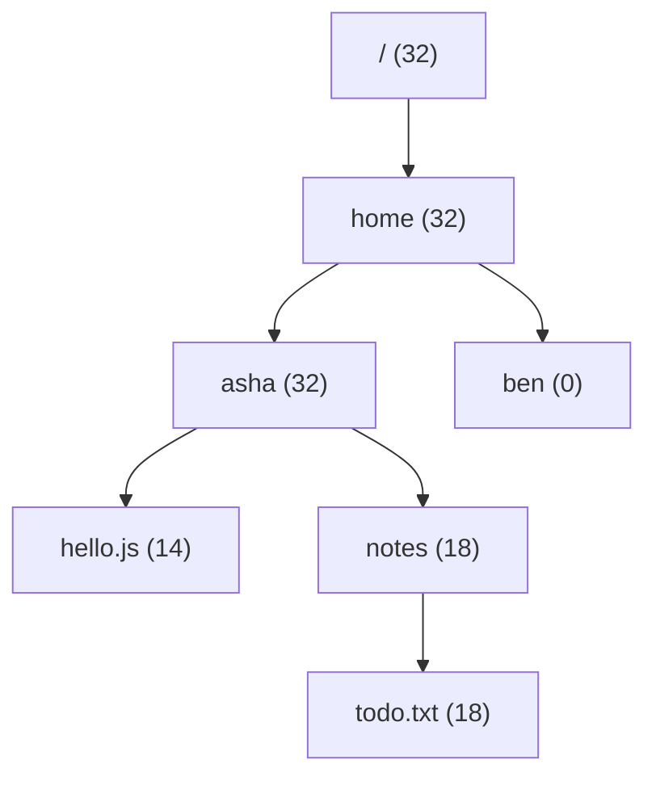
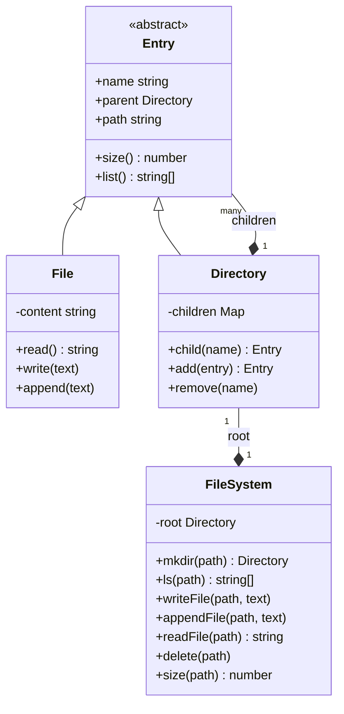
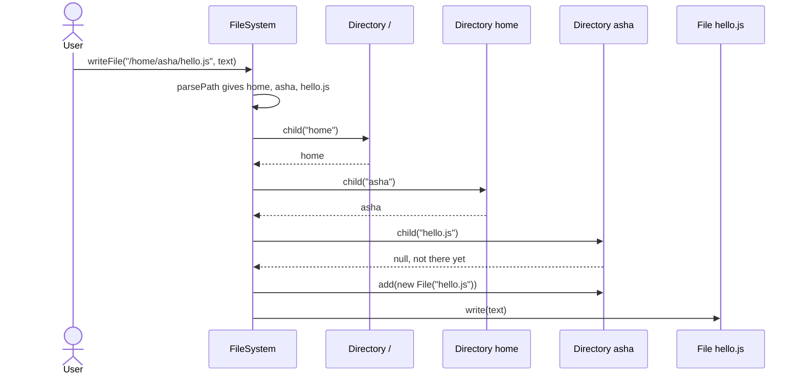

<Callout title="About this question">
  **Difficulty:** Hard. **Patterns used:** [Composite](../design-patterns/composite.mdx) with an
  [abstract class](../oop-basics/interfaces-abstract-classes.mdx), [Proxy](../design-patterns/proxy.mdx) for
  permissions (an extension). **Also asked as:** "Design In-Memory File System" (LeetCode 588), "Design a
  file explorer", "Design Unix `ls` and `mkdir`".
</Callout>

## Understand the problem

Think of a toy box that holds toys and smaller boxes. Each smaller box can hold toys and even smaller boxes. To ask
"how heavy is the big box?", you don't need to open everything yourself. You ask each thing inside: a toy says its
weight, and a box asks its own contents, then adds up the answers.

A file system works the same way. A **folder** (directory) holds files and other folders. A **path** like
`/home/asha/notes/todo.txt` is the list of folders you open, one by one, to reach a file.

What makes it interesting:

- **A tree of two kinds of things.** Files and folders are different, but some questions (name, size, path) work on
  both. This is the [Composite](../design-patterns/composite.mdx) pattern.
- **Paths must be parsed**, including odd ones like `/a//b/`.
- **Many ways to go wrong:** a path that doesn't exist, a file used as a folder, deleting `/`.

Here is the tree we build in the code below. Each number is a size in bytes. A folder's size is the sum of what is
inside it.



## Step 1: Requirements

### Functional requirements

1. Users should be able to make a folder, and every missing folder on the way, like `mkdir -p /a/b/c`.
2. Users should be able to list a folder's contents, sorted by name. Listing a file gives just its name.
3. Users should be able to write a file (replace its text) and append to a file. Both make the file if it is missing.
4. Users should be able to read a file.
5. Users should be able to delete a file, or a folder with everything inside it.
6. Users should be able to get the size of a file, or of a folder (the sum of everything inside).

### Out of scope

- Saving to disk, permissions, links, and moving or renaming (see "Adding features").
- Relative paths, `.` and `..` (we accept only full paths that start with `/`).
- Many users at once, file times, and very large files.

### Questions to ask the interviewer

| Question | What we assume |
| --- | --- |
| Does `writeFile` make missing folders? | No, like Node's `fs.writeFile`: the folder must exist. `mkdir` makes folders. |
| What does `ls` on a file return? | A list with just the file's name, like Unix `ls`. |
| Does `delete` on a folder delete its contents? | Yes, like `rm -r`. But never `/`. |
| How is size measured? | One character = one byte, to keep it simple. |
| How should errors look? | Like Node's: `ENOENT`, `ENOTDIR`, `EISDIR`. |

## Step 2: Core classes

| Class | What it is | Key data | Key actions |
| --- | --- | --- | --- |
| `Entry` (abstract) | Anything in the tree | name, parent | `path`, `size()`, `list()`, `isDirectory()` |
| `File` | A leaf: holds text | content | `read`, `write`, `append` |
| `Directory` | A branch: holds entries | children (a `Map` from name to entry) | `child(name)`, `add`, `remove` |
| `FileSystem` | The front door | the root folder `/` | `mkdir`, `ls`, `writeFile`, `appendFile`, `readFile`, `delete`, `size` |

Plus one helper function, `parsePath`, that turns `/home/asha` into `['home', 'asha']`.

**Enums:** none are needed. The error codes (`ENOENT`, `ENOTDIR`, `EISDIR`) sit in one frozen object.

Only four classes, and that is right for this problem. The power comes from the recursion in `size`, not from many
classes. See [DRY, KISS and YAGNI](../design-principles/dry-kiss-yagni.mdx).

## Step 3: Class diagram



Key choices:

- **Composite.** `Directory` holds `Entry` objects, and an `Entry` can be a `File` or another `Directory`. So
  `size()` on a folder just calls `size()` on each child, and the recursion does the rest.
- **Composition (filled diamond).** A child can't live without its folder: deleting a folder deletes everything in it.
- **`children` is a `Map` from name to entry.** Finding a child by name is fast, and names are unique in a folder for
  free.
- **Each entry knows its `parent`.** That gives us `path` (walk up to `/`) and `delete` (ask the parent to remove
  me) without searching.
- **Safe over transparent.** `size()` and `list()` are on every entry, because they make sense for both. But
  `read()` and `write()` are only on `File`. A folder has no "text", so we don't pretend it does.

## Step 4: Main methods

| Method | What it does |
| --- | --- |
| `FileSystem.mkdir(path)` | Walks the path and makes each missing folder. Fails if a file is in the way. |
| `FileSystem.ls(path)` | A folder: its children's names, sorted. A file: just its name. |
| `FileSystem.writeFile(path, text)` | Replaces the file's text. Makes the file if missing. The folder must exist. |
| `FileSystem.appendFile(path, text)` | Adds text to the end. Makes the file if missing. |
| `FileSystem.readFile(path)` | Returns the text. Fails on a folder. |
| `FileSystem.delete(path)` | Removes a file, or a folder with everything inside. Never `/`. |
| `FileSystem.size(path)` | A file: its length. A folder: the sum of its children's sizes. |
| `Entry.size()` / `Entry.list()` | The Composite methods. Each class answers in its own way. |

The main flow, writing a file:



## Step 5: Code

Run all the parts together as one `.mjs` file.

**Part 1: errors and path parsing.** Error messages look like Node's, and `parsePath` turns a path into a list of
names.

```js
const ERRORS = Object.freeze({
  ENOENT: 'no such file or directory',
  ENOTDIR: 'not a directory',
  EISDIR: 'illegal operation on a directory',
});
const fsError = (code, path) => new Error(`${code}: ${ERRORS[code]}, ${path}`);

// "/a//b/" -> ["a", "b"]
function parsePath(path) {
  if (typeof path !== 'string' || !path.startsWith('/')) throw new Error(`Path must start with "/": ${path}`);
  const names = path.split('/').filter((name) => name !== '');
  if (names.some((name) => name === '.' || name === '..')) throw new Error(`"." and ".." are not supported: ${path}`);
  return names;
}
```

**Part 2: the Composite.** An abstract `Entry`, a `File` leaf, and a `Directory` that holds more entries.

```js
class Entry { // abstract: a file or a folder
  constructor(name, parent) {
    if (new.target === Entry) throw new Error('Entry is abstract');
    this.name = name;
    this.parent = parent; // a Directory, or null for "/"
  }
  get path() {
    if (!this.parent) return '/';
    const parentPath = this.parent.path;
    return parentPath === '/' ? `/${this.name}` : `${parentPath}/${this.name}`;
  }
  isDirectory() { return false; }
  size() { throw new Error('not implemented'); }
  list() { throw new Error('not implemented'); }
}

class File extends Entry {
  #content = '';
  size() { return this.#content.length; } // one character = one byte, to keep it simple
  list() { return [this.name]; } // like `ls notes.txt`
  read() { return this.#content; }
  write(text) { this.#content = text; }
  append(text) { this.#content += text; }
}

class Directory extends Entry {
  #children = new Map(); // name -> Entry
  isDirectory() { return true; }
  size() { // a folder's size is the sum of its children: the Composite pattern
    let total = 0;
    for (const child of this.#children.values()) total += child.size();
    return total;
  }
  list() { return [...this.#children.keys()].sort(); }
  child(name) { return this.#children.get(name) ?? null; }
  add(entry) {
    this.#children.set(entry.name, entry);
    return entry;
  }
  remove(name) { this.#children.delete(name); }
}
```

**Part 3: the main service.** `FileSystem` walks paths from the root and turns every wrong path into a clear error.

```js
class FileSystem {
  #root = new Directory('', null);

  mkdir(path) { // like `mkdir -p`: makes every missing folder on the way
    let dir = this.#root;
    for (const name of parsePath(path)) {
      const next = dir.child(name) ?? dir.add(new Directory(name, dir));
      if (!next.isDirectory()) throw fsError('ENOTDIR', next.path); // a file is in the way
      dir = next;
    }
    return dir;
  }

  ls(path = '/') { return this.#find(path).list(); }

  writeFile(path, text) { this.#fileAt(path).write(text); }
  appendFile(path, text) { this.#fileAt(path).append(text); }

  readFile(path) {
    const entry = this.#find(path);
    if (entry.isDirectory()) throw fsError('EISDIR', path);
    return entry.read();
  }

  delete(path) { // a folder goes with everything inside it, like `rm -r`
    const entry = this.#find(path);
    if (entry === this.#root) throw new Error('Cannot delete "/"');
    entry.parent.remove(entry.name);
  }

  size(path = '/') { return this.#find(path).size(); }

  #find(path) { // walk down from "/", one name at a time
    let entry = this.#root;
    for (const name of parsePath(path)) {
      if (!entry.isDirectory()) throw fsError('ENOTDIR', entry.path);
      entry = entry.child(name);
      if (entry === null) throw fsError('ENOENT', path);
    }
    return entry;
  }

  #fileAt(path) { // the file at path; made if missing, but its folder must exist
    const names = parsePath(path);
    const name = names.pop();
    if (name === undefined) throw fsError('EISDIR', '/');
    const parent = this.#find(`/${names.join('/')}`);
    if (!parent.isDirectory()) throw fsError('ENOTDIR', parent.path);
    const entry = parent.child(name) ?? parent.add(new File(name, parent));
    if (entry.isDirectory()) throw fsError('EISDIR', entry.path);
    return entry;
  }
}
```

**Part 4: try it.** Build the tree from the picture above, then try every kind of bad path.

```js
const fs = new FileSystem();
const attempt = (fn) => {
  try {
    return fn();
  } catch (e) {
    return e.message;
  }
};

// 1. Make folders and files.
fs.mkdir('/home/asha/notes'); // (makes home, asha and notes)
fs.writeFile('/home/asha/notes/todo.txt', 'buy milk');
fs.appendFile('/home/asha/notes/todo.txt', ', fix bike');
fs.writeFile('/home/asha/hello.js', 'console.log(1)');
fs.mkdir('/home/ben');

// 2. List, read and size.
console.log(fs.ls('/home')); // [ 'asha', 'ben' ]
console.log(fs.ls('/home/asha')); // [ 'hello.js', 'notes' ]
console.log(fs.ls('/home/asha/hello.js')); // [ 'hello.js' ]
console.log(fs.readFile('/home/asha/notes/todo.txt')); // buy milk, fix bike
console.log(fs.size('/home/asha/notes/todo.txt'), fs.size('/home/asha/hello.js'), fs.size('/')); // 18 14 32

// 3. Edge cases.
console.log(attempt(() => fs.readFile('/home/zoe/a.txt'))); // ENOENT: no such file or directory, /home/zoe/a.txt
console.log(attempt(() => fs.mkdir('/home/asha/hello.js/lib'))); // ENOTDIR: not a directory, /home/asha/hello.js
console.log(attempt(() => fs.readFile('/home'))); // EISDIR: illegal operation on a directory, /home
console.log(attempt(() => fs.writeFile('/tmp/a.txt', 'hi'))); // ENOENT: no such file or directory, /tmp
console.log(attempt(() => fs.ls('home'))); // Path must start with "/": home
console.log(attempt(() => fs.delete('/'))); // Cannot delete "/"

// 4. Delete a folder with everything in it.
fs.delete('/home/asha/notes');
console.log(fs.ls('/home/asha'), fs.size('/')); // [ 'hello.js' ] 14
```

The variable is called `fs`, like Node's file system module, but it is our own in-memory class. Nothing touches the
real disk.

## Step 6: Edge cases and extensions

### Edge cases

| Case | What happens |
| --- | --- |
| A path that doesn't exist | `ENOENT: no such file or directory`. |
| A file used as a folder (`/home/asha/hello.js/lib`) | `ENOTDIR: not a directory, /home/asha/hello.js`. |
| Reading a folder, or writing to one | `EISDIR: illegal operation on a directory`. |
| Writing into a missing folder | `ENOENT` for the folder. Make it first with `mkdir`. |
| `mkdir` on a folder that exists | Nothing happens, like `mkdir -p`. |
| Deleting `/` | `Cannot delete "/"`. |
| Extra slashes, like `/home//asha/` | Fine: empty names are dropped. |
| A path without a leading `/`, or with `..` | Refused with a clear message. |
| `ls` sorting | Uses JavaScript's default sort, which compares UTF-16 code units, so `B.txt` comes before `a.txt`. |

### Two requests at once

All methods here are **synchronous**, so in one process two calls can't mix: each runs to the end before the next
starts.

The danger comes when the files live somewhere slow, like a disk or a database, and a method uses `await`. Then
"read the old text, `await`, write old + new" can lose an update:

```js
// Not runnable: a broken async appendFile, to show the bug.
async appendFile(path, text) {
  const old = await this.#store.read(path); // both appends read "buy milk"
  await this.#store.write(path, old + text); // the second write wipes out the first one's text
}
```

Fixes:

1. **One lock per path** in the process: a small promise queue, so appends to the same file run one after another.
2. **Let the store do it in one step:** an "append" operation that the disk or database runs atomically, or a
   version number that rejects a write based on old text.
3. **Folders too:** "create `/home` if missing" must be one atomic step. Otherwise two `mkdir` calls can both make a
   new `/home`, and the second replaces the first, with everything inside it.

See [Race Conditions and Locks](../concurrency/race-conditions-locks.mdx).

### Adding features

**1. Permissions.** The simple way, without touching `FileSystem`, is a [Proxy](../design-patterns/proxy.mdx): an
object with the same methods that checks the user first, then passes the call on. Here, each user may only touch
their own home folder:

```js
// Builds on the Step 5 code.
class UserFileSystem { // a Proxy: same methods, plus a permission check
  #fs;
  #user;
  constructor(fs, user) {
    this.#fs = fs;
    this.#user = user;
  }
  #check(path) {
    const [top, owner] = parsePath(path);
    if (top !== 'home' || owner !== this.#user) throw new Error(`EACCES: permission denied, ${path}`);
  }
  writeFile(path, text) { this.#check(path); this.#fs.writeFile(path, text); }
  readFile(path) { this.#check(path); return this.#fs.readFile(path); }
}
const ben = new UserFileSystem(fs, 'ben');
ben.writeFile('/home/ben/a.txt', 'hi');
console.log(ben.readFile('/home/ben/a.txt')); // hi
console.log(attempt(() => ben.readFile('/home/asha/hello.js'))); // EACCES: permission denied, /home/asha/hello.js
```

Real Unix-style permissions go further: each `Entry` stores an `owner` and read, write and execute bits for the
owner, the group, and everyone else. `#find` then checks each folder on the way down. That is a change inside the
core, so say so in the interview.

**2. Links.**

- A **symbolic link** (a shortcut) is a new `Entry` subclass, `SymLink`, that stores a target path. `#find`
  follows it when walking. Add a hop limit to stop loops (Linux gives up after 40 links, with `ELOOP`). The
  Composite takes the new kind of entry without changes to `Directory`.
- A **hard link** is two names for the same file. That breaks "each entry has one parent". The fix is to split the
  file's data (Unix calls it an **inode**) from its name: a folder maps names to inodes, and two names can share one.

**3. Move and rename (`mv`).** Find the entry, remove it from its old parent, add it to the new parent, and update
its `parent` and `name`. Refuse to move a folder into itself or its own child.

## Patterns used

| Pattern | Where | Why |
| --- | --- | --- |
| [Composite](../design-patterns/composite.mdx) | `Entry`, `File`, `Directory` | Treat files and folders the same way. Folder size is a simple recursion. |
| Abstract class ([Interfaces and Abstract Classes](../oop-basics/interfaces-abstract-classes.mdx)) | `Entry` | Shared data (name, parent, path) in one place. It can't be made directly. |
| [Facade](../design-patterns/facade.mdx) | `FileSystem` | Users work with paths, not with tree nodes. |
| [Proxy](../design-patterns/proxy.mdx) | `UserFileSystem` (extension) | Add permission checks without changing `FileSystem`. |

The Composite pattern shows up in many real trees. In the browser DOM, an element can hold text and other elements,
and `element.textContent` returns the text of everything inside it, just like a folder's size. The `du` command
adds up folder sizes the same way.

## Follow-up questions

<Accordions>
<Accordion title="Folder size is slow on a huge tree. How do you speed it up?">

Keep a running `size` total in each folder. When a file grows by 10 bytes, add 10 to its folder, that folder's
parent, and so on up to `/`. Now `size` is instant, but every write costs one step per folder level. Pick this when
size is asked for much more often than files change.

</Accordion>
<Accordion title="How is this the same as LeetCode 588, Design In-Memory File System?">

Same idea, other names: `ls`, `mkdir`, `addContentToFile` (our `appendFile`) and `readContentFromFile` (our
`readFile`). `ls` on a file returns just its name, and the list is sorted. The tree with a `Map` of children is the
usual answer there too.

</Accordion>
<Accordion title="How would you find all files named '*.js'?">

Walk the tree from a folder, and collect every `File` whose name matches. Add a `walk()` method on `Entry`: a file
yields itself, and a folder yields itself and then each child's `walk()`. That is the Composite again.

</Accordion>
<Accordion title="Why not store the whole tree as one Map from full path to entry?">

That makes reading a known path one lookup. But listing a folder means scanning every key, and deleting or renaming
a folder means changing every path under it. A tree keeps those cheap. Some systems keep both: the tree, plus a
cache from path to entry.

</Accordion>
</Accordions>

## What the interviewer expects

<Tabs items={['Mid-level', 'Senior', 'Staff']}>
<Tab value="Mid-level">

- `File` and `Directory` with a shared abstract parent.
- Correct path parsing and `mkdir -p`.
- `ls` sorted, read, write and append working.

</Tab>
<Tab value="Senior">

- Names the Composite pattern and uses it for `size`.
- Handles every bad path with a clear error: missing, file used as a folder, deleting `/`.
- Explains safe versus transparent Composite (why `read` is only on `File`).
- A clean plan for permissions and links.

</Tab>
<Tab value="Staff">

- Everything from senior, quickly.
- Trade-offs: cached folder sizes, tree versus path map, inodes for hard links.
- Concurrency once storage is async: per-path locks, atomic append.
- Knows what real file systems do (inodes, symlink limits) and when it matters.

</Tab>
</Tabs>

<Callout title="Remember this" type="success">
  - **Composite:** an abstract `Entry`, a `File` leaf, and a `Directory` holding more entries.
  - A folder's **size is the sum of its children**: one line of recursion.
  - **Parse paths once** (`/a//b/` gives `a`, `b`) and walk from the root with a `Map` lookup per name.
  - Clear errors: `ENOENT` (missing), `ENOTDIR` (file used as a folder), `EISDIR` (folder used as a file), and never
    delete `/`.
  - **Permissions:** a Proxy in front. **Symlinks:** a new `Entry` subclass with a hop limit.
</Callout>
