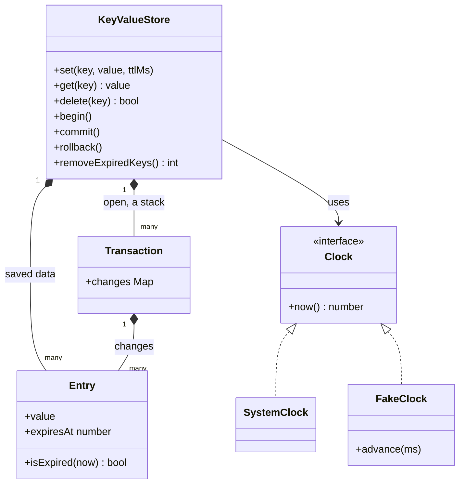
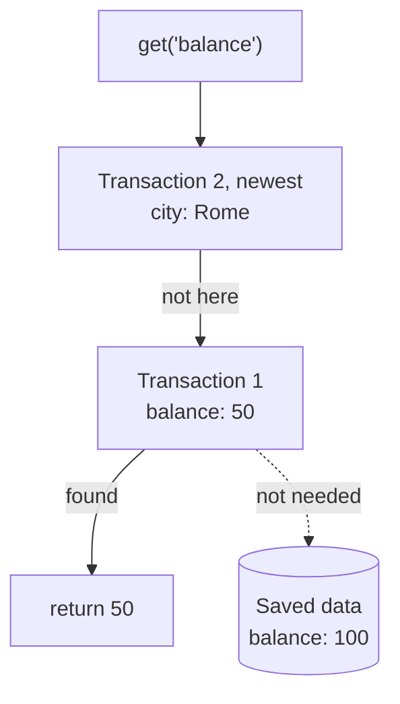
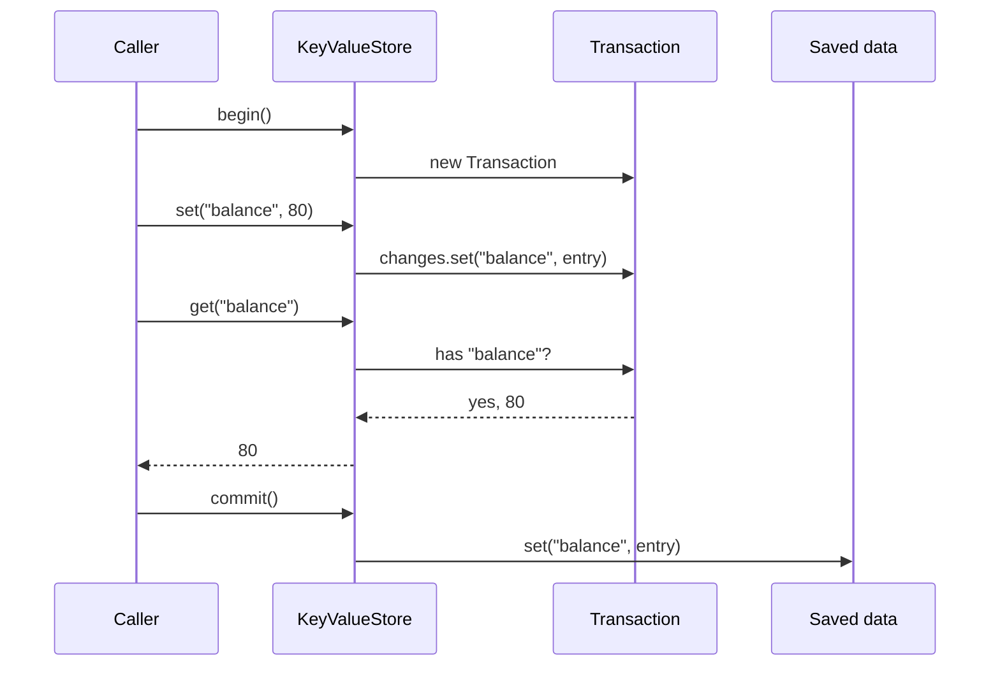

<Callout title="About this question">
  - **Difficulty:** Medium. An easy start, then the interviewer adds expiry, then transactions, then nested transactions.
  - **Patterns used:** [Dependency Injection](../design-principles/dependency-injection.mdx) (the clock), [composition](../oop-basics/composition-vs-inheritance.mdx) (a Map plus a stack of transactions), [Command](../design-patterns/command.mdx) (the undo log, a follow-up).
  - **Also asked as:** "Design a mini Redis", "A simple database with BEGIN, ROLLBACK and COMMIT", "A key-value store with expiry". A favourite live coding round at startups.
</Callout>

## Understand the problem

Think of a notebook where you write things down: "locker code: 4821", "wifi: cafe123". Some notes are good only for a while, like a one-time code that works for 5 minutes. And sometimes you write in **pencil** first, and switch to ink only when you are sure. If it goes wrong, you erase the pencil.

A **key-value store** is that notebook in code: a big Map from keys to values, like a tiny Redis. Three things make it interesting:

- **Expiry (TTL, "time to live").** A key can vanish after some time. But when do we actually delete it from memory?
- **Transactions.** `begin()` starts a pencil draft. `commit()` keeps it. `rollback()` throws it away.
- **Nesting.** A draft inside a draft. `rollback()` must undo only the newest one.

<Callout title="How this question is usually asked" type="idea">
  In steps. First `get`, `set` and `delete`. Then "add a TTL". Then "add transactions". Then "now make them nest". Design
  so each step adds code and doesn't rewrite the last one. Say this plan out loud at the start.
</Callout>

## Step 1: Requirements

### Functional requirements

1. Users should be able to `set(key, value)`, `get(key)` and `delete(key)`.
2. Users should be able to give a key a TTL in milliseconds. After that time, `get` returns `undefined`.
3. Expired keys should be removed from memory, even if nobody reads them again.
4. Users should be able to `begin()` a transaction, then `commit()` to keep its changes or `rollback()` to undo them.
5. Transactions should nest. `rollback()` and `commit()` work on the newest open transaction.
6. Inside a transaction, `get` should see the transaction's own changes.

### Out of scope

- Saving to disk. Everything lives in memory and is lost on restart.
- Many servers and copies. That is the [distributed cache](/learn/system-design/questions/distributed-cache) question.
- A memory limit with eviction. See the [LRU cache](./lru-cache.mdx).
- Many clients, each with their own transactions. We add it in "Two requests at once".

### Questions to ask the interviewer

| Question | What we assume |
| --- | --- |
| What are keys and values? | Keys are strings. A value can be anything except `undefined`. |
| What does `get` return for a missing or expired key? | `undefined`, like `Map`. |
| Does a TTL count from `set` or from `commit`? | From `set`. |
| Does `set` without a TTL keep the old TTL? | No. The key now never expires, like Redis `SET`. |
| Does `commit` save only the newest transaction, or all of them? | Ask! We commit the newest one into the one below it. Some versions say `COMMIT` saves all of them (see the follow-ups). |
| One caller or many? | One caller first. Many callers is a follow-up. |

## Step 2: Core classes

| Class | What it is | Key data | Key actions |
| --- | --- | --- | --- |
| `KeyValueStore` | The main service. Callers use only this. | `data`, `transactions`, `clock` | `set`, `get`, `delete`, `begin`, `commit`, `rollback`, `removeExpiredKeys` |
| `Entry` | One stored value, and when it expires | `value`, `expiresAt` | `isExpired(now)` |
| `Transaction` | One open transaction: only the changes since `begin()` | `changes` (key → Entry, or `null` for deleted) | — |
| `Clock` (interface) | Tells the time | — | `now()` |
| `SystemClock` | The real time, from `Date.now()` | — | `now()` |
| `FakeClock` | Time for tests, moved by hand | `time` | `now()`, `advance(ms)` |

There are no enums here.

<Callout title="Why a Clock class?" type="idea">
  TTL depends on time. With the real clock, a test for "expires after 1 hour" would wait one hour. With a `FakeClock`,
  the test calls `clock.advance(3600000)` and finishes at once. The store gets its clock from outside. That is
  [Dependency Injection](../design-principles/dependency-injection.mdx).
</Callout>

## Step 3: Class diagram



- **A Map for the saved data.** `get`, `set` and `delete` take O(1).
- **`Entry` wraps the value.** The value and its expiry time travel together.
- **Transactions are a stack.** `begin` pushes one. `commit` and `rollback` pop the newest one.
- **A transaction stores only changes,** not a copy of the whole store. So `begin` is O(1), even with a million keys.
- **`null` means "deleted".** A key deleted in a transaction must hide the saved value until commit. So the transaction remembers "deleted" (`null`), which is different from "not touched" (no entry at all).

### How `get` finds a key

Two transactions are open. The newest one changed `city`. The older one changed `balance`.



`get` looks in the newest transaction first, then the older ones, then the saved data. The first place that knows the key wins. `rollback` just throws the top layer away. `commit` moves its changes one layer down.

### Two ways to remove expired keys

| | Lazy cleanup | Periodic cleanup |
| --- | --- | --- |
| When | When `get` finds an expired key | Every few seconds, in the background |
| Cost | Almost free: we were reading the key anyway | One pass over the keys |
| Weak spot | A key that nobody reads stays in memory forever | Between two runs, expired keys still use memory (but `get` hides them) |

We use **both**. Lazy cleanup keeps `get` correct. Periodic cleanup frees memory from keys nobody reads.

## Step 4: Main methods

- `set(key, value, ttlMs)` → saves an `Entry`. Into the newest transaction if one is open, else into the data.
- `get(key)` → the value, or `undefined` if it is missing, deleted or expired.
- `delete(key)` → `true` if there was a value. Inside a transaction, it saves `null`.
- `begin()` → pushes a new, empty `Transaction`.
- `commit()` → pops the newest transaction and writes its changes one level down.
- `rollback()` → pops the newest transaction and throws it away.
- `removeExpiredKeys()` → the periodic cleanup. Returns how many keys it removed.

A transaction from start to commit:



## Step 5: Code

The code comes in small parts. Paste them together in order, and they run as one file.

### Part 1: The clocks

`Clock` is the "interface": a base class whose method only throws. The store uses `SystemClock` in real life, and tests use `FakeClock`.

```js
// Interface: something that tells the time, in milliseconds.
class Clock {
    now() {
        throw new Error("not implemented");
    }
}

// The real clock.
class SystemClock extends Clock {
    now() {
        return Date.now();
    }
}

// A clock for tests: time moves only when we say so.
class FakeClock extends Clock {
    constructor(startTime) {
        super();
        this.time = startTime;
    }

    now() {
        return this.time;
    }

    advance(ms) {
        this.time += ms;
    }
}
```

### Part 2: The entry and the transaction

An `Entry` knows its own expiry time, so it can say if it is expired. A `Transaction` is only a Map of changes.

```js
// One stored value, and when it expires.
class Entry {
    constructor(value, expiresAt) {
        this.value = value;

        // A time in milliseconds, or null for "never expires".
        this.expiresAt = expiresAt;
    }

    isExpired(now) {
        if (this.expiresAt === null) {
            return false;
        }

        return now >= this.expiresAt;
    }
}

// One open transaction: only the changes made since begin().
class Transaction {
    constructor() {
        // key -> Entry, or null when the key was deleted.
        this.changes = new Map();
    }
}
```

### Part 3: The store, writing values

The store gets its clock from outside. If none is given, it uses the real one. The class goes on until Part 7.

```js
class KeyValueStore {
    constructor(clock = new SystemClock()) {
        this.clock = clock;

        // The saved (committed) data: key -> Entry
        this.data = new Map();

        // Open transactions, like a stack. The last one is the newest.
        this.transactions = [];

        // The timer of the cleanup job, while it runs.
        this.cleanupTimer = null;
    }

    // ttlMs is optional. Without it, the key never expires.
    set(key, value, ttlMs) {
        // get() returns undefined for "missing", so it can't be a value.
        if (value === undefined) {
            throw new Error("Value can't be undefined");
        }

        const expiresAt = this.expiryTime(ttlMs);
        const entry = new Entry(value, expiresAt);
        this.write(key, entry);
    }
```

A TTL is turned into a fixed time: "now plus the TTL". Then checking expiry later is one comparison.

```js
    // When a key set now with this TTL will expire. null means never.
    expiryTime(ttlMs) {
        if (ttlMs === undefined) {
            return null;
        }

        if (typeof ttlMs !== "number" || ttlMs <= 0) {
            throw new Error("TTL must be more than 0 ms");
        }

        return this.clock.now() + ttlMs;
    }
```

### Part 4: The store, reading values

`get` finds the newest entry for the key and checks if it has expired. `delete` saves `null`, which means "deleted".

```js
    get(key) {
        const entry = this.findEntry(key);

        // Never set, or deleted.
        if (entry === null) {
            return undefined;
        }

        // A value set inside a transaction can expire too.
        if (entry.isExpired(this.clock.now())) {
            return undefined;
        }

        return entry.value;
    }

    // Returns true if there was a value to delete.
    delete(key) {
        const existed = this.get(key) !== undefined;

        this.write(key, null);
        return existed;
    }
```

`findEntry` walks the transactions from the newest to the oldest, then looks in the saved data. That is the picture from Step 3. The saved data does the lazy cleanup.

```js
    // The newest entry for a key, or null.
    findEntry(key) {
        // Newest transaction first: its changes hide the older ones.
        for (let i = this.transactions.length - 1; i >= 0; i--) {
            const changes = this.transactions[i].changes;
            if (changes.has(key)) {
                return changes.get(key);
            }
        }

        return this.findSavedEntry(key);
    }

    // The saved entry for a key, or null.
    findSavedEntry(key) {
        const entry = this.data.get(key);
        if (entry === undefined) {
            return null;
        }

        // Lazy cleanup: an expired key is deleted when someone reads it.
        if (entry.isExpired(this.clock.now())) {
            this.data.delete(key);
            return null;
        }

        return entry;
    }
```

### Part 5: Where a change goes

Every change goes through `write`. Inside a transaction, it only notes the change. Outside, it changes the saved data. This one method is what makes transactions easy to add.

```js
    // Save one change. entry is an Entry, or null for "deleted".
    write(key, entry) {
        const transaction = this.currentTransaction();

        // Inside a transaction: only note the change.
        if (transaction !== null) {
            transaction.changes.set(key, entry);
            return;
        }

        // No transaction: change the saved data now.
        if (entry === null) {
            this.data.delete(key);
        } else {
            this.data.set(key, entry);
        }
    }

    // The newest open transaction, or null.
    currentTransaction() {
        if (this.transactions.length === 0) {
            return null;
        }

        const lastIndex = this.transactions.length - 1;
        return this.transactions[lastIndex];
    }
```

### Part 6: Transactions

`begin` pushes, `rollback` pops and forgets. `commit` pops and writes each change again. Because the newest transaction is gone, `write` now puts each change **one level down**: into the transaction below, or into the saved data.

```js
    begin() {
        this.transactions.push(new Transaction());
    }

    // Undo the newest transaction: throw its changes away.
    rollback() {
        if (this.transactions.length === 0) {
            throw new Error("No transaction");
        }

        this.transactions.pop();
    }

    // Keep the newest transaction's changes.
    commit() {
        if (this.transactions.length === 0) {
            throw new Error("No transaction");
        }

        const finished = this.transactions.pop();

        // Each item of a Map is a [key, value] pair.
        for (const [key, entry] of finished.changes) {
            this.write(key, entry);
        }
    }
```

How it works:

- A nested commit doesn't save anything for real. It only moves changes into the outer transaction.
- So if the outer transaction rolls back later, the inner changes are undone too.
- Only the outermost commit changes the saved data.

### Part 7: Periodic cleanup

The rest of the class. `removeExpiredKeys` makes one pass over the saved data. `startCleanup` runs it again and again with a timer.

```js
    // Periodic cleanup: delete every expired key from the saved data.
    // Returns how many keys it deleted.
    removeExpiredKeys() {
        const now = this.clock.now();
        let removed = 0;

        // Deleting from a Map while looping over it is safe in JavaScript.
        for (const [key, entry] of this.data) {
            if (entry.isExpired(now)) {
                this.data.delete(key);
                removed += 1;
            }
        }

        return removed;
    }
```

In Node.js, a running timer keeps the program alive. So call `stopCleanup()` when the app shuts down.

```js
    // Run removeExpiredKeys() every intervalMs, in the background.
    startCleanup(intervalMs) {
        this.stopCleanup();

        this.cleanupTimer = setInterval(() => {
            this.removeExpiredKeys();
        }, intervalMs);
    }

    stopCleanup() {
        if (this.cleanupTimer !== null) {
            clearInterval(this.cleanupTimer);
            this.cleanupTimer = null;
        }
    }
}
```

### Part 8: Try it

A store with a fake clock, so the results are the same on every run. First, plain values and a TTL.

```js
const clock = new FakeClock(0);
const store = new KeyValueStore(clock);

store.set("city", "Paris");

// A one-time code, good for 5 seconds.
store.set("otp", "4821", 5000);
console.log(store.get("city"), store.get("otp")); // Paris 4821

// 5 seconds later, the code has expired.
clock.advance(5000);
console.log(store.get("otp")); // undefined

console.log(store.delete("city")); // true
console.log(store.delete("city")); // false
```

Now keys that nobody reads again. We peek at `store.data.size` to see what is still in memory.

```js
store.set("session:1", "ann", 1000);
store.set("session:2", "ben", 1000);
store.set("session:3", "cat", 1000);
clock.advance(2000);

// All three have expired, but nobody read them, so they still use memory.
console.log(store.data.size); // 3

// The periodic cleanup frees them.
console.log(store.removeExpiredKeys()); // 3
console.log(store.data.size); // 0
```

A simple transaction, rolled back:

```js
store.set("balance", 100);

store.begin();
store.set("balance", 80);
console.log(store.get("balance")); // 80

store.rollback();
console.log(store.get("balance")); // 100
```

Nested transactions. The inner rollback undoes only the inner change.

```js
// The outer transaction.
store.begin();
store.set("balance", 50);

// The inner transaction.
store.begin();
store.delete("balance");
console.log(store.get("balance")); // undefined

store.rollback();
console.log(store.get("balance")); // 50

store.commit();
console.log(store.get("balance")); // 50
```

An inner commit, then an outer rollback: both are undone. And `commit` with nothing open is an error.

```js
store.begin();
store.set("a", 1);

store.begin();
store.set("b", 2);
store.commit();
console.log(store.get("a"), store.get("b")); // 1 2

store.rollback();
console.log(store.get("a"), store.get("b")); // undefined undefined

try {
    store.commit();
} catch (error) {
    console.log(error.message); // No transaction
}
```

## Step 6: Edge cases and extensions

### Edge cases

| Case | What happens |
| --- | --- |
| `get` on an expired key | Returns `undefined`, and the key is deleted from memory right there (lazy cleanup). |
| An expired key that nobody reads | Stays in memory until the periodic cleanup runs. That is why we need both. |
| `set` on a key that had a TTL, without a new TTL | The old TTL is gone. The key now never expires. |
| A TTL of 0 or less | Error. To remove a key, call `delete`. |
| The value `undefined` | Error, because `get` uses `undefined` for "missing". `null` is fine. |
| `commit` or `rollback` with no open transaction | Error: "No transaction". |
| `delete` inside a transaction | Saves `null` in the transaction. `get` returns `undefined` at once, and `rollback` brings the value back. |
| A key expires while a transaction is open | `get` returns `undefined`, inside and outside the transaction. The TTL counts from `set`. |
| An inner commit, then an outer rollback | Both are undone. An inner commit only moves changes into the outer transaction. |

### Two requests at once

**Inside one Node.js process,** each method is safe on its own. They have no `await`, so each one finishes before the next starts. The cleanup timer runs **between** calls, never in the middle of one.

**The real problem is the shared transaction stack.** There is only one stack, so two callers that use transactions get mixed up:

```js
// NOT SAFE. A fragment, not runnable on its own.
async function payBill(store, amount) {
    store.begin();
    const balance = store.get("balance");
    store.set("balance", balance - amount);

    // While we wait, another request runs. Its set() lands in OUR
    // transaction, and its rollback() could throw away OUR change.
    await bank.charge(amount);

    store.commit();
}
```

The fix: give each caller a **session** with its own stack of transactions. All sessions share the saved data. A session's outermost `commit` writes its changes to the data in one go, with no `await` in between, so nobody sees half a commit.

```js
// A fragment, not runnable on its own.
const session = store.openSession();
session.begin();
session.set("balance", 80);
await bank.charge(20);

// Writes all the session's changes to the shared data at once.
session.commit();
```

If two sessions change the same key, the last commit wins. To catch that, give each key a version number. At commit, if the key changed since the session read it, fail the commit and let the caller try again. This is **optimistic locking**. See [Locks and Deadlocks](/learn/system-design/databases/locking).

**In Java,** keep the data in a `ConcurrentHashMap`, give each thread its own session, and run the outermost commit under one lock, so other threads never see half of it. See [Race Conditions and Locks](../concurrency/race-conditions-locks.mdx).

**With many servers,** each server has its own memory. One shared store across servers is the [distributed cache](/learn/system-design/questions/distributed-cache) question.

### Adding features

- **A memory limit:** when the store is full, evict the least recently used key. See the [LRU cache](./lru-cache.mdx). To allow other rules (LFU, oldest first), put the rule behind an `EvictionPolicy` interface. This is [Strategy](../design-patterns/strategy.mdx).
- **"How long until it expires?"** A `ttl(key)` method returns `entry.expiresAt - now`, or `null` for a key with no TTL.
- **Survive a restart:** append every change to a log file, and replay the log at startup. Take a full snapshot now and then, so the log stays short.
- **Watch a key:** callers subscribe to a key and hear about each change. This is [Observer](../design-patterns/observer.mdx).

## Patterns used

| Pattern | Where | Why |
| --- | --- | --- |
| [Dependency Injection](../design-principles/dependency-injection.mdx) | `new KeyValueStore(clock)` | Tests move time by hand instead of waiting. |
| Interface ([Dependency Inversion](../design-principles/dependency-inversion.mdx)) | `Clock`: `SystemClock`, `FakeClock` | The store doesn't care where the time comes from. |
| [Composition](../oop-basics/composition-vs-inheritance.mdx) | The store has a Map and a stack of `Transaction`s | Simple parts that each do one job. |
| [Command](../design-patterns/command.mdx) (follow-up) | The undo log: each change knows how to undo itself | Another way to build rollback. |
| [Strategy](../design-patterns/strategy.mdx) (extension) | `EvictionPolicy` | Swap LRU for LFU when memory is full. |

Redis is the real-world version. `SET key value EX 60` saves a key with a 60-second TTL. Redis removes expired keys in the same two ways as here: when a client reads an expired key, and with a background job that keeps checking a small random sample of keys that have a TTL. Redis transactions (`MULTI`, `EXEC`, `DISCARD`) can't be nested, and there is no rollback: once `EXEC` runs, a command that fails doesn't undo the others. Nested rollback is what SQL databases call a **savepoint**: `ROLLBACK TO SAVEPOINT` undoes only the work after it, like our inner rollback.

## Follow-up questions

<Accordions>
<Accordion title="Why not copy the whole store on begin()?">

It works, and rollback is easy: put the copy back. But with a million keys, every `begin` copies a million entries, even if the transaction changes only one key. Storing only the changes makes `begin` O(1), and the memory grows with the number of changes, not the size of the store.

</Accordion>
<Accordion title="Reads get slower with many nested transactions. Is there another way?">

Yes: an **undo log**. Write changes straight into the data, and save the **old** value in the transaction ("balance was 100"). Each saved old value is like a [Command](../design-patterns/command.mdx) that knows how to undo one change.

| | Layers of changes (this page) | Undo log |
| --- | --- | --- |
| `get` | Checks each layer, then the data: O(depth) | Reads the data: O(1) |
| `rollback` | Pops the top layer: O(1) | Puts the old values back: O(changes) |
| Nested `commit` | Merges the changes one layer down | Merges the undo lists. For a key in both, keep the older old value. |
| Outermost `commit` | Writes the changes to the data | Throws the undo list away |

Pick the undo log when reads are much more common than rollbacks.

</Accordion>
<Accordion title="What if COMMIT must save all open transactions?">

Some versions of this question say that. Commit the newest transaction until none are left:

```js
// One more KeyValueStore method. A fragment, not runnable on its own.
commitAll() {
    if (this.transactions.length === 0) {
        throw new Error("No transaction");
    }

    while (this.transactions.length > 0) {
        this.commit();
    }
}
```

</Accordion>
<Accordion title="Why not a setTimeout for each key, to delete it on time?">

A million keys would mean a million timers. Changing a key's TTL means finding and clearing its old timer. And `set` inside a transaction that rolls back would leave a timer behind. Lazy cleanup plus one periodic job costs almost nothing, and `get` is always correct.

</Accordion>
</Accordions>

## What the interviewer expects

<Tabs items={['Mid-level', 'Senior', 'Staff']}>
<Tab value="Mid-level">

- `get`, `set` and `delete` on a Map.
- TTL with an `expiresAt` time and lazy cleanup in `get`.
- `begin`, `commit` and `rollback` for one level.

</Tab>
<Tab value="Senior">

- Nested transactions as a stack of change layers, with `null` for "deleted".
- Lazy plus periodic cleanup, and why you need both.
- A clock passed in, so TTL tests don't wait.

</Tab>
<Tab value="Staff">

- Everything from senior, but faster.
- Layers vs undo log, with the cost of each.
- Sessions for many callers, conflicts between them, and saving to disk.

</Tab>
</Tabs>

<Callout title="Remember this" type="success">
  - Build it in steps: a Map, then TTL, then transactions. Each step adds code and doesn't rewrite the last one.
  - TTL: save `expiresAt`. Delete lazily when read, and with a periodic job for keys nobody reads.
  - Transactions are a stack. Each one stores only its changes, and `null` means "deleted".
  - `get` checks the newest transaction first. `commit` moves changes one level down. `rollback` just pops.
  - Pass the clock in, so TTL tests run at once.
</Callout>
