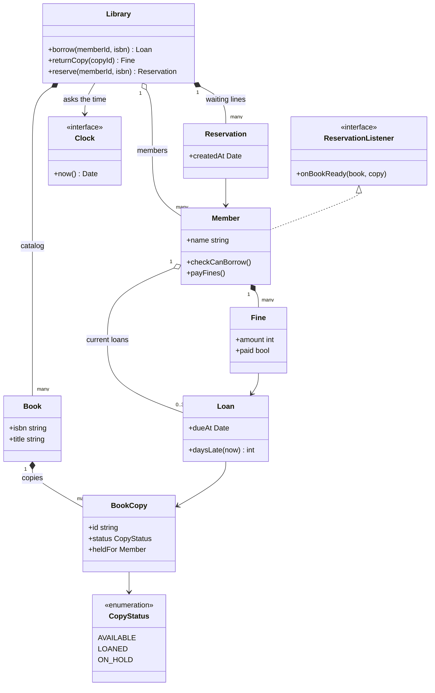
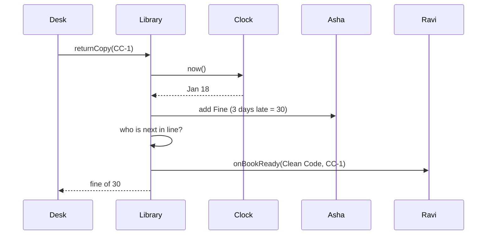

<Callout title="About this question">
  - **Difficulty:** Medium.
  - **Patterns used:** [Observer](../design-patterns/observer.mdx) ("your reserved book is ready"), [Dependency Injection](../design-principles/dependency-injection.mdx) (the clock).
  - **Also asked as:** "Design a library system", "Design a book lending system", "Design a DVD or tool rental system".
</Callout>

## Understand the problem

Think of your local library. The catalog says it has "Clean Code". On the shelf there are **two copies** of it, each with its own barcode sticker. You borrow one copy for 2 weeks. If you bring it back late, you pay a small fine. If all copies are out, you put your name on a waiting list, and the library calls you when one comes back.

Three things make it interesting:

- **A title is not a copy.** "Clean Code" is one title. Copy CC-1 and copy CC-2 are two real objects. You borrow a **copy**, but you reserve a **title** (any copy will do).
- **Rules about members.** At most 3 books at a time, and no new books while you owe a fine.
- **Time.** Due dates and fines depend on today's date. The code must let a test say "now it is 17 days later", without waiting 17 days.

## Step 1: Requirements

### Functional requirements

1. Users should be able to borrow a free copy of a book for 14 days.
2. Users should be able to return a copy. If it is late, they get a fine of ₹10 per day.
3. Users should not be able to borrow more than 3 books, or borrow while they have unpaid fines.
4. Users should be able to reserve a book when no copy is free, and be told when a copy is ready for them.
5. Users should be able to pay their fines.

### Out of scope

- Searching the catalog by author or subject (a simple filter, skipped here).
- Real payments, logins, and the e-mail or SMS service itself.
- E-books, inter-library loans, buying new books.

### Questions to ask the interviewer

| Question | What we assume |
| --- | --- |
| Can a library have many copies of one book? | Yes. Each copy has its own barcode and its own status. |
| How long is a loan? How many books at once? | 14 days and 3 books. Both are settings. |
| How is the fine counted? | ₹10 for each started day late. Money in whole rupees. |
| Who gets a returned book if many people reserved it? | First come, first served. The copy is held for the first person in line. |
| How are members told? | Through a notification. We only model "the member is told". |

## Step 2: Core classes

| Class | What it is | Key data | Key actions |
| --- | --- | --- | --- |
| `Book` | A title in the catalog | `isbn`, `title`, `author`, `copies` | — |
| `BookCopy` | One physical copy on the shelf | `id` (barcode), `book`, `status`, `heldFor` | — |
| `Member` | A person who can borrow | `id`, `name`, `loans`, `fines`, `inbox` | `checkCanBorrow()`, `payFines()`, `onBookReady()` |
| `Loan` | "This member has this copy until this date" | `copy`, `member`, `borrowedAt`, `dueAt`, `returnedAt` | `daysLate(now)` |
| `Reservation` | A place in the waiting line for a title | `member`, `book`, `createdAt` | — |
| `Fine` | Money owed for a late return | `loan`, `amount`, `paid` | — |
| `Clock` (interface) | Tells the time. `SystemClock` for real use, `FakeClock` for tests. | — | `now()` |
| `ReservationListener` (interface) | Anyone who wants to hear "your book is ready" | — | `onBookReady(book, copy)` |
| `Library` | The main service. The front desk calls it. | books, copies, members, active loans, waiting lines | `borrow`, `returnCopy`, `reserve` |

**Enum:** `CopyStatus`: `AVAILABLE`, `LOANED`, `ON_HOLD` (kept for the member who reserved it).

## Step 3: Class diagram



- **`Book` and `BookCopy` are two classes.** Title data lives once, in `Book`. Status and barcode live in each `BookCopy`. A loan points to a copy. A reservation is for a title.
- **Composition for copies.** A copy belongs to exactly one book entry. Remove the book from the catalog, and its copies go too.
- **Aggregation for members.** Members are people. They exist even if a library closes.
- **Two interfaces.** `Clock` lets tests control time. `ReservationListener` lets the library tell "someone" a book is ready, without knowing if it is an e-mail, an SMS, or a test.

## Step 4: Main methods

- `Library.borrow(memberId, isbn)` → `Loan`. Checks the member's limits, finds a copy (one held for this member first, else any free one), and makes a loan.
- `Library.returnCopy(copyId)` → `Fine` or `null`. Closes the loan, adds a fine if it is late, and gives the copy to the next person in line.
- `Library.reserve(memberId, isbn)` → `Reservation`. Adds the member to the waiting line. Only allowed when no copy is free.
- `Member.checkCanBorrow()`. Throws if the member has 3 books or owes money.
- `Member.onBookReady(book, copy)`. Called by the library when a reserved book comes back.
- `Loan.daysLate(now)` → how many started days past the due date.

The main flow: a late return of a book that someone else reserved.



## Step 5: Code

The code is split into small parts. They run as one file, in order. **Run** on a part also runs the earlier parts it needs.

### Part 1: The enum and the clock

`CopyStatus` is a plain object used as an enum. `DAY` helps with date maths.

```js
// The status of one copy.
// ON_HOLD means it is kept for the member who reserved it.
const CopyStatus = {
    AVAILABLE: "AVAILABLE",
    LOANED: "LOANED",
    ON_HOLD: "ON_HOLD",
};

// One day in milliseconds.
const DAY = 24 * 60 * 60 * 1000;
```

`Clock` is an interface with two versions. `FakeClock` only moves when a test tells it to.

```js
// The Clock "interface": anything that can tell the time.
class Clock {
    now() {
        throw new Error("not implemented");
    }
}

// For real use: the real time.
class SystemClock extends Clock {
    now() {
        return new Date();
    }
}

// For tests: time moves only when we say so.
class FakeClock extends Clock {
    constructor(start) {
        super();
        // The current time, in milliseconds.
        this.time = start.getTime();
    }

    now() {
        return new Date(this.time);
    }

    advanceDays(days) {
        this.time += days * DAY;
    }
}
```

### Part 2: Books, copies, loans and fines

`Book` is the title. `BookCopy` is the real object on the shelf.

```js
// A title in the catalog, like "Clean Code".
class Book {
    constructor(isbn, title, author) {
        this.isbn = isbn;
        this.title = title;
        this.author = author;
        this.copies = [];
    }
}

// One physical copy, with its own barcode.
class BookCopy {
    constructor(id, book) {
        this.id = id;
        this.book = book;
        this.status = CopyStatus.AVAILABLE;

        // The member it is kept for, when it is ON_HOLD.
        this.heldFor = null;
    }
}
```

A loan knows how late it is.

```js
// "This member has this copy until this date."
class Loan {
    constructor(copy, member, borrowedAt, dueAt) {
        this.copy = copy;
        this.member = member;
        this.borrowedAt = borrowedAt;
        this.dueAt = dueAt;
        this.returnedAt = null;
    }

    // How many started days past the due date. 0 if on time or early.
    daysLate(now) {
        // Subtracting two dates gives milliseconds.
        const lateMs = now - this.dueAt;

        // A started day counts as a full day, so round up.
        const days = Math.ceil(lateMs / DAY);
        if (days <= 0) {
            return 0;
        }
        return days;
    }
}
```

A fine and a reservation only hold data.

```js
// Money owed for a late return, in whole rupees.
class Fine {
    constructor(loan, amount) {
        this.loan = loan;
        this.amount = amount;
        this.paid = false;
    }
}

// A place in the waiting line for a title.
class Reservation {
    constructor(member, book, createdAt) {
        this.member = member;
        this.book = book;
        this.createdAt = createdAt;
    }
}
```

### Part 3: The member

A member knows its own limits, and listens for "your book is ready". The listener is the [Observer](../design-patterns/observer.mdx) interface.

```js
// The ReservationListener "interface" (Observer):
// anyone who wants to hear "your book is ready".
class ReservationListener {
    onBookReady(book, copy) {
        throw new Error("not implemented");
    }
}

// A person who can borrow books.
class Member extends ReservationListener {
    // "static" means one value for the whole class: Member.MAX_LOANS.
    static MAX_LOANS = 3;

    constructor(id, name) {
        super();
        this.id = id;
        this.name = name;
        this.loans = [];
        this.fines = [];

        // Messages for the member, like "your book is ready".
        this.inbox = [];
    }
```

Next, the member checks its own limits: at most 3 books, and no unpaid fines.

```js
    // The total of all fines not paid yet.
    getUnpaidFines() {
        let total = 0;
        for (const fine of this.fines) {
            if (!fine.paid) {
                total += fine.amount;
            }
        }
        return total;
    }

    // Throws if the member can't borrow right now.
    checkCanBorrow() {
        if (this.loans.length >= Member.MAX_LOANS) {
            throw new Error(`${this.name} already has ${Member.MAX_LOANS} books`);
        }

        const unpaid = this.getUnpaidFines();
        if (unpaid > 0) {
            throw new Error(`${this.name} must first pay fines of ₹${unpaid}`);
        }
    }
```

The rest of `Member`: paying fines, and hearing that a book is ready.

```js
    payFines() {
        for (const fine of this.fines) {
            fine.paid = true;
        }
    }

    // The library calls this when a reserved book comes back.
    onBookReady(book, copy) {
        const message = `"${book.title}" is ready for you (copy ${copy.id})`;
        this.inbox.push(message);
    }
}
```

### Part 4: The library

`Library` gets the clock from outside, so tests decide what "now" is. It keeps everything in Maps, so lookups are fast.

```js
// The main service. The front desk calls it.
class Library {
    static LOAN_DAYS = 14;
    // ₹10 for each late day.
    static FINE_PER_DAY = 10;

    constructor(clock) {
        this.clock = clock;

        // isbn -> Book
        this.books = new Map();
        // copy id -> BookCopy
        this.copies = new Map();
        // member id -> Member
        this.members = new Map();
        // copy id -> the open Loan for that copy
        this.loans = new Map();
        // isbn -> list of Reservations, first come, first served
        this.waitingLines = new Map();
    }
```

Setting up: adding books with their copies, and adding members.

```js
    // Add a title and make one BookCopy per barcode.
    addBook(book, copyIds) {
        this.books.set(book.isbn, book);

        for (const id of copyIds) {
            const copy = new BookCopy(id, book);
            book.copies.push(copy);
            this.copies.set(id, copy);
        }

        return book;
    }

    addMember(member) {
        this.members.set(member.id, member);
        return member;
    }

    // Look up one copy by its barcode.
    copy(id) {
        return this.copies.get(id);
    }
```

`borrow` checks the member, picks a copy and makes the loan. It checks and takes the copy with no `await` in between, so no one else can take it.

```js
    borrow(memberId, isbn) {
        const member = this.findOrThrow(this.members, memberId, "member");
        const book = this.findOrThrow(this.books, isbn, "book");
        member.checkCanBorrow();

        const copy = this.pickCopyFor(member, book);
        if (copy === null) {
            throw new Error(`No copy of "${book.title}" is free. Reserve it instead.`);
        }

        copy.status = CopyStatus.LOANED;
        copy.heldFor = null;

        // The loan is due LOAN_DAYS from now.
        const now = this.clock.now();
        const dueTime = now.getTime() + Library.LOAN_DAYS * DAY;
        const loan = new Loan(copy, member, now, new Date(dueTime));

        member.loans.push(loan);
        this.loans.set(copy.id, loan);
        return loan;
    }
```

`borrow` uses two small helpers:

```js
    // Find an item in a map, or throw a clear error.
    // "what" is a word for the message, like "member" or "book".
    findOrThrow(map, id, what) {
        const item = map.get(id);
        if (!item) {
            throw new Error(`Unknown ${what}: ${id}`);
        }
        return item;
    }

    // A copy held for this member comes first. Otherwise, any free copy.
    // Returns null if there is none.
    pickCopyFor(member, book) {
        for (const copy of book.copies) {
            if (copy.status === CopyStatus.ON_HOLD && copy.heldFor === member) {
                return copy;
            }
        }

        for (const copy of book.copies) {
            if (copy.status === CopyStatus.AVAILABLE) {
                return copy;
            }
        }

        return null;
    }
```

`returnCopy` closes the loan, adds a fine if the copy is late, and gives the copy to the next person in line.

```js
    returnCopy(copyId) {
        const loan = this.loans.get(copyId);
        if (!loan) {
            throw new Error(`Copy ${copyId} is not on loan`);
        }

        const now = this.clock.now();
        loan.returnedAt = now;
        this.loans.delete(copyId);

        // Take this loan off the member's list.
        const member = loan.member;
        member.loans = member.loans.filter((other) => other !== loan);

        // Late? Add a fine to the member.
        let fine = null;
        const daysLate = loan.daysLate(now);
        if (daysLate > 0) {
            fine = new Fine(loan, daysLate * Library.FINE_PER_DAY);
            member.fines.push(fine);
        }

        this.giveToNextInLine(loan.copy);
        return fine;
    }
```

`reserve` adds the member to the waiting line. It is only allowed when no copy is free.

```js
    reserve(memberId, isbn) {
        const member = this.findOrThrow(this.members, memberId, "member");
        const book = this.findOrThrow(this.books, isbn, "book");

        const hasFreeCopy = book.copies.some((copy) => copy.status === CopyStatus.AVAILABLE);
        if (hasFreeCopy) {
            throw new Error(`"${book.title}" is on the shelf. Borrow it instead.`);
        }

        // The waiting line for this title, or a new empty one.
        let line = this.waitingLines.get(isbn);
        if (line === undefined) {
            line = [];
        }

        // One place in line per member.
        const alreadyInLine = line.some((reservation) => reservation.member === member);
        if (alreadyInLine) {
            throw new Error(`${member.name} already reserved "${book.title}"`);
        }

        const reservation = new Reservation(member, book, this.clock.now());
        line.push(reservation);
        this.waitingLines.set(isbn, line);
        return reservation;
    }
```

Last, what happens to a returned copy. This is where the Observer pattern tells the member.

```js
    // Keep the copy for the first person in line, if anyone is waiting.
    giveToNextInLine(copy) {
        const line = this.waitingLines.get(copy.book.isbn);

        // Nobody is waiting: the copy goes back on the shelf.
        if (line === undefined || line.length === 0) {
            copy.status = CopyStatus.AVAILABLE;
            return;
        }

        // First come, first served: take the first reservation off the line.
        const next = line.shift();
        copy.status = CopyStatus.ON_HOLD;
        copy.heldFor = next.member;

        // Observer: tell the member who waited.
        next.member.onBookReady(copy.book, copy);
    }
}
```

### Part 5: Try it

One copy of "Clean Code", four copies of "Refactoring", and a fake clock. `show` runs an action and prints the error message if it throws, so the program keeps going.

```js
// "action" is a small function, like () => library.borrow("M2", "BK-1").
function show(action) {
    try {
        return action();
    } catch (error) {
        console.log(error.message);
    }
}

// For real use: new SystemClock()
const clock = new FakeClock(new Date("2026-01-01T00:00:00Z"));
const library = new Library(clock);

const cleanCode = new Book("BK-1", "Clean Code", "Robert C. Martin");
const refactoring = new Book("BK-2", "Refactoring", "Martin Fowler");
library.addBook(cleanCode, ["CC-1"]);
library.addBook(refactoring, ["RF-1", "RF-2", "RF-3", "RF-4"]);

const asha = library.addMember(new Member("M1", "Asha"));
const ravi = library.addMember(new Member("M2", "Ravi"));
```

Asha borrows the only copy of "Clean Code". Ravi can't, so he reserves it.

```js
const loan = library.borrow("M1", "BK-1");

// toISOString() gives "2026-01-15T00:00:00.000Z". The first 10 characters are the date.
const dueDate = loan.dueAt.toISOString().slice(0, 10);
console.log(loan.copy.id, dueDate); // CC-1 2026-01-15

show(() => library.borrow("M2", "BK-1")); // No copy of "Clean Code" is free. Reserve it instead.
library.reserve("M2", "BK-1");
```

17 days later, Asha brings it back 3 days late. The copy is now held for Ravi, and he is told.

```js
clock.advanceDays(17);
const fine = library.returnCopy("CC-1");
console.log(fine.amount); // 30

console.log(ravi.inbox[0]); // "Clean Code" is ready for you (copy CC-1)
console.log(library.copy("CC-1").status); // ON_HOLD
```

Asha can't borrow until she pays. Then she hits the 3-book limit. Ravi picks up the copy held for him.

```js
show(() => library.borrow("M1", "BK-2")); // Asha must first pay fines of ₹30

asha.payFines();
for (let i = 0; i < 3; i++) {
    library.borrow("M1", "BK-2");
}
show(() => library.borrow("M1", "BK-2")); // Asha already has 3 books

const raviLoan = library.borrow("M2", "BK-1");
console.log(raviLoan.copy.id); // CC-1
```

## Step 6: Edge cases and extensions

### Edge cases

| Case | What happens |
| --- | --- |
| The member has 3 books | `borrow` throws "already has 3 books". |
| The member owes a fine | `borrow` throws until the fine is paid. |
| No copy is free | `borrow` throws and suggests a reservation. |
| A copy is on hold for Ravi, and Asha wants it | Asha can't take it. Only Ravi gets a copy held for him. |
| Reserve while a copy is on the shelf | Refused: borrow it instead. |
| Reserve the same book twice | Refused. One place in line per member. |
| Return a copy that is not on loan | Throws "is not on loan". |
| Returned by the due time, or early | `daysLate` is 0, so there is no fine. |
| Returned on the due date, but a few hours after `dueAt` | `dueAt` is an exact time, and a started day counts, so the fine is ₹10. To be kinder, set `dueAt` to the end of the due day. |
| Ravi never picks up his held copy | Extension: the hold ends after 3 days. A daily job gives the copy to the next person in line. |
| A copy is lost or damaged | Extension: a `LOST` status and a fine for the price of the book. |

### Two requests at once

One copy of "Clean Code" is left. Asha and Ravi ask for it at two desks at the same moment.

In the code above, `borrow` finds the copy and marks it `LOANED` with no `await` in between, so JavaScript runs it to the end before the next call starts. The danger comes when the copies live in a database and the code waits between the check and the write:

```js noRun
// NOT SAFE. A fragment, not runnable on its own.
async borrow(memberId, isbn) {
    // Asha's call and Ravi's call both find CC-1.
    const copy = await db.findFreeCopy(isbn);

    // Both save a loan for the same copy.
    await db.saveLoan(copy.id, memberId);
}
```

Two ways to make it safe:

- **One server:** keep the check and the write in one method with no `await` between them (as above), or put a small lock around them.
- **Many servers:** let the database pick the winner with one conditional update. Only one call can change the row:

```sql
UPDATE copies SET status = 'LOANED' WHERE id = 'CC-1' AND status = 'AVAILABLE';
-- 1 row changed: you got it. 0 rows changed: someone was faster, try another copy.
```

In Java, you would mark `borrow` as `synchronized`. See [Race Conditions and Locks](../concurrency/race-conditions-locks.mdx).

### Adding features

- **E-mail and SMS:** add `EmailNotifier` and `SmsNotifier` as more listeners. `Member.onBookReady` passes the message on, and `Library` doesn't change. This is [Observer](../design-patterns/observer.mdx).
- **Different members** (students: 3 books for 14 days; teachers: 10 books for 30 days): give each member a `MembershipPlan` object with the limits, instead of `if (type === 'TEACHER')`. This is [Strategy](../design-patterns/strategy.mdx).
- **New fine rules** (one free day, a cap of ₹500): move the fine maths into a `FinePolicy` interface with one class per rule. This is [Strategy](../design-patterns/strategy.mdx) and the [Open-Closed Principle](../design-principles/open-closed.mdx).

## Patterns used

| Pattern | Where | Why |
| --- | --- | --- |
| [Observer](../design-patterns/observer.mdx) | `ReservationListener`, `Member.onBookReady` | Reserving = signing up to hear "a copy is back". The library tells the first one in line, without knowing how they are told. |
| [Dependency Injection](../design-principles/dependency-injection.mdx) | `new Library(clock)` | Tests use `FakeClock` and move time forward in one line. |
| Interface | `Clock`: `SystemClock`, `FakeClock` | The library depends on "something that tells the time", not on `Date.now()`. See [Dependency Inversion](../design-principles/dependency-inversion.mdx). |
| [Strategy](../design-patterns/strategy.mdx) (extension) | `FinePolicy`, `MembershipPlan` | New rules become new classes. |

## Follow-up questions

<Accordions>
<Accordion title="Why not keep a count of copies inside Book?">

A count can't say **which** copy is out, who has it, or which one is damaged. Each copy has its own barcode, status and loans, so it is its own object. `Book` keeps the shared title data once, so it isn't repeated on every copy.

</Accordion>
<Accordion title="Why pass a clock in, and not call Date.now()?">

Fines depend on time. With `Date.now()` inside `Library`, a test for "3 days late" would have to wait 17 days, or change the computer's clock. With an injected `Clock`, the test calls `clock.advanceDays(17)`. Java has the same idea built in: `java.time.Clock`, with `Clock.fixed(...)` for tests.

</Accordion>
<Accordion title="How do you remind people about overdue books?">

A job runs once a day. It looks at every open loan and finds those with `daysLate(now) > 0`, then sends a reminder. In a database, find them with `WHERE returnedAt IS NULL AND dueAt < today`, with an index on `dueAt`.

</Accordion>
<Accordion title="What if Ravi never collects the book he reserved?">

Store `heldUntil` on the copy (for example, 3 days after it came back). The daily job finds holds that have run out, and calls the same "give to next in line" method. If no one is waiting, the copy becomes `AVAILABLE`.

</Accordion>
</Accordions>

## What the interviewer expects

<Tabs items={['Mid-level', 'Senior', 'Staff']}>
<Tab value="Mid-level">

- `Book` vs `BookCopy`, `Member`, `Loan`, `Library`.
- Working borrow and return, with the borrow limit and a late fine.
- A clean class diagram with the right relationships.

</Tab>
<Tab value="Senior">

- Reservations with a waiting line, and Observer for "your book is ready".
- An injected clock, so fines can be tested.
- The race for the last copy, and the database rule for many servers.

</Tab>
<Tab value="Staff">

- Everything from senior, but faster.
- Many branches sharing one catalog, and moving copies between branches.
- Daily jobs (reminders, hold expiry), and which rules to keep as settings.

</Tab>
</Tabs>

<Callout title="Remember this" type="success">
  - `Book` is the title. `BookCopy` is the real object on the shelf. You borrow a copy and reserve a title.
  - The member checks its own limits: 3 books, no unpaid fines.
  - A returned copy goes to the first person in line (ON_HOLD), and they are told: Observer.
  - Pass the clock in. Then a "17 days later" test takes one line.
  - Check and take the last copy with no `await` in between. With many servers, use a conditional `UPDATE`.
</Callout>
