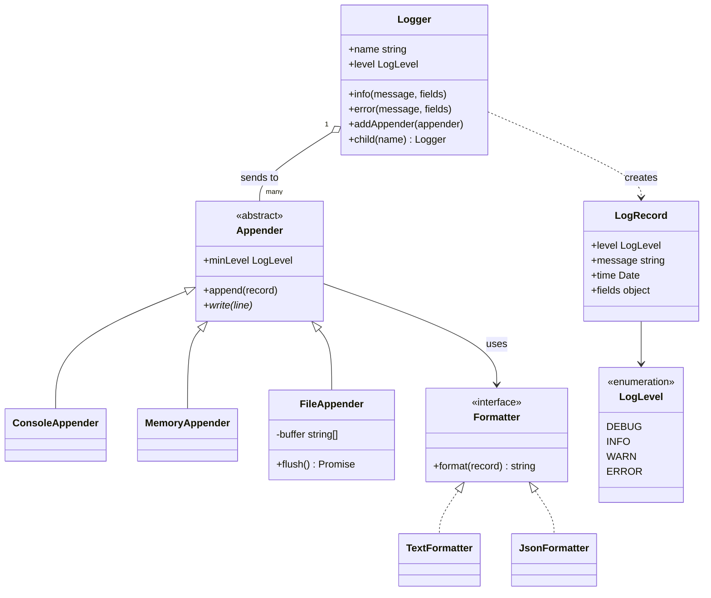
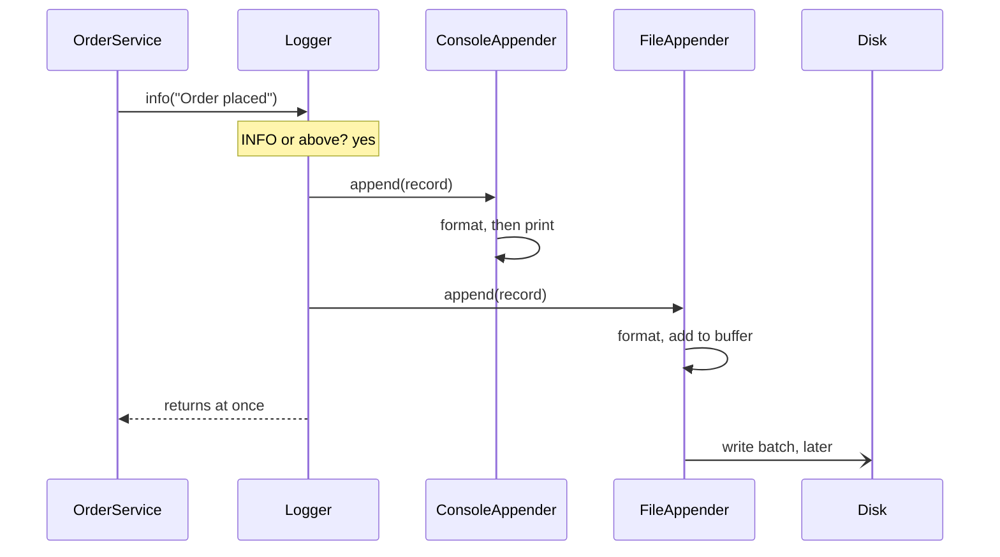

<Callout title="About this question">
  - **Difficulty:** Easy.
  - **Patterns used:** [Observer](../design-patterns/observer.mdx) (one log goes to every output), [Strategy](../design-patterns/strategy.mdx) (formatters), [Template Method](../design-patterns/template-method.mdx) (appenders), [Singleton](../design-patterns/singleton.mdx) vs [Dependency Injection](../design-principles/dependency-injection.mdx), and [Chain of Responsibility](../design-patterns/chain-of-responsibility.mdx) as the classic textbook answer.
  - **Also asked as:** "Design a logging library", "Design Log4j", "Design a logging framework".
</Callout>

## Understand the problem

Think of a ship's logbook. The crew writes down what happens: "09:00, left port", "14:30, storm warning". Some notes are routine, some are urgent. Copies can go to the captain, to the office on shore, and into the book.

A **logger** does the same for a program. The code calls `log.info('Server started')`, and the line goes to the screen, a file, or a log server. What makes it interesting:

- **Levels.** In production you want warnings and errors, not every debug note. Filtering must be cheap.
- **Many outputs, many formats.** Short text for people, JSON for machines. New outputs must be easy to add.
- **Speed.** A slow disk must never slow down a user's request.
- **One logger for the whole app.** A Singleton, or pass it in? Interviewers love this trade-off.

## Step 1: Requirements

### Functional requirements

1. Users should be able to log a message at a level: DEBUG, INFO, WARN or ERROR, with optional extra data (`{ orderId: 42 }`).
2. Users should be able to set a minimum level. Messages below it are dropped.
3. Users should be able to send logs to many outputs at once: the console, memory (for tests) and a file.
4. Each output should be able to have its own format (text or JSON) and its own minimum level.
5. Logging should not slow the caller. File writes happen in the background.
6. Parts of the app should be able to use named loggers, like `[orders]`, that share the same outputs.

### Out of scope

- Log rotation (starting a new file every day) and deleting old files.
- Searching logs, dashboards and alerts.
- Sending logs over the network (it is just one more output).

### Questions to ask the interviewer

| Question | What we assume |
| --- | --- |
| Which levels? | DEBUG, INFO, WARN, ERROR, from least to most serious. |
| Can each output filter on its own? | Yes. For example, the console shows INFO and up, an alert output only ERROR. |
| Can we lose a log line? | Rarely, in a crash. Speed matters more. ERROR lines can be written at once if needed. |
| One logger or many? | One setup for the app, with named child loggers for its parts. |
| Is it used by many threads? | Node.js has one main thread. We discuss Java threads in the edge cases. |

## Step 2: Core classes

| Class | What it is | Key data | Key actions |
| --- | --- | --- | --- |
| `LogRecord` | One log event | `level`, `message`, `loggerName`, `time`, `fields` | — |
| `Formatter` (interface) | Turns a record into a line | — | `format(record)` |
| `TextFormatter`, `JsonFormatter` | Text for people, JSON for machines | — | `format(record)` |
| `Appender` (abstract) | One output | `formatter`, `minLevel` | `append(record)`, `write(line)` |
| `ConsoleAppender`, `MemoryAppender`, `FileAppender` | The screen, an array, a file | `FileAppender`: a buffer | `write(line)`, `flush()` |
| `Logger` | What the app calls | `name`, `level`, `appenders`, `clock` | `debug`, `info`, `warn`, `error`, `child` |

**Enum:** `LogLevel`: `DEBUG`, `INFO`, `WARN`, `ERROR`. A list keeps their order, so "WARN and up" is one comparison.

## Step 3: Class diagram



- **The logger tells every appender.** One `info()` call goes to each registered output, like listeners on Node's `EventEmitter`. `addAppender` is "subscribe". This is [Observer](../design-patterns/observer.mdx).
- **Aggregation, not composition, for appenders.** A child logger like `[orders]` shares its parent's appenders. They are not owned by one logger.
- **`Formatter` is an interface, separate from the appender.** Where a line goes and how it looks change for different reasons. Any output can use any format. This is [Strategy](../design-patterns/strategy.mdx).
- **`Appender` is an abstract class.** The logger only calls `append(record)`. The base class filters by level and formats once. Each output fills in only `write(line)`. This is [Template Method](../design-patterns/template-method.mdx).
- **The clock is passed in.** Tests and examples can use a fixed time, so the output is always the same.

### One logger for the whole app: Singleton or dependency injection?

Every class needs to log. There are two common ways to give them a logger:

```js noRun
// A fragment, not runnable on its own.

// 1. Singleton: one object, reached from anywhere.
class AppLogger {
    static getInstance() {
        // Make the logger the first time only. Later calls get the same one.
        if (!AppLogger.instance) {
            AppLogger.instance = new Logger({ name: "app" });
        }

        return AppLogger.instance;
    }
}

// In JavaScript, a module export does the same job.
// A module runs once, so every import gets the same object.
export const log = new Logger({ name: "app" });

// 2. Dependency injection: the class gets the logger from outside.
class OrderService {
    constructor(logger) {
        this.logger = logger;
    }
}

const orderService = new OrderService(log.child("orders"));
```

| | Singleton | Dependency injection |
| --- | --- | --- |
| Easy to use | Very: call it from anywhere | A little more typing: pass it in |
| Tests | Hard: every test shares one logger | Easy: pass a logger with a `MemoryAppender` and check its lines |
| Different settings per part | Hard | Easy: pass `log.child('orders')` |
| Hidden needs | The class secretly depends on it | The constructor shows it |

A good answer: **create one logger at startup (one setup, like a singleton), and pass it in (or a child of it) where it is needed.** Many real apps do take the logger from a shared module, and that is fine for small apps.

## Step 4: Main methods

- `Logger.info(message, fields)` (and `debug`, `warn`, `error`) → logs at that level.
- `Logger.log(level, message, fields)` → drops it if below `level`; otherwise makes a `LogRecord` and gives it to every appender.
- `Logger.child(name)` → a logger with a new name and the same outputs.
- `Appender.append(record)` → checks its own `minLevel`, formats, then calls `write(line)`.
- `FileAppender.flush()` → a promise that resolves when every line is on disk.

One log call, with a console and a file:



## Step 5: Code

The code uses `import` and top-level `await`, so save all the parts together as one file, `logger.mjs`, and run it with Node.js. The parts that write a file can't run in the browser playground. Long classes come in a few pieces. Together they make the whole class.

### Part 1: Levels, the record and the formatters

**The levels.** A list keeps them in order, so "WARN and up" is one comparison.

```js noRun
import { appendFile, readFile, rm } from "node:fs/promises";
import { tmpdir } from "node:os";
import { join } from "node:path";

const LogLevel = {
    DEBUG: "DEBUG",
    INFO: "INFO",
    WARN: "WARN",
    ERROR: "ERROR",
};

// From least to most serious.
const LEVEL_ORDER = [LogLevel.DEBUG, LogLevel.INFO, LogLevel.WARN, LogLevel.ERROR];

// True if `level` is as serious as `minimum`, or more serious.
function isAtLeast(level, minimum) {
    const levelRank = LEVEL_ORDER.indexOf(level);
    const minimumRank = LEVEL_ORDER.indexOf(minimum);

    return levelRank >= minimumRank;
}
```

**The record.** One log event, with all its data in one object.

```js
class LogRecord {
    constructor(level, message, loggerName, time, fields) {
        this.level = level;
        this.message = message;
        this.loggerName = loggerName;
        this.time = time;
        // Extra data, like { orderId: 42 }.
        this.fields = fields;
    }
}
```

**The text formatter.** Every formatter has the same `format(record)` method. This one makes a short line for people.

```js
// The interface: a formatter turns a record into one line of text.
class Formatter {
    format(record) {
        throw new Error("not implemented");
    }
}

// For people: short and easy to scan.
class TextFormatter extends Formatter {
    format(record) {
        // Keep just the time of day, like "09:00:00.000".
        const time = record.time.toISOString().slice(11, 23);

        // padEnd(5) makes "INFO" as wide as "ERROR", so the lines line up.
        const level = record.level.padEnd(5);

        // Turn { port: 3000 } into " port=3000".
        let fieldsText = "";
        for (const key of Object.keys(record.fields)) {
            fieldsText += ` ${key}=${record.fields[key]}`;
        }

        return `${time} ${level} [${record.loggerName}] ${record.message}${fieldsText}`;
    }
}
```

**The JSON formatter.** One JSON object per line, for machines.

```js
class JsonFormatter extends Formatter {
    format(record) {
        const data = {
            time: record.time.toISOString(),
            level: record.level,
            logger: record.loggerName,
            message: record.message,
        };

        // Add the extra fields at the end, like orderId and total.
        Object.assign(data, record.fields);

        return JSON.stringify(data);
    }
}
```

### Part 2: The appenders

**The base class.** It checks the level and formats the line. Each output fills in only `write(line)`.

```js
// Abstract: it filters and formats, then each output fills in write(line).
class Appender {
    constructor(formatter, minLevel = LogLevel.DEBUG) {
        // Only subclasses, like ConsoleAppender, may be created.
        if (this.constructor === Appender) {
            throw new Error("Appender is abstract");
        }

        this.formatter = formatter;
        this.minLevel = minLevel;
    }

    append(record) {
        // Each output can skip levels below its own minimum.
        if (!isAtLeast(record.level, this.minLevel)) {
            return;
        }

        const line = this.formatter.format(record);
        this.write(line);
    }

    write(line) {
        throw new Error("not implemented");
    }
}
```

**The console and memory outputs.** The console prints the line. Memory keeps it in an array, which is handy in tests.

```js
class ConsoleAppender extends Appender {
    write(line) {
        console.log(line);
    }
}

class MemoryAppender extends Appender {
    constructor(formatter, minLevel) {
        super(formatter, minLevel);
        this.lines = [];
    }

    write(line) {
        this.lines.push(line);
    }
}
```

**The file output, piece 1.** `write(line)` only adds the line to a buffer and returns at once. If no writer is running, it starts one.

```js
class FileAppender extends Appender {
    constructor(path, formatter, minLevel) {
        super(formatter, minLevel);
        this.path = path;
        // Lines waiting to be written.
        this.buffer = [];
        // The background write loop while it runs, or null.
        this.writing = null;
        // Lines lost because the disk failed.
        this.dropped = 0;
    }

    write(line) {
        this.buffer.push(line);

        // Start one writer, only if none is running.
        if (this.writing === null) {
            this.writing = this.drain();
        }
    }
```

**The file output, piece 2.** These methods finish the `FileAppender` class. `drain()` writes the waiting lines in one batch, then checks for more.

```js
    async drain() {
        while (this.buffer.length > 0) {
            // Take every waiting line. New lines go into a fresh buffer.
            const batch = this.buffer;
            this.buffer = [];

            const text = batch.join("\n") + "\n";
            try {
                await appendFile(this.path, text);
            } catch (error) {
                // A full disk must never crash the app. Count the lost lines.
                this.dropped += batch.length;
            }
        }

        this.writing = null;
    }

    // Wait until every line is on disk, for example before the app exits.
    async flush() {
        await this.writing;
    }
}
```

How it works:

- `write` never waits. It only adds the line to `buffer`.
- `writing` holds the running `drain()` loop. While it runs, new lines just join the buffer, so they stay in order.
- `flush()` waits for that loop to end.

### Part 3: The logger

It drops low levels first, then tells every appender. A broken appender can't break the app.

**Its settings.** The logger takes one options object. Any option you leave out gets a default.

```js
class Logger {
    // Pass an object like { name: "app", level: LogLevel.INFO }.
    // An option you leave out gets the value after "=".
    // The "= {}" at the end lets you call new Logger() with no options at all.
    constructor({
        name = "app",
        level = LogLevel.INFO,
        appenders = [],
        clock = () => new Date(),
    } = {}) {
        this.name = name;
        this.level = level;
        this.appenders = appenders;
        // A function that returns the time now. Tests pass a fixed one.
        this.clock = clock;
    }

    // Subscribe one more output.
    addAppender(appender) {
        this.appenders.push(appender);
    }
```

**The level shortcuts.** Each one calls `log` with its own level.

```js
    debug(message, fields) {
        this.log(LogLevel.DEBUG, message, fields);
    }

    info(message, fields) {
        this.log(LogLevel.INFO, message, fields);
    }

    warn(message, fields) {
        this.log(LogLevel.WARN, message, fields);
    }

    error(message, fields) {
        this.log(LogLevel.ERROR, message, fields);
    }
```

**`log` and `child`.** These finish the `Logger` class.

```js
    log(level, message, fields = {}) {
        // Drop it early, so a filtered log costs almost nothing.
        if (!isAtLeast(level, this.level)) {
            return;
        }

        const time = this.clock();
        const record = new LogRecord(level, message, this.name, time, fields);

        // Tell every output (Observer).
        for (const appender of this.appenders) {
            try {
                appender.append(record);
            } catch (error) {
                // One broken output must not stop the others, or the app.
            }
        }
    }

    // Same outputs and settings, but a new name.
    child(name) {
        return new Logger({
            name: name,
            level: this.level,
            appenders: this.appenders,
            clock: this.clock,
        });
    }
}
```

### Part 4: Try it

Three outputs: the console (text), memory (WARN and up) and a file (JSON). `OrderService` gets its logger by dependency injection.

**A service that logs.**

```js
class OrderService {
    // The logger is passed in: dependency injection.
    constructor(logger) {
        this.logger = logger;
    }

    placeOrder(orderId, total) {
        this.logger.info("Order placed", { orderId: orderId, total: total });
    }
}
```

**Set up the outputs and the logger.** A fixed clock makes the output the same on every run.

```js noRun
const path = join(tmpdir(), "logger-demo.log");
// Start with an empty file on every run.
await rm(path, { force: true });

const consoleOutput = new ConsoleAppender(new TextFormatter());
// Memory keeps only WARN and ERROR lines.
const memory = new MemoryAppender(new TextFormatter(), LogLevel.WARN);
// The file gets every level the logger lets through.
const file = new FileAppender(path, new JsonFormatter());

function fixedClock() {
    return new Date("2026-01-01T09:00:00Z");
}

const log = new Logger({
    name: "app",
    level: LogLevel.INFO,
    appenders: [consoleOutput, memory, file],
    clock: fixedClock,
});
```

**Log some lines.** Each comment shows what the console prints.

```js noRun
// Below INFO: dropped, prints nothing.
log.debug("Cache warmed");

log.info("Server started", { port: 3000 });
// prints: 09:00:00.000 INFO  [app] Server started port=3000

const orderService = new OrderService(log.child("orders"));
orderService.placeOrder(42, 99.5);
// prints: 09:00:00.000 INFO  [orders] Order placed orderId=42 total=99.5

log.warn("Disk almost full", { usedPercent: 91 });
// prints: 09:00:00.000 WARN  [app] Disk almost full usedPercent=91

log.error("Payment failed", { orderId: 42 });
// prints: 09:00:00.000 ERROR [app] Payment failed orderId=42
```

**Check memory and the file.** The file lines were written in the background, so wait for `flush()` first.

```js noRun
console.log(memory.lines.length); // 2

await file.flush();

const fileText = await readFile(path, "utf8");
const fileLines = fileText.trim().split("\n");
console.log(fileLines.length); // 4
console.log(fileLines[1]);
// {"time":"2026-01-01T09:00:00.000Z","level":"INFO","logger":"orders","message":"Order placed","orderId":42,"total":99.5}
```

The first line went to disk alone. The next three arrived while that write was running, so they waited in the buffer and went in one batch.

## Step 6: Edge cases and extensions

### Edge cases

| Case | What happens |
| --- | --- |
| A message below the logger's level | Dropped on the first line of `log`, before any record or string is built. |
| One output fails (a full disk, a bug) | Caught. The other outputs still get the line, and the app keeps running. `FileAppender` counts `dropped` lines. |
| Fields that can't become JSON (an object that points to itself) | `JSON.stringify` throws, and the `try` in `log` stops it. Better: a safe formatter that replaces such values. |
| The app crashes before the buffer is written | The last lines are lost. Call `flush()` on shutdown. For ERROR lines, you can choose to write at once. |
| Logs come faster than the disk can write | The buffer grows. Cap it (say 10,000 lines), drop DEBUG lines first, and count what was dropped. Or make the caller wait: safer for audit logs, but slower. |
| Secrets in the data (passwords, card numbers) | Remove or mask known field names before formatting. |
| User text with a newline in it | It can fake a second log line. JSON escapes newlines. Never run code found inside messages: that was the Log4Shell bug in Log4j in 2021. |

### Two requests at once

A server handles many requests at once, and all of them log. In Node.js, each `log()` call runs to the end before the next one starts, so two lines never mix in the middle.

The real race is in the **async file write**. If every line started its own write, the writes would run side by side, and the lines could land in the wrong order:

```js noRun
// NOT SAFE. A fragment, not runnable on its own.
write(line) {
    // Each line starts its own write. They can finish in any order.
    appendFile(this.path, line + "\n");
}
```

`FileAppender` avoids this with **one writer at a time**. `writing` holds the running loop. New lines only join the buffer, and the loop writes them in order. It is a small form of [Producer-Consumer](../concurrency/producer-consumer.mdx): the app produces lines, and one loop consumes them.

- **Many processes or servers:** don't let them write to the same file. Each one writes to its own output (often just the console), and a log tool gathers the lines in one place.
- **In Java,** many threads log at once. Log4j 2 offers async loggers: threads put events in a queue, and a background thread writes them.

See [Race Conditions and Locks](../concurrency/race-conditions-locks.mdx).

### Adding features

- **A new output** (a log server, a chat alert for ERROR): add one `Appender` class with a `write(line)`. `Logger` doesn't change. This is the [Open-Closed Principle](../design-principles/open-closed.mdx).
- **A new format** (colors, a different text layout): add one `Formatter` class. This is [Strategy](../design-patterns/strategy.mdx).
- **Processing steps** (hide secrets, then add a request id, then keep only 1 in 10 DEBUG lines): put each step in a small handler that passes the record to the next, like Express middleware. This is [Chain of Responsibility](../design-patterns/chain-of-responsibility.mdx).

## Patterns used

| Pattern | Where | Why |
| --- | --- | --- |
| [Observer](../design-patterns/observer.mdx) | `Logger` and its `appenders` | One log call reaches every output that subscribed. |
| [Strategy](../design-patterns/strategy.mdx) | `Formatter`: `TextFormatter`, `JsonFormatter` | Change how lines look without touching outputs. |
| [Template Method](../design-patterns/template-method.mdx) | `Appender.append()` calls `write(line)` | Filter and format in one place. Each output writes its own way. |
| [Singleton](../design-patterns/singleton.mdx) or [Dependency Injection](../design-principles/dependency-injection.mdx) | How code gets the logger | One setup for the app. Passing it in keeps tests easy. |
| [Chain of Responsibility](../design-patterns/chain-of-responsibility.mdx) (extension) | Processing steps | Add or remove steps without changing the others. |

Real loggers follow this shape. Log4j has loggers, appenders and layouts (its word for formatters). Python's `logging` has loggers, handlers and formatters. In Node.js, Winston calls its outputs "transports", and pino writes JSON lines and can run its transports in a worker thread, to keep the main thread fast.

## Follow-up questions

<Accordions>
<Accordion title="What is the textbook Chain of Responsibility logger?">

Each handler owns one level: `InfoHandler` → `WarnHandler` → `ErrorHandler`. A message starts at the first handler. Each one writes the message if the level matches, then passes it to the next. It is a common interview answer. Our design instead sends every record to all outputs, and each output filters for itself. That is simpler to extend, and it fits how real loggers work.

</Accordion>
<Accordion title="Why check the level before building the message?">

`log.debug('User: ' + JSON.stringify(user))` builds the string even when DEBUG is off. On a hot path that wastes time. Pass the data as `fields` and let the logger format it only if needed, or pass a function: `log.debug(() => expensiveText())`. In Java, people write `if (log.isDebugEnabled())` for the same reason.

</Accordion>
<Accordion title="How do you add a request id to every line?">

Create a child logger per request with the id as a field, and pass it down. Or, in Node.js, keep the id in `AsyncLocalStorage` (from `node:async_hooks`), and let the logger read it for every record. Then any code can find out which request it is working for.

</Accordion>
</Accordions>

## What the interviewer expects

<Tabs items={['Mid-level', 'Senior', 'Staff']}>
<Tab value="Mid-level">

- Levels and filtering that work.
- An `Appender` interface with console and file outputs.
- Clean, small classes: logger, record, appender, formatter.

</Tab>
<Tab value="Senior">

- Singleton vs dependency injection, with the testing trade-off.
- Async file writes that keep the order and never crash the app.
- Edge cases: failing outputs, secrets, unsafe user text.

</Tab>
<Tab value="Staff">

- Everything from senior, but faster.
- Back-pressure: what happens when logs come faster than the disk.
- Logging across many servers, request ids, and when to drop lines.

</Tab>
</Tabs>

<Callout title="Remember this" type="success">
  - Drop low levels first. A filtered log should cost almost nothing.
  - The logger tells every appender (Observer). Where a line goes and how it looks are separate (Appender and Formatter).
  - Write files in the background with one writer and a buffer, so logging never slows a request.
  - Make one logger at startup and pass it in. A Singleton is easy to reach, but hard to test.
  - A broken output must never break the app.
</Callout>
