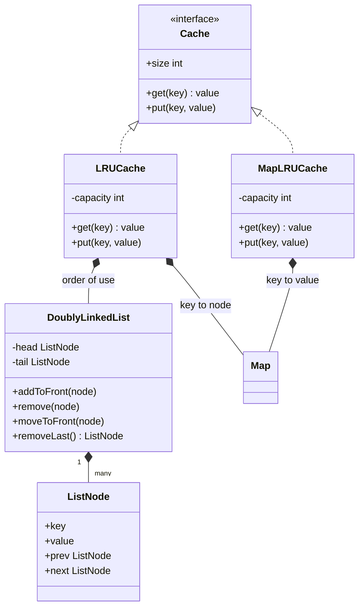
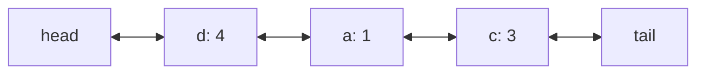
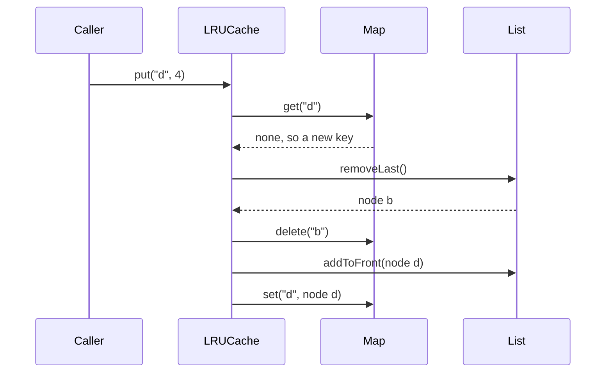

<Callout title="About this question">
  - **Difficulty:** Easy to explain, a little tricky to code.
  - **Patterns used:** an interface (`Cache`) with two implementations, [composition](../oop-basics/composition-vs-inheritance.mdx) (a Map plus a list), and [Proxy](../design-patterns/proxy.mdx) when a cache sits in front of a slow service.
  - **Also asked as:** LeetCode 146 "LRU Cache", "Design an in-memory cache with eviction".
</Callout>

## Understand the problem

Your desk has room for three books. You need a fourth one. Which book goes back on the shelf? The one you haven't touched for the longest time. That is **LRU: Least Recently Used**.

A **cache** is a small, fast store that keeps copies of data that is slow to get (from a database or another server). It has a fixed **capacity** (how many items fit). When it is full and a new item comes, one item must leave. This is called **eviction**. An LRU cache evicts the item that was used longest ago.

The interesting part is speed. Both `get` and `put` must take **O(1)** time: the same short time with 10 items or 10 million.

## Step 1: Requirements

### Functional requirements

1. Users should be able to `get(key)`: get the value, or `undefined` if the key isn't there. This counts as a use.
2. Users should be able to `put(key, value)`: add a new item or update an old one. This counts as a use.
3. When the cache is full, `put` should first remove the least recently used item.
4. Both `get` and `put` should take O(1) time.

### Out of scope

- Expiry times (TTL). We add them as an extension.
- Limits in bytes. We count items, not memory.
- Sharing one cache across many servers.

### Questions to ask the interviewer

| Question | What we assume |
| --- | --- |
| Does `get` count as a use? | Yes. Reading an item makes it the most recent. |
| Does updating a key count as a use? | Yes. And it never evicts anything, because the count doesn't grow. |
| What does `get` return for a missing key? | `undefined`, like `Map`. (LeetCode's version returns -1.) |
| Can the capacity be 0? | Yes. Such a cache stores nothing. A negative capacity is an error. |
| May I use `Map`'s insertion order? | Ask! Many interviewers say "show the long way". |

## Step 2: Core classes

| Class | What it is | Key data | Key actions |
| --- | --- | --- | --- |
| `Cache` (interface) | What every cache can do | — | `get`, `put`, `size` |
| `ListNode` | One item in the list | `key`, `value`, `prev`, `next` | — |
| `DoublyLinkedList` | Items in order of use, newest first | `head`, `tail` (fake end nodes) | `addToFront`, `remove`, `moveToFront`, `removeLast` |
| `LRUCache` | The classic answer: a Map plus the list | `capacity`, `map`, `list` | `get`, `put` |
| `MapLRUCache` | The short answer: only a `Map` | `capacity`, `map` | `get`, `put` |

There are no enums here. The only fixed choice is the eviction rule, and an interface covers that later.

## Step 3: Class diagram



How the two parts work together. The Map finds a node at once. The list keeps the order of use:



`d` is the most recent and `c` is the least recent. The next eviction removes `c`, the node just before `tail`.

- **Why a Map?** It finds the node for a key in O(1).
- **Why a doubly linked list?** It can take a node out of the middle and put it at the front in O(1), because each node knows both neighbours. An array would need O(n) to move items.
- **Why does the node keep its key?** When the last node is evicted, we must also delete it from the Map. The node is all we have, so it must know its key.
- **Why fake `head` and `tail` nodes?** They are called **sentinels**. With them, every real node always has a neighbour on both sides, so there are no `null` checks.
- **Why a `Cache` interface?** Code that uses the cache doesn't care which one it gets. Both classes pass the same test below.

## Step 4: Main methods

- `LRUCache.get(key)` → the value or `undefined`. Moves the node to the front.
- `LRUCache.put(key, value)` → adds or updates, then moves the node to the front. Evicts the last node first if the cache is full.
- `DoublyLinkedList.moveToFront(node)` → `remove(node)`, then `addToFront(node)`.
- `DoublyLinkedList.removeLast()` → takes out the node just before `tail`, the least recently used.

`put` with a new key when the cache is full:



## Step 5: Code

**Part 1: the interface and the list node.**

```js
class Cache { // interface
  get(key) { throw new Error('not implemented'); }
  put(key, value) { throw new Error('not implemented'); }
  get size() { throw new Error('not implemented'); }
}

class ListNode {
  constructor(key, value) {
    this.key = key; // kept so that, when this node is removed, we know which Map entry to delete
    this.value = value;
    this.prev = null;
    this.next = null;
  }
}
```

**Part 2: the doubly linked list, written by hand.** Four pointer changes to add, two to remove.

```js
// Most recently used at the front (after head). Least recently used at the back (before tail).
class DoublyLinkedList {
  #head = new ListNode(null, null); // sentinel: a fake first node, so we never check for null
  #tail = new ListNode(null, null); // sentinel: a fake last node
  constructor() {
    this.#head.next = this.#tail;
    this.#tail.prev = this.#head;
  }
  addToFront(node) {
    node.prev = this.#head;
    node.next = this.#head.next;
    this.#head.next.prev = node;
    this.#head.next = node;
  }
  remove(node) {
    node.prev.next = node.next;
    node.next.prev = node.prev;
    node.prev = null;
    node.next = null;
  }
  moveToFront(node) {
    this.remove(node);
    this.addToFront(node);
  }
  removeLast() {
    const last = this.#tail.prev;
    if (last === this.#head) return null; // empty
    this.remove(last);
    return last;
  }
  keys() { // front to back, for printing
    const keys = [];
    for (let node = this.#head.next; node !== this.#tail; node = node.next) keys.push(node.key);
    return keys;
  }
}
```

**Part 3: the two caches.** `LRUCache` is the classic answer. `MapLRUCache` uses a JavaScript trick: a `Map` remembers the order in which keys were added, and deleting then setting a key moves it to the end.

```js
function checkCapacity(capacity) {
  if (!Number.isInteger(capacity) || capacity < 0) throw new Error('Capacity must be a whole number, 0 or more');
}

class LRUCache extends Cache { // the classic way: Map + doubly linked list
  #capacity;
  #map = new Map(); // key -> ListNode, to find a node in O(1)
  #list = new DoublyLinkedList(); // the order of use, to move and remove nodes in O(1)
  constructor(capacity) {
    super();
    checkCapacity(capacity);
    this.#capacity = capacity;
  }
  get(key) {
    const node = this.#map.get(key);
    if (!node) return undefined;
    this.#list.moveToFront(node); // just used
    return node.value;
  }
  put(key, value) {
    if (this.#capacity === 0) return; // a cache with no room keeps nothing
    const node = this.#map.get(key);
    if (node) { // update: no eviction needed
      node.value = value;
      this.#list.moveToFront(node);
      return;
    }
    if (this.#map.size === this.#capacity) {
      const oldest = this.#list.removeLast();
      this.#map.delete(oldest.key);
    }
    const fresh = new ListNode(key, value);
    this.#list.addToFront(fresh);
    this.#map.set(key, fresh);
  }
  get size() { return this.#map.size; }
  keys() { return this.#list.keys(); } // most recent first
}

class MapLRUCache extends Cache { // the shortcut: a Map keeps keys in insertion order
  #capacity;
  #map = new Map();
  constructor(capacity) {
    super();
    checkCapacity(capacity);
    this.#capacity = capacity;
  }
  get(key) {
    if (!this.#map.has(key)) return undefined;
    const value = this.#map.get(key);
    this.#map.delete(key); // delete, then set: the key moves to the end (the newest)
    this.#map.set(key, value);
    return value;
  }
  put(key, value) {
    if (this.#capacity === 0) return;
    this.#map.delete(key); // set alone would keep an old key in its old place
    this.#map.set(key, value);
    if (this.#map.size > this.#capacity) {
      const oldest = this.#map.keys().next().value; // the first key is the least recently used
      this.#map.delete(oldest);
    }
  }
  get size() { return this.#map.size; }
  keys() { return [...this.#map.keys()].reverse(); } // most recent first, like LRUCache
}
```

**Part 4: try it.** The same steps on both caches give the same result, because both follow the `Cache` interface.

```js
function fillAndUse(cache) { // works with any Cache
  cache.put('a', 1);
  cache.put('b', 2);
  cache.put('c', 3);
  cache.get('a'); // 'a' is now the most recent
  cache.put('d', 4); // full: 'b' is the least recently used, so it goes
  return cache.keys();
}
console.log(fillAndUse(new LRUCache(3))); // [ 'd', 'a', 'c' ]
console.log(fillAndUse(new MapLRUCache(3))); // [ 'd', 'a', 'c' ]

const cache = new LRUCache(2);
cache.put('x', 10);
cache.put('y', 20);
console.log(cache.get('x')); // 10
cache.put('z', 30); // removes 'y'
console.log(cache.get('y')); // undefined
cache.put('x', 11); // an update: nothing is removed
console.log(cache.keys(), cache.size); // [ 'x', 'z' ] 2

const tiny = new LRUCache(1);
tiny.put('a', 1);
tiny.put('b', 2);
console.log(tiny.keys()); // [ 'b' ]

const none = new LRUCache(0);
none.put('a', 1);
console.log(none.get('a'), none.size); // undefined 0
try { new LRUCache(-1); } catch (e) { console.log(e.message); } // Capacity must be a whole number, 0 or more
```

<Callout title="Why the interviewer may still want the long way" type="idea">
  The `Map` version is correct and short, and it is fine for real JavaScript code. But the question tests whether you
  can **build** an O(1) structure: pointers, sentinels and the Map that points into the list. The trick also works
  only in JavaScript. Java's `HashMap` keeps no order, so a Java interviewer expects the list (or Java's ready-made
  `LinkedHashMap`). A good plan: say the trick in one sentence, then offer to write the long way.
</Callout>

## Step 6: Edge cases and extensions

### Edge cases

| Case | What happens |
| --- | --- |
| Capacity 0 | `put` does nothing, and `get` always returns `undefined`. |
| Capacity 1 | Every new key evicts the one before. |
| Negative or broken capacity (`-1`, `2.5`, `'3'`) | The constructor throws. |
| `put` on an existing key when the cache is full | Updates the value and moves it to the front. Nothing is evicted. |
| `get` on a missing key | Returns `undefined`. Nothing in the order changes. |
| Storing the value `undefined` | `get` can't tell "missing" from "stored `undefined`". Add a `has(key)` method, or don't allow it. |
| Keys that are objects | `Map` compares objects by identity, so `{ id: 1 }` and another `{ id: 1 }` are two keys. Use a string or number key. |

### Two requests at once

**Inside one Node.js process,** this cache is safe as it is. JavaScript runs one piece of code at a time, and `get` and `put` have no `await`, so each one finishes before the next starts. Worker threads don't share normal objects, so each worker would have its own cache.

**In Java,** many threads can call `get` at once. Note that `get` also **changes** the list, so even reads need the lock. The simple fix is to mark `get` and `put` as `synchronized` (one thread at a time). Fast libraries such as Caffeine avoid one big lock.

**The real race in JavaScript** is in code that *uses* the cache with an `await`. Two requests for the same missing user both miss the cache, and both load it from the database. With many requests, this is called a **cache stampede**. The fix: store the **promise** in the cache at once, before any `await`:

```js
// A fragment, not runnable on its own.
async function getUser(id) {
  let promise = cache.get(id);
  if (!promise) {
    promise = db.loadUser(id); // no await here
    cache.put(id, promise);    // the second request finds this promise and waits for the same load
  }
  return promise;              // (if the load fails, remove the promise so the next call tries again)
}
```

**With many servers,** each server has its own cache. For one shared cache, use Redis with its `allkeys-lru` eviction policy. Redis uses an approximate LRU: it checks a few sample keys instead of keeping a perfect list. See [Race Conditions and Locks](../concurrency/race-conditions-locks.mdx).

### Adding features

- **Expiry (TTL):** store `expiresAt` in each node. `get` treats an expired node as missing and removes it.
- **A different eviction rule** (LFU: least *frequently* used, or FIFO: oldest added): put the rule behind an `EvictionPolicy` interface. This is [Strategy](../design-patterns/strategy.mdx).
- **A cache in front of a slow service:** `CachedUserService` has the same methods as `UserService` and checks the cache first. Callers can't tell the difference. This is [Proxy](../design-patterns/proxy.mdx).

## Patterns used

| Pattern | Where | Why |
| --- | --- | --- |
| Interface ([Dependency Inversion](../design-principles/dependency-inversion.mdx)) | `Cache`, with `LRUCache` and `MapLRUCache` | Callers depend on "a cache", so either version works. |
| [Composition](../oop-basics/composition-vs-inheritance.mdx) | `LRUCache` has a `Map` and a `DoublyLinkedList` | Two simple parts make one fast whole. |
| [Strategy](../design-patterns/strategy.mdx) (extension) | `EvictionPolicy` | Swap LRU for LFU without rewriting the cache. |
| [Proxy](../design-patterns/proxy.mdx) (extension) | A cached service with the same methods | Add caching without changing callers. |

LRU caches are everywhere. Java's `LinkedHashMap` can keep keys in order of access, and its `removeEldestEntry` method turns it into an LRU cache in a few lines. On npm, the `lru-cache` package is widely used. Redis offers LRU eviction when memory is full.

## Follow-up questions

<Accordions>
<Accordion title="Why not a singly linked list?">

To remove a node from the middle, you must change the node **before** it. A singly linked list has no `prev` pointer, so finding that node means walking from the start: O(n). With `prev`, it is O(1).

</Accordion>
<Accordion title="Is the Map shortcut really O(1)?">

Yes, on average. `Map`'s `get`, `set`, `delete` and `has` are fast hash lookups. Getting the first key with `keys().next()` is O(1) too. Both versions have the same speed. The difference is what they show the interviewer.

</Accordion>
<Accordion title="LRU or LFU: which is better?">

LRU keeps what was used **recently**. It suits most apps, where recent data is likely to be used again. LFU keeps what is used **often**. It suits a stable set of hot items, but an item that was popular last week can stay forever. One full scan of the data can push every hot item out of an LRU cache. LFU resists that.

</Accordion>
<Accordion title="How would you limit the cache by memory, not by count?">

Give each item a size (for example, its string length). Keep a running total. In `put`, evict from the back until the new item fits.

</Accordion>
</Accordions>

## What the interviewer expects

<Tabs items={['Mid-level', 'Senior', 'Staff']}>
<Tab value="Mid-level">

- The Map plus doubly linked list idea, explained clearly.
- Working `get` and `put` with correct pointer changes.
- Capacity edge cases: 0, 1, and updating an existing key.

</Tab>
<Tab value="Senior">

- Clean code with sentinels and a `Cache` interface.
- Both versions, with the trade-off of the `Map` shortcut.
- Thread safety: why `get` is also a write, and the promise trick against stampedes.

</Tab>
<Tab value="Staff">

- Everything from senior, but faster.
- Eviction as a pluggable policy (LRU, LFU, TTL).
- Caches across many servers, and why Redis uses an approximate LRU.

</Tab>
</Tabs>

<Callout title="Remember this" type="success">
  - Map for "find it in O(1)", doubly linked list for "move or remove it in O(1)".
  - The node keeps its key, so an evicted node can be deleted from the Map.
  - Fake `head` and `tail` nodes remove every `null` check.
  - The `Map` shortcut (delete, then set) is fine in real code. Offer it, then write the long way.
  - `get` changes the order too, so in Java even reads need the lock.
</Callout>
