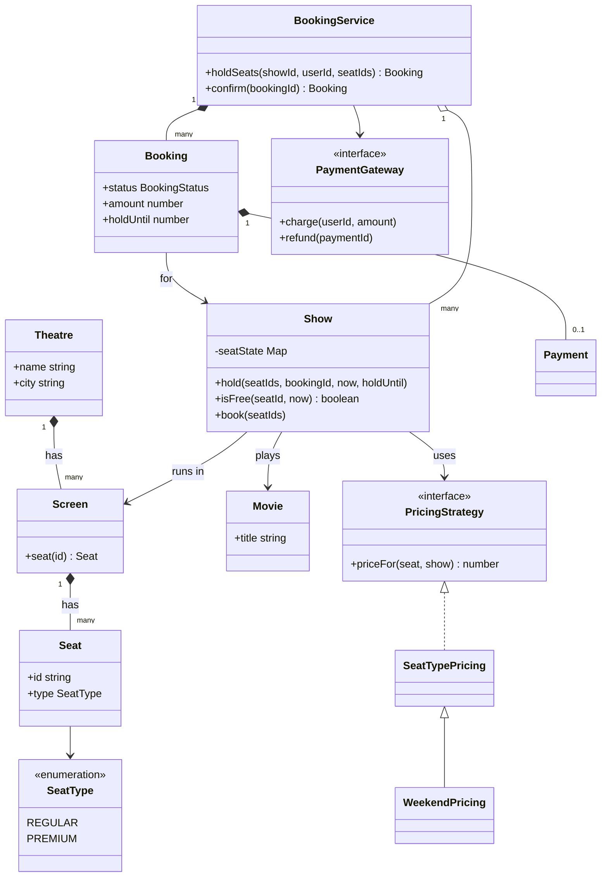
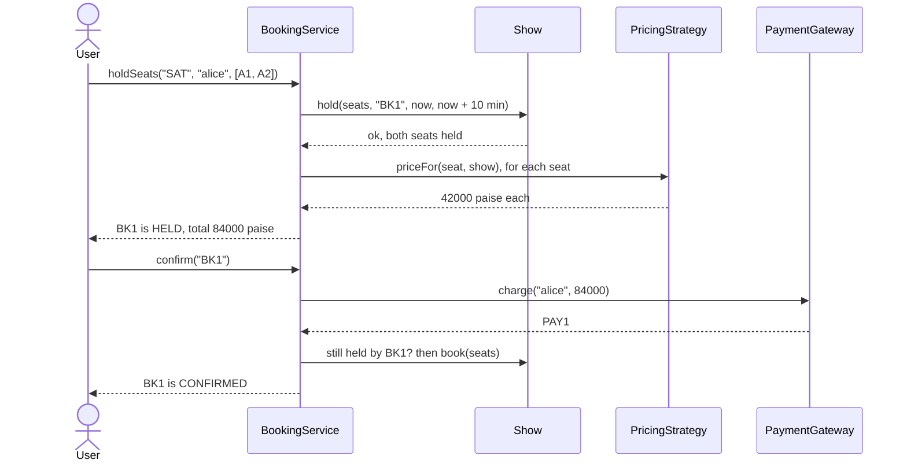

<Callout title="About this question">
  **Difficulty:** Hard. **Patterns used:** [Strategy](../design-patterns/strategy.mdx),
  [Facade](../design-patterns/facade.mdx), [Dependency Injection](../design-principles/dependency-injection.mdx),
  plus an atomic hold from [Race Conditions and Locks](../concurrency/race-conditions-locks.mdx).
  **Also asked as:** "Design BookMyShow", "Design a cinema seat booking system".
</Callout>

## Understand the problem

Think of the ticket counter at a cinema. You point at two seats on the seat map. The clerk puts a "taken" sticker on
them. Then you pay. If you walk away without paying, the clerk peels the stickers off after a while.

An app like BookMyShow does the same thing, but thousands of people point at the same seat map at once.

What makes it interesting:

- **Two people, one seat.** Alice and Bob both click seat A2 at the same moment. Only one may get it.
- **Paying takes time.** We can't keep a seat locked forever while someone types a card number. So we **hold** it
  for a few minutes, and the hold **expires** (runs out) by itself.
- **Prices change.** A premium seat costs more than a regular one, and weekends cost more than weekdays.

## Step 1: Requirements

### Functional requirements

1. Users should be able to see the free seats of a show.
2. Users should be able to pick one or more seats and **hold** them for 10 minutes. They get all the seats, or none.
3. Users should be able to pay to **confirm** the booking.
4. Users should be able to give up a hold. A hold that runs out frees the seats too.
5. The price should depend on the seat type and the day (weekend shows cost more).
6. Admins should be able to add theatres, screens, movies and shows.

### Out of scope

- Searching movies by city or language (a simple filter).
- Cancelling a paid ticket and refunds (see [Design a Hotel Booking System](./hotel-booking.mdx) for refund rules).
- Food, coupons, user accounts and the seat map screen.

### Questions to ask the interviewer

| Question | What we assume |
| --- | --- |
| How long is a hold? | 10 minutes. |
| Can a user book many seats at once? | Yes, and it is all or nothing. |
| What changes the price? | The seat type sets the base price. Weekend shows add 20%. |
| One server or many? | Design for one process first. Then explain the database rule for many servers. |
| Can a paid ticket be cancelled? | Not for now. |

## Step 2: Core classes

| Class | What it is | Key data | Key actions |
| --- | --- | --- | --- |
| `Movie` | A film | title, length | – |
| `Theatre` | A cinema building | name, city, screens | `addScreen` |
| `Screen` | One hall in a theatre | name, seats | `seat(id)` |
| `Seat` | One chair in a screen | id like `A1`, type | – |
| `Show` | A movie on a screen at a time | movie, screen, start time, seat states | `hold`, `isFree`, `book`, `release` |
| `Booking` | One user's seats for one show | seats, amount, status, hold end time | – |
| `Payment` | Proof that money was paid | payment id, amount, time | – |
| `PricingStrategy` | The rule that prices a seat | price table | `priceFor(seat, show)` |
| `PaymentGateway` | The outside card or UPI service | – | `charge`, `refund` |
| `BookingService` | The front door for the app | shows, bookings, clock | `holdSeats`, `confirm`, `cancelHold` |

**Enums:**

- `SeatType`: `REGULAR`, `PREMIUM`.
- `BookingStatus`: `HELD`, `PAYING`, `CONFIRMED`, `EXPIRED`, `CANCELLED`.

A seat's free or taken state lives in `Show`, not in `Seat`. Seat A1 exists at every show in that screen. It can be
taken at 2 pm and free at 6 pm.

## Step 3: Class diagram



Key choices:

- **Composition for Theatre → Screen → Seat.** A seat can't exist without its screen, or a screen without its
  theatre.
- **Seat states live in `Show`.** The "is it free?" check and the "take it" write sit in one class. That is what
  makes the hold atomic (done in one go).
- **`PricingStrategy` is an interface.** Each show gets its own rule. See [Strategy](../design-patterns/strategy.mdx).
- **`PaymentGateway` is an interface.** The real one talks to a card company, and tests use a fake. See
  [Dependency Inversion](../design-principles/dependency-inversion.mdx).
- **A clock is passed in.** With a fake clock, tests can jump 11 minutes ahead in one line.

## Step 4: Main methods

| Method | What it does |
| --- | --- |
| `BookingService.holdSeats(showId, userId, seatIds)` | Holds all the seats for 10 minutes, or none. Returns a `HELD` booking with the price. |
| `BookingService.confirm(bookingId)` | Async. Charges the user, then marks the seats booked. Returns the `CONFIRMED` booking. |
| `BookingService.cancelHold(bookingId)` | Gives the seats back before paying. |
| `BookingService.freeSeats(showId)` | Lists the seat ids that are free right now. |
| `Show.hold(seatIds, bookingId, now, holdUntil)` | Checks every seat first, then writes every seat. No `await` inside. |
| `Show.isFree(seatId, now)` | True if nobody has the seat, or their hold ran out. |
| `PricingStrategy.priceFor(seat, show)` | Returns the price of one seat at one show, in paise. |

The main flow, hold then pay:



## Step 5: Code

Money is in whole **paise** (₹1 = 100 paise), so there are no rounding errors. Time is in milliseconds from a clock
that we pass in. On your computer, run all the parts together as one `.mjs` file (the last part uses top-level `await`). Long classes
come in a few pieces. Together they make the whole class. **Run** on a part also runs the earlier parts it needs.

### Part 1: Enums and small classes

**The enums and a print helper.**

```js
const SeatType = {
    REGULAR: "REGULAR",
    PREMIUM: "PREMIUM",
};

const BookingStatus = {
    HELD: "HELD",
    PAYING: "PAYING",
    CONFIRMED: "CONFIRMED",
    EXPIRED: "EXPIRED",
    CANCELLED: "CANCELLED",
};

// Only for printing: 84000 paise becomes "₹840.00".
function rupees(paise) {
    const amount = paise / 100;
    return `₹${amount.toFixed(2)}`;
}
```

**Movie and Seat.** Plain data holders.

```js
class Movie {
    constructor(id, title, minutes) {
        this.id = id;
        this.title = title;
        this.minutes = minutes;
    }
}

class Seat {
    constructor(id, type) {
        // Like "A1".
        this.id = id;
        // A SeatType.
        this.type = type;
    }
}
```

**Screen.** One hall. It also keeps its seats in a `Map`, so finding seat "A1" is quick.

```js
class Screen {
    constructor(id, name, seats) {
        this.id = id;
        this.name = name;
        this.seats = seats;
        // Seat id -> Seat, for quick lookups.
        this.seatsById = new Map();
        for (const seat of seats) {
            this.seatsById.set(seat.id, seat);
        }
    }

    seat(id) {
        const seat = this.seatsById.get(id);
        if (!seat) {
            throw new Error(`No seat ${id} in ${this.name}`);
        }

        return seat;
    }
}
```

**Theatre.** A cinema building with its screens.

```js
class Theatre {
    constructor(id, name, city) {
        this.id = id;
        this.name = name;
        this.city = city;
        this.screens = [];
    }

    addScreen(screen) {
        this.screens.push(screen);
        return screen;
    }
}
```

**Payment and a fake clock.** Tests control the fake clock. It only moves when we tell it to.

```js
class Payment {
    constructor(id, bookingId, amount, paidAt) {
        this.id = id;
        this.bookingId = bookingId;
        // Whole paise.
        this.amount = amount;
        this.paidAt = paidAt;
    }
}

class FakeClock {
    constructor(ms) {
        this.ms = ms;
    }

    now() {
        return this.ms;
    }

    advanceMinutes(minutes) {
        // One minute is 60 * 1000 milliseconds.
        this.ms += minutes * 60 * 1000;
    }
}
```

### Part 2: The core classes

**The pricing rules.** `SeatTypePricing` looks up the price by seat type.

```js
// The interface: every pricing rule has priceFor(seat, show).
class PricingStrategy {
    priceFor(seat, show) {
        throw new Error("not implemented");
    }
}

class SeatTypePricing extends PricingStrategy {
    // prices is like { REGULAR: 20000, PREMIUM: 35000 }, in paise.
    constructor(prices) {
        super();
        this.prices = prices;
    }

    priceFor(seat, show) {
        return this.prices[seat.type];
    }
}
```

**Weekend pricing.** It takes the seat type price, then adds a percent on Saturday and Sunday.

```js
class WeekendPricing extends SeatTypePricing {
    constructor(prices, extraPercent) {
        super(prices);
        this.extraPercent = extraPercent;
    }

    priceFor(seat, show) {
        const basePrice = super.priceFor(seat, show);

        // getUTCDay() gives 0 for Sunday and 6 for Saturday.
        const day = new Date(show.startsAt).getUTCDay();
        const isWeekend = day === 0 || day === 6;
        if (!isWeekend) {
            return basePrice;
        }

        const extra = Math.round((basePrice * this.extraPercent) / 100);
        return basePrice + extra;
    }
}
```

**The `Show`, piece 1: is a seat free?** Each show keeps its own seat states. A seat that is not in the `Map` is free.

```js
class Show {
    constructor(id, movie, screen, startsAt, pricing) {
        this.id = id;
        this.movie = movie;
        this.screen = screen;
        // Milliseconds, UTC.
        this.startsAt = startsAt;
        // A PricingStrategy.
        this.pricing = pricing;
        // Seat id -> { bookingId, booked, holdUntil }.
        this.seatState = new Map();
    }

    isFree(seatId, now) {
        const state = this.seatState.get(seatId);

        // Nobody has held this seat.
        if (!state) {
            return true;
        }

        // A booked seat is never free.
        if (state.booked) {
            return false;
        }

        // A hold that ran out counts as free.
        return state.holdUntil <= now;
    }
```

**The `Show`, piece 2: the atomic `hold`.** It checks every seat first, then takes every seat. There is no `await`
inside, so nothing else can run between the check and the write.

```js
    hold(seatIds, bookingId, now, holdUntil) {
        // 1. Check every seat. Throw before we change anything: all or nothing.
        for (const seatId of seatIds) {
            // seat() throws if the seat does not exist.
            this.screen.seat(seatId);

            if (!this.isFree(seatId, now)) {
                throw new Error(`Seat ${seatId} is not free`);
            }
        }

        // 2. Take every seat.
        for (const seatId of seatIds) {
            this.seatState.set(seatId, { bookingId: bookingId, booked: false, holdUntil: holdUntil });
        }
    }

    // True if this booking still holds every seat, even if the hold just ran out.
    isHeldBy(seatIds, bookingId) {
        for (const seatId of seatIds) {
            const state = this.seatState.get(seatId);
            if (!state || state.bookingId !== bookingId) {
                return false;
            }
        }

        return true;
    }
```

**The `Show`, piece 3: book, release and list.** These finish the `Show` class.

```js
    book(seatIds) {
        for (const seatId of seatIds) {
            this.seatState.get(seatId).booked = true;
        }
    }

    // Free the seats, but only the ones this booking still holds.
    release(seatIds, bookingId) {
        for (const seatId of seatIds) {
            const state = this.seatState.get(seatId);
            if (state && state.bookingId === bookingId) {
                this.seatState.delete(seatId);
            }
        }
    }

    freeSeats(now) {
        const freeIds = [];
        for (const seat of this.screen.seats) {
            if (this.isFree(seat.id, now)) {
                freeIds.push(seat.id);
            }
        }

        return freeIds;
    }
}
```

**The `Booking`.** One user's seats for one show.

```js
class Booking {
    constructor(id, userId, show, seatIds, amount, holdUntil) {
        this.id = id;
        this.userId = userId;
        this.show = show;
        this.seatIds = seatIds;
        // Whole paise.
        this.amount = amount;
        this.holdUntil = holdUntil;
        this.status = BookingStatus.HELD;
        // Set when the user pays.
        this.payment = null;
    }
}
```

**The payment interface, and a fake for tests.** The fake never fails, and gives ids `PAY1`, `PAY2`, and so on.

```js
// The interface for a card or UPI provider.
class PaymentGateway {
    async charge(userId, amount) {
        throw new Error("not implemented");
    }

    async refund(paymentId) {
        throw new Error("not implemented");
    }
}

class FakeGateway extends PaymentGateway {
    constructor() {
        super();
        this.nextNumber = 1;
    }

    async charge(userId, amount) {
        const paymentId = `PAY${this.nextNumber}`;
        this.nextNumber++;
        return paymentId;
    }

    async refund(paymentId) {
        return true;
    }
}
```

### Part 3: The main service

`holdSeats` has no `await`. `confirm` has one, so it marks the booking `PAYING` before it, and checks the seats again
after it.

**Piece 1: the data, and adding shows.**

```js
class BookingService {
    constructor(clock, gateway, holdMinutes = 10) {
        this.clock = clock;
        this.gateway = gateway;
        this.holdMs = holdMinutes * 60 * 1000;
        // Show id -> Show, and booking id -> Booking.
        this.shows = new Map();
        this.bookings = new Map();
        // Used to make booking ids: BK1, BK2, and so on.
        this.nextId = 1;
    }

    addShow(show) {
        this.shows.set(show.id, show);
        return show;
    }

    freeSeats(showId) {
        const show = this.findShow(showId);
        return show.freeSeats(this.clock.now());
    }
```

**Piece 2: check the request.** A helper for `holdSeats`. It throws before any seat is touched.

```js
    checkRequest(show, seatIds, now) {
        if (now >= show.startsAt) {
            throw new Error(`Show ${show.id} has started`);
        }

        if (seatIds.length === 0) {
            throw new Error("Pick at least one seat");
        }

        // A Set drops repeats. If the Set is smaller, a seat was picked twice.
        if (new Set(seatIds).size !== seatIds.length) {
            throw new Error("A seat is picked twice");
        }
    }
```

**Piece 3: `holdSeats`.** Hold all the seats or none, then work out the price.

```js
    holdSeats(showId, userId, seatIds) {
        const show = this.findShow(showId);
        const now = this.clock.now();
        this.checkRequest(show, seatIds, now);

        // Hold the seats. If any seat is taken, this throws and nothing is held.
        const bookingId = `BK${this.nextId}`;
        const holdUntil = now + this.holdMs;
        show.hold(seatIds, bookingId, now, holdUntil);
        // Only now use up the id, so a failed hold doesn't skip a number.
        this.nextId++;

        // Add up the price of every seat.
        let amount = 0;
        for (const seatId of seatIds) {
            const seat = show.screen.seat(seatId);
            amount += show.pricing.priceFor(seat, show);
        }

        const booking = new Booking(bookingId, userId, show, seatIds, amount, holdUntil);
        this.bookings.set(bookingId, booking);
        return booking;
    }
```

**Piece 4: get ready to pay.** A helper for `confirm`. It runs before the `await`, and marks the booking `PAYING`.

```js
    startPaying(booking) {
        if (booking.status !== BookingStatus.HELD) {
            throw new Error(`${booking.id} is ${booking.status}`);
        }

        // Too late: the hold ran out. Give the seats back.
        if (this.clock.now() >= booking.holdUntil) {
            booking.show.release(booking.seatIds, booking.id);
            booking.status = BookingStatus.EXPIRED;
            throw new Error(`Hold on ${booking.id} ran out. Pick seats again.`);
        }

        // Mark it before the await. A second "Pay" click now fails the first check above.
        booking.status = BookingStatus.PAYING;
    }
```

**Piece 5: `confirm`.** Charge the user, check the seats again, then book them.

```js
    async confirm(bookingId) {
        const booking = this.findBooking(bookingId);
        this.startPaying(booking);

        let paymentId;
        try {
            paymentId = await this.gateway.charge(booking.userId, booking.amount);
        } catch (error) {
            // The card failed. Let the user try again.
            booking.status = BookingStatus.HELD;
            throw error;
        }

        // The await let other code run. Check again before we write.
        if (!booking.show.isHeldBy(booking.seatIds, booking.id)) {
            await this.gateway.refund(paymentId);
            booking.status = BookingStatus.EXPIRED;
            throw new Error(`Seats for ${bookingId} were taken. Payment refunded.`);
        }

        booking.show.book(booking.seatIds);
        const paidAt = this.clock.now();
        booking.payment = new Payment(paymentId, booking.id, booking.amount, paidAt);
        booking.status = BookingStatus.CONFIRMED;
        return booking;
    }
```

**Piece 6: cancel a hold, and the lookups.** These finish the `BookingService` class.

```js
    cancelHold(bookingId) {
        const booking = this.findBooking(bookingId);
        if (booking.status !== BookingStatus.HELD) {
            throw new Error(`${bookingId} is ${booking.status}`);
        }

        booking.show.release(booking.seatIds, booking.id);
        booking.status = BookingStatus.CANCELLED;
    }

    findShow(showId) {
        const show = this.shows.get(showId);
        if (!show) {
            throw new Error(`No show ${showId}`);
        }

        return show;
    }

    findBooking(bookingId) {
        const booking = this.bookings.get(bookingId);
        if (!booking) {
            throw new Error(`No booking ${bookingId}`);
        }

        return booking;
    }
}
```

### Part 4: Try it

One screen, a Friday show and a Saturday show, and every tricky case.

**Set up the cinema.**

```js
// Friday 20 Nov 2026, 09:00 UTC. Months start at 0 in JavaScript, so 10 is November.
const clock = new FakeClock(Date.UTC(2026, 10, 20, 9, 0));
const service = new BookingService(clock, new FakeGateway(), 10);

const cinema = new Theatre("T1", "City Cinema", "Pune");
const seats = [
    new Seat("A1", SeatType.PREMIUM),
    new Seat("A2", SeatType.PREMIUM),
    new Seat("B1", SeatType.REGULAR),
    new Seat("B2", SeatType.REGULAR),
];
const audi1 = cinema.addScreen(new Screen("S1", "Audi 1", seats));
const movie = new Movie("M1", "Toy Robots 3", 120);
```

**Add two shows.** Friday uses normal prices. Saturday adds 20%.

```js
// ₹200 and ₹350, in paise.
const prices = { REGULAR: 20000, PREMIUM: 35000 };

const friday = Date.UTC(2026, 10, 20, 14, 0);
const saturday = Date.UTC(2026, 10, 21, 14, 0);
service.addShow(new Show("FRI", movie, audi1, friday, new SeatTypePricing(prices)));
service.addShow(new Show("SAT", movie, audi1, saturday, new WeekendPricing(prices, 20)));
```

**Cases 1 and 2: Alice holds two seats, and Bob can't get A2.**

```js
// 1. Alice holds two premium seats on Saturday (weekend: +20%).
const alice = service.holdSeats("SAT", "alice", ["A1", "A2"]);
console.log(alice.id, alice.status, rupees(alice.amount)); // BK1 HELD ₹840.00

// 2. Bob wants B1 and A2. A2 is taken, so he gets neither.
try {
    service.holdSeats("SAT", "bob", ["B1", "A2"]);
} catch (error) {
    console.log(error.message); // Seat A2 is not free
}
console.log(service.freeSeats("SAT")); // [ 'B1', 'B2' ]
```

In case 2, B1 was free, but Bob did not get it, because A2 failed. That is "all or nothing".

**Cases 3 and 4: Alice pays, and Bob waits too long.**

```js
// 3. Alice pays.
await service.confirm("BK1");
console.log(alice.status, alice.payment.id); // CONFIRMED PAY1

// 4. Bob holds B1 on Friday (normal price), then waits too long.
const bob = service.holdSeats("FRI", "bob", ["B1"]);
console.log(bob.id, rupees(bob.amount)); // BK2 ₹200.00

clock.advanceMinutes(11);
try {
    await service.confirm("BK2");
} catch (error) {
    console.log(error.message); // Hold on BK2 ran out. Pick seats again.
}
```

**Case 5: Carol and Dave click B1 at the same moment.** `Promise.resolve().then(...)` runs each click a moment
later, like a real request. `Promise.allSettled` waits for both, even if one fails.

```js
const carolClick = Promise.resolve().then(() => service.holdSeats("FRI", "carol", ["B1"]));
const daveClick = Promise.resolve().then(() => service.holdSeats("FRI", "dave", ["B1"]));

const clicks = await Promise.allSettled([carolClick, daveClick]);
for (const click of clicks) {
    if (click.status === "fulfilled") {
        console.log(`${click.value.userId} got B1`);
    } else {
        console.log(click.reason.message);
    }
}
// carol got B1
// Seat B1 is not free
```

**Case 6: Carol clicks "Pay" twice.**

```js
const pays = await Promise.allSettled([service.confirm("BK3"), service.confirm("BK3")]);
for (const pay of pays) {
    if (pay.status === "fulfilled") {
        console.log(pay.value.status);
    } else {
        console.log(pay.reason.message);
    }
}
// CONFIRMED
// BK3 is PAYING
```

## Step 6: Edge cases and extensions

### Edge cases

| Case | What happens |
| --- | --- |
| A seat id that doesn't exist | `Screen.seat` throws `No seat Z9 in Audi 1`. Nothing is held. |
| No seats, or the same seat twice | Rejected before anything is held. |
| One seat of many is taken | The whole request fails. The free seats stay free. |
| The user never pays | The hold runs out after 10 minutes. `isFree` treats it as free. No timer is needed. |
| Two clicks on "Pay" | The first sets `PAYING`. The second fails with `BK3 is PAYING`. No double charge. |
| The card fails | The status goes back to `HELD`, so the user can try another card while the hold lasts. |
| The hold runs out during payment, and someone takes the seat | The check after the `await` fails. We refund at once. |
| The show has started | `holdSeats` refuses it. |
| A show at 00:30 on Saturday, in India | `getUTCDay` reads the day in UTC, where it is still Friday 19:00. So no weekend price. A real app works out the day in the theatre's own time zone. |

### Two requests at once

**What could race.** JavaScript runs your code on one thread, so two requests never run the same line at the same
instant. But an `await` pauses a function, and other requests run in that gap. A check, then an `await`, then a write
is a bug:

```js noRun
// Not runnable: a broken holdSeats, to show the bug.
async holdSeats(showId, userId, seatIds) {
    const show = this.findShow(showId);

    for (const seatId of seatIds) {
        if (!show.isFree(seatId, now)) {
            throw new Error(`Seat ${seatId} is not free`);
        }
    }

    // Pause: Bob's request runs here, and also sees A2 free.
    await this.audit.log(userId, seatIds);

    // Both requests write, so A2 is sold twice.
    for (const seatId of seatIds) {
        show.markHeld(seatId, bookingId);
    }
}
```

**How we made it safe:**

1. **No `await` between check and write.** `Show.hold` checks all seats, then writes all seats, in one synchronous
   call. Once it starts, it runs to the end. That is why Carol and Dave can't both get B1.
2. **Mark before you wait.** `confirm` must `await` the payment. So it sets `PAYING` first. A second click sees
   `PAYING` and stops.
3. **Check again after you wait.** The hold may run out during a slow payment. After the `await`, we check that the
   seats are still ours. If not, we refund.
4. **If the check itself needs an `await`** (say, reading a database), put a small in-process lock around the
   check and the write, one lock per show.

In Java, an interviewer may expect `synchronized` on `hold`, or a lock per show. In JavaScript, a method with no
`await` already runs to the end without a break.

**Many servers.** Each server has its own memory, so an in-memory check can't stop two servers from selling A2. Let
the database decide, with one conditional update in a transaction:

```sql
UPDATE show_seats
SET status = 'HELD', booking_id = 'BK1', hold_until = NOW() + INTERVAL '10 minutes'
WHERE show_id = 'SAT' AND seat_id IN ('A1', 'A2')
  AND (status = 'FREE' OR (status = 'HELD' AND hold_until < NOW()));
-- 2 rows changed: both seats are yours. Fewer: roll back, someone else has one.
```

The [Ticket Booking system design](/learn/system-design/questions/ticket-booking) covers this in depth: why not lock
rows while the user pays, idempotency keys, and huge crowds. See also
[Race Conditions and Locks](../concurrency/race-conditions-locks.mdx).

### Adding features

**1. A new price rule, like 30% off morning shows.** Add one new class. `Show` and `BookingService` don't change.
This is the [Strategy](../design-patterns/strategy.mdx) pattern, and it follows the
[Open-Closed Principle](../design-principles/open-closed.mdx).

```js
// Builds on the Step 5 code.
// 30% off shows that start before 12:00.
class MorningPricing extends SeatTypePricing {
    priceFor(seat, show) {
        const basePrice = super.priceFor(seat, show);

        const hour = new Date(show.startsAt).getUTCHours();
        if (hour >= 12) {
            return basePrice;
        }

        const discount = Math.round((basePrice * 30) / 100);
        return basePrice - discount;
    }
}

const sundayMorning = Date.UTC(2026, 10, 22, 9, 0);
service.addShow(new Show("SUN-AM", movie, audi1, sundayMorning, new MorningPricing(prices)));

const erin = service.holdSeats("SUN-AM", "erin", ["A1"]);
console.log(rupees(erin.amount)); // ₹245.00
```

**2. Send the ticket by e-mail and SMS.** Let `BookingService` announce "booking confirmed", and let an e-mail
sender and an SMS sender listen. Adding WhatsApp later is one more listener. This is the
[Observer](../design-patterns/observer.mdx) pattern.

**3. Cancel a paid ticket with a refund.** Add a `RefundPolicy` interface (full refund up to 24 hours before the
show, nothing after). Each theatre picks its policy. That is Strategy again, as in
[Design a Hotel Booking System](./hotel-booking.mdx).

## Patterns used

| Pattern | Where | Why |
| --- | --- | --- |
| [Strategy](../design-patterns/strategy.mdx) | `PricingStrategy`, `SeatTypePricing`, `WeekendPricing` | New price rules without changing `Show` or the service. |
| [Facade](../design-patterns/facade.mdx) | `BookingService` | One simple front door over shows, pricing and payment. |
| [Dependency Injection](../design-principles/dependency-injection.mdx) | The clock and `PaymentGateway` are passed in | Tests use a fake clock and a fake gateway. |
| Atomic method ([Race Conditions and Locks](../concurrency/race-conditions-locks.mdx)) | `Show.hold` | Check and write in one go, so a seat is never sold twice. |

## Follow-up questions

<Accordions>
<Accordion title="Why not just lock the seats until the user pays?">

Paying can take minutes, and many users close the tab halfway. A lock held that long blocks everyone else, and if
the user leaves, nothing unlocks it. A hold with an end time frees itself: once `holdUntil` passes, `isFree` says
the seat is free. This is **lazy expiry**: no timer and no cleanup job are needed for correctness.

</Accordion>
<Accordion title="How do you show a live seat map?">

Use [Observer](../design-patterns/observer.mdx): when `Show` changes a seat, it tells listeners, and the server
pushes the change to open seat maps (for example over a WebSocket). The map can be a second behind. That is fine,
because the real check happens in `hold`. If the seat was just taken, the user sees "Sorry, just taken".

</Accordion>
<Accordion title="How do you stop one user from holding the whole hall?">

Cap the seats per booking (for example, 10). Allow only one active hold per user per show. Add a rate limit on
`holdSeats` per user.

</Accordion>
</Accordions>

## What the interviewer expects

<Tabs items={['Mid-level', 'Senior', 'Staff']}>
<Tab value="Mid-level">

- Clear classes: Theatre, Screen, Seat, Show, Booking, Payment.
- Seat state kept per show, not on the seat.
- A two-step flow: hold, then pay.
- All or nothing when booking many seats.

</Tab>
<Tab value="Senior">

- Spots the `await` race without help, and keeps `hold` synchronous.
- Explains hold expiry, the `PAYING` status, and the check after payment.
- Pricing as a Strategy, and the clock and gateway passed in.
- Knows that many servers need a conditional database update.

</Tab>
<Tab value="Staff">

- Everything from senior, quickly.
- Trade-offs: hold length versus lost sales, refunds when a hold runs out mid-payment, idempotency keys.
- Huge launches (a virtual waiting room), and a seat map that may be slightly stale.
- Links the class design to the database and service design.

</Tab>
</Tabs>

<Callout title="Remember this" type="success">
  - **Hold first, pay second.** A hold has an end time, and an old hold counts as free.
  - `holdSeats` is **all or nothing**, with **no `await`** between the check and the write.
  - Before an `await`, mark the booking (`PAYING`). After it, **check again** before you write.
  - Seat state lives in **`Show`**, because one seat has a different state at every show.
  - Many servers: let the **database** decide with one conditional update. Pricing is a **Strategy**.
</Callout>
