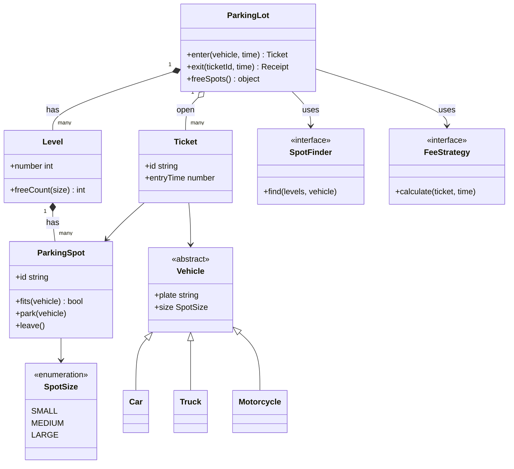
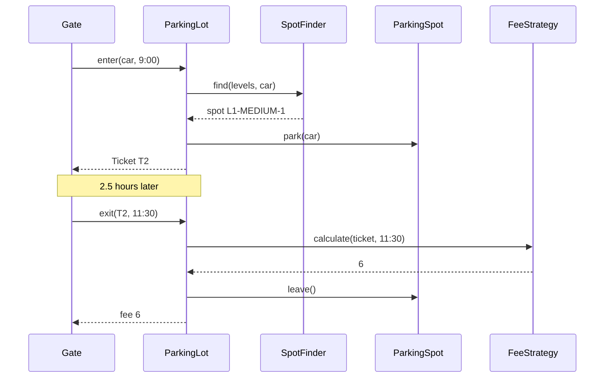

<Callout title="About this question">
  - **Difficulty:** Easy. The classic first LLD question.
  - **Patterns used:** [Strategy](../design-patterns/strategy.mdx) (fees, choosing a spot), [Factory](../design-patterns/factory.mdx) (vehicles).
  - **Also asked as:** "Design a parking garage", "Design a smart parking system", "Design a multi-level car park".
</Callout>

## Understand the problem

Think of a shopping mall car park. You drive up to the gate, a machine gives you a ticket, and you park. When you leave, you show the ticket at the exit and pay for the time you stayed.

We model that with classes. Three things make it interesting:

- **Sizes.** A truck can't use a motorcycle spot, but a motorcycle can use a truck spot.
- **Rules change.** Today it is "2 per hour". Next month it is "flat 5 on weekends". The code must take new rules easily.
- **Many gates.** Two cars arrive at the same moment, and only one spot is left. Only one of them may get it.

## Step 1: Requirements

### Functional requirements

1. Users should be able to drive in with a motorcycle, car or truck, and get a ticket for a free spot.
2. Users should get only a spot that fits: a motorcycle fits any spot, a car fits MEDIUM or LARGE, a truck fits only LARGE.
3. Users should be able to exit with their ticket and pay a fee based on time and vehicle size.
4. Users should be able to see how many spots of each size are free (the "FREE: 12" sign at the entrance).
5. The owner should be able to change the fee rule and the spot-choosing rule.

### Out of scope

- Real payment (cards, cash). We return the amount to pay.
- Booking a spot ahead, monthly passes, electric car charging.
- Cameras, sensors and the gate hardware.

### Questions to ask the interviewer

| Question | What we assume |
| --- | --- |
| One building with many levels? | Yes. Each level has SMALL, MEDIUM and LARGE spots. |
| Can a small vehicle take a bigger spot? | Yes, but only when no smaller spot that fits is free. |
| How is the fee charged? | Per started hour, with a price per vehicle size. It must be easy to change. |
| How many gates? | Several entry and exit gates, all working at the same time. |
| What if the lot is full? | Refuse at the gate and show "FULL". |

## Step 2: Core classes

Nouns from the requirements become classes. Fixed lists of choices become enums.

| Class | What it is | Key data | Key actions |
| --- | --- | --- | --- |
| `Vehicle` (abstract) | Something that parks. `Motorcycle`, `Car` and `Truck` extend it. | `plate`, `size` | — |
| `VehicleFactory` | Makes the right vehicle from a type name | type → class map | `create(type, plate)` |
| `ParkingSpot` | One place to park | `id`, `size`, the parked vehicle | `fits(vehicle)`, `park(vehicle)`, `leave()` |
| `Level` | One floor of the building | `number`, `spots` | `freeCount(size)` |
| `Ticket` | Proof that a vehicle came in | `id`, `vehicle`, `spot`, `entryTime` | — |
| `SpotFinder` (interface) | The rule for picking a spot | — | `find(levels, vehicle)` |
| `FeeStrategy` (interface) | The rule for the price | — | `calculate(ticket, exitTime)` |
| `ParkingLot` | The main service. The gates call it. | `levels`, open tickets, the two rules | `enter`, `exit`, `freeSpots` |

**Enums:**

- `SpotSize`: `SMALL`, `MEDIUM`, `LARGE`.
- `VehicleType`: `MOTORCYCLE`, `CAR`, `TRUCK`.

<Callout title="Is a gate a class?" type="idea">
  Not yet. A gate only calls `ParkingLot.enter()` or `ParkingLot.exit()`. Add a `Gate` class only when gates get their
  own data, such as a display or a ticket printer. Saying this out loud shows you keep the design small on purpose.
</Callout>

## Step 3: Class diagram



To keep the picture small, it leaves out `VehicleFactory` and the rule classes: `BestFitSpotFinder` and `NearestSpotFinder` implement `SpotFinder`, and `HourlyFee` and `FlatFee` implement `FeeStrategy`.

- **Composition for levels and spots.** A spot doesn't exist without its level, and a level doesn't exist without the lot. The lot creates them and they live and die with it.
- **Association for the ticket.** A ticket only points to a vehicle and a spot. It doesn't own them: the car drives away, and the spot stays.
- **Two interfaces for the rules.** `ParkingLot` knows only "something that finds a spot" and "something that prices a stay". A new rule is a new class, and the lot doesn't change. This is the same idea as the compare function you pass to `Array.prototype.sort`.
- **`Vehicle` is abstract and knows its `size`.** The lot never asks "is this a truck?". It asks "what size do you need?". There is no `if (type === 'TRUCK')` anywhere.

## Step 4: Main methods

- `ParkingLot.enter(vehicle, time)` → `Ticket`. Finds a spot, takes it, and makes a ticket. Throws if the lot is full or the plate is already inside.
- `ParkingLot.exit(ticketId, time)` → `{ plate, spot, fee }`. Prices the stay and frees the spot.
- `ParkingLot.freeSpots()` → free spots per size, for the sign at the entrance.
- `SpotFinder.find(levels, vehicle)` → a free spot that fits, or `null`.
- `FeeStrategy.calculate(ticket, exitTime)` → the price.
- `VehicleFactory.create(type, plate)` → a `Motorcycle`, `Car` or `Truck`.

The main flow, from entry to exit:



## Step 5: Code

**Part 1: enums and small classes.** Each vehicle knows the smallest spot size it needs. The factory turns a type name into the right class.

```js
const SpotSize = Object.freeze({ SMALL: 'SMALL', MEDIUM: 'MEDIUM', LARGE: 'LARGE' });
const VehicleType = Object.freeze({ MOTORCYCLE: 'MOTORCYCLE', CAR: 'CAR', TRUCK: 'TRUCK' });
const SIZES = [SpotSize.SMALL, SpotSize.MEDIUM, SpotSize.LARGE]; // small to large

class Vehicle { // abstract
  constructor(plate) {
    if (new.target === Vehicle) throw new Error('Vehicle is abstract');
    this.plate = plate;
  }
  get size() { throw new Error('not implemented'); } // the smallest spot it fits in
}
class Motorcycle extends Vehicle { get size() { return SpotSize.SMALL; } }
class Car extends Vehicle { get size() { return SpotSize.MEDIUM; } }
class Truck extends Vehicle { get size() { return SpotSize.LARGE; } }

class VehicleFactory {
  static #classes = { MOTORCYCLE: Motorcycle, CAR: Car, TRUCK: Truck };
  static create(type, plate) {
    const VehicleClass = VehicleFactory.#classes[type];
    if (!VehicleClass) throw new Error(`Unknown vehicle type: ${type}`);
    return new VehicleClass(plate);
  }
}

class ParkingSpot {
  #vehicle = null;
  constructor(id, size) {
    this.id = id;
    this.size = size;
  }
  get isFree() { return this.#vehicle === null; }
  fits(vehicle) { return SIZES.indexOf(this.size) >= SIZES.indexOf(vehicle.size); }
  park(vehicle) {
    if (!this.isFree) throw new Error(`Spot ${this.id} is taken`);
    this.#vehicle = vehicle;
  }
  leave() { this.#vehicle = null; }
}

class Ticket {
  static #nextId = 1;
  constructor(vehicle, spot, entryTime) {
    this.id = `T${Ticket.#nextId++}`;
    this.vehicle = vehicle;
    this.spot = spot;
    this.entryTime = entryTime;
  }
}
```

**Part 2: levels and the two rules.** Each rule is an "interface" (a base class whose method throws) with small classes that fill it in.

```js
class Level {
  constructor(number, counts) { // counts: how many spots of each size, e.g. { SMALL: 2, MEDIUM: 5 }
    this.number = number;
    this.spots = [];
    for (const size of SIZES) {
      for (let i = 1; i <= (counts[size] ?? 0); i++) {
        this.spots.push(new ParkingSpot(`L${number}-${size}-${i}`, size));
      }
    }
  }
  freeCount(size) { return this.spots.filter((s) => s.isFree && s.size === size).length; }
}

class SpotFinder { // interface
  find(levels, vehicle) { throw new Error('not implemented'); }
}
class NearestSpotFinder extends SpotFinder { // lowest level first, any spot that fits
  find(levels, vehicle) {
    for (const level of levels) {
      const spot = level.spots.find((s) => s.isFree && s.fits(vehicle));
      if (spot) return spot;
    }
    return null;
  }
}
class BestFitSpotFinder extends SpotFinder { // smallest spot that fits, so big spots stay free
  find(levels, vehicle) {
    for (const size of SIZES.slice(SIZES.indexOf(vehicle.size))) {
      for (const level of levels) {
        const spot = level.spots.find((s) => s.isFree && s.size === size);
        if (spot) return spot;
      }
    }
    return null;
  }
}

const HOUR = 60 * 60 * 1000;
class FeeStrategy { // interface
  calculate(ticket, exitTime) { throw new Error('not implemented'); }
}
class HourlyFee extends FeeStrategy {
  constructor(ratePerHour) { // price per hour, by vehicle size
    super();
    this.ratePerHour = ratePerHour;
  }
  calculate(ticket, exitTime) {
    const hours = Math.max(1, Math.ceil((exitTime - ticket.entryTime) / HOUR)); // a started hour counts as full
    return hours * this.ratePerHour[ticket.vehicle.size];
  }
}
class FlatFee extends FeeStrategy {
  constructor(amount) {
    super();
    this.amount = amount;
  }
  calculate() { return this.amount; }
}
```

**Part 3: the main service.** `ParkingLot` gets its rules from outside (dependency injection), so tests and new rules are easy.

```js
class ParkingLot {
  #tickets = new Map(); // ticket id -> Ticket
  #platesInside = new Set();
  constructor(levels, spotFinder, feeStrategy) {
    this.levels = levels;
    this.spotFinder = spotFinder;
    this.feeStrategy = feeStrategy;
  }

  // Find and take the spot with no `await` in between, so no other car can grab it.
  enter(vehicle, time = Date.now()) {
    if (this.#platesInside.has(vehicle.plate)) throw new Error(`${vehicle.plate} is already inside`);
    const spot = this.spotFinder.find(this.levels, vehicle);
    if (!spot) throw new Error(`Full: no spot for ${vehicle.plate}`);
    spot.park(vehicle);
    this.#platesInside.add(vehicle.plate);
    const ticket = new Ticket(vehicle, spot, time);
    this.#tickets.set(ticket.id, ticket);
    return ticket;
  }

  exit(ticketId, time = Date.now()) {
    const ticket = this.#tickets.get(ticketId);
    if (!ticket) throw new Error(`Unknown ticket: ${ticketId}`);
    const fee = this.feeStrategy.calculate(ticket, time);
    ticket.spot.leave();
    this.#tickets.delete(ticketId); // a used ticket can't be used again
    this.#platesInside.delete(ticket.vehicle.plate);
    return { plate: ticket.vehicle.plate, spot: ticket.spot.id, fee };
  }

  freeSpots() {
    const free = {};
    for (const size of SIZES) free[size] = this.levels.reduce((n, level) => n + level.freeCount(size), 0);
    return free;
  }
}
```

**Part 4: try it.** A tiny lot with four spots on two levels.

```js
const lot = new ParkingLot(
  [new Level(1, { SMALL: 1, MEDIUM: 1 }), new Level(2, { MEDIUM: 1, LARGE: 1 })],
  new BestFitSpotFinder(),
  new HourlyFee({ SMALL: 1, MEDIUM: 2, LARGE: 4 }),
);
const nine = Date.UTC(2026, 0, 1, 9); // 9:00, as milliseconds

const bike = VehicleFactory.create(VehicleType.MOTORCYCLE, 'BIKE-1');
const car1 = VehicleFactory.create(VehicleType.CAR, 'CAR-1');
const car2 = VehicleFactory.create(VehicleType.CAR, 'CAR-2');
const truck = VehicleFactory.create(VehicleType.TRUCK, 'TRUCK-1');

const t1 = lot.enter(bike, nine);
const t2 = lot.enter(car1, nine);
const t3 = lot.enter(car2, nine);
console.log(t1.id, t1.spot.id); // T1 L1-SMALL-1
console.log(t3.id, t3.spot.id); // T3 L2-MEDIUM-1
console.log(lot.freeSpots()); // { SMALL: 0, MEDIUM: 0, LARGE: 1 }

try { lot.enter(car2, nine); } catch (e) { console.log(e.message); } // CAR-2 is already inside
lot.enter(truck, nine);
try {
  lot.enter(VehicleFactory.create(VehicleType.CAR, 'CAR-3'), nine);
} catch (e) { console.log(e.message); } // Full: no spot for CAR-3

console.log(lot.exit(t2.id, nine + 2.5 * HOUR)); // { plate: 'CAR-1', spot: 'L1-MEDIUM-1', fee: 6 }
console.log(lot.freeSpots()); // { SMALL: 0, MEDIUM: 1, LARGE: 0 }

lot.feeStrategy = new FlatFee(5); // weekend price: swap the strategy, nothing else changes
console.log(lot.exit(t1.id, nine + 8 * HOUR).fee); // 5
```

`CAR-1` stayed 2.5 hours. That is 3 started hours × 2 = 6.

## Step 6: Edge cases and extensions

### Edge cases

| Case | What happens |
| --- | --- |
| The lot is full | `enter` throws "Full". The gate shows FULL and doesn't open. |
| A truck comes, and only MEDIUM spots are free | Full for the truck. Cars can still come in. |
| A motorcycle comes, and only a LARGE spot is free | It gets the LARGE spot. It fits, and best-fit only prefers smaller spots. |
| The same plate enters twice | Refused: "already inside". This catches a camera that reads a plate twice. |
| An unknown or already used ticket at the exit | Refused. A used ticket is deleted, so it can't be used twice. |
| A lost ticket | Find the ticket by plate, and charge a fixed "lost ticket" price (one more `FeeStrategy`). |
| A stay of 10 minutes | Charged 1 hour, the minimum. |
| An unknown vehicle type | `VehicleFactory.create` throws. |

### Two requests at once

Two cars reach two gates at the same moment, and one spot is left. Only one may get it.

JavaScript runs one piece of code at a time. A plain function like `enter` always finishes before the next call starts. The danger is an `await` between **finding** a spot and **taking** it:

```js
// NOT SAFE. A fragment, not runnable on its own.
async enter(vehicle) {
  const spot = this.spotFinder.find(this.levels, vehicle); // car A finds L2-LARGE-1
  await this.printer.printTicket(vehicle);                 // car A waits here. Car B runs and finds the same spot.
  spot.park(vehicle);                                      // the second park() throws "Spot is taken"
}
```

The fix: take the spot first, then do the slow work.

```js
// SAFE. A fragment, not runnable on its own.
async enter(vehicle) {
  const spot = this.spotFinder.find(this.levels, vehicle);
  if (!spot) throw new Error('Full');
  spot.park(vehicle);                      // taken at once; no one else can find it now
  await this.printer.printTicket(vehicle); // slow work after (if it fails, call spot.leave())
}
```

With **many gates on many servers**, each server has its own memory, so this is not enough. Keep the spots in a database and let the database pick the winner:

```sql
UPDATE spots SET plate = 'CAR-3'
WHERE id = 'L2-LARGE-1' AND plate IS NULL;
-- 1 row changed: you got the spot. 0 rows changed: someone was faster, try the next spot.
```

In Java, you would mark `enter` as `synchronized`, so only one thread runs it at a time. See [Race Conditions and Locks](../concurrency/race-conditions-locks.mdx).

### Adding features

- **A new price rule** (weekend flat price, first 30 minutes free): add a new `FeeStrategy` class. `ParkingLot` doesn't change. This is [Strategy](../design-patterns/strategy.mdx) and the [Open-Closed Principle](../design-principles/open-closed.mdx).
- **A new vehicle** (a bus that needs LARGE): add `class Bus extends Vehicle` and register it in `VehicleFactory`. The lot and the finders don't change. This is [Factory](../design-patterns/factory.mdx).
- **Live "FREE" signs on every level:** the lot sends a "spot changed" event, and each sign listens, just like Node's `EventEmitter`. This is [Observer](../design-patterns/observer.mdx).

## Patterns used

| Pattern | Where | Why |
| --- | --- | --- |
| [Strategy](../design-patterns/strategy.mdx) | `FeeStrategy`: `HourlyFee`, `FlatFee` | Change prices without touching the lot. |
| [Strategy](../design-patterns/strategy.mdx) | `SpotFinder`: `BestFitSpotFinder`, `NearestSpotFinder` | Change how spots are chosen. |
| [Factory](../design-patterns/factory.mdx) | `VehicleFactory.create(type, plate)` | One place turns `'CAR'` into a `Car`. |
| [Dependency Injection](../design-principles/dependency-injection.mdx) | `new ParkingLot(levels, finder, fee)` | The lot gets its rules from outside, so tests can pass simple ones. |

## Follow-up questions

<Accordions>
<Accordion title="Why not make ParkingLot a Singleton?">

There is one lot in the building, so it is tempting. But a singleton is shared global state: tests can't start with a fresh lot, and a company with ten lots can't have ten objects. Create one lot at startup and pass it to the gates instead. See [Singleton](../design-patterns/singleton.mdx).

</Accordion>
<Accordion title="With 10,000 spots, how do you find a free one fast?">

Scanning every spot is slow. Keep a list of free spots for each size (per level). Taking a spot removes one from the list in O(1). Leaving puts it back. For "nearest to the entrance", use a min-heap ordered by distance.

</Accordion>
<Accordion title="How would you add spot booking?">

Add a `Reservation` class (plate, spot, from, to). The spot finder skips spots that are booked for the coming hours. On entry, a car with a booking goes straight to its booked spot.

</Accordion>
<Accordion title="Where does payment go?">

Behind a `PaymentMethod` interface with `pay(amount)`, so card, cash and phone payments are separate classes (Strategy again). `exit` returns the fee, and the exit gate charges it before it opens.

</Accordion>
</Accordions>

## What the interviewer expects

<Tabs items={['Mid-level', 'Senior', 'Staff']}>
<Tab value="Mid-level">

- Clear classes: `Vehicle`, `ParkingSpot`, `Level`, `Ticket`, `ParkingLot`.
- Working `enter` and `exit`, with the size rule and a simple fee.
- A clean class diagram with the right relationships.

</Tab>
<Tab value="Senior">

- Strategy for fees and for choosing a spot, without being asked.
- The race between two gates, and the database rule for many servers.
- Edge cases: full lot, lost ticket, the same car twice.

</Tab>
<Tab value="Staff">

- Everything from senior, but faster.
- Fast free-spot lookup for big lots, and running many lots from one system.
- Clear choices about what to leave simple, and why.

</Tab>
</Tabs>

<Callout title="Remember this" type="success">
  - Ask about sizes, fees and gates first. Say that payment and booking are out of scope.
  - A vehicle knows its size, and a spot knows if a vehicle fits. No `if (type === 'TRUCK')` in the lot.
  - The fee and the spot choice are Strategies: a new rule is a new class.
  - Find and take a spot with no `await` in between. With many servers, let the database pick the winner.
  - Pass the lot to the gates. It doesn't need to be a Singleton.
</Callout>
