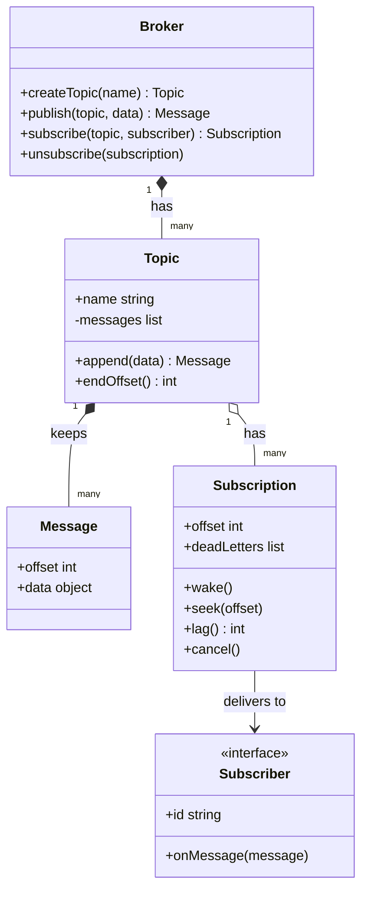
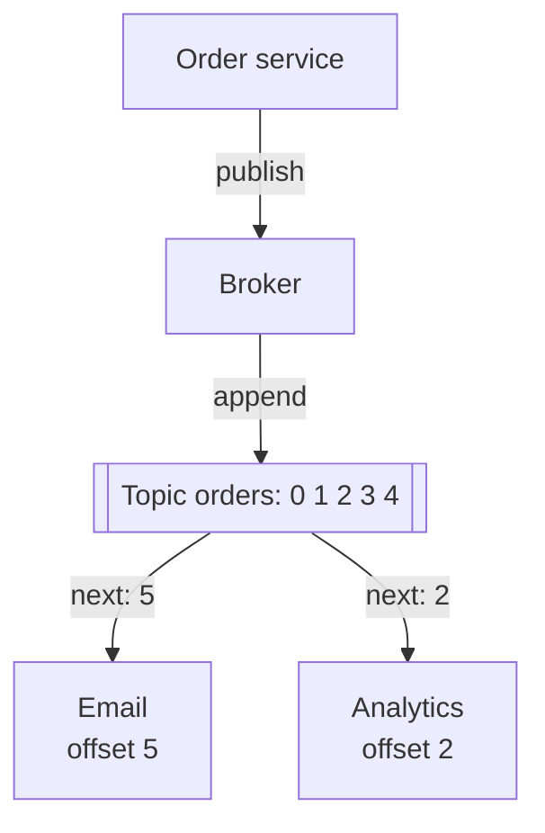
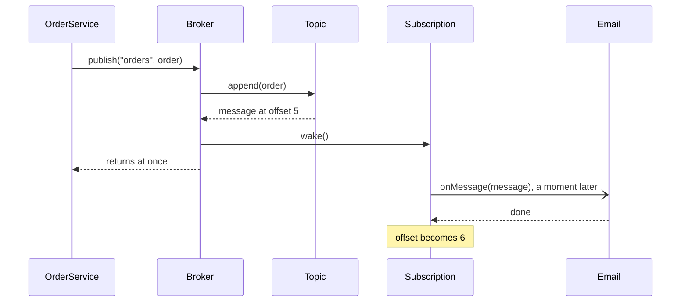

<Callout title="About this question">
  - **Difficulty:** Medium.
  - **Patterns used:** [Observer](../design-patterns/observer.mdx) (subscribers listen to a topic), [Producer-Consumer](../concurrency/producer-consumer.mdx) (each subscriber works at its own pace), [Facade](../design-patterns/facade.mdx) (one `Broker` in front).
  - **Also asked as:** "Design a message broker", "Design an in-memory message queue", "Design an event bus", "Design Kafka (LLD)".
</Callout>

## Understand the problem

Think of magazine subscriptions. A publisher prints "Cricket Weekly" and hands the copies to the post office. The post office knows who subscribed, and puts a copy in each of their mailboxes. The publisher never knows who reads it. If you go on holiday, the magazines pile up in your mailbox, and you read them when you are back. Your neighbour still gets theirs on time.

A pub-sub system does the same inside a program. A **publisher** sends a message to a **topic**, like `orders`. Every **subscriber** of that topic gets it. The **broker** sits in the middle.

What makes it interesting:

- **Publishers and subscribers don't know each other.** The order service just says "new order". It doesn't know that email, analytics and the warehouse are listening.
- **Every subscriber gets every message, in order.** Order 2 must never arrive before order 1.
- **Speeds differ.** Email is fast. Analytics is slow. A slow subscriber must not slow down the publisher or the others.
- **Failures.** A subscriber can throw. It must not break the others, and one bad message must not block the messages behind it.

This is the class design, inside one program. For a broker that keeps messages on disk across many machines, like Kafka, see the [Distributed Message Queue system design](/learn/system-design/questions/distributed-message-queue).

## Step 1: Requirements

### Functional requirements

1. Users should be able to create topics, like `orders` or `payments`.
2. Publishers should be able to publish a message to a topic, and get control back at once.
3. Subscribers should be able to subscribe to a topic, and unsubscribe at any time.
4. Each subscriber should get every message published after it subscribed, in the same order.
5. A slow or failing subscriber should not slow down or break the publisher or the other subscribers.
6. A subscriber should be able to replay old messages from a point it chooses.

### Out of scope

- Saving messages to disk, and surviving a restart.
- Many machines, partitions and consumer groups (the distributed version).
- Filters and wildcard topics like `orders.*` (an extension later).

### Questions to ask the interviewer

| Question | What we assume |
| --- | --- |
| Does the broker call subscribers (push), or do they ask (pull)? | Push. The broker calls `onMessage` on each subscriber. |
| Does a new subscriber get old messages? | No, only new ones. It can ask for a replay with `seek`. |
| Must the order be kept? | Yes, for each subscriber, within one topic. |
| What if a subscriber throws? | Try up to 3 times. Then put the message aside (a "dead letter") and move on. |
| Can a message be lost? | Not while the program runs. Everything is in memory, so a crash loses it (out of scope). |
| Sync or async? | Async. `publish` returns at once, and subscribers run a moment later. |

## Step 2: Core classes

| Class | What it is | Key data | Key actions |
| --- | --- | --- | --- |
| `Message` | One published item | `topicName`, `offset`, `data` | — |
| `Topic` | A named channel. It keeps its messages in order, like a log. | `name`, `messages`, `subscriptions` | `append(data)`, `endOffset()` |
| `Subscriber` (interface) | Anyone who wants messages | `id` | `onMessage(message)` |
| `Subscription` | One subscriber on one topic, with its own place in it | `offset`, `deadLetters` | `wake()`, `seek(offset)`, `lag()`, `cancel()` |
| `Broker` | The main service. Everyone talks to it. | `topics` | `createTopic`, `publish`, `subscribe`, `unsubscribe` |

An **offset** is a message's place in the topic: 0, 1, 2, and so on. A subscription remembers one number: the offset of the next message it needs. It is like a bookmark in a book.

<Callout title="Is a publisher a class?" type="idea">
  Not here. Any code that calls `broker.publish()` is a publisher, like the order service. Add a `Publisher` class
  only when publishers get their own data, such as a name for the logs or a rate limit. Saying this shows you keep
  the design small on purpose.
</Callout>

## Step 3: Class diagram



`PrintService`, `AnalyticsService` and `WarehouseService` in the code below implement `Subscriber`. They are left out to keep the picture small.

- **Composition for topics and messages.** The broker creates the topics, and a topic creates its messages. They don't exist without it.
- **The subscription is its own class.** It holds what belongs to "this subscriber on this topic": the offset, the failed messages, and its delivery loop. One subscriber can be on two topics, with a different offset on each.
- **`Subscriber` is an interface.** The broker only calls `onMessage`. It never knows if it is talking to email or analytics. This is [Observer](../design-patterns/observer.mdx).
- **The `Broker` is the front door.** Publishers never touch a `Topic`. They call the broker, which is a [Facade](../design-patterns/facade.mdx).

### Offsets or a queue per subscriber?

There are two common ways to give every subscriber every message. We use **offsets**: one shared list, and one bookmark per subscriber.



Email has handled all 5 messages, so its next offset is 5. Analytics is slow. It has handled 0 and 1, so its next offset is 2: it is 3 messages behind. Both read the same list. Nothing is copied.

| | Offsets (one shared log) | A queue per subscriber |
| --- | --- | --- |
| How it works | The topic keeps every message. Each subscriber keeps a number: its place. | `publish` puts the message into every subscriber's own queue. The subscriber removes it when done. |
| Copies | One copy of each message | One per subscriber |
| Replay old messages | Easy: move the offset back | Not possible: handled messages are gone |
| Deleting old messages | Needs a rule, like "keep the last 7 days" | Automatic: gone once handled |
| In the real world | Kafka, Redis Streams | RabbitMQ, Amazon SNS + SQS |

Offsets give replay for free, and it is how Kafka works. A queue per subscriber is also a fine answer. Say which one you pick, and why.

## Step 4: Main methods

- `Broker.createTopic(name)` → `Topic`. Throws if the name is taken.
- `Broker.publish(topicName, data)` → `Message`. Adds the message to the topic, wakes every subscription, and returns at once.
- `Broker.subscribe(topicName, subscriber)` → `Subscription`. Starts at the end of the topic, so only new messages arrive.
- `Broker.unsubscribe(subscription)`. Stops delivery. A message being handled still finishes.
- `Subscription.wake()`. Starts the delivery loop, if it isn't running.
- `Subscription.seek(offset)`. Moves the bookmark, for a replay.
- `Subscription.lag()` → how many messages it is behind.

One publish, from the order service to the email subscriber:



## Step 5: Code

On your computer, save all the parts together as one file, `pubsub.mjs` ("Try it" uses top-level `await`). Long classes come in a few pieces. Together they make the whole class. **Run** on a part also runs the earlier parts it needs.

### Part 1: Messages and topics

**A message.** It knows its topic, its place (offset), and its data.

```js
class Message {
    constructor(topicName, offset, data) {
        this.topicName = topicName;
        // Its place in the topic: 0, 1, 2, and so on.
        this.offset = offset;
        this.data = data;
    }
}
```

**A topic.** It keeps every message in an array. The array index is the offset.

```js
// A named channel. It keeps every message, in the order they came in.
class Topic {
    constructor(name) {
        this.name = name;
        // The log: messages[0] has offset 0, messages[1] has offset 1, ...
        this.messages = [];
        // subscription id -> Subscription
        this.subscriptions = new Map();
    }

    append(data) {
        // The next offset is the number of messages so far.
        const offset = this.messages.length;
        const message = new Message(this.name, offset, data);
        this.messages.push(message);
        return message;
    }

    // The offset the next message will get.
    endOffset() {
        return this.messages.length;
    }
}
```

### Part 2: The subscriber interface

Every subscriber has an `id` and an `onMessage(message)` method. This is the observer in [Observer](../design-patterns/observer.mdx).

```js
// Interface: a subscriber has an id and an onMessage() method.
// onMessage may be async, and it may throw.
class Subscriber {
    constructor(id) {
        this.id = id;
    }

    async onMessage(message) {
        throw new Error("not implemented");
    }
}
```

### Part 3: The subscription

This is the heart of the design. Each subscription has its **own delivery loop**, so a slow subscriber only slows itself.

**Piece 1: its data.** A new subscription starts at the end of the topic.

```js
// The number for the next subscription id.
let nextSubscriptionNumber = 1;

// One subscriber on one topic, with its own place (offset) in the topic.
class Subscription {
    constructor(topic, subscriber, maxAttempts = 3) {
        this.id = `S${nextSubscriptionNumber}`;
        nextSubscriptionNumber += 1;

        this.topic = topic;
        this.subscriber = subscriber;
        // How many times to try one message before giving up on it.
        this.maxAttempts = maxAttempts;

        // The offset of the next message to deliver.
        // A new subscriber starts at the end, so it gets only new messages.
        this.offset = topic.endOffset();
        // Becomes false on unsubscribe.
        this.active = true;
        // The running delivery loop, or null when there is nothing to do.
        this.delivering = null;
        // Becomes true when seek() moves the offset.
        this.seekCalled = false;
        // Messages that failed every attempt.
        this.deadLetters = [];
    }
```

**Piece 2: the delivery loop.** `wake()` starts one loop. The loop hands over messages one at a time, until it reaches the end of the topic.

```js
    // Called when a new message arrives. Starts the loop, if it isn't running.
    wake() {
        if (this.delivering !== null) {
            return;
        }

        this.delivering = this.deliver();
    }

    async deliver() {
        // Wait one moment, so publish() returns before any subscriber runs.
        await Promise.resolve();

        while (this.active && this.offset < this.topic.endOffset()) {
            const message = this.topic.messages[this.offset];
            this.seekCalled = false;
            await this.deliverOne(message);

            // Move to the next message, unless seek() moved us while we waited.
            if (!this.seekCalled) {
                this.offset += 1;
            }
        }

        // No await between the last check and this line,
        // so a new message can't slip in unseen.
        this.delivering = null;
    }
```

How it works:

- `delivering` holds the running loop. While it runs, `wake()` does nothing, so there is never more than one loop per subscriber. That keeps the messages in order.
- `await Promise.resolve()` waits one tiny moment. `publish` finishes first, and the subscriber runs right after. So the publisher never waits for a subscriber.
- The offset moves only **after** a message is handled, like a Kafka consumer that commits after processing.
- If `seek()` runs while a message is being handled, `seekCalled` tells the loop to keep the new offset and not add 1. This also works for a seek back to the message being handled: it runs again.
- A message that arrives while the loop runs is picked up by the same loop, because the `while` checks `endOffset()` each time.

**Piece 3: retries and dead letters.** A failed message is tried again, up to `maxAttempts` times. If it still fails, it goes to `deadLetters`, and the loop moves on.

```js
    // Try a message a few times. If it still fails, set it aside and move on.
    async deliverOne(message) {
        for (let attempt = 1; attempt <= this.maxAttempts; attempt++) {
            try {
                await this.subscriber.onMessage(message);
                return;
            } catch (error) {
                // It failed. The loop tries again.
            }
        }

        // Every attempt failed. Don't let it block the messages behind it.
        this.deadLetters.push(message);
    }
```

This version tries again at once. A real system waits a little between tries, longer each time. See [Retries and Backoff](/learn/system-design/messaging/retries-backoff-timeouts) and [Dead Letter Queues](/learn/system-design/messaging/dead-letter-queues).

**Piece 4: replay, stop, lag and flush.** These finish the `Subscription` class.

```js
    // Replay: move back (or forward) to any offset.
    seek(offset) {
        if (offset < 0 || offset > this.topic.endOffset()) {
            throw new Error(`No offset ${offset} in ${this.topic.name}`);
        }

        this.offset = offset;
        this.seekCalled = true;
        this.wake();
    }

    // Stop. A message being handled right now still finishes.
    cancel() {
        this.active = false;
    }

    // How many messages this subscriber still has to handle.
    lag() {
        return this.topic.endOffset() - this.offset;
    }

    // Wait until this subscriber has caught up. Handy in tests.
    async flush() {
        await this.delivering;
    }
}
```

### Part 4: The broker

**Piece 1: topics.** The broker keeps its topics by name.

```js
// The main service. Publishers and subscribers talk to the broker.
class Broker {
    constructor() {
        // topic name -> Topic
        this.topics = new Map();
    }

    createTopic(name) {
        if (this.topics.has(name)) {
            throw new Error(`Topic ${name} already exists`);
        }

        const topic = new Topic(name);
        this.topics.set(name, topic);
        return topic;
    }

    getTopic(name) {
        const topic = this.topics.get(name);
        if (!topic) {
            throw new Error(`No topic ${name}`);
        }

        return topic;
    }
```

**Piece 2: publishing.** `publish` saves the message, wakes every subscription, and returns. It never waits for a subscriber.

```js
    // Save the message, wake every subscriber, and return at once.
    publish(topicName, data) {
        const topic = this.getTopic(topicName);
        const message = topic.append(data);

        for (const subscription of topic.subscriptions.values()) {
            subscription.wake();
        }

        return message;
    }
```

**Piece 3: subscribing and unsubscribing.**

```js
    subscribe(topicName, subscriber) {
        const topic = this.getTopic(topicName);

        // The same subscriber twice would get every message twice.
        for (const existing of topic.subscriptions.values()) {
            if (existing.subscriber.id === subscriber.id) {
                throw new Error(`${subscriber.id} is already on ${topicName}`);
            }
        }

        const subscription = new Subscription(topic, subscriber);
        topic.subscriptions.set(subscription.id, subscription);
        return subscription;
    }

    unsubscribe(subscription) {
        subscription.cancel();
        subscription.topic.subscriptions.delete(subscription.id);
    }
```

**Piece 4: status.** This finishes the `Broker` class. It shows how far behind each subscriber is.

```js
    // How far behind each subscriber is, like "email: 0 behind".
    status(topicName) {
        const topic = this.getTopic(topicName);
        const parts = [];

        for (const subscription of topic.subscriptions.values()) {
            const name = subscription.subscriber.id;
            parts.push(`${name}: ${subscription.lag()} behind`);
        }

        return parts.join(" | ");
    }
}
```

### Part 5: Try it

**A fast and a slow subscriber.** `sleep` stands in for slow work, like a network call.

```js
// Wait some milliseconds.
function sleep(milliseconds) {
    return new Promise((resolve) => setTimeout(resolve, milliseconds));
}

// Fast: prints each message at once.
class PrintService extends Subscriber {
    async onMessage(message) {
        console.log(`${this.id} got order ${message.data.orderId}`);
    }
}

// Slow: each message takes 50 ms.
class AnalyticsService extends Subscriber {
    constructor(id) {
        super(id);
        this.count = 0;
    }

    async onMessage(message) {
        await sleep(50);
        this.count += 1;
    }
}
```

**A subscriber that fails.** The warehouse throws for an order with no items.

```js
class WarehouseService extends Subscriber {
    async onMessage(message) {
        if (message.data.items === 0) {
            throw new Error("Order has no items");
        }

        console.log(`${this.id} packed order ${message.data.orderId}`);
    }
}
```

**Publish three orders.** `publish` returns before any subscriber runs, so "published 3 orders" prints first.

```js
const broker = new Broker();
broker.createTopic("orders");

const email = broker.subscribe("orders", new PrintService("email"));
const analytics = broker.subscribe("orders", new AnalyticsService("analytics"));

broker.publish("orders", { orderId: 1 });
broker.publish("orders", { orderId: 2 });
broker.publish("orders", { orderId: 3 });
console.log("published 3 orders");
console.log(broker.status("orders")); // email: 3 behind | analytics: 3 behind
```

**Wait for each subscriber.** Email is done almost at once. Analytics takes 50 ms per message, so it is still 3 behind.

```js
await email.flush();
// email got order 1
// email got order 2
// email got order 3
console.log(broker.status("orders")); // email: 0 behind | analytics: 3 behind

await analytics.flush();
console.log(broker.status("orders")); // email: 0 behind | analytics: 0 behind
console.log(analytics.subscriber.count); // 3
```

Email finished while analytics was still on its first message. Neither waited for the other, and the publisher waited for neither.

**Unsubscribe and replay.** Email stops getting messages. A new `audit` subscriber starts at the end, then replays from offset 2.

```js
broker.unsubscribe(email);
broker.publish("orders", { orderId: 4 });
await analytics.flush();
console.log(analytics.subscriber.count); // 4

const audit = broker.subscribe("orders", new PrintService("audit"));
console.log(audit.lag()); // 0

audit.seek(2);
await audit.flush();
// audit got order 3
// audit got order 4
```

**A bad message.** The warehouse fails 3 times on order 5. That order goes to the dead letters, and order 6 still gets packed.

```js
broker.unsubscribe(audit);
broker.unsubscribe(analytics);
const warehouse = broker.subscribe("orders", new WarehouseService("warehouse"));

broker.publish("orders", { orderId: 5, items: 0 });
broker.publish("orders", { orderId: 6, items: 2 });
await warehouse.flush();
// warehouse packed order 6

console.log(warehouse.deadLetters.length); // 1
console.log(warehouse.deadLetters[0].data.orderId); // 5
```

**Mistakes the broker refuses.**

```js
try {
    broker.publish("refunds", { orderId: 7 });
} catch (error) {
    console.log(error.message); // No topic refunds
}

try {
    broker.subscribe("orders", new PrintService("warehouse"));
} catch (error) {
    console.log(error.message); // warehouse is already on orders
}
```

## Step 6: Edge cases and extensions

### Edge cases

| Case | What happens |
| --- | --- |
| Publish to a topic that doesn't exist | Throws "No topic refunds". Another choice: create the topic on first use. |
| A topic with no subscribers | The message is still saved. A later subscriber can replay it with `seek`. |
| The same subscriber subscribes twice | Refused. It would get every message twice. |
| A subscriber throws | Tried 3 times, then put in `deadLetters`. The messages behind it still arrive. |
| Unsubscribe in the middle of a message (even from inside `onMessage`) | That message finishes. The loop checks `active` and stops before the next one. |
| `seek` to an offset that doesn't exist | Throws "No offset 9 in orders". |
| A subscriber never returns (a network call that hangs) | Its loop is stuck for good. Add a timeout: after, say, 5 seconds, count it as a failure. |
| A subscriber publishes to the topic it listens to | Allowed. It is just one more message. Watch out for endless loops. |

### Slow subscribers

A slow subscriber falls behind. Its messages stay in the topic until it catches up, so memory keeps growing. Pick a rule, and say it out loud in the interview:

| Option | How it works | Good | Bad |
| --- | --- | --- | --- |
| Keep everything | The slow one catches up later. | Nothing is lost. | Memory grows without limit. |
| Retention limit | Keep only the last N messages (or 7 days). A subscriber that falls too far behind jumps ahead. | Memory is capped. | The slow one misses messages. Kafka works this way. |
| Drop when full | Each subscriber may be at most N behind. Drop its oldest messages. | Simple and capped. | Loses messages. Fine for live prices or metrics. |
| Back-pressure | `publish` waits while a subscriber is too far behind. | Nothing is lost, memory is capped. | One slow subscriber slows everyone down. |
| More workers | Let the slow subscriber handle a few messages at once. | It catches up. | The order is no longer kept. |

Messages that every subscriber has already handled (below the lowest offset) can always be deleted safely. A good default: a retention limit, plus an alert when `lag()` keeps growing. Teams that run Kafka watch "consumer lag" closely for the same reason.

### Two requests at once

Two services publish to `orders` at the same moment.

In JavaScript, `publish` has no `await`. Taking the next offset and pushing the message happen together, so two messages never get the same offset. Each subscription also runs only one loop (`delivering`), so a subscriber never handles two messages at once, and the order stays right.

The danger is an `await` between **taking** the offset and **saving** the message:

```js noRun
// NOT SAFE. A fragment, not runnable on its own.
async append(data) {
    const offset = this.messages.length;

    // Another publish runs here and takes the same offset.
    await this.disk.save(offset, data);

    this.messages.push(new Message(this.name, offset, data));
}
```

The fix: push the message first, so the offset is taken at once, then do the slow work. Or keep one writer that saves messages one by one, like the file writer in the [Logger](./logger.mdx).

In Java, many threads publish at once. You would make `append` `synchronized`, and give each subscription its own thread that waits (`wait()` and `notify()`) until new messages arrive. See [Race Conditions and Locks](../concurrency/race-conditions-locks.mdx) and [Producer-Consumer](../concurrency/producer-consumer.mdx).

### Adding features

- **Filters** ("only orders over 100"): give `subscribe` a filter function. The loop skips messages that don't match, but still moves the offset. The broker doesn't change.
- **Wildcard topics** (`orders.*` gets both `orders.created` and `orders.paid`): when a message is published, the broker also wakes subscriptions whose pattern matches the topic name.
- **Saving to disk:** append each message to a file before `publish` returns, and save each offset. This is the first step towards the distributed version.
- **Keys and partitions:** split a topic into parts by a key, like the customer id. Each part keeps its own order, and different parts can be handled at the same time. This is how Kafka scales.

## Patterns used

| Pattern | Where | Why |
| --- | --- | --- |
| [Observer](../design-patterns/observer.mdx) | `Subscriber.onMessage`, called for each message | The publisher doesn't know who listens. A new subscriber changes nothing else. |
| [Producer-Consumer](../concurrency/producer-consumer.mdx) | The topic sits between publishers and each delivery loop | Each side works at its own speed. |
| [Facade](../design-patterns/facade.mdx) | `Broker` | One simple front door. Callers never touch a `Topic`. |
| [Dependency Inversion](../design-principles/dependency-inversion.mdx) | The broker depends on the `Subscriber` interface | Any class with `onMessage` can subscribe. |

Real systems follow the same shape:

- **Node's `EventEmitter`** is pub-sub with no buffer. `emit` calls every listener right away, one after another. A slow listener blocks the caller, and a listener added later never sees old events.
- **Redis Pub/Sub** is fire-and-forget: a subscriber that is not connected when a message is sent never gets it. **Redis Streams** keep the messages, with an ID for each, so readers can catch up and replay.
- **Kafka** uses offsets just like this page, and keeps each consumer group's offsets in an internal topic called `__consumer_offsets`.
- **RabbitMQ** uses a queue per subscriber: a "fanout" exchange copies each message into every queue bound to it.

## Follow-up questions

<Accordions>
<Accordion title="Why not just use EventEmitter?">

For simple cases, do. But `emit` calls every listener right away, inside the same call. A slow listener blocks the publisher, and a listener that throws stops the ones after it. There is no buffer, no retry and no replay. Our broker adds a log, an offset per subscriber, and a separate loop for each one.

</Accordion>
<Accordion title="How do you keep the order?">

One topic is one list, so the offsets are in order. Each subscription runs one loop and handles one message at a time. If a subscriber needs many workers to keep up, split the topic by a key, like the order id. Messages with the same key go to the same worker and stay in order. That is what Kafka partitions do.

</Accordion>
<Accordion title="At-most-once or at-least-once?">

It depends on when the offset moves. We move it **after** the message is handled. Once offsets are saved to disk, a crash in the middle means the message is handled again after the restart: **at-least-once**. Moving it **before** means a crash skips the message: **at-most-once**. With at-least-once, make subscribers safe to run twice (idempotent), for example by remembering the message ids they already handled. See [Delivery Guarantees](/learn/system-design/messaging/delivery-guarantees).

</Accordion>
<Accordion title="Push or pull?">

We push: the broker calls `onMessage`. In a **pull** design, the subscriber asks "give me messages from offset 5" when it is ready. Pull handles slow subscribers well, because each one takes only what it can handle. Kafka consumers pull. Our loop is close to pull: it takes the next message only when the last one is done.

</Accordion>
<Accordion title="How would you scale this to many machines?">

Save messages to disk in an append-only file, split each topic into partitions across machines, copy each partition to other machines, and let a group of consumers share the partitions. See the [Distributed Message Queue system design](/learn/system-design/questions/distributed-message-queue).

</Accordion>
</Accordions>

## What the interviewer expects

<Tabs items={['Mid-level', 'Senior', 'Staff']}>
<Tab value="Mid-level">

- Clear classes: `Broker`, `Topic`, `Message`, `Subscriber`, and subscribe and unsubscribe that work.
- Every subscriber gets every message, in order.
- One failing subscriber doesn't break the others.

</Tab>
<Tab value="Senior">

- Async delivery with one loop per subscriber, so a slow one only slows itself.
- Offsets vs a queue per subscriber, with the trade-off.
- Retries, dead letters, and a clear rule for slow subscribers.

</Tab>
<Tab value="Staff">

- Everything from senior, but faster.
- Delivery guarantees: when to move the offset, and idempotent subscribers.
- The path to the distributed version: disk, partitions, consumer groups, and watching lag.

</Tab>
</Tabs>

<Callout title="Remember this" type="success">
  - The broker sits in the middle. Publishers and subscribers never know each other.
  - A topic keeps its messages in order. Each subscriber keeps its own offset, like a bookmark.
  - One delivery loop per subscriber. A slow one falls behind, but never blocks the publisher or the others.
  - Retry a failing message a few times, then put it in the dead letters and move on.
  - Pick a rule for slow subscribers: keep everything, a retention limit, drop, or back-pressure.
</Callout>
