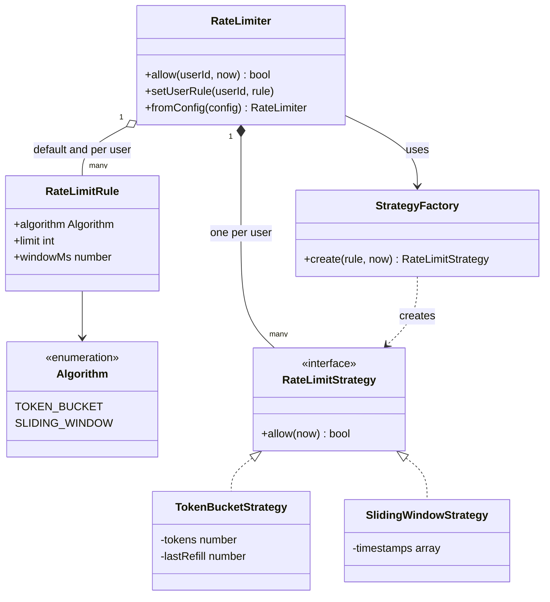
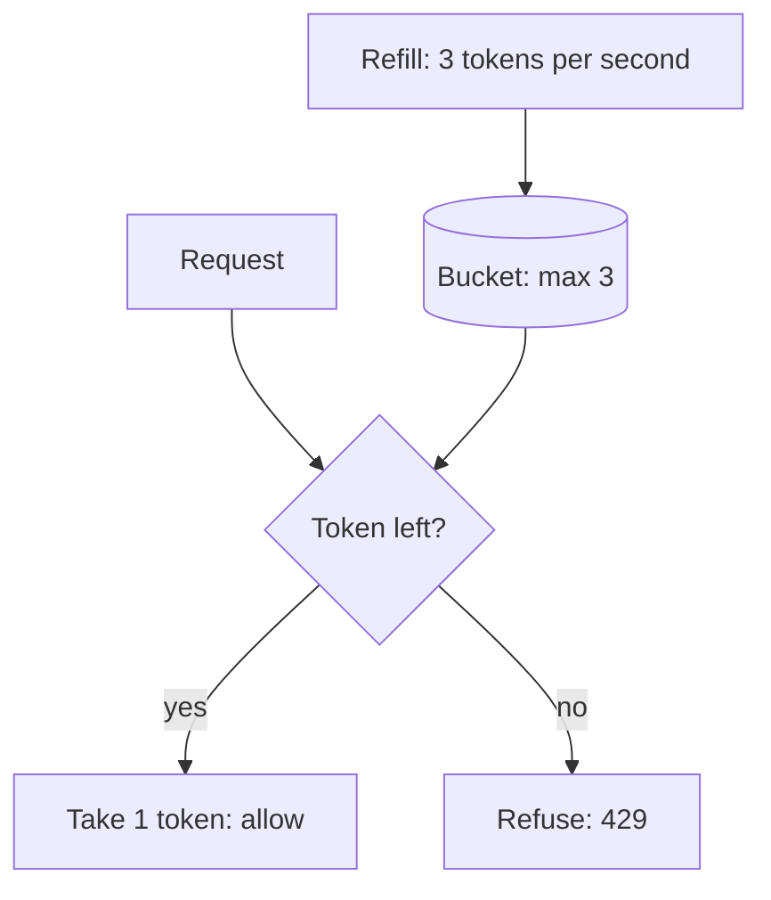
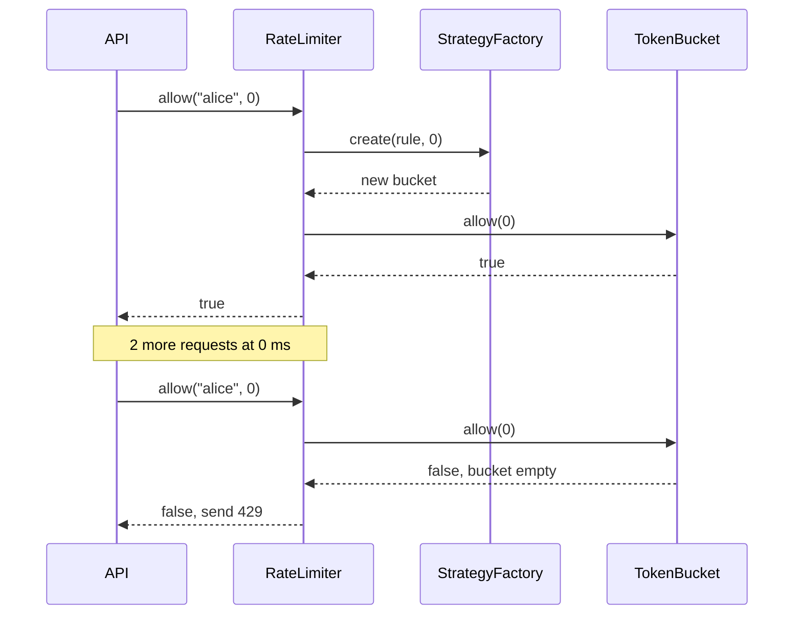

<Callout title="About this question">
  - **Difficulty:** Medium. The code is short, but the interviewer digs into the algorithms and "what about many servers?".
  - **Patterns used:** [Strategy](../design-patterns/strategy.mdx) (the algorithm), [Factory](../design-patterns/factory.mdx) (makes the right strategy from a rule).
  - **Also asked as:** "Design an API throttler", "Implement a token bucket", "Design a rate limiter class". The big-picture version, with Redis and many servers, is [Design a Rate Limiter (system design)](/learn/system-design/questions/rate-limiter).
</Callout>

## Understand the problem

An ATM lets you take out cash at most 5 times a day. Try a 6th time, and it says "limit reached, try again tomorrow". A **rate limiter** does the same for an API: each user may send at most N requests in a time window. Extra requests are refused, and the server answers **429 Too Many Requests**.

Why? So one user can't hog the server, an attacker can't guess passwords a million times, and costs stay under control.

There are two common ways to count:

- **Token bucket.** Like a jar that holds at most 3 tokens. A new token drips in every third of a second. Each request takes one token. An empty jar means "refused". A full jar lets a short burst through.
- **Sliding window.** Like a club bouncer with a notebook. He writes down the time of each guest, and lets you in only if fewer than 3 came in during the last second. Strict: never more than 3 in any one second.

Three things make it interesting:

- **Two algorithms.** The code that calls the limiter must not care which one runs.
- **Different limits for different users.** Free users get 3 per second, paying users get 10.
- **Many requests at once,** and later, many servers.

<Callout title="LLD or system design?" type="idea">
  This page designs the **classes inside one server**. The system design version is about where the limiter sits, Redis, and
  many servers. If the interviewer says "write the classes", you are here. If they say "draw the boxes", see
  [the system design page](/learn/system-design/questions/rate-limiter).
</Callout>

## Step 1: Requirements

### Functional requirements

1. The API should be able to call `allow(userId)` before it handles a request, and get `true` (go ahead) or `false` (refuse with 429).
2. Each user should have their own count. One busy user must not block the others.
3. A limit should be set as "N requests per time window", for example 3 per second.
4. The owner should be able to pick the algorithm, token bucket or sliding window, without changing the code that calls the limiter.
5. The owner should be able to give one user a different limit, for example a paying customer.

### Out of scope

- Many servers sharing one count. That is the [system design version](/learn/system-design/questions/rate-limiter).
- Sending the 429 response and its headers. We return `true` or `false`.
- Limits per endpoint or per IP address. We add them as extensions.

### Questions to ask the interviewer

| Question | What we assume |
| --- | --- |
| Who is limited: a user, an API key, or an IP address? | A user id. Any string key works the same way. |
| How is a limit written? | "N requests per window", for example 3 per 1000 ms. |
| Are short bursts OK? | Ask! Yes → token bucket. No → sliding window. We support both. |
| Can users have different limits? | Yes. One default rule, and a custom rule for some users. |
| One server or many? | One server first. Many servers is a follow-up. |
| What happens to a refused request? | It is dropped, not queued. The caller gets 429 and tries again later. |

## Step 2: Core classes

| Class | What it is | Key data | Key actions |
| --- | --- | --- | --- |
| `RateLimitRule` | The config for one limit. Checks its own values. | `algorithm`, `limit`, `windowMs` | — |
| `RateLimitStrategy` (interface) | One user's limiter. Says yes or no to one request. | — | `allow(now)` |
| `TokenBucketStrategy` | Tokens drip back in over time. Allows bursts. | `tokens`, `lastRefill` | `allow(now)` |
| `SlidingWindowStrategy` | Remembers the time of each recent request. Strict. | `timestamps` | `allow(now)` |
| `StrategyFactory` | Makes the right strategy from a rule | algorithm → class map | `create(rule, now)` |
| `RateLimiter` | The main service. The API calls it. | default rule, user rules, one strategy per user | `allow(userId, now)`, `setUserRule(userId, rule)`, `fromConfig(config)` |

**Enum:**

- `Algorithm`: `TOKEN_BUCKET`, `SLIDING_WINDOW`.

<Callout title="Why one strategy object per user?" type="idea">
  Each strategy object holds the numbers of **one** user: their tokens, or their request times. So a strategy needs no
  Map and no user id. The `RateLimiter` does the "which user?" part. Each class has one job, and each one is easy to test.
</Callout>

## Step 3: Class diagram



- **An interface for the algorithm.** `RateLimiter` only knows "something with `allow(now)`". A new algorithm is a new class, and the limiter doesn't change. This is [Strategy](../design-patterns/strategy.mdx).
- **The rule is plain data.** Limits live in a config, not in code. A bad value (limit 0, unknown algorithm) throws at startup, not on the first request.
- **A factory turns a rule into a strategy.** It is the only place that knows the class names.
- **Composition for strategies.** A user's strategy lives inside the limiter and is made on their first request.

### How the token bucket decides



### The two algorithms side by side

The rule is 3 requests per 1000 ms. The same requests go to both:

| Time | Requests | Token bucket | Sliding window |
| --- | --- | --- | --- |
| 0 ms | 4 at once | 3 allowed, 1 refused. The bucket is empty. | 3 allowed, 1 refused. 3 times are saved. |
| 500 ms | 1 | **Allowed.** 1.5 tokens came back. | **Refused.** The 3 requests from 0 ms are still in the last second. |
| 1000 ms | 1 | Allowed. | Allowed. The requests from 0 ms have left the window. |

In the first half second, the token bucket let 4 requests through. That is more than 3 in one second, but the average stays at 3 per second. For most APIs that is fine. If "never more than 3 in any second" is a hard rule, use the sliding window.

| | Token bucket | Sliding window |
| --- | --- | --- |
| Memory per user | 2 numbers | Up to `limit` timestamps |
| Short bursts | Allowed, up to the bucket size | Never over the limit |
| Good for | Most APIs. A common default. | Small limits that must be exact, like 5 login tries per minute |

## Step 4: Main methods

- `RateLimiter.allow(userId, now)` → `true` or `false`. Finds the user's strategy (or makes it), then asks it.
- `RateLimiter.setUserRule(userId, rule)` → gives one user their own limit.
- `RateLimiter.fromConfig(config)` → builds a limiter from a plain object, like one read from a JSON file.
- `StrategyFactory.create(rule, now)` → a `TokenBucketStrategy` or a `SlidingWindowStrategy`.
- `RateLimitStrategy.allow(now)` → `true` or `false` for one request of one user.

A user's first request, then a 4th request in the same moment (the rule is 3 per second):



## Step 5: Code

The code comes in small parts. Paste them together in order, and they run as one file.

### Part 1: The algorithm names and the rule

`RateLimitRule` is the config for one limit. It checks its own values, so a bad config fails at startup.

```js
const Algorithm = {
    TOKEN_BUCKET: "TOKEN_BUCKET",
    SLIDING_WINDOW: "SLIDING_WINDOW",
};

// One limit: at most `limit` requests every `windowMs` milliseconds.
class RateLimitRule {
    constructor(algorithm, limit, windowMs) {
        const knownAlgorithms = Object.values(Algorithm);
        if (!knownAlgorithms.includes(algorithm)) {
            throw new Error(`Unknown algorithm: ${algorithm}`);
        }

        if (!Number.isInteger(limit) || limit < 1) {
            throw new Error("Limit must be a whole number, 1 or more");
        }

        if (typeof windowMs !== "number" || windowMs <= 0) {
            throw new Error("Window must be more than 0 ms");
        }

        this.algorithm = algorithm;
        this.limit = limit;
        this.windowMs = windowMs;
    }
}
```

### Part 2: The interface and the token bucket

`RateLimitStrategy` is the "interface": a base class whose method only throws. Each algorithm is a class that fills it in.

```js
// Interface: one user's limiter.
// allow(now) answers "may this request go ahead?"
class RateLimitStrategy {
    allow(now) {
        throw new Error("not implemented");
    }
}
```

The token bucket starts full. Each allowed request takes one token.

```js
// Tokens drip back in at a steady speed. Each request takes one.
// A full bucket lets a short burst through.
class TokenBucketStrategy extends RateLimitStrategy {
    constructor(rule, now) {
        super();
        this.capacity = rule.limit;
        this.windowMs = rule.windowMs;

        // The bucket starts full.
        this.tokens = rule.limit;
        this.lastRefill = now;
    }

    allow(now) {
        this.refill(now);

        if (this.tokens >= 1) {
            this.tokens -= 1;
            return true;
        }

        return false;
    }
```

There is no timer that adds tokens. Instead, each call works out how many tokens came back since the last call.

```js
    // Add the tokens earned since the last refill.
    refill(now) {
        const msPassed = now - this.lastRefill;

        // No time passed, or the clock went back: nothing to add.
        if (msPassed <= 0) {
            return;
        }

        // "3 per 1000 ms": after 500 ms, 1.5 tokens are back.
        const earned = (msPassed * this.capacity) / this.windowMs;

        // Never more than the bucket can hold.
        this.tokens = Math.min(this.capacity, this.tokens + earned);
        this.lastRefill = now;
    }
}
```

How it works:

- The bucket stores only two numbers: `tokens` and `lastRefill`.
- Tokens can be fractions, like 1.5. A request needs one whole token.
- After a long quiet time, the bucket is full again, but never more than full.

### Part 3: The sliding window

The sliding window keeps the time of each allowed request, oldest first. A request is allowed only if fewer than `limit` requests are inside the window.

```js
// Remembers when each recent request came in.
class SlidingWindowStrategy extends RateLimitStrategy {
    constructor(rule) {
        super();
        this.limit = rule.limit;
        this.windowMs = rule.windowMs;

        // Times of the allowed requests, oldest first.
        this.timestamps = [];
    }

    allow(now) {
        this.removeOldRequests(now);

        if (this.timestamps.length < this.limit) {
            this.timestamps.push(now);
            return true;
        }

        return false;
    }
```

Before counting, forget the requests that are now older than the window. The oldest ones are at the front, so we stop at the first one that is still inside.

```js
    removeOldRequests(now) {
        const windowStart = now - this.windowMs;

        while (this.timestamps.length > 0) {
            const oldest = this.timestamps[0];
            if (oldest > windowStart) {
                break;
            }

            this.timestamps.shift();
        }
    }
}
```

Refused requests are not saved. So a user who keeps sending requests gets back in as soon as old ones leave the window.

### Part 4: The factory

The factory turns an algorithm name like `"TOKEN_BUCKET"` into the right class.

```js
class StrategyFactory {
    static create(rule, now) {
        // Each algorithm name points to its class.
        const classes = {
            TOKEN_BUCKET: TokenBucketStrategy,
            SLIDING_WINDOW: SlidingWindowStrategy,
        };

        const StrategyClass = classes[rule.algorithm];

        // The token bucket uses `now` as its start time.
        // The sliding window doesn't need it, and ignores it.
        return new StrategyClass(rule, now);
    }
}
```

The rule already checked that the algorithm is known, so the factory doesn't check again.

### Part 5: The rate limiter

`RateLimiter` is the main service. It keeps a default rule, custom rules for some users, and one strategy per user. The class goes on in Part 6.

```js
// The main service. The API calls allow() before each request.
class RateLimiter {
    constructor(defaultRule) {
        this.defaultRule = defaultRule;

        // Custom rules for some users: userId -> RateLimitRule
        this.userRules = new Map();

        // One strategy per user, made on their first request.
        // userId -> RateLimitStrategy
        this.strategies = new Map();
    }

    // Give one user their own limit, for example a paying customer.
    setUserRule(userId, rule) {
        this.userRules.set(userId, rule);

        // Throw away their old strategy. The next request makes a new one.
        this.strategies.delete(userId);
    }

    ruleFor(userId) {
        const customRule = this.userRules.get(userId);
        if (customRule !== undefined) {
            return customRule;
        }

        return this.defaultRule;
    }
```

`allow` makes the user's strategy on their first request, then asks it. It never checks which algorithm it is.

```js
    allow(userId, now = Date.now()) {
        let strategy = this.strategies.get(userId);

        // The user's first request: make their strategy from their rule.
        if (strategy === undefined) {
            const rule = this.ruleFor(userId);
            strategy = StrategyFactory.create(rule, now);
            this.strategies.set(userId, strategy);
        }

        return strategy.allow(now);
    }
```

### Part 6: Building it from a config

The rest of the class. `fromConfig` reads a plain object, like one loaded from a JSON file. To change the algorithm, you change the config, not the code.

```js
    static fromConfig(config) {
        const defaultRule = RateLimiter.makeRule(config.default);
        const limiter = new RateLimiter(defaultRule);

        for (const userId of Object.keys(config.users)) {
            const rule = RateLimiter.makeRule(config.users[userId]);
            limiter.setUserRule(userId, rule);
        }

        return limiter;
    }

    // Turn { algorithm, limit, windowMs } into a RateLimitRule.
    static makeRule(settings) {
        return new RateLimitRule(
            settings.algorithm,
            settings.limit,
            settings.windowMs,
        );
    }
}
```

### Part 7: Try it

Everyone gets 3 requests per second with a token bucket. Bob gets the same limit, but with the strict sliding window. Times are passed in by hand, so the results are the same on every run.

```js
const limiter = RateLimiter.fromConfig({
    default: { algorithm: "TOKEN_BUCKET", limit: 3, windowMs: 1000 },
    users: {
        bob: { algorithm: "SLIDING_WINDOW", limit: 3, windowMs: 1000 },
    },
});

// Send `count` requests at the same moment. Return how many got through.
function countAllowed(userId, count, now) {
    let allowed = 0;

    for (let i = 0; i < count; i++) {
        if (limiter.allow(userId, now)) {
            allowed += 1;
        }
    }

    return allowed;
}
```

At 0 ms, Alice and Bob each send 4 requests at once. Both get 3 through.

```js
console.log(countAllowed("alice", 4, 0)); // 3
console.log(countAllowed("bob", 4, 0)); // 3
```

This is the table from Step 3, in code. At 500 ms, the two algorithms give different answers.

```js
// Alice's bucket has 1.5 tokens again.
// Bob's window still holds his 3 requests from 0 ms.
console.log(limiter.allow("alice", 500)); // true
console.log(limiter.allow("bob", 500)); // false

// At 1000 ms, Bob's first 3 requests leave the window.
console.log(limiter.allow("alice", 1000)); // true
console.log(limiter.allow("bob", 1000)); // true

// A new user has their own full bucket.
console.log(limiter.allow("carol", 1000)); // true
```

Alice starts paying, so she gets 10 per second. A bad rule fails at once.

```js
const paidRule = new RateLimitRule(Algorithm.TOKEN_BUCKET, 10, 1000);
limiter.setUserRule("alice", paidRule);
console.log(countAllowed("alice", 11, 2000)); // 10

try {
    new RateLimitRule("LEAKY_BUCKET", 5, 1000);
} catch (error) {
    console.log(error.message); // Unknown algorithm: LEAKY_BUCKET
}
```

## Step 6: Edge cases and extensions

### Edge cases

| Case | What happens |
| --- | --- |
| A user's first request | A new strategy is made. A new bucket starts full. |
| Limit 0, a negative window, or an unknown algorithm | `RateLimitRule` throws at startup, not on the first request. |
| A burst right after a quiet time | Token bucket: allowed up to the bucket size, on purpose. Sliding window: never more than the limit in any window. |
| A user's rule changes | `setUserRule` throws away the old strategy. The next request starts fresh. |
| The computer clock goes back | The bucket adds nothing until time moves on. Safer: a clock that only moves forward, like `performance.now()`. |
| Millions of users who stop coming | Their strategies stay in the Map forever: a memory leak. Remove the ones not used for a few minutes, or keep strategies in an [LRU cache](./lru-cache.mdx). |
| A request from someone not logged in | Use their IP address as the key. |

### Two requests at once

**Inside one Node.js process,** this limiter is safe as it is. JavaScript runs one piece of code at a time, and `allow` has no `await`. So "read the tokens, check, take one" always finishes before the next request runs.

The danger is an `await` between **reading** and **writing**, for example when the bucket lives in a database:

```js
// NOT SAFE. A fragment, not runnable on its own.
async allow(userId) {
    // Two requests both read tokens = 1.
    const bucket = await store.loadBucket(userId);

    if (bucket.tokens >= 1) {
        bucket.tokens -= 1;

        // Both save tokens = 0, and both requests got through.
        await store.saveBucket(userId, bucket);
        return true;
    }

    return false;
}
```

The fix: do "read, check, write" as **one step** inside the store. In Redis, that is one Lua script.

**With many servers,** each server has its own Map. Behind a load balancer with 4 servers, a user can get 4 times the limit. The counts must live in one shared place, like Redis, and be changed in one atomic step. That is the [system design version](/learn/system-design/questions/rate-limiter).

**In Java,** many threads can call `allow` for the same user at once. Mark each strategy's `allow` as `synchronized`, so only one thread changes one user's bucket at a time, while different users never wait for each other. Keep the strategies in a `ConcurrentHashMap`, and make a user's strategy with `computeIfAbsent`. A plain "get, then put if missing" lets two threads each make a full bucket for the same new user, and one of them is lost. See [Race Conditions and Locks](../concurrency/race-conditions-locks.mdx).

### Adding features

- **A new algorithm** (fixed window, sliding window counter): add one strategy class and one line in the factory. `RateLimiter` doesn't change. This is the [Open-Closed Principle](../design-principles/open-closed.mdx).
- **Stricter limits for some endpoints** (login, but not search): use `userId + ":" + endpoint` as the key, with a rule for each endpoint.
- **Two limits at once** (10 per second **and** 1,000 per day): a strategy that holds both and allows a request only if both say yes. This is [Composite](../design-patterns/composite.mdx). Careful: if the first one takes a token and the second one says no, that token is lost. Check both first, then take from both.
- **A limiter in front of a service:** a `RateLimitedService` with the same methods as the real service calls `allow` first. Callers can't tell the difference. This is [Proxy](../design-patterns/proxy.mdx), and it is what an Express middleware does.

## Patterns used

| Pattern | Where | Why |
| --- | --- | --- |
| [Strategy](../design-patterns/strategy.mdx) | `RateLimitStrategy`: `TokenBucketStrategy`, `SlidingWindowStrategy` | Swap the algorithm with one config change. |
| [Factory](../design-patterns/factory.mdx) | `StrategyFactory.create(rule, now)` | One place turns `"TOKEN_BUCKET"` into a class. |
| [Composite](../design-patterns/composite.mdx) (extension) | One strategy made of two limits | Per second and per day limits together. |
| [Proxy](../design-patterns/proxy.mdx) (extension) | `RateLimitedService` | Add limits without changing callers. |

Real limiters look like this. Java's Guava library has a `RateLimiter` class, and its `tryAcquire()` method is our `allow()`. Amazon API Gateway throttles with a token bucket: you set a "rate" and a "burst", which are the refill speed and the bucket size. In Node.js, the `express-rate-limit` middleware keeps its counts in each process's memory by default, so with several servers you plug in a shared store such as Redis.

## Follow-up questions

<Accordions>
<Accordion title="Token bucket or sliding window: which would you pick?">

Token bucket for most APIs. It needs only 2 numbers per user and allows small bursts, which real users make (a page load sends 5 requests at once). Sliding window when the limit is small and must be exact, like 5 login tries per minute. Its cost is memory: a limit of 1,000 per hour means up to 1,000 timestamps per user. The **sliding window counter** is a middle way: two counters per user and a small estimate. See the [system design page](/learn/system-design/questions/rate-limiter).

</Accordion>
<Accordion title="How do you tell the client when to try again?">

Return `{ allowed, retryAfterMs }` instead of `true` or `false`, and send it in the `Retry-After` header with the 429. For the token bucket, the wait is the time to earn the missing part of one token: `(1 - tokens) * windowMs / capacity`. For the sliding window, it is the time until the oldest request leaves the window: `oldest + windowMs - now`.

</Accordion>
<Accordion title="How do you test it without waiting for real seconds?">

Pass the time in, as `allow(userId, now)` does here. Tests send `0`, `500` and `1000` and check the answers at once. Another way is to pass in a clock object with a `now()` method, and use a fake clock in tests. Both are [Dependency Injection](../design-principles/dependency-injection.mdx).

</Accordion>
<Accordion title="Why not one strategy object per rule, with a Map of users inside?">

That works too. But then every strategy repeats the same "find this user's numbers" code. With one object per user, a strategy holds only its own numbers, and the user lookup lives in one place: `RateLimiter`. It also makes a user's rule change easy: throw away one object.

</Accordion>
</Accordions>

## What the interviewer expects

<Tabs items={['Mid-level', 'Senior', 'Staff']}>
<Tab value="Mid-level">

- One algorithm, explained and coded well. Token bucket is the usual choice.
- A separate count for each user.
- Edge cases: the first request, a bad limit.

</Tab>
<Tab value="Senior">

- Strategy for the algorithm and a factory from config, without being asked.
- The trade-off between token bucket and sliding window, with numbers.
- Why one process is safe, and why an `await` or many servers break it.

</Tab>
<Tab value="Staff">

- Everything from senior, but faster.
- Memory for millions of users: removing idle users, and the sliding window counter.
- A clear line between this class and the shared Redis design for many servers.

</Tab>
</Tabs>

<Callout title="Remember this" type="success">
  - Ask: who is limited, how a limit is written, and are bursts OK?
  - The algorithm is a Strategy. A factory makes it from a rule, so a config change swaps it.
  - Token bucket: 2 numbers, allows bursts. Sliding window: one timestamp per request, strict.
  - No timer refills the bucket. Each call works out the tokens earned since the last one.
  - One process is safe with no `await`. Many servers need one shared store, like Redis, with atomic updates.
</Callout>
