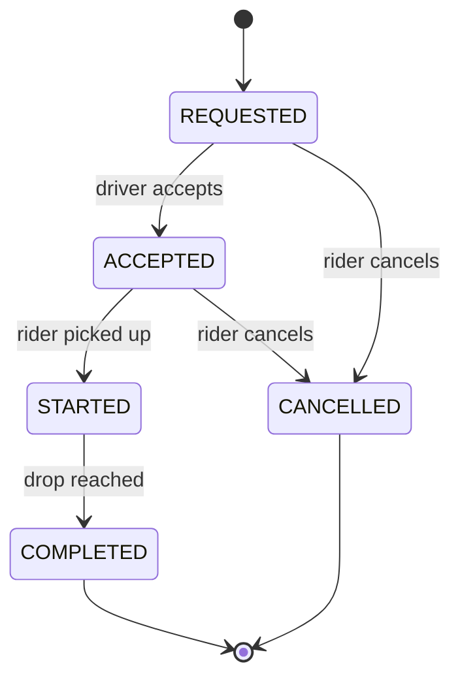
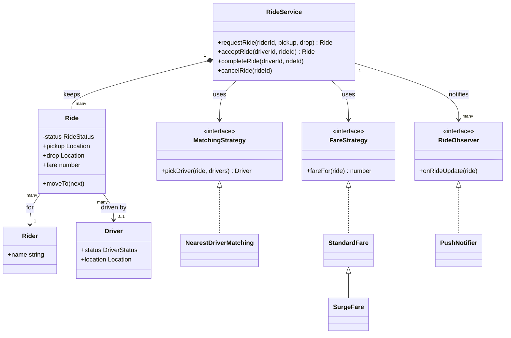
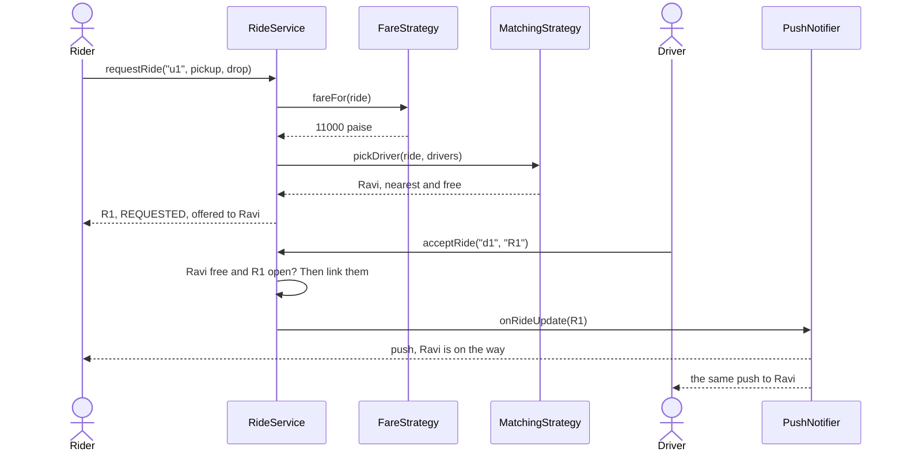

<Callout title="About this question">
  **Difficulty:** Hard. **Patterns used:** [Strategy](../design-patterns/strategy.mdx),
  [Observer](../design-patterns/observer.mdx), a state machine (see [State](../design-patterns/state.mdx)),
  [Facade](../design-patterns/facade.mdx), plus an atomic accept from
  [Race Conditions and Locks](../concurrency/race-conditions-locks.mdx).
  **Also asked as:** "Design Uber (LLD)", "Design Ola", "Design a cab booking system".
</Callout>

## Understand the problem

Think of an old taxi stand with a dispatcher. A customer calls and says "from the station to the market". The
dispatcher looks at the map, picks the closest free taxi, and radios the driver. The driver says "OK, coming". The
dispatcher tells the customer "your taxi is on the way".

A ride-sharing app does the same, with phones instead of radios.

What makes it interesting:

- **A ride moves through steps:** requested, accepted, started, completed (or cancelled). Some moves must never
  happen, like cancelling a trip that is already half done.
- **Rules that change:** how we pick a driver, and how we price a trip (surge at rush hour).
- **Many people to tell:** the rider and the driver both need updates at every step.
- **One driver, two rides.** Two riders near the same driver get offered the same driver. If he taps "Accept" on
  both, only one may work.

This is the class design. For servers, maps and millions of location updates, see the
[Uber system design](/learn/system-design/questions/uber).

## Step 1: Requirements

### Functional requirements

1. Riders should be able to request a ride from a pickup point to a drop point, and see the fare first.
2. The system should offer the ride to the nearest available driver.
3. Drivers should be able to accept, start and complete a ride.
4. Riders should be able to cancel a ride before the trip starts.
5. The rider and the driver should get a message at every step.
6. A driver should never have two rides at once.

### Out of scope

- Real maps, road distance and live GPS (we use straight-line distance on a grid).
- Payment, ratings, ride pooling and scheduled rides.
- Offer timeouts (if a driver ignores an offer, try the next one). See "Follow-up questions".

### Questions to ask the interviewer

| Question | What we assume |
| --- | --- |
| How do we pick a driver? | The nearest available driver within 5 km, by straight-line distance. |
| How is the fare worked out? | Base fare + a price per km. At busy times, multiply by a surge factor. |
| When is the fare fixed? | When the rider requests the ride. The rider sees it up front. |
| Can a rider cancel any time? | Only before the trip starts. |
| One server or many? | One process first. Then the database rule for many servers. |

## Step 2: Core classes

| Class | What it is | Key data | Key actions |
| --- | --- | --- | --- |
| `Rider` | The person who wants a ride | id, name | – |
| `Driver` | The person who drives | id, name, location, status | – |
| `Location` | A point on the map | x, y (km) | `distanceTo(other)` |
| `Ride` | One trip, a small state machine | rider, driver, pickup, drop, fare, status | `moveTo(next)` |
| `MatchingStrategy` | The rule that picks a driver | max distance | `pickDriver(ride, drivers)` |
| `FareStrategy` | The rule that prices a trip | base, per km, surge | `fareFor(ride)` |
| `RideObserver` | Anyone who wants ride updates | – | `onRideUpdate(ride)` |
| `RideService` | The front door for the app | riders, drivers, rides, strategies, observers | `requestRide`, `acceptRide`, `startRide`, `completeRide`, `cancelRide` |

**Enums:**

- `RideStatus`: `REQUESTED`, `ACCEPTED`, `STARTED`, `COMPLETED`, `CANCELLED`.
- `DriverStatus`: `AVAILABLE`, `ON_RIDE`, `OFFLINE`.

**The ride's states.** Only these moves are allowed. Anything else throws an error.



## Step 3: Class diagram



Key choices:

- **`Ride` guards its own state.** The allowed moves sit in one table inside `Ride`. Nobody can set the status
  directly, so "cancel a started trip" is impossible everywhere, not just in one method.
- **Two Strategies, both swappable.** Matching and fare rules change often (new cities, festivals, rush hour). The
  service only talks to the interfaces. See [Strategy](../design-patterns/strategy.mdx).
- **Observer for messages.** The service doesn't know about phones, e-mail or SMS. It tells every
  `RideObserver`, and each one decides what to send. See [Observer](../design-patterns/observer.mdx).
- **`Ride` → `Driver` is "0..1".** A new ride has no driver yet. The driver is set only when one accepts.
- **`Location` is a small value** (x and y), shown as a field type to keep the diagram small. `RideService` also
  keeps maps of all riders and drivers by id.

## Step 4: Main methods

| Method | What it does |
| --- | --- |
| `RideService.requestRide(riderId, pickup, drop)` | Makes a `REQUESTED` ride, sets the fare, and picks a driver to offer it to. |
| `RideService.findDriver(rideId)` | Asks the matching strategy for a driver again (say, after the first one said no). |
| `RideService.acceptRide(driverId, rideId)` | Atomic: checks the driver is free, the ride is still open and was offered to this driver, then links them. |
| `RideService.startRide(driverId, rideId)` | The rider is in the car. |
| `RideService.completeRide(driverId, rideId)` | The trip is over. The driver is free again, at the drop point. |
| `RideService.cancelRide(rideId)` | Allowed only before the trip starts. Frees the driver. |
| `Ride.moveTo(next)` | Changes the status if the move is allowed, or throws. |

The main flow, from request to accept:



## Step 5: Code

Money is in whole **paise** (₹1 = 100 paise). Distances are in km on a simple grid. Run all the parts together as
one `.mjs` file (the last part uses top-level `await`).

### Part 1: The enums

Fixed lists of choices are plain objects. `rupees` turns paise into text, only for printing.

```js
const RideStatus = {
    REQUESTED: "REQUESTED",
    ACCEPTED: "ACCEPTED",
    STARTED: "STARTED",
    COMPLETED: "COMPLETED",
    CANCELLED: "CANCELLED",
};

const DriverStatus = {
    AVAILABLE: "AVAILABLE",
    ON_RIDE: "ON_RIDE",
    OFFLINE: "OFFLINE",
};

// 11000 paise becomes "₹110.00".
function rupees(paise) {
    const amount = paise / 100;
    return `₹${amount.toFixed(2)}`;
}
```

### Part 2: A location

A point on a simple city grid. It knows the straight-line distance to another point.

```js
// x and y are in km.
class Location {
    constructor(x, y) {
        this.x = x;
        this.y = y;
    }

    distanceTo(other) {
        const xDistance = this.x - other.x;
        const yDistance = this.y - other.y;
        // Math.hypot gives the straight line from the two sides (Pythagoras).
        return Math.hypot(xDistance, yDistance);
    }
}
```

### Part 3: Riders and drivers

A new driver starts as available.

```js
class Rider {
    constructor(id, name) {
        this.id = id;
        this.name = name;
    }
}

class Driver {
    constructor(id, name, location) {
        this.id = id;
        this.name = name;
        this.location = location;
        this.status = DriverStatus.AVAILABLE;
    }
}
```

### Part 4: The ride, a small state machine

The allowed moves sit in one table inside `Ride`. The table and the status are private, so nobody outside can set the status directly. The class goes on in the next block.

```js
class Ride {
    // The only moves allowed: each status -> the statuses it can go to next.
    // `static` means one table for the whole class.
    // `#` means private: only code inside Ride can use it.
    static #NEXT = {
        REQUESTED: [RideStatus.ACCEPTED, RideStatus.CANCELLED],
        ACCEPTED: [RideStatus.STARTED, RideStatus.CANCELLED],
        STARTED: [RideStatus.COMPLETED],
        COMPLETED: [],
        CANCELLED: [],
    };

    #status = RideStatus.REQUESTED;

    constructor(id, rider, pickup, drop) {
        this.id = id;
        this.rider = rider;
        this.pickup = pickup;
        this.drop = drop;
        // Set when a driver accepts.
        this.driver = null;
        // The driver we asked.
        this.offeredTo = null;
        // Whole paise, quoted up front.
        this.fare = 0;
    }
```

**Reading and changing the status.** `moveTo` is the only way to change it, and it checks the table first.

```js
    // A getter: others can read ride.status, but they can't change it.
    get status() {
        return this.#status;
    }

    distanceKm() {
        return this.pickup.distanceTo(this.drop);
    }

    moveTo(next) {
        const allowed = Ride.#NEXT[this.#status];
        if (!allowed.includes(next)) {
            throw new Error(`Ride ${this.id} can't go from ${this.#status} to ${next}`);
        }

        this.#status = next;
    }
}
```

### Part 5: The matching rule

`MatchingStrategy` is the "interface": a base class whose method only throws. `NearestDriverMatching` picks the nearest available driver within a distance.

```js
// Interface: every matching rule has a pickDriver() method.
class MatchingStrategy {
    pickDriver(ride, drivers) {
        throw new Error("not implemented");
    }
}

class NearestDriverMatching extends MatchingStrategy {
    constructor(maxKm) {
        super();
        this.maxKm = maxKm;
    }

    // Returns the best driver, or null if no one is free and close enough.
    pickDriver(ride, drivers) {
        let bestDriver = null;
        let bestKm = Infinity;

        for (const driver of drivers) {
            const isFree = driver.status === DriverStatus.AVAILABLE;
            const km = driver.location.distanceTo(ride.pickup);

            // Keep this driver if they are free, close enough, and closer than the best so far.
            if (isFree && km <= this.maxKm && km < bestKm) {
                bestDriver = driver;
                bestKm = km;
            }
        }

        return bestDriver;
    }
}
```

### Part 6: The fare rules

The normal fare is a base price plus a price per km.

```js
// Interface: every fare rule has a fareFor() method.
class FareStrategy {
    fareFor(ride) {
        throw new Error("not implemented");
    }
}

class StandardFare extends FareStrategy {
    // base and perKm are in whole paise.
    constructor(base, perKm) {
        super();
        this.base = base;
        this.perKm = perKm;
    }

    fareFor(ride) {
        const distancePrice = Math.round(this.perKm * ride.distanceKm());
        return this.base + distancePrice;
    }
}
```

A surge fare is the standard fare, made bigger at busy times.

```js
class SurgeFare extends StandardFare {
    // surgePercent: 150 means 1.5 times.
    constructor(base, perKm, surgePercent) {
        super(base, perKm);
        this.surgePercent = surgePercent;
    }

    fareFor(ride) {
        // super.fareFor() works out the standard fare first.
        const standardFare = super.fareFor(ride);
        return Math.round((standardFare * this.surgePercent) / 100);
    }
}
```

### Part 7: The observer

Anyone who wants ride updates is a `RideObserver`. `PushNotifier` stands in for real phone pushes. The class goes on in the next block.

```js
// Interface: every observer has an onRideUpdate() method.
class RideObserver {
    onRideUpdate(ride) {
        throw new Error("not implemented");
    }
}

class PushNotifier extends RideObserver {
    onRideUpdate(ride) {
        const text = this.messageFor(ride);

        // Before a driver accepts, only the rider gets the push.
        let to = ride.rider.name;
        if (ride.driver !== null) {
            to = `${ride.rider.name} and ${ride.driver.name}`;
        }

        console.log(`[push to ${to}] ${ride.id}: ${text}`);
    }
```

**The message for each status.** `messageFor` picks the text of the push.

```js
    messageFor(ride) {
        if (ride.status === RideStatus.ACCEPTED) {
            return `${ride.driver.name} is on the way`;
        }
        if (ride.status === RideStatus.STARTED) {
            return "trip started";
        }
        if (ride.status === RideStatus.COMPLETED) {
            return `trip done, pay ${rupees(ride.fare)}`;
        }
        if (ride.status === RideStatus.CANCELLED) {
            return "ride cancelled";
        }
    }
}
```

### Part 8: The main service

`RideService` is the front door for the app. It keeps every rider, driver and ride, plus the two rules and the observers. Its helper methods start with `#`, so they are private. They come last, in Part 9. The class goes on over the next four blocks.

```js
class RideService {
    constructor(matchingStrategy, fareStrategy) {
        this.matchingStrategy = matchingStrategy;
        this.fareStrategy = fareStrategy;
        // id -> Rider, id -> Driver and id -> Ride
        this.riders = new Map();
        this.drivers = new Map();
        this.rides = new Map();
        this.observers = [];
        // The number for the next ride id: R1, R2, R3.
        this.nextRideNumber = 1;
    }

    addRider(rider) {
        this.riders.set(rider.id, rider);
    }

    addDriver(driver) {
        this.drivers.set(driver.id, driver);
    }

    subscribe(observer) {
        this.observers.push(observer);
    }

    // For example, surge pricing at rush hour.
    setFareStrategy(fareStrategy) {
        this.fareStrategy = fareStrategy;
    }
```

**Requesting a ride.** The fare is fixed now, so the rider sees it before the trip. Then the service picks a driver to offer the ride to.

```js
    requestRide(riderId, pickup, drop) {
        const id = `R${this.nextRideNumber}`;
        this.nextRideNumber += 1;

        const rider = this.#find(this.riders, riderId);
        const ride = new Ride(id, rider, pickup, drop);
        ride.fare = this.fareStrategy.fareFor(ride);
        this.rides.set(ride.id, ride);

        this.findDriver(ride.id);
        return ride;
    }

    // Asks the matching rule for a driver. Can be called again, say after the first driver said no.
    findDriver(rideId) {
        const ride = this.#find(this.rides, rideId);
        const allDrivers = Array.from(this.drivers.values());
        ride.offeredTo = this.matchingStrategy.pickDriver(ride, allDrivers);
        return ride.offeredTo;
    }
```

**Accepting a ride.** It checks and writes with no `await` in between, so a driver can't take two rides.

```js
    acceptRide(driverId, rideId) {
        const driver = this.#find(this.drivers, driverId);
        const ride = this.#find(this.rides, rideId);

        // 1. Check that the driver is free, and the ride is still open.
        if (driver.status !== DriverStatus.AVAILABLE) {
            throw new Error(`${driver.name} is not available`);
        }
        if (ride.status !== RideStatus.REQUESTED) {
            throw new Error(`Ride ${rideId} is already ${ride.status}`);
        }
        // Only the driver we asked may take it. A late answer, after the
        // ride went to someone else, is refused.
        if (ride.offeredTo !== driver) {
            throw new Error(`Ride ${rideId} was not offered to ${driver.name}`);
        }

        // 2. Link them.
        ride.moveTo(RideStatus.ACCEPTED);
        ride.driver = driver;
        driver.status = DriverStatus.ON_RIDE;

        this.#publish(ride);
        return ride;
    }
```

**Starting, finishing and cancelling.** Each one moves the ride to its next status and tells the observers. `moveTo` throws if the move is not allowed.

```js
    startRide(driverId, rideId) {
        const ride = this.#driversRide(driverId, rideId);
        ride.moveTo(RideStatus.STARTED);
        this.#publish(ride);
    }

    // The driver is free again, at the drop point.
    completeRide(driverId, rideId) {
        const ride = this.#driversRide(driverId, rideId);
        ride.moveTo(RideStatus.COMPLETED);
        ride.driver.status = DriverStatus.AVAILABLE;
        ride.driver.location = ride.drop;
        this.#publish(ride);
    }

    cancelRide(rideId) {
        const ride = this.#find(this.rides, rideId);
        // This throws once the trip has started.
        ride.moveTo(RideStatus.CANCELLED);

        // Free the driver, if one had accepted.
        if (ride.driver !== null) {
            ride.driver.status = DriverStatus.AVAILABLE;
        }

        this.#publish(ride);
    }
```

### Part 9: The private helpers

The end of `RideService`. Only its own methods can call these.

```js
    // Tells every observer about the ride.
    #publish(ride) {
        for (const observer of this.observers) {
            observer.onRideUpdate(ride);
        }
    }

    // The ride, but only if this driver is driving it.
    #driversRide(driverId, rideId) {
        const ride = this.#find(this.rides, rideId);
        if (ride.driver === null || ride.driver.id !== driverId) {
            throw new Error(`Ride ${rideId} is not ${driverId}'s ride`);
        }
        return ride;
    }

    #find(map, id) {
        const item = map.get(id);
        if (!item) {
            throw new Error(`Not found: ${id}`);
        }
        return item;
    }
}
```

### Part 10: Try it

Three drivers and two riders. Lines starting with `[push` are printed by the `PushNotifier`.

```js
// Only drivers within 5 km.
const matching = new NearestDriverMatching(5);
// ₹50 + ₹12 per km, in paise.
const fare = new StandardFare(5000, 1200);

const service = new RideService(matching, fare);
service.subscribe(new PushNotifier());

service.addRider(new Rider("u1", "Asha"));
service.addRider(new Rider("u2", "Ben"));

const ravi = new Driver("d1", "Ravi", new Location(1, 1));
const meena = new Driver("d2", "Meena", new Location(4, 4));
const kabir = new Driver("d3", "Kabir", new Location(0, 0));
kabir.status = DriverStatus.OFFLINE;

service.addDriver(ravi);
service.addDriver(meena);
service.addDriver(kabir);
```

Two riders ask for a ride. Both rides are offered to Ravi, because he is the nearest free driver.

```js
// 1. Asha asks for a 5 km ride. Kabir is closer, but offline.
const ride1 = service.requestRide("u1", new Location(0, 0), new Location(3, 4));
console.log(ride1.id, ride1.offeredTo.name, rupees(ride1.fare)); // R1 Ravi ₹110.00

// 2. Ben asks too. Ravi is still free, so Ben's ride is offered to him as well.
const ride2 = service.requestRide("u2", new Location(1, 0), new Location(1, 6));
console.log(ride2.id, ride2.offeredTo.name, rupees(ride2.fare)); // R2 Ravi ₹122.00
```

Ravi taps "Accept" on both at the same moment. `Promise.resolve().then(...)` runs each tap a moment later, like a request coming in. `Promise.allSettled` waits for both taps, even if one fails.

```js
// 3. Only one tap can work.
const tapOne = Promise.resolve().then(() => service.acceptRide("d1", "R1"));
const tapTwo = Promise.resolve().then(() => service.acceptRide("d1", "R2"));
const taps = await Promise.allSettled([tapOne, tapTwo]);
// [push to Asha and Ravi] R1: Ravi is on the way

const results = [];
for (const tap of taps) {
    if (tap.status === "fulfilled") {
        results.push(`${tap.value.id} accepted`);
    } else {
        results.push(tap.reason.message);
    }
}
console.log(results); // [ 'R1 accepted', 'Ravi is not available' ]
```

Ben's ride goes to Meena. Then Ravi's trip runs, with one move that is not allowed.

```js
// 4. Ben's ride goes to the next nearest free driver.
console.log(service.findDriver("R2").name); // Meena
service.acceptRide("d2", "R2"); // [push to Ben and Meena] R2: Meena is on the way

// 5. The trip.
service.startRide("d1", "R1"); // [push to Asha and Ravi] R1: trip started
try {
    service.cancelRide("R1");
} catch (error) {
    console.log(error.message); // Ride R1 can't go from STARTED to CANCELLED
}
service.completeRide("d1", "R1"); // [push to Asha and Ravi] R1: trip done, pay ₹110.00
service.cancelRide("R2"); // [push to Ben and Meena] R2: ride cancelled
console.log(ravi.status, meena.status); // AVAILABLE AVAILABLE
```

Rush hour: swap the fare rule. Nothing else changes.

```js
// 6. Surge pricing: 1.5 times the normal fare.
service.setFareStrategy(new SurgeFare(5000, 1200, 150));
const ride3 = service.requestRide("u1", new Location(3, 4), new Location(0, 0));
console.log(ride3.id, ride3.offeredTo.name, rupees(ride3.fare)); // R3 Ravi ₹165.00
```

In step 6, Ravi is nearest again, because he finished R1 at Asha's drop point, (3, 4). The fare is (₹50 + 5 km ×
₹12) × 1.5 = ₹165.

## Step 6: Edge cases and extensions

### Edge cases

| Case | What happens |
| --- | --- |
| No free driver within 5 km | `offeredTo` is `null`. The app says "no cars nearby" and can call `findDriver` again later. |
| An offline driver is closest | Skipped. Only `AVAILABLE` drivers are picked. |
| A driver accepts two rides | The second `acceptRide` throws `Ravi is not available`. |
| Two drivers accept the same ride | The second throws `Ride R1 is already ACCEPTED`. |
| A driver accepts a ride offered to someone else (say, a late answer after `findDriver` moved it on) | Throws `Ride R2 was not offered to Ravi`. |
| Cancel after the trip started | `moveTo` throws `can't go from STARTED to CANCELLED`. |
| A driver tries to start someone else's ride | `#driversRide` throws `Ride R1 is not d2's ride`. |
| Complete a ride twice | The second call throws `can't go from COMPLETED to COMPLETED`. |
| The surge starts mid-trip | No change: the fare was fixed when the ride was requested. |

### Two requests at once

**What could race.** JavaScript runs one piece of code at a time, but an `await` lets other requests run in the gap.
If `acceptRide` waited for something between the check and the write, Ravi could end up with both rides:

```js
// Not runnable: a broken acceptRide, to show the bug.
async acceptRide(driverId, rideId) {
    const driver = this.#find(this.drivers, driverId);
    const ride = this.#find(this.rides, rideId);
    if (driver.status !== DriverStatus.AVAILABLE) {
        throw new Error("not available");
    }

    // A pause: his second tap runs here, and sees AVAILABLE too.
    await this.maps.etaFor(driver.location, ride.pickup);

    // Both taps get here: one driver, two rides.
    driver.status = DriverStatus.ON_RIDE;
}
```

**How to make it safe:**

1. **Check and write in one synchronous block.** Our `acceptRide` checks the driver and the ride, then writes both,
   with no `await` in between. That is why case 3 gives one ride to Ravi and an error for the other.
2. **Do slow work before or after.** Need an ETA from a maps service? Get it before the check, or after the write.
   Never in the middle.
3. **Many servers: let the database decide.** Use one conditional update per row, in one transaction:

```sql
UPDATE drivers SET status = 'ON_RIDE', ride_id = 'R1'
WHERE id = 'd1' AND status = 'AVAILABLE';     -- 1 row: the driver is yours
UPDATE rides SET status = 'ACCEPTED', driver_id = 'd1'
WHERE id = 'R1' AND status = 'REQUESTED';     -- 1 row: the ride is yours
-- If either changed 0 rows, roll back.
```

In Java, an interviewer may expect `synchronized` on `acceptRide`, or a lock per driver. In JavaScript, a method
with no `await` already runs to the end without a break. See
[Race Conditions and Locks](../concurrency/race-conditions-locks.mdx). The
[Uber system design](/learn/system-design/questions/uber) shows how this works with many servers and Redis locks.

### Adding features

**1. E-mail a receipt when a trip ends.** Add one new observer. `RideService` and `Ride` don't change. This is the
[Observer](../design-patterns/observer.mdx) pattern.

```js
// Builds on the Step 5 code.
class ReceiptMailer extends RideObserver {
    onRideUpdate(ride) {
        // Only send a receipt when the trip is done.
        if (ride.status === RideStatus.COMPLETED) {
            console.log(`[email to ${ride.rider.name}] Receipt for ${ride.id}: ${rupees(ride.fare)}`);
        }
    }
}

service.subscribe(new ReceiptMailer());
service.acceptRide("d1", "R3"); // [push to Asha and Ravi] R3: Ravi is on the way
service.startRide("d1", "R3"); // [push to Asha and Ravi] R3: trip started
service.completeRide("d1", "R3");
// [push to Asha and Ravi] R3: trip done, pay ₹165.00
// [email to Asha] Receipt for R3: ₹165.00
```

**2. Match by road time, not straight-line distance.** Write an `EtaMatching` class that asks a maps service for
the driving time. It is a new [Strategy](../design-patterns/strategy.mdx), and the maps service sits behind an
[Adapter](../design-patterns/adapter.mdx). `RideService` doesn't change.

**3. Ride types (bike, auto, car).** Add a `vehicleType` to `Driver` and to the request. A
`VehicleTypeMatching` strategy filters by type and then picks the nearest. Each type gets its own `StandardFare`
rates, kept in a small map from type to fare strategy.

## Patterns used

| Pattern | Where | Why |
| --- | --- | --- |
| [Strategy](../design-patterns/strategy.mdx) | `MatchingStrategy`, `FareStrategy` | Swap how drivers are picked and how trips are priced, even at runtime (surge). |
| [Observer](../design-patterns/observer.mdx) | `RideObserver`, `PushNotifier` | Add new kinds of messages without touching the service. |
| State machine (see [State](../design-patterns/state.mdx)) | The `#NEXT` table in `Ride` | Only valid moves are allowed, checked in one place. |
| [Facade](../design-patterns/facade.mdx) | `RideService` | One simple front door over riders, drivers, rides and rules. |

A table of allowed moves is enough here, because each state has no special behaviour. If states grew their own
logic (say, `STARTED` tracks the route and `ACCEPTED` tracks the wait time), move to the full
[State](../design-patterns/state.mdx) pattern: one class per state.

## Follow-up questions

<Accordions>
<Accordion title="The driver ignores the offer. What then?">

Give each offer an end time, like 15 seconds, using a clock passed in. If the driver hasn't accepted by then, call
`findDriver` again and skip drivers who already ignored this ride. Keep a small "already asked" list on the `Ride`.

</Accordion>
<Accordion title="Straight-line distance is wrong because of rivers and one-way roads. Fix it?">

Yes, by adding a new matching strategy. Use straight-line distance to pick, say, the 5 closest drivers quickly. Then
ask a maps service for the real driving time for just those 5, and pick the fastest. Real maps use latitude and
longitude, so straight-line distance there uses the haversine formula, not `Math.hypot`.

</Accordion>
<Accordion title="How do you find nearby drivers fast when there are 100,000 of them?">

Don't loop over all of them. Split the map into cells (a grid or geohash) and keep a list of drivers per cell. Look
only at the rider's cell and the cells next to it. The [Uber system design](/learn/system-design/questions/uber)
covers this in depth.

</Accordion>
<Accordion title="Why fix the fare at request time?">

The rider agrees to a price before the trip, and a surge that starts mid-trip doesn't change it. It also makes the
fare easy to test: it depends only on the ride and the strategy in use at that moment.

</Accordion>
</Accordions>

## What the interviewer expects

<Tabs items={['Mid-level', 'Senior', 'Staff']}>
<Tab value="Mid-level">

- Clear classes: Rider, Driver, Location, Ride, RideService.
- Ride statuses with only valid moves allowed.
- Nearest-driver matching and a simple fare formula.

</Tab>
<Tab value="Senior">

- Matching and fare as Strategies, notifications as Observer.
- Spots "one driver, two rides" and makes accept atomic.
- Explains the database rule for many servers.
- Handles cancel rules, offer timeouts and driver states.

</Tab>
<Tab value="Staff">

- Everything from senior, quickly.
- Links the class design to the system design: location updates, geohash cells, Redis locks.
- Trade-offs in matching: nearest versus fastest, fairness to drivers, batching requests.
- Knows when a transition table is enough and when the full State pattern pays off.

</Tab>
</Tabs>

<Callout title="Remember this" type="success">
  - A ride is a **state machine**: `REQUESTED → ACCEPTED → STARTED → COMPLETED`, or `CANCELLED` before the start.
    Keep the allowed moves in **one table** inside `Ride`.
  - **Matching and fare are Strategies.** Surge is just a different fare strategy.
  - **Notifications are Observers.** New messages mean new listeners, not new `if`s.
  - `acceptRide` checks the driver and the ride, then writes both, with **no `await`** in between.
  - Many servers: a **conditional update** (`WHERE status = 'AVAILABLE'`) decides who wins.
</Callout>
