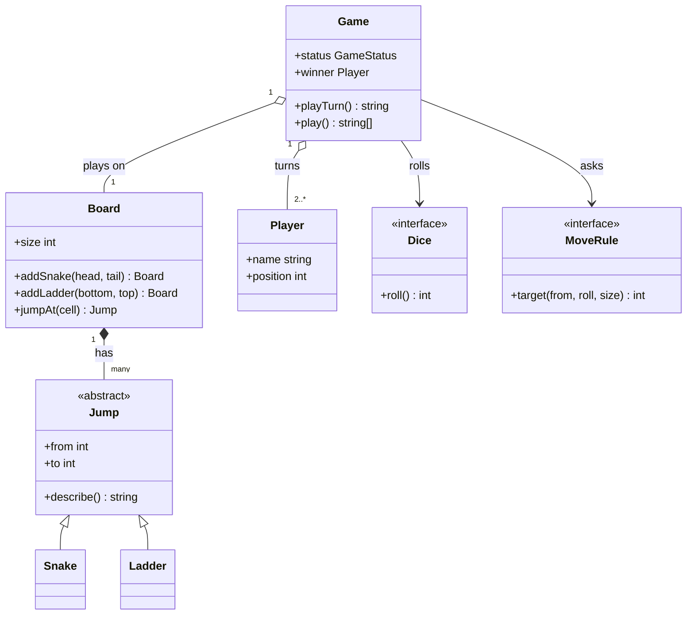
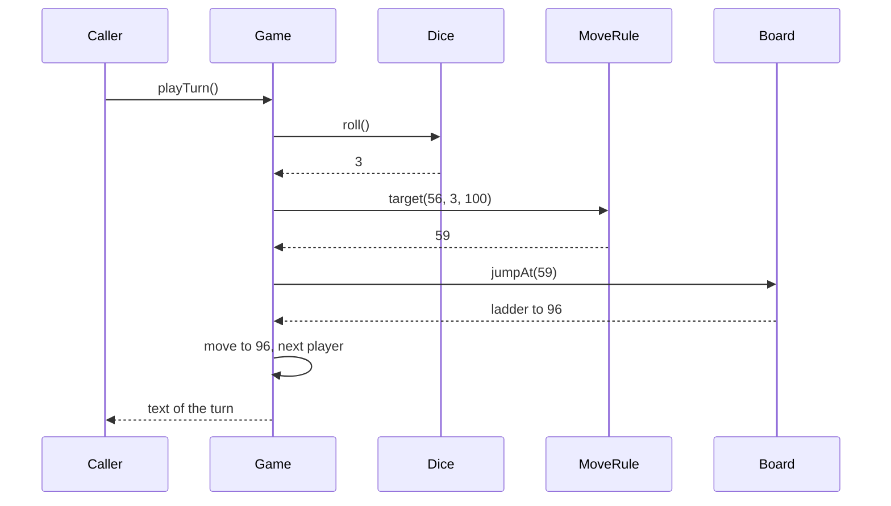

<Callout title="About this question">
  - **Difficulty:** Medium. The game is simple. The test is clean classes, a testable dice, and rules that are easy to change.
  - **Patterns used:** [Strategy](../design-patterns/strategy.mdx) (the dice and the move rule), [Polymorphism](../oop-basics/polymorphism.mdx) (snakes and ladders as jumps).
  - **Also asked as:** "Design a board game", "Design Snakes and Ladders", "Design Ludo" (the same ideas, with more rules).
</Callout>

## Understand the problem

Think of the board game you played as a child. The board has cells 1 to 100. Everyone starts off the board. On your turn you roll a dice and move forward. If you land at the bottom of a **ladder**, you climb up. If you land on a **snake's head**, you slide down to its tail. The first player to reach 100 wins.

The game comes from an old Indian game called Moksha Patam.

What makes it interesting in an interview:

- **Randomness.** A real dice is random, but a test needs the same rolls every time. So the dice must be easy to swap.
- **Rules differ from home to home.** "You must land on 100 exactly." "If you go past 100, bounce back." "Roll a 6 to start." The rules must be easy to change.
- **The board must make sense.** A snake must go down. A ladder must go up. No two things on one cell.

## Step 1: Requirements

### Functional requirements

1. Users should be able to set up a board of any size with snakes and ladders.
2. Users should be able to play with 2 or more players, taking turns in order.
3. On each turn, the player rolls the dice and moves. A ladder takes them up, and a snake takes them down.
4. A player whose roll goes past the last cell doesn't move.
5. The first player to reach the last cell exactly wins, and the game ends.

### Out of scope

- Drawing the board, animations, sound.
- Online play and saving games (discussed at the end).
- Rule variants like "roll a 6 to start" (an extension).

### Questions to ask the interviewer

| Question | What we assume |
| --- | --- |
| How big is the board? | 100 cells, but the size is a setting. |
| How many players? | 2 or more. |
| What if a roll goes past 100? | The player stays where they are. Other rules must be easy to add. |
| Can two players stand on the same cell? | Yes. No one is knocked off. |
| Does the game end at the first winner? | Yes. |

## Step 2: Core classes

| Class | What it is | Key data | Key actions |
| --- | --- | --- | --- |
| `Jump` (abstract) | Something that moves you from one cell to another. `Snake` and `Ladder` extend it. | `from`, `to` | `describe()` |
| `Board` | The cells and where the snakes and ladders are | `size`, jumps by start cell | `addSnake`, `addLadder`, `jumpAt(cell)` |
| `Player` | One person playing | `name`, `position` | — |
| `Dice` (interface) | Gives a number. `RandomDice` for real games, `FixedDice` for tests. | — | `roll()` |
| `MoveRule` (interface) | Where a roll takes you. `ExactFinishRule` is the normal rule. | — | `target(from, roll, size)` |
| `Game` | The main service: whose turn it is, and who won | board, players, dice, rule, turn, `status`, `winner` | `playTurn()`, `play()` |

**Enum:** `GameStatus`: `IN_PROGRESS`, `FINISHED`.

## Step 3: Class diagram



`RandomDice` and `FixedDice` implement `Dice`. `ExactFinishRule` implements `MoveRule`. They, and the `GameStatus` enum, are left out of the picture to keep it small.

- **Snakes and ladders share one base class.** Both are "land on cell X, go to cell Y". The board stores them in one `Map`, and the game never asks "is this a snake?". It just follows `jump.to`.
- **The dice is an interface.** The game gets it from outside. A test passes a `FixedDice`, so every run gives the same game.
- **The "past 100" check is an interface too.** A new rule is a new class. `Game` doesn't change.
- **Aggregation for the board and players.** The same board layout can be used for many games, and players can play again. A new `Game` puts every player back at cell 0.

## Step 4: Main methods

- `Board.addSnake(head, tail)` / `Board.addLadder(bottom, top)` → the board, so calls can be chained. Throws for a bad layout.
- `Board.jumpAt(cell)` → the `Jump` that starts on this cell, or `null`.
- `Dice.roll()` → a number from 1 to 6.
- `MoveRule.target(from, roll, size)` → the cell the roll takes you to (or `from` if you can't move).
- `Game.playTurn()` → a line of text about the turn. Rolls, moves, follows a jump, checks for a win, and passes the turn on.
- `Game.play()` → plays turns until someone wins, and returns all the lines.

One turn:



## Step 5: Code

The code comes in small parts. Paste them together in order, and they run as one file.

### Part 1: The enum and the jump

A `Jump` is "land on `from`, go to `to`". Snakes and ladders are both jumps.

```js
const GameStatus = {
    IN_PROGRESS: "IN_PROGRESS",
    FINISHED: "FINISHED",
};

// Abstract: we only make a Snake or a Ladder, never a plain Jump.
class Jump {
    constructor(from, to) {
        // this.constructor is the class that `new` was called with.
        if (this.constructor === Jump) {
            throw new Error("Jump is abstract");
        }

        this.from = from;
        this.to = to;
    }

    describe() {
        throw new Error("not implemented");
    }
}
```

### Part 2: Snakes and ladders

Each one checks its own direction when it is made: a snake must go down, and a ladder must go up.

```js
class Snake extends Jump {
    constructor(head, tail) {
        if (tail >= head) {
            throw new Error(`A snake must go down: ${head} -> ${tail}`);
        }

        super(head, tail);
    }

    describe() {
        return `snake down to ${this.to}`;
    }
}

class Ladder extends Jump {
    constructor(bottom, top) {
        if (top <= bottom) {
            throw new Error(`A ladder must go up: ${bottom} -> ${top}`);
        }

        super(bottom, top);
    }

    describe() {
        return `ladder up to ${this.to}`;
    }
}
```

### Part 3: A player

A player starts off the board, at cell 0.

```js
class Player {
    constructor(name) {
        this.name = name;
        // 0 means "not on the board yet".
        this.position = 0;
    }
}
```

### Part 4: The dice

`Dice` is the "interface": a base class whose method only throws. `RandomDice` is for real games.

```js
// Interface: every dice has a roll() method.
class Dice {
    roll() {
        throw new Error("not implemented");
    }
}

class RandomDice extends Dice {
    // Pass your own seeded random function to get the same game every time.
    constructor(faces = 6, random = Math.random) {
        super();
        this.faces = faces;
        this.random = random;
    }

    roll() {
        // random() gives a number from 0 up to 1 (never 1 itself).
        const fromZero = Math.floor(this.random() * this.faces);
        return fromZero + 1;
    }
}
```

`FixedDice` is for tests and demos. It rolls the numbers you give it, in order.

```js
class FixedDice extends Dice {
    constructor(rolls) {
        super();
        this.rolls = rolls;
        this.nextIndex = 0;
    }

    roll() {
        const roll = this.rolls[this.nextIndex];

        // Move to the next number. After the last one, start again from the first.
        this.nextIndex = (this.nextIndex + 1) % this.rolls.length;
        return roll;
    }
}
```

### Part 5: The move rule

The rule says where a roll takes you. The normal rule: if you would go past the end, you don't move.

```js
// Interface: where does this roll take you?
class MoveRule {
    target(from, roll, size) {
        throw new Error("not implemented");
    }
}

class ExactFinishRule extends MoveRule {
    target(from, roll, size) {
        const newPosition = from + roll;
        if (newPosition > size) {
            return from;
        }
        return newPosition;
    }
}
```

### Part 6: The board

The board keeps every jump by its start cell. The class goes on over the next two blocks.

```js
class Board {
    constructor(size = 100) {
        this.size = size;
        // start cell -> Jump
        this.jumps = new Map();
    }

    addSnake(head, tail) {
        return this.add(new Snake(head, tail));
    }

    addLadder(bottom, top) {
        return this.add(new Ladder(bottom, top));
    }

    // The jump that starts on this cell, or null.
    jumpAt(cell) {
        if (!this.jumps.has(cell)) {
            return null;
        }
        return this.jumps.get(cell);
    }
```

**Checking a new jump.** `add` refuses a jump that doesn't make sense on this board. It returns the board, so calls can be chained.

```js
    add(jump) {
        const startsOnBoard = jump.from >= 1 && jump.from <= this.size;
        const endsOnBoard = jump.to >= 1 && jump.to <= this.size;
        if (!startsOnBoard || !endsOnBoard) {
            throw new Error(`${jump.from} -> ${jump.to} is not on the board`);
        }

        if (jump.from === this.size) {
            throw new Error("Nothing can start on the last cell");
        }

        if (this.jumps.has(jump.from)) {
            throw new Error(`Cell ${jump.from} already has a snake or ladder`);
        }

        // No chains: a jump can't end where another starts, or start where another ends.
        if (this.jumps.has(jump.to) || this.endsAt(jump.from)) {
            throw new Error("No chains: a jump cannot end where another starts");
        }

        this.jumps.set(jump.from, jump);
        return this;
    }
```

**Finding where jumps end.** A small helper for the "no chains" check.

```js
    // Does any jump end on this cell?
    endsAt(cell) {
        for (const jump of this.jumps.values()) {
            if (jump.to === cell) {
                return true;
            }
        }
        return false;
    }
}
```

### Part 7: The game

`Game` is the main service. It gets the board, players, dice and rule from outside. The class goes on over the next two blocks.

```js
class Game {
    constructor(board, players, dice, rule = new ExactFinishRule()) {
        if (players.length < 2) {
            throw new Error("Need at least 2 players");
        }

        // Everyone starts off the board, even players from an old game.
        for (const player of players) {
            player.position = 0;
        }

        this.board = board;
        this.players = players;
        this.dice = dice;
        this.rule = rule;
        // The index of the player whose turn it is.
        this.turn = 0;
        this.status = GameStatus.IN_PROGRESS;
        this.winner = null;
    }

    currentPlayer() {
        return this.players[this.turn];
    }
```

**One turn.** `playTurn` rolls, moves, checks for a win, and passes the turn on. `play` is the game loop: it plays turns until someone wins.

```js
    playTurn() {
        if (this.status === GameStatus.FINISHED) {
            throw new Error(`Game over. ${this.winner.name} won.`);
        }

        const player = this.currentPlayer();
        const roll = this.dice.roll();
        const text = this.move(player, roll);

        if (player.position === this.board.size) {
            this.status = GameStatus.FINISHED;
            this.winner = player;
            return `${text}. ${player.name} wins!`;
        }

        // Next player. After the last player, go back to the first.
        this.turn = (this.turn + 1) % this.players.length;
        return text;
    }

    // maxTurns stops a broken test dice from looping forever.
    play(maxTurns = 10000) {
        const log = [];
        while (this.status === GameStatus.IN_PROGRESS && log.length < maxTurns) {
            const line = this.playTurn();
            log.push(line);
        }
        return log;
    }
```

**Moving a player.** `move` asks the rule where the roll goes, follows a snake or ladder, and returns a line of text about the move.

```js
    move(player, roll) {
        const from = player.position;
        const target = this.rule.target(from, roll, this.board.size);
        const start = `${player.name} rolled ${roll}: `;

        // The rule said "don't move".
        if (target === from) {
            return `${start}${from + roll} is past ${this.board.size}, stays at ${from}`;
        }

        player.position = target;

        const jump = this.board.jumpAt(target);
        if (jump === null) {
            return `${start}${from} -> ${target}`;
        }

        // Follow the snake or ladder. The game never asks which one it is.
        player.position = jump.to;
        return `${start}${from} -> ${target}, ${jump.describe()}`;
    }
}
```

### Part 8: Try it

A `FixedDice` makes the game the same every time. Each `add` call returns the board, so the calls are chained.

```js
const board = new Board(100)
    .addLadder(4, 56)
    .addLadder(59, 96)
    .addSnake(14, 7)
    .addSnake(98, 12);

const players = [new Player("Asha"), new Player("Ravi")];
const dice = new FixedDice([4, 5, 3, 6, 6, 3, 4]);
const game = new Game(board, players, dice);

const lines = game.play();
for (const line of lines) {
    console.log(line);
}
// Asha rolled 4: 0 -> 4, ladder up to 56
// Ravi rolled 5: 0 -> 5
// Asha rolled 3: 56 -> 59, ladder up to 96
// Ravi rolled 6: 5 -> 11
// Asha rolled 6: 102 is past 100, stays at 96
// Ravi rolled 3: 11 -> 14, snake down to 7
// Asha rolled 4: 96 -> 100. Asha wins!

console.log(game.status, game.winner.name); // FINISHED Asha
```

Things that are refused. `printError` runs an action and prints the error message if it throws.

```js
function printError(action) {
    try {
        return action();
    } catch (error) {
        console.log(error.message);
    }
}

printError(() => game.playTurn()); // Game over. Asha won.
printError(() => board.addSnake(20, 30)); // A snake must go down: 20 -> 30
printError(() => board.addLadder(14, 40)); // Cell 14 already has a snake or ladder
printError(() => board.addLadder(50, 98)); // No chains: a jump cannot end where another starts
```

For a real game, use `new RandomDice()`. Nothing else changes.

## Step 6: Edge cases and extensions

### Edge cases

| Case | What happens |
| --- | --- |
| A roll goes past the last cell | The player doesn't move (`ExactFinishRule`). |
| A ladder ends on the last cell | The player climbs to 100 and wins at once. |
| A snake on the last cell | Refused: "Nothing can start on the last cell". |
| Two snakes or ladders start on one cell | Refused. |
| A ladder ends on a snake's head (a chain) | Refused. So a move follows at most one jump, and can never loop forever. |
| A "snake" that goes up | The `Snake` constructor throws. |
| Fewer than 2 players | The `Game` constructor throws. |
| A turn after the game is over | `playTurn` throws "Game over". |
| Two players on the same cell | Allowed. |
| A test dice that never lets anyone finish | `play` stops after `maxTurns`. |

### Two requests at once

On one computer, players take turns, so nothing runs at the same time. Online, it is different: a player double-clicks "Roll", or both players click at the same moment.

- `playTurn` does the roll, the move and "next player" in one method, with no `await` in between. JavaScript runs it to the end, so a half-done turn is never seen.
- The server must also check **whose turn it is**, so an extra click from the wrong player is refused:

```js
// Add to the code above. An online game refuses a roll from the wrong player.
class OnlineGame extends Game {
    playTurnFor(name) {
        if (this.currentPlayer().name !== name) {
            throw new Error(`Not your turn, ${name}`);
        }

        return this.playTurn();
    }
}

const onlinePlayers = [new Player("Asha"), new Player("Ravi")];
const online = new OnlineGame(new Board(100), onlinePlayers, new FixedDice([2]));

printError(() => online.playTurnFor("Ravi")); // Not your turn, Ravi
console.log(online.playTurnFor("Asha")); // Asha rolled 2: 0 -> 2
printError(() => online.playTurnFor("Asha")); // Not your turn, Asha
```

With many servers, keep each game on one server, or save each move with its turn number, so that only one save for "turn 7" can win. See [Race Conditions and Locks](../concurrency/race-conditions-locks.mdx).

### Adding features

- **New rules** ("bounce back from 100"): a new `MoveRule` class. `Game` doesn't change. This is [Strategy](../design-patterns/strategy.mdx) and the [Open-Closed Principle](../design-principles/open-closed.mdx):

```js
// Add to the code above. Going past 100 bounces you back: 96 + 6 = 102, so you end on 98.
class BounceBackRule extends MoveRule {
    target(from, roll, size) {
        const newPosition = from + roll;
        if (newPosition <= size) {
            return newPosition;
        }

        // Go back by the number of steps you went past the end.
        const stepsPast = newPosition - size;
        return size - stepsPast;
    }
}

const bouncyBoard = new Board(100).addLadder(4, 96);
const bouncyPlayers = [new Player("Asha"), new Player("Ravi")];
const bouncy = new Game(bouncyBoard, bouncyPlayers, new FixedDice([4, 1, 6]), new BounceBackRule());

// Asha climbs to 96, and Ravi moves to 1. Then Asha rolls a 6.
bouncy.playTurn();
bouncy.playTurn();
console.log(bouncy.playTurn()); // Asha rolled 6: 96 -> 98
```

- **More boards:** the board size is a setting, and layouts can be loaded from a list like `[{ type: 'snake', from: 98, to: 12 }]`. A small [Factory](../design-patterns/factory.mdx) can build named boards, such as "kids" (few snakes) or "hard" (many snakes).
- **Two dice:** `class TwoDice extends Dice` whose `roll()` adds two rolls. The game doesn't change.
- **Show moves on screen as they happen:** the game sends a "moved" event, and the screen listens. This is [Observer](../design-patterns/observer.mdx).

## Patterns used

| Pattern | Where | Why |
| --- | --- | --- |
| [Strategy](../design-patterns/strategy.mdx) | `Dice`: `RandomDice`, `FixedDice` | Real games are random. Tests are repeatable. |
| [Strategy](../design-patterns/strategy.mdx) | `MoveRule`: `ExactFinishRule`, `BounceBackRule` | Home rules become new classes, not new `if`s. |
| [Polymorphism](../oop-basics/polymorphism.mdx) | `Jump`: `Snake`, `Ladder` | The game just follows `jump.to`. It never asks which kind it is. |
| [Dependency Injection](../design-principles/dependency-injection.mdx) | `new Game(board, players, dice, rule)` | Every part the game uses comes from outside, so each one is easy to swap. |

## Follow-up questions

<Accordions>
<Accordion title="How do you test a game that uses a random dice?">

Don't use `Math.random()` inside `Game`. Pass a `Dice` in. Tests pass a `FixedDice` with the rolls they need, like `[4, 5, 3]`. For "random but repeatable" runs, pass a seeded random function to `RandomDice`, so the same seed gives the same game.

</Accordion>
<Accordion title="Why are Snake and Ladder classes, and not one class with a type field?">

Both work. Subclasses give each kind its own check (a snake must go down) and its own text, with no `if (type === 'SNAKE')`. A new kind of jump, like a "portal", is one more subclass. If they never differ in behaviour, one `Jump` class with a type is also fine. Say this tradeoff out loud.

</Accordion>
<Accordion title="What is the fewest rolls needed to win on a board?">

Think of each cell as a node, and each roll of 1 to 6 as an edge (after following any jump). Then a breadth-first search (BFS) from 0 finds the fewest rolls to reach 100. It is a well-known coding problem: LeetCode 909, "Snakes and Ladders". It is also a quick way to check that a new board can be finished.

</Accordion>
<Accordion title="How would you add 'roll a 6 to start' and 'a 6 gives another turn'?">

Both are about turns, not moves. Add a second interface, `TurnRule`, that the game asks two questions: "can this player start with this roll?" and "does this roll give another turn?". The game asks the rule instead of checking `roll === 6` itself.

</Accordion>
</Accordions>

## What the interviewer expects

<Tabs items={['Mid-level', 'Senior', 'Staff']}>
<Tab value="Mid-level">

- Clear classes: `Board`, `Snake`, `Ladder`, `Player`, `Dice`, `Game`.
- A working game loop with the "past 100" rule and a win check.
- Board checks: snakes go down, ladders go up.

</Tab>
<Tab value="Senior">

- A `Dice` interface and a fixed dice for tests, without being asked.
- Rules as classes (Strategy), so variants don't change `Game`.
- Edge cases: chains of jumps, a turn after the game ends, the wrong player rolling.

</Tab>
<Tab value="Staff">

- Everything from senior, but faster.
- Online play: one owner per game, turn numbers, and sending moves to every player.
- Checking boards (BFS for the fewest rolls), and when to stop adding options.

</Tab>
</Tabs>

<Callout title="Remember this" type="success">
  - `Snake` and `Ladder` are both a `Jump`: land on `from`, go to `to`. The game never asks which one it is.
  - Pass the dice in. `FixedDice` makes every test game the same.
  - The "past 100" check is a `MoveRule`. A home rule is a new class.
  - Check the board when it is built: snakes go down, ladders go up, one jump per cell, no chains.
  - One turn = one method with no `await` inside. Online, also check whose turn it is.
</Callout>
