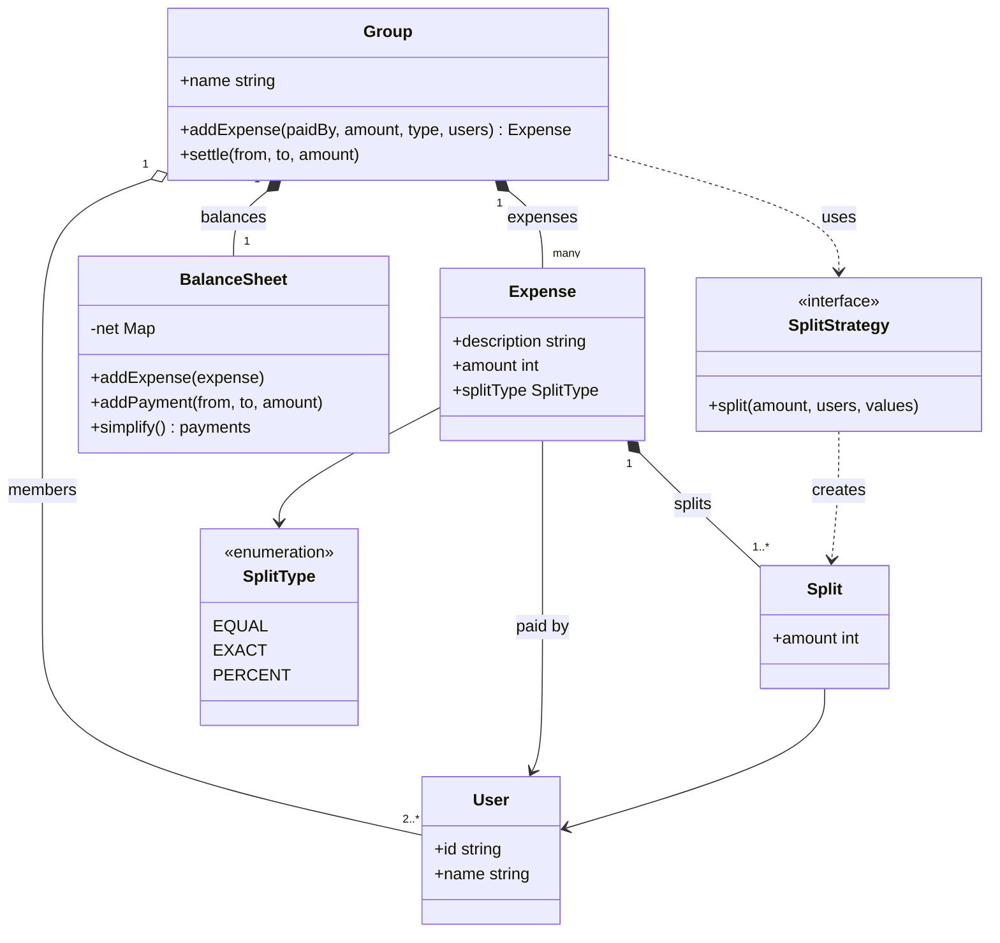
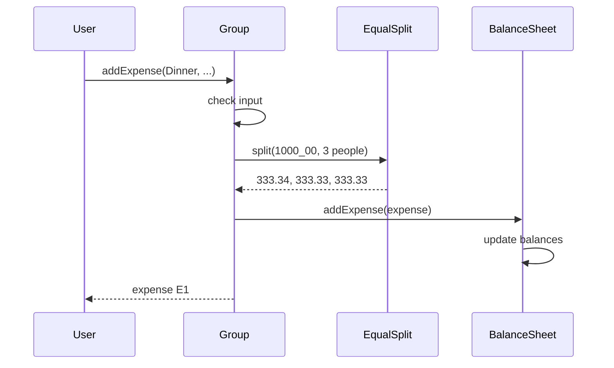
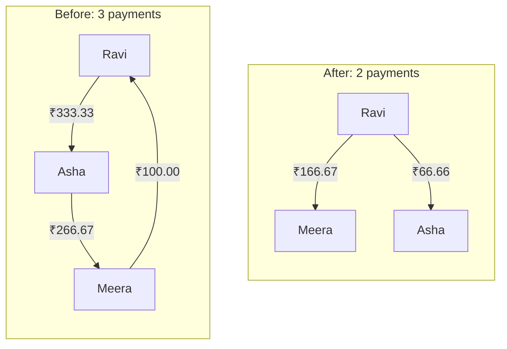

<Callout title="About this question">
  - **Difficulty:** Medium.
  - **Patterns used:** [Strategy](../design-patterns/strategy.mdx) (equal, exact and percent splits), [Factory](../design-patterns/factory.mdx) (split type → strategy).
  - **Also asked as:** "Design an expense sharing app", "Split bills between friends", "Design a shared expense tracker".
</Callout>

## Understand the problem

Three friends go on a trip to Goa. Asha pays for dinner. Ravi pays for a taxi. Meera pays for the hotel. Not every cost is shared the same way: dinner is split equally, the taxi was only for Ravi and Meera, and the hotel is split by room size. At the end, who should pay whom, and how much?

Splitwise is a real app that does this. Three things make it interesting:

- **Different ways to split.** Equally, by exact amounts, or by percent. New ways will come later.
- **Money must add up to the paisa.** ₹1,000 split three ways is ₹333.33 + ₹333.33 + ₹333.33 = ₹999.99. One paisa is missing. Someone must pay it.
- **Fewest payments.** Each expense makes its own small debts. Paying them all one by one can mean many transfers. Splitwise has a "simplify debts" option that cuts them down.

## Step 1: Requirements

### Functional requirements

1. Users should be able to create a group with members.
2. Users should be able to add an expense: who paid, how much, and who shares it.
3. Users should be able to split an expense equally, by exact amounts, or by percent.
4. Users should be able to see each member's balance: "gets back ₹X" or "owes ₹X".
5. Users should be able to see the fewest payments that settle the group, and record a payment.

### Out of scope

- Logins, friends lists, and sending real money.
- Many currencies (an extension).
- Receipts, photos, comments, and editing old expenses.

### Questions to ask the interviewer

| Question | What we assume |
| --- | --- |
| Only groups, or also one-to-one expenses? | Only groups. A one-to-one expense is a group of two. |
| One currency? | Yes, Indian rupees. Money is stored as whole **paise** (1 rupee = 100 paise). |
| Who pays the left-over paisa in an equal split? | The first people in the list, one paisa each. |
| Must percents be whole numbers? | Yes, and they must add up to 100. |
| Show every small debt, or simplify? | Show each member's balance, plus the simplified payments. |

## Step 2: Core classes

| Class | What it is | Key data | Key actions |
| --- | --- | --- | --- |
| `User` | A person | `id`, `name` | — |
| `Group` | People who share costs. The main service. | `name`, members, expenses, `balances` | `addExpense`, `settle` |
| `Expense` | One cost that was paid | `description`, `paidBy`, `amount`, `splitType`, `splits` | — |
| `Split` | One person's share of an expense | `user`, `amount` | — |
| `SplitStrategy` (interface) | A way to split: `EqualSplit`, `ExactSplit`, `PercentSplit` | — | `split(amount, users, values)` |
| `BalanceSheet` | Who is up and who is down in the group | net balance per user | `addExpense`, `addPayment`, `describe`, `simplify` |

**Enum:** `SplitType`: `EQUAL`, `EXACT`, `PERCENT`.

## Step 3: Class diagram



`EqualSplit`, `ExactSplit` and `PercentSplit` implement `SplitStrategy`. They are left out of the picture to keep it small.

- **Aggregation for members.** People exist outside the group, and one person can be in many groups.
- **Composition for expenses, splits and the balance sheet.** They only make sense inside their group. Delete the group, and they go too.
- **The split rule is an interface.** `Group` asks "split this amount" and gets back a list of shares. A new way to split is a new class.
- **`BalanceSheet` does the money maths.** `Group` checks the input and keeps the history. Each class has one job.

## Step 4: Main methods

- `Group.addExpense(description, paidBy, amount, splitType, users, values)` → `Expense`. Checks the input, splits the amount with the right strategy, and updates the balances.
- `Group.settle(from, to, amount)`. Records that `from` paid `to` back.
- `SplitStrategy.split(amount, users, values)` → `Split[]`. The shares always add up to `amount` exactly.
- `BalanceSheet.describe(user)` → "Asha gets back ₹66.66", "Ravi owes ₹233.33" or "is settled up".
- `BalanceSheet.simplify()` → the fewest payments, found greedily: the biggest debtor pays the biggest creditor, again and again.

The main flow, adding an expense:



## Step 5: Code

**Part 1: the enum, money and small classes.** Money is always whole paise, never a decimal number. ₹1,000.00 is written `1000_00`.

```js
const SplitType = Object.freeze({ EQUAL: 'EQUAL', EXACT: 'EXACT', PERCENT: 'PERCENT' });

const sum = (numbers) => numbers.reduce((a, b) => a + b, 0);
// Only for showing money. All maths uses whole paise.
const money = (paise) => `₹${Math.floor(paise / 100)}.${String(paise % 100).padStart(2, '0')}`;

class User {
  constructor(id, name) {
    this.id = id;
    this.name = name;
  }
}

class Split { // one person's share of an expense
  constructor(user, amount) {
    this.user = user;
    this.amount = amount; // paise
  }
}

class Expense {
  static #nextId = 1;
  constructor(description, paidBy, amount, splitType, splits) {
    this.id = `E${Expense.#nextId++}`;
    this.description = description;
    this.paidBy = paidBy;
    this.amount = amount;
    this.splitType = splitType;
    this.splits = splits;
  }
}
```

**Part 2: the split strategies.** Each one returns shares that add up to the amount exactly. Left-over paise go to the first people, one each.

```js
class SplitStrategy { // interface
  split(amount, users, values) { throw new Error('not implemented'); }
}

class EqualSplit extends SplitStrategy {
  split(amount, users) {
    const base = Math.floor(amount / users.length);
    const extra = amount % users.length; // the paise that don't divide evenly
    return users.map((user, i) => new Split(user, base + (i < extra ? 1 : 0)));
  }
}

class ExactSplit extends SplitStrategy {
  split(amount, users, amounts) {
    if (amounts.length !== users.length) throw new Error('Give one amount per person');
    if (sum(amounts) !== amount) throw new Error(`Amounts add up to ${money(sum(amounts))}, not ${money(amount)}`);
    return users.map((user, i) => new Split(user, amounts[i]));
  }
}

class PercentSplit extends SplitStrategy {
  split(amount, users, percents) {
    if (percents.length !== users.length) throw new Error('Give one percent per person');
    if (sum(percents) !== 100) throw new Error(`Percents add up to ${sum(percents)}, not 100`);
    const shares = percents.map((p) => Math.floor((amount * p) / 100));
    const extra = amount - sum(shares); // paise lost when rounding down
    return users.map((user, i) => new Split(user, shares[i] + (i < extra ? 1 : 0)));
  }
}

const splitStrategies = { // a small factory: split type -> strategy
  [SplitType.EQUAL]: new EqualSplit(),
  [SplitType.EXACT]: new ExactSplit(),
  [SplitType.PERCENT]: new PercentSplit(),
};
```

**Part 3: the balance sheet.** One number per person: above 0 means "gets money back", below 0 means "owes money".

```js
class BalanceSheet {
  #net = new Map(); // user -> paise

  addExpense(expense) {
    this.#change(expense.paidBy, expense.amount);
    for (const split of expense.splits) this.#change(split.user, -split.amount);
  }
  addPayment(from, to, amount) { // `from` paid `to` back
    this.#change(from, amount);
    this.#change(to, -amount);
  }
  balanceOf(user) { return this.#net.get(user) ?? 0; }

  describe(user) {
    const balance = this.balanceOf(user);
    if (balance > 0) return `${user.name} gets back ${money(balance)}`;
    if (balance < 0) return `${user.name} owes ${money(-balance)}`;
    return `${user.name} is settled up`;
  }

  // Greedy: the biggest debtor pays the biggest creditor, until everyone is at 0.
  simplify() {
    const creditors = [];
    const debtors = [];
    for (const [user, balance] of this.#net) {
      if (balance > 0) creditors.push({ user, amount: balance });
      if (balance < 0) debtors.push({ user, amount: -balance });
    }
    const payments = [];
    while (creditors.length > 0 && debtors.length > 0) {
      creditors.sort((x, y) => y.amount - x.amount);
      debtors.sort((x, y) => y.amount - x.amount);
      const [creditor, debtor] = [creditors[0], debtors[0]];
      const amount = Math.min(creditor.amount, debtor.amount);
      payments.push({ from: debtor.user, to: creditor.user, amount });
      creditor.amount -= amount;
      debtor.amount -= amount;
      if (creditor.amount === 0) creditors.shift();
      if (debtor.amount === 0) debtors.shift();
    }
    return payments;
  }

  #change(user, delta) { this.#net.set(user, this.balanceOf(user) + delta); }
}
```

**Part 4: the main service.** `Group` checks the input, picks the strategy, and keeps the history.

```js
const checkAmount = (amount) => {
  if (!Number.isInteger(amount) || amount <= 0) throw new Error('Amount must be whole paise, above 0');
};

class Group {
  #members;
  #expenses = [];
  constructor(name, members) {
    this.name = name;
    this.#members = new Set(members);
    this.balances = new BalanceSheet();
  }
  get members() { return [...this.#members]; }
  get expenses() { return [...this.#expenses]; }

  addExpense(description, paidBy, amount, splitType, users, values = []) {
    checkAmount(amount);
    for (const user of [paidBy, ...users]) {
      if (!this.#members.has(user)) throw new Error(`${user.name} is not in ${this.name}`);
    }
    const strategy = splitStrategies[splitType];
    if (!strategy) throw new Error(`Unknown split type: ${splitType}`);
    const expense = new Expense(description, paidBy, amount, splitType, strategy.split(amount, users, values));
    this.#expenses.push(expense);
    this.balances.addExpense(expense); // no `await` between the check and the update
    return expense;
  }

  settle(from, to, amount) {
    checkAmount(amount);
    this.balances.addPayment(from, to, amount);
  }
}
```

**Part 5: try it.** The Goa trip: dinner split equally, a taxi by exact amounts, and the hotel by percent.

```js
const show = (fn) => { try { return fn(); } catch (e) { console.log(e.message); } };

const asha = new User('u1', 'Asha');
const ravi = new User('u2', 'Ravi');
const meera = new User('u3', 'Meera');
const trip = new Group('Goa trip', [asha, ravi, meera]);

const dinner = trip.addExpense('Dinner', asha, 1000_00, SplitType.EQUAL, [asha, ravi, meera]);
console.log(dinner.splits.map((s) => money(s.amount)).join(', ')); // ₹333.34, ₹333.33, ₹333.33
trip.addExpense('Taxi', ravi, 500_00, SplitType.EXACT, [ravi, meera], [100_00, 400_00]);
trip.addExpense('Hotel', meera, 1200_00, SplitType.PERCENT, [asha, ravi, meera], [50, 25, 25]);

for (const user of trip.members) console.log(trip.balances.describe(user));
// Asha gets back ₹66.66
// Ravi owes ₹233.33
// Meera gets back ₹166.67

for (const p of trip.balances.simplify()) console.log(`${p.from.name} pays ${p.to.name} ${money(p.amount)}`);
// Ravi pays Meera ₹166.67
// Ravi pays Asha ₹66.66

trip.settle(ravi, meera, 166_67);
console.log(trip.balances.describe(meera)); // Meera is settled up
console.log(trip.balances.describe(ravi)); // Ravi owes ₹66.66

show(() => trip.addExpense('Snacks', asha, 300_00, SplitType.PERCENT, [asha, ravi], [50, 40])); // Percents add up to 90, not 100
show(() => trip.addExpense('Fuel', ravi, 900_00, SplitType.EXACT, [ravi, meera], [400_00, 400_00])); // Amounts add up to ₹800.00, not ₹900.00
console.log(0.1 + 0.2); // 0.30000000000000004
```

The last line shows why money is never a decimal number in JavaScript: `0.1 + 0.2` is not exactly `0.3`.

**Why simplify?** Without it, each pair of people settles on their own. After the three expenses, that is three payments, going round in a circle. Simplifying needs only two:



Each person ends with the same balance either way. Only the number of payments changes.

## Step 6: Edge cases and extensions

### Edge cases

| Case | What happens |
| --- | --- |
| ₹1,000 split by 3 | ₹333.34 + ₹333.33 + ₹333.33. The shares always add up to the total. |
| Percents don't add up to 100 | Refused: "Percents add up to 90, not 100". |
| Exact amounts don't add up to the total | Refused, showing both totals. |
| Amount is 0, negative, or a decimal like `99.5` | Refused: money is whole paise, above 0. |
| The payer or a sharer is not in the group | Refused: "Ravi is not in Goa trip". |
| The payer is not one of the sharers | Allowed. Asha can pay for a taxi only Ravi and Meera used. |
| Someone pays back more than they owe | Allowed. Their balance flips, and now they get money back. |
| Everyone is settled | `simplify()` returns an empty list. |

### Two requests at once

Asha and Ravi add an expense from two phones at the same moment.

In the code above, `addExpense` checks the input and updates every balance with no `await` in between, so JavaScript runs one call to the end before the next one starts. The danger comes when balances live in a database and the code reads, waits, then writes:

```js
// NOT SAFE. A fragment, not runnable on its own.
async addShare(groupId, userId, share) {
  const balance = await db.getBalance(groupId, userId);  // both phones read -₹100.00
  await db.setBalance(groupId, userId, balance - share); // the second write wipes out the first
}
```

How to make it safe:

- **One process:** no `await` between reading and writing a balance, as in `BalanceSheet`.
- **Many servers:** let the database do the maths in one step, and save the expense and all its shares in **one database transaction**, so no one sees half an expense:

```sql
UPDATE balances SET amount = amount - 33333
WHERE group_id = 'goa' AND user_id = 'u2';
```

Even safer: save only the expenses (each one is a new row, never changed), and work out the balances from them. Two new rows can never overwrite each other. See [Race Conditions and Locks](../concurrency/race-conditions-locks.mdx).

### Adding features

- **A new way to split**, like by shares (a couple pays 2 shares, a single person 1): a new `SplitStrategy` class plus one line in the factory. `Group` doesn't change. This is [Strategy](../design-patterns/strategy.mdx) and the [Open-Closed Principle](../design-principles/open-closed.mdx):

```js
// Add to the code above. Split by shares: [2, 1, 1] means 2/4, 1/4 and 1/4.
class ShareSplit extends SplitStrategy {
  split(amount, users, shares) {
    const total = sum(shares);
    const parts = shares.map((s) => Math.floor((amount * s) / total));
    const extra = amount - sum(parts);
    return users.map((user, i) => new Split(user, parts[i] + (i < extra ? 1 : 0)));
  }
}
splitStrategies.SHARES = new ShareSplit(); // also add SHARES to the SplitType enum
const fuel = trip.addExpense('Fuel', ravi, 900_00, 'SHARES', [asha, ravi, meera], [2, 1, 1]);
console.log(fuel.splits.map((s) => money(s.amount)).join(', ')); // ₹450.00, ₹225.00, ₹225.00
```

- **Edit or delete an expense:** apply the same expense again with every sign flipped, then apply the new version. Each change is an object that can be undone. This is [Command](../design-patterns/command.mdx).
- **"Ravi added an expense" alerts:** the group sends an event when an expense is added, and the alert service listens. This is [Observer](../design-patterns/observer.mdx).
- **Many currencies:** store `{ amount, currency }` and keep one balance per currency. Convert only when someone settles up.

## Patterns used

| Pattern | Where | Why |
| --- | --- | --- |
| [Strategy](../design-patterns/strategy.mdx) | `SplitStrategy`: `EqualSplit`, `ExactSplit`, `PercentSplit` | Each split rule is its own small class. A new rule doesn't touch `Group`. |
| [Factory](../design-patterns/factory.mdx) | `splitStrategies[splitType]` | One place turns `'PERCENT'` into the right strategy, so there is no `switch` in `Group`. |
| [Single Responsibility](../design-principles/single-responsibility.mdx) | `Group` vs `BalanceSheet` | `Group` checks input and keeps history. `BalanceSheet` does the money maths. |
| Greedy algorithm | `BalanceSheet.simplify()` | Few payments, with simple and fast code. |

## Follow-up questions

<Accordions>
<Accordion title="Why store money as whole paise and not as 333.33?">

Computers can't store most decimals exactly. In JavaScript, `0.1 + 0.2` is `0.30000000000000004`. Over many expenses, these tiny errors add up, and balances stop adding up to 0. Whole numbers of paise are always exact. Payment companies do the same: Stripe's API takes amounts in the smallest unit of the currency, so ₹10.00 is sent as `1000`.

</Accordion>
<Accordion title="Does the greedy method always find the fewest payments?">

No. It never needs more than (number of people − 1) payments, but sometimes a cleverer set of payments is shorter. Finding the true fewest is a very hard problem (NP-hard): the time grows too fast for big groups. Greedy is simple, fast and good enough, and it is what interviewers expect. Say this tradeoff out loud.

</Accordion>
<Accordion title="How would you show 'Ravi owes Asha' for each pair, like the app does?">

Keep a second map: debtor → creditor → amount. When Asha owes Ravi ₹100 and Ravi then owes Asha ₹30, net them into "Asha owes Ravi ₹70". The net balances stay the same. `simplify()` still works from the net balances.

</Accordion>
<Accordion title="With 10,000 people in a group, is sorting every round too slow?">

Sorting every round costs O(n² log n). Use two heaps (priority queues) instead: one for creditors and one for debtors, each giving the biggest one in O(log n). Then the whole simplify is O(n log n).

</Accordion>
</Accordions>

## What the interviewer expects

<Tabs items={['Mid-level', 'Senior', 'Staff']}>
<Tab value="Mid-level">

- Clear classes: `User`, `Group`, `Expense`, `Split`, `BalanceSheet`.
- Equal, exact and percent splits that add up correctly.
- Balances per person.

</Tab>
<Tab value="Senior">

- Strategy for the splits, and money in whole paise, without being asked.
- Left-over paise handled, and input checked (percents add up to 100).
- Simplify debts with the greedy method, and its limits.

</Tab>
<Tab value="Staff">

- Everything from senior, but faster.
- Expenses as rows that are never changed, and balances worked out from them.
- Edits and deletes, many currencies, and big groups (heaps).

</Tab>
</Tabs>

<Callout title="Remember this" type="success">
  - Money is whole paise (or cents), never a decimal number. `0.1 + 0.2` is not `0.3`.
  - Each split type is a Strategy. Every split must add up to the total; left-over paise go to the first people.
  - Keep one net balance per person: above 0 gets money back, below 0 owes.
  - Simplify greedily: the biggest debtor pays the biggest creditor, again and again.
  - Add an expense in one step: no `await` in the middle, or one database transaction.
</Callout>
