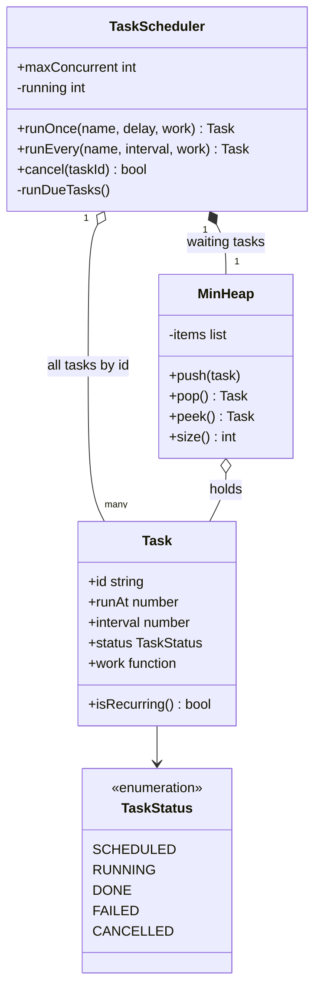
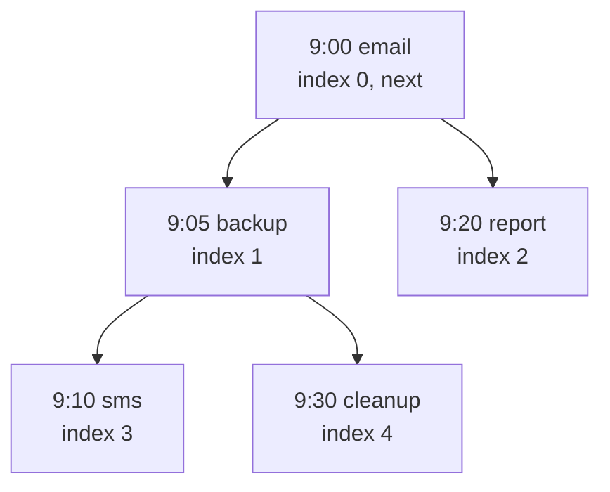
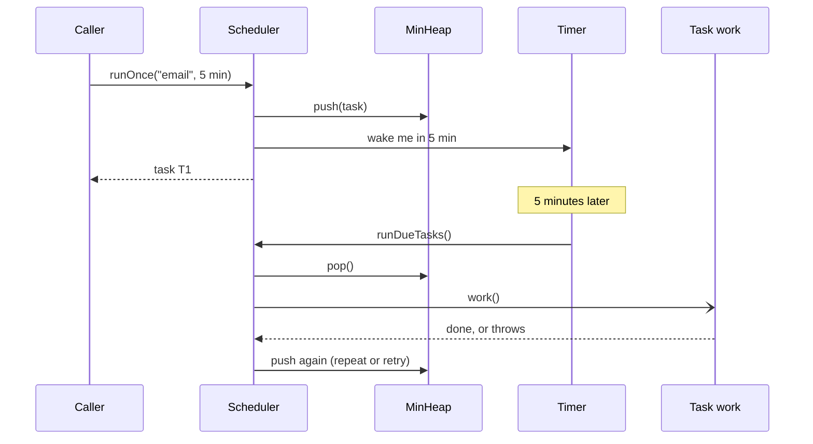
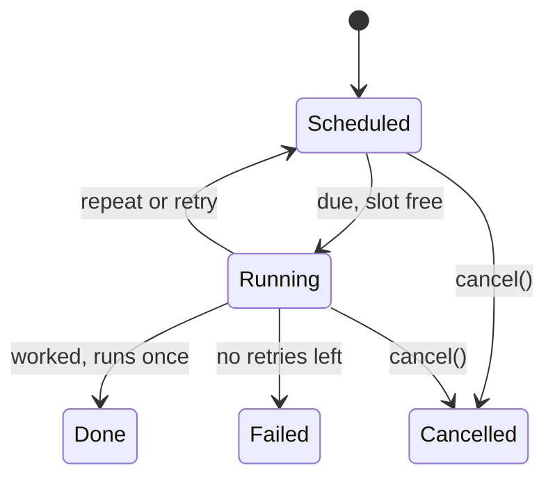

<Callout title="About this question">
  - **Difficulty:** Medium.
  - **Patterns used:** a min-heap priority queue (the next task, fast), [Command](../design-patterns/command.mdx) (a task wraps the work to run), [Producer-Consumer](../concurrency/producer-consumer.mdx) (a limited number of tasks run at once).
  - **Also asked as:** "Design a job scheduler (LLD)", "Design cron", "Design a delayed task queue", "Design setTimeout".
</Callout>

## Understand the problem

Think of the alarm and reminder app on your phone. "Remind me to call Mom in 20 minutes." "Wake me at 7:00 every day." You add alarms in any order, but the phone always knows which one comes next. When it rings, you can snooze it, or turn it off for good.

A task scheduler does the same for code. You give it a function and a time, and it runs the function when the time comes. What makes it interesting:

- **Find the next task fast.** With 100,000 waiting tasks, checking all of them every second is far too slow. A **min-heap** gives the earliest task at once.
- **Some tasks repeat.** After each run, the task must be put back for its next run.
- **Tasks fail.** A bank call times out. Try again a few times, and wait longer before each try.
- **Not too many at once.** If 500 tasks are due at 9:00, we can't start 500 network calls together. At most N run at once, and the rest wait their turn.
- **Cancel.** A task can be stopped before it runs, or a repeating task stopped for good.

This is the class design, inside one program. For millions of jobs on many servers, where each job must run only once, see the [Job Scheduler system design](/learn/system-design/questions/job-scheduler).

## Step 1: Requirements

### Functional requirements

1. Users should be able to schedule a task to run once, after a delay.
2. Users should be able to schedule a recurring task that runs again and again, with a fixed gap.
3. The scheduler should run each task when it is due, earliest first, and never early.
4. Users should be able to cancel a task that has not finished. A recurring task stops for good.
5. A task that fails should be retried a few times, with a longer wait before each try.
6. At most N tasks should run at the same time. The others wait for a free slot.
7. Users should be able to see a task's status: scheduled, running, done, failed or cancelled.

### Out of scope

- Calendar rules like "every Monday at 9:00" (cron). An extension later.
- Saving tasks so they survive a restart.
- Many servers (the distributed version).
- Stopping a task in the middle of a run.

### Questions to ask the interviewer

| Question | What we assume |
| --- | --- |
| One machine or many? | One program. Many servers is the system-design version. |
| How exact must the time be? | Never early. A few milliseconds late is fine. |
| For a recurring task, is the gap counted from the start or the end of a run? | From the end ("fixed delay"), so two runs of the same task never overlap. |
| What if a task fails? | Retry up to 2 times. The wait doubles before each retry. Then mark it FAILED. |
| How many tasks at once? | A setting, `maxConcurrent`. We use 2. |
| A task is due, but all slots are busy? | It waits and runs a little late. It is never skipped. |
| Do tasks have priorities? | Not now: earliest first. On a tie, the task added first goes first. |

## Step 2: Core classes

| Class | What it is | Key data | Key actions |
| --- | --- | --- | --- |
| `Task` | One thing to run, once or again and again | `id`, `work`, `runAt`, `interval`, `status`, `failures` | `isRecurring()` |
| `MinHeap` | The waiting tasks, with the one due first always on top | `items` (an array) | `push`, `pop`, `peek`, `size` |
| `TaskScheduler` | The main service. It owns the heap, the timer and the running count. | `queue`, `tasks`, `running`, `timer`, settings | `runOnce`, `runEvery`, `cancel` |

**Enum:** `TaskStatus`: `SCHEDULED`, `RUNNING`, `DONE`, `FAILED`, `CANCELLED`.

<Callout title="Is a worker a class?" type="idea">
  Not here. In JavaScript, a "worker" is just a running `async` call, and the scheduler counts them with
  `running`. Add a `Worker` class only when workers get their own data, such as a thread or a separate process.
</Callout>

## Step 3: Class diagram



- **The heap is its own class.** The scheduler only calls `push`, `pop` and `peek`. It doesn't care how the heap works inside.
- **Two places hold tasks.** The heap holds only the **waiting** tasks, in time order. The `tasks` map holds **every** task by id, so `cancel` and status checks are fast.
- **A task is a Command.** It wraps the function to run. The scheduler never knows what a task does. See [Command](../design-patterns/command.mdx).
- **One timer, not one per task.** The scheduler sets a single timer, for the task at the top of the heap.

### Why a min-heap?

We always need **the task due first**. Here are three ways to keep the waiting tasks:

| Way to keep the tasks | Add a task | See the next task | Take the next task out |
| --- | --- | --- | --- |
| A plain list | O(1) | O(n): look at every task | O(n) |
| A sorted array | O(n): move items to make room | O(1) | O(1) |
| A min-heap | O(log n) | O(1): it is on top | O(log n) |

With 100,000 tasks, log n is about 17 steps. The heap is fast for both adding and taking out.

A **min-heap** is a tree where every parent is due **before** its children. So the root is always the task due first. The tree is kept in a plain array: the children of index `i` are at `2i + 1` and `2i + 2`.



The array is `[9:00, 9:05, 9:20, 9:10, 9:30]`. It is **not** fully sorted: 9:20 comes before 9:10. A heap only promises that each parent is earlier than its children. That is enough to know the first task, and it is cheaper than keeping everything sorted.

## Step 4: Main methods

- `TaskScheduler.runOnce(name, delay, work)` → `Task`. Runs `work` once, after `delay` milliseconds.
- `TaskScheduler.runEvery(name, interval, work)` → `Task`. Runs `work` again and again, `interval` milliseconds after each run ends.
- `TaskScheduler.cancel(taskId)` → `true` if the task was stopped, `false` if it had already finished.
- `TaskScheduler.armTimer()`. Sets one timer, for the task due first.
- `TaskScheduler.runDueTasks()`. Starts every task that is due, while a slot is free.
- `MinHeap.push(task)`, `MinHeap.pop()` → the task due first, `MinHeap.peek()` → the same task, without removing it.

One task, from scheduling to its run:



How a task moves between its states:



## Step 5: Code

"Try it" uses top-level `await`, so save all the parts together as one file, `scheduler.mjs`. Long classes come in a few pieces. Paste the pieces in order and they make the whole class.

### Part 1: The task

**The status.** A task is always in one of these five states.

```js
const TaskStatus = {
    SCHEDULED: "SCHEDULED",
    RUNNING: "RUNNING",
    DONE: "DONE",
    FAILED: "FAILED",
    CANCELLED: "CANCELLED",
};
```

**The task.** It holds the function to run, when to run it, and how it is doing.

```js
// The number for the next task id.
let nextTaskNumber = 1;

class Task {
    constructor(name, work, runAt, interval) {
        // The number breaks ties: a task made earlier goes first.
        this.number = nextTaskNumber;
        this.id = `T${nextTaskNumber}`;
        nextTaskNumber += 1;

        this.name = name;
        // The function to run. It may be async.
        this.work = work;
        // When it should run next, in milliseconds (like Date.now()).
        this.runAt = runAt;
        // For a recurring task, the wait between runs. 0 means "run once".
        this.interval = interval;

        this.status = TaskStatus.SCHEDULED;
        // Failed attempts in a row.
        this.failures = 0;
        this.lastError = null;
    }

    isRecurring() {
        return this.interval > 0;
    }
}
```

### Part 2: The min-heap

The heap keeps the task due first at the top. Keep the tree picture from Step 3 in mind while you read.

**Piece 1: the basics.** The tree lives in a plain array.

```js
// A min-heap of tasks. The task due first is always at index 0.
// It is a tree stored in an array:
// the children of index i are at 2i + 1 and 2i + 2.
class MinHeap {
    constructor() {
        this.items = [];
    }

    size() {
        return this.items.length;
    }

    // The task due first, without removing it.
    peek() {
        return this.items[0];
    }
```

**Piece 2: comparing and swapping.** `isBefore` is the only place that knows the order: earlier time first, then the older task.

```js
    // True if the task at `index` should run before the one at `otherIndex`.
    isBefore(index, otherIndex) {
        const task = this.items[index];
        const other = this.items[otherIndex];

        if (task.runAt !== other.runAt) {
            return task.runAt < other.runAt;
        }

        // Same time: the task made first goes first.
        return task.number < other.number;
    }

    swap(index, otherIndex) {
        const saved = this.items[index];
        this.items[index] = this.items[otherIndex];
        this.items[otherIndex] = saved;
    }
```

**Piece 3: adding a task.** Put it at the end. Then, while it is due before its parent, swap them. This is called "bubble up".

```js
    // Add a task: put it at the end, then move it up to its place.
    push(task) {
        this.items.push(task);
        this.bubbleUp(this.items.length - 1);
    }

    bubbleUp(index) {
        while (index > 0) {
            const parent = Math.floor((index - 1) / 2);

            // The parent is due first, so the task is in its place.
            if (!this.isBefore(index, parent)) {
                return;
            }

            this.swap(index, parent);
            index = parent;
        }
    }
```

**Piece 4: taking out the first task.** Take the top. Move the last task to the top, then let it sink to its place.

```js
    // Remove and return the task due first.
    pop() {
        const first = this.items[0];
        const last = this.items.pop();

        // Move the last task to the top, then down to its place.
        if (this.items.length > 0) {
            this.items[0] = last;
            this.bubbleDown(0);
        }

        return first;
    }
```

**Piece 5: sinking down.** This finishes the `MinHeap` class. While a child is due before the task, swap the task with its earliest child. This is called "bubble down".

```js
    bubbleDown(index) {
        const size = this.items.length;

        // Keep going while the task has at least one child.
        while (2 * index + 1 < size) {
            const left = 2 * index + 1;
            const right = 2 * index + 2;

            // Which is due first: the task, or one of its children?
            let earliest = index;
            if (this.isBefore(left, earliest)) {
                earliest = left;
            }
            if (right < size && this.isBefore(right, earliest)) {
                earliest = right;
            }

            // The task is due before both children, so it is in its place.
            if (earliest === index) {
                return;
            }

            this.swap(index, earliest);
            index = earliest;
        }
    }
}
```

How it works, with the heap from the picture, `[9:00, 9:05, 9:20, 9:10, 9:30]`:

- **Push 9:02.** It goes to the end, index 5. Its parent is index 2 (9:20). 9:02 is earlier, so they swap. Its new parent is index 0 (9:00), which is earlier, so it stops. Two steps, not a full sort.
- **Pop.** 9:00 is taken out. The last task (9:30) moves to the top. Its children are 9:05 and 9:20, and 9:05 is the earliest, so they swap. Its new child is 9:10, which is earlier, so they swap again. Now 9:05 is on top.
- Each step moves one level up or down the tree, and the tree has about log n levels. That is why both are O(log n).

### Part 3: The scheduler

**Piece 1: its data.** The settings, the heap, a map of every task, the running count and the timer.

```js
class TaskScheduler {
    // settings: for example { maxConcurrent: 2, maxRetries: 2, retryDelay: 20 }
    constructor(settings) {
        // At most this many tasks run at the same time.
        this.maxConcurrent = settings.maxConcurrent;
        // How many times to retry a task that fails.
        this.maxRetries = settings.maxRetries;
        // The wait before the first retry (in ms). It doubles each time.
        this.retryDelay = settings.retryDelay;

        // The tasks waiting for their time, the one due first on top.
        this.queue = new MinHeap();
        // Every task by id, to cancel it or see its status.
        this.tasks = new Map();
        // How many tasks are running right now.
        this.running = 0;
        // The one timer that wakes us at the next due time, or null.
        this.timer = null;
    }
```

**Piece 2: adding tasks.** Both public methods make a `Task`, put it in the heap, and reset the timer.

```js
    // Run `work` once, after `delay` milliseconds.
    runOnce(name, delay, work) {
        return this.addTask(name, delay, 0, work);
    }

    // Run `work` every `interval` milliseconds, until it is cancelled.
    runEvery(name, interval, work) {
        return this.addTask(name, interval, interval, work);
    }

    addTask(name, delay, interval, work) {
        const runAt = Date.now() + delay;
        const task = new Task(name, work, runAt, interval);

        this.tasks.set(task.id, task);
        this.queue.push(task);

        // The new task may be due before the one the timer waits for.
        this.armTimer();
        return task;
    }
```

**Piece 3: cancel.** Cancel only **marks** the task. Finding a task in the middle of a heap takes O(n), but marking it takes O(1). The scheduler skips it when it comes out of the heap. This is called "lazy delete".

```js
    // Returns true if the task was stopped, false if it had already finished.
    cancel(taskId) {
        const task = this.tasks.get(taskId);
        if (!task) {
            throw new Error(`No task ${taskId}`);
        }

        // Only a waiting or a running task can be cancelled.
        const isWaiting = task.status === TaskStatus.SCHEDULED;
        const isRunning = task.status === TaskStatus.RUNNING;
        if (!isWaiting && !isRunning) {
            return false;
        }

        // Only mark it. It stays in the heap and is skipped when it comes out.
        // A running task finishes this run, but never runs again.
        task.status = TaskStatus.CANCELLED;
        return true;
    }
```

**Piece 4: the one timer.** Like a phone that sets its alarm for the next alarm only. It is reset every time the top of the heap may have changed.

```js
    // Set one timer, for the task due first.
    armTimer() {
        if (this.timer !== null) {
            clearTimeout(this.timer);
            this.timer = null;
        }

        // Nothing waiting, or no free slot. A task that ends calls us again.
        if (this.queue.size() === 0 || this.running >= this.maxConcurrent) {
            return;
        }

        const next = this.queue.peek();
        let wait = next.runAt - Date.now();
        if (wait < 0) {
            wait = 0;
        }

        this.timer = setTimeout(() => {
            this.timer = null;
            this.runDueTasks();
        }, wait);
    }
```

**Piece 5: running due tasks.** Start every task that is due, while a slot is free. Don't wait for one task to end before starting the next.

```js
    // Start every task that is due, while there is a free slot.
    runDueTasks() {
        while (this.running < this.maxConcurrent && this.queue.size() > 0) {
            const next = this.queue.peek();

            // The first task is not due yet, so no task is.
            if (next.runAt > Date.now()) {
                break;
            }

            this.queue.pop();

            // Cancelled while it waited: skip it.
            if (next.status === TaskStatus.CANCELLED) {
                continue;
            }

            // No await here: start it, and look at the next one.
            this.runTask(next);
        }

        this.armTimer();
    }
```

**Piece 6: running one task.** It takes a slot, runs the work, and frees the slot when the work ends.

```js
    async runTask(task) {
        // Count the slot before the first await, so no one else takes it.
        this.running += 1;
        task.status = TaskStatus.RUNNING;

        try {
            await task.work();
            this.afterSuccess(task);
        } catch (error) {
            this.afterFailure(task, error);
        }

        this.running -= 1;
        // A slot is free now: start the next due task, if there is one.
        this.runDueTasks();
    }
```

How it works:

- `runDueTasks` calls `runTask` without `await`, so two due tasks start together. `running` counts them.
- `runTask` adds 1 to `running` **before** its first `await`. So the `while` loop sees the new count at once, and never starts more than `maxConcurrent` tasks.
- When a task ends, it frees its slot and calls `runDueTasks` again. That is how a waiting task gets its turn.
- A task that throws is caught by the same `try`, even if `work` is not `async`.

**Piece 7: after a run that worked.** A recurring task goes back in the heap for its next run. A one-off task is done.

```js
    afterSuccess(task) {
        task.failures = 0;

        // Cancelled during this run: stop here.
        if (task.status === TaskStatus.CANCELLED) {
            return;
        }

        if (task.isRecurring()) {
            // The next run is one interval after this one ended.
            task.runAt = Date.now() + task.interval;
            task.status = TaskStatus.SCHEDULED;
            this.queue.push(task);
            return;
        }

        task.status = TaskStatus.DONE;
    }
```

**Piece 8: after a run that failed.** This finishes the `TaskScheduler` class. The task goes back in the heap a little later, until it runs out of retries.

```js
    afterFailure(task, error) {
        task.failures += 1;
        task.lastError = error.message;

        if (task.status === TaskStatus.CANCELLED) {
            return;
        }

        if (task.failures > this.maxRetries) {
            task.status = TaskStatus.FAILED;
            return;
        }

        // Wait longer after each failure: 1x, then 2x, then 4x the retry delay.
        const multiplier = Math.pow(2, task.failures - 1);
        const wait = this.retryDelay * multiplier;

        task.runAt = Date.now() + wait;
        task.status = TaskStatus.SCHEDULED;
        this.queue.push(task);
    }
}
```

Doubling the wait is called **exponential backoff**. It gives a busy service time to recover. See [Retries and Backoff](/learn/system-design/messaging/retries-backoff-timeouts).

### Part 4: Try it

The delays are small (milliseconds) so the demo runs fast.

**Set up.** At most 2 tasks at once, 2 retries, and 20 ms before the first retry.

```js
// Wait some milliseconds.
function sleep(milliseconds) {
    return new Promise((resolve) => setTimeout(resolve, milliseconds));
}

const scheduler = new TaskScheduler({
    maxConcurrent: 2,
    maxRetries: 2,
    retryDelay: 20,
});
```

**Tasks run in time order, not in the order they were added.**

```js
scheduler.runOnce("report", 150, () => console.log("run: report"));
scheduler.runOnce("email", 50, () => console.log("run: email"));
scheduler.runOnce("backup", 100, () => console.log("run: backup"));

await sleep(200);
// run: email
// run: backup
// run: report
```

**Cancel a task before it runs.** It never prints. Cancelling it again returns `false`, and an unknown id throws.

```js
const reminder = scheduler.runOnce("reminder", 50, () => {
    console.log("run: reminder");
});
console.log(scheduler.cancel(reminder.id)); // true

await sleep(100);
console.log(reminder.status); // CANCELLED
console.log(scheduler.cancel(reminder.id)); // false

try {
    scheduler.cancel("T99");
} catch (error) {
    console.log(error.message); // No task T99
}
```

**A recurring task.** It runs every 50 ms. On its third run, it cancels itself.

```js
let beats = 0;

const heartbeat = scheduler.runEvery("heartbeat", 50, () => {
    beats += 1;
    console.log(`heartbeat ${beats}`);

    if (beats === 3) {
        scheduler.cancel(heartbeat.id);
    }
});

await sleep(250);
// heartbeat 1
// heartbeat 2
// heartbeat 3
console.log(heartbeat.status); // CANCELLED
```

The third run was cancelled while it was running. It finished, but `afterSuccess` saw `CANCELLED` and did not put it back.

**Retries.** The payment fails twice, then works. The export fails every time, so it ends as `FAILED`.

```js
let attempts = 0;

const payment = scheduler.runOnce("payment", 10, () => {
    attempts += 1;
    console.log(`payment attempt ${attempts}`);

    if (attempts < 3) {
        throw new Error("Bank timeout");
    }
});

const exportTask = scheduler.runOnce("export", 10, () => {
    throw new Error("Disk full");
});

await sleep(150);
// payment attempt 1
// payment attempt 2
// payment attempt 3
console.log(payment.status); // DONE
console.log(exportTask.status, exportTask.lastError); // FAILED Disk full
```

The payment ran at about 10 ms, then 20 ms later, then 40 ms after that.

**At most 2 at once.** Three slow tasks are due at the same time. C waits until A frees a slot.

```js
// A task that takes 100 ms, like a slow network call.
async function slowJob(name) {
    console.log(`start ${name}`);
    await sleep(100);
    console.log(`end ${name}`);
}

scheduler.runOnce("A", 10, () => slowJob("A"));
scheduler.runOnce("B", 10, () => slowJob("B"));
scheduler.runOnce("C", 10, () => slowJob("C"));

await sleep(300);
// start A
// start B
// end A
// start C
// end B
// end C
```

## Step 6: Edge cases and extensions

### Edge cases

| Case | What happens |
| --- | --- |
| A delay of 0, or a time in the past | The wait becomes 0, so it runs as soon as possible. |
| Two tasks due at the same moment | The task added first runs first (`isBefore` compares `number`). |
| A task is due, but all slots are busy | It stays in the heap and runs when a slot frees. Late, but never skipped. |
| Cancel a waiting task | Marked `CANCELLED`, and skipped when it comes out of the heap. |
| Cancel a running task | This run finishes (JavaScript can't stop a function halfway). It never runs or retries again. |
| Cancel a finished task | Returns `false`. Nothing changes. |
| Cancel an unknown id | Throws "No task T99". |
| A run takes longer than its interval | The next run is counted from the end of this one, so runs never overlap. |
| A recurring task fails every retry | Marked `FAILED`, and it stops. Another choice: skip this run, and keep the schedule. |
| Many tasks are cancelled | They stay in the heap until their time, and use memory. When more than half are cancelled, rebuild the heap without them. |
| The computer's clock is changed | `Date.now()` jumps, and tasks run too early or too late. For delays, use `performance.now()`, which never goes back. |

### Two requests at once

A timer fires and a task ends at almost the same moment. Both call `runDueTasks`. Can two slots be counted as one, or one task start twice?

In JavaScript, no. `runDueTasks` has no `await`. Popping a task and adding 1 to `running` happen together, so one call always finishes before the next one starts. The danger is an `await` between **checking** for a free slot and **taking** it:

```js
// NOT SAFE. A fragment, not runnable on its own.
async startNext() {
    if (this.running < this.maxConcurrent) {
        const task = this.queue.pop();

        // Another call runs here, sees the same count, and starts one more.
        await this.log.save(task);

        this.running += 1;
        await task.work();
    }
}
```

The fix: take the slot first (`running += 1`), then do any slow work. Our `runTask` does exactly this.

A recurring task also never runs twice at the same time: its next run goes into the heap only after the current run ends.

- **Many servers:** each server has its own heap, so two servers could run the same task. A task must be **claimed** in a shared database or Redis first, and tasks should be safe to run twice. See the [Job Scheduler system design](/learn/system-design/questions/job-scheduler).
- **In Java,** tasks run on a pool of threads, so the heap is shared between threads and must be guarded by a lock. Java's `ScheduledThreadPoolExecutor` does this for you. See [Race Conditions and Locks](../concurrency/race-conditions-locks.mdx).

### Adding features

- **Calendar rules** ("every Monday at 9:00"): add a `Schedule` interface with `nextRunAfter(time)`. `IntervalSchedule` and `CronSchedule` implement it, and the scheduler asks the task's schedule for its next time. This is [Strategy](../design-patterns/strategy.mdx).
- **Retry rules:** a `RetryPolicy` interface with `nextWait(failures)`: fixed, doubling, or doubling plus a small random "jitter", so many failed tasks don't all retry at the same moment. Strategy again.
- **Priorities:** keep one heap per priority. When a slot frees, take a due task from the highest-priority heap first.
- **Timeouts:** race `task.work()` against a timer with `Promise.race`, and count a timeout as a failure.
- **Surviving a restart:** save every task in a database, and load the waiting ones into the heap at startup.

## Patterns used

| Pattern | Where | Why |
| --- | --- | --- |
| Priority queue (min-heap) | `MinHeap` | See the next task in O(1). Add and take out in O(log n). |
| [Command](../design-patterns/command.mdx) | `Task` wraps `work`, a function to run later | The scheduler runs any task without knowing what it does. |
| [Producer-Consumer](../concurrency/producer-consumer.mdx) | Callers add tasks. At most `maxConcurrent` run at once. | Callers never wait, and the limit protects the services the tasks call. |
| [Strategy](../design-patterns/strategy.mdx) (extension) | `Schedule` and `RetryPolicy` | New timing or retry rules without touching the scheduler. |

Real schedulers follow this shape:

- **Java's `ScheduledThreadPoolExecutor`** keeps its waiting tasks in a heap (its `DelayedWorkQueue`) and runs them on a pool of threads. It offers both `scheduleAtFixedRate` and `scheduleWithFixedDelay`.
- **Python's `sched` module** is a small scheduler built on `heapq`, Python's heap.
- **Node.js** keeps its own timers in a priority queue too. That is how `setTimeout` knows which timer fires next.

## Follow-up questions

<Accordions>
<Accordion title="Why not just call setTimeout for each task?">

For a few simple tasks, that is fine. But you can't limit how many run at once, retry them, list them, or show their status. And a timer can't be saved to disk. Our scheduler owns the waiting tasks in its own heap, and uses one timer only as an alarm clock for the next task.

</Accordion>
<Accordion title="Fixed rate or fixed delay?">

**Fixed delay** (ours): the next run starts `interval` after the last run **ends**. Runs never overlap, but the times drift if runs are slow. **Fixed rate**: the next run is at the planned time plus `interval` (9:00, 9:05, 9:10), however long each run takes. It keeps the clock times, but if a run is slower than the interval, runs pile up. Java offers both: `scheduleWithFixedDelay` and `scheduleAtFixedRate`.

</Accordion>
<Accordion title="How else could cancel remove a task from the heap?">

Keep a map from each task to its index in the heap array, and update it on every swap. Then cancel can find the task in O(1), swap it with the last item, remove it, and bubble up or down: O(log n) in all. It frees memory at once, but every swap must update the map. Lazy delete is simpler, and good enough unless most tasks get cancelled.

</Accordion>
<Accordion title="How do you test this?">

Real timers make tests slow and a little fragile. Pass in a clock (a function that returns the time) instead of calling `Date.now()`, and use fake timers, like Jest's `jest.useFakeTimers()` and `jest.advanceTimersByTime(5000)`. Then a test can jump 5 seconds ahead in one line, and get the same result every time.

</Accordion>
<Accordion title="How would this work on many servers?">

Save tasks in a database, with an index on the run time. Load the tasks due soon into a timer queue. Before a worker runs a task, it claims it, so only one server runs it. Make tasks safe to run twice, because a crash can cause a retry. See the [Job Scheduler system design](/learn/system-design/questions/job-scheduler).

</Accordion>
</Accordions>

## What the interviewer expects

<Tabs items={['Mid-level', 'Senior', 'Staff']}>
<Tab value="Mid-level">

- Clear classes: `Task`, `TaskScheduler`, and a structure that keeps tasks in time order.
- One-off tasks that run in the right order, and cancel.
- Statuses that make sense: scheduled, running, done.

</Tab>
<Tab value="Senior">

- A min-heap, with its costs, and why it beats a sorted list.
- One timer, reset when an earlier task arrives or a run ends.
- Recurring tasks, retries with backoff, a limit on how many run at once, and lazy cancel.

</Tab>
<Tab value="Staff">

- Everything from senior, but faster.
- Fixed rate vs fixed delay, clock changes, and many cancelled tasks in the heap.
- The path to many servers: claiming tasks, idempotent tasks, and saving tasks to survive a crash.

</Tab>
</Tabs>

<Callout title="Remember this" type="success">
  - Keep the waiting tasks in a min-heap by run time: see the next in O(1), add and take out in O(log n).
  - One timer, set for the task on top. Reset it when an earlier task arrives or a run ends.
  - Cancel = mark it and skip it later (lazy delete).
  - Recurring = put the task back after each run. Retry = put it back later, and double the wait each time.
  - Count the slot before any `await`. At most `maxConcurrent` tasks run at once.
</Callout>
