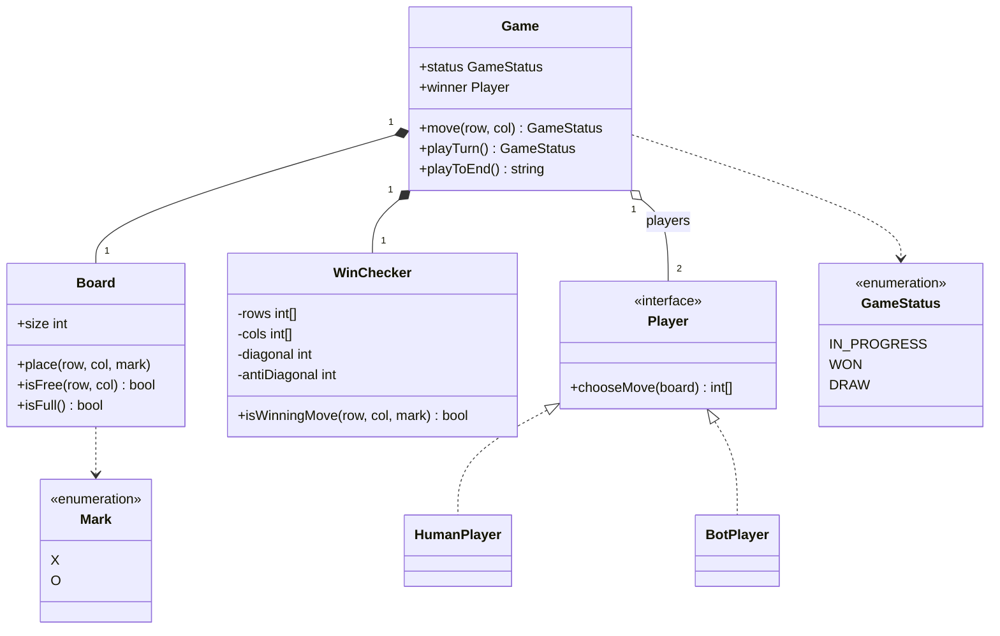
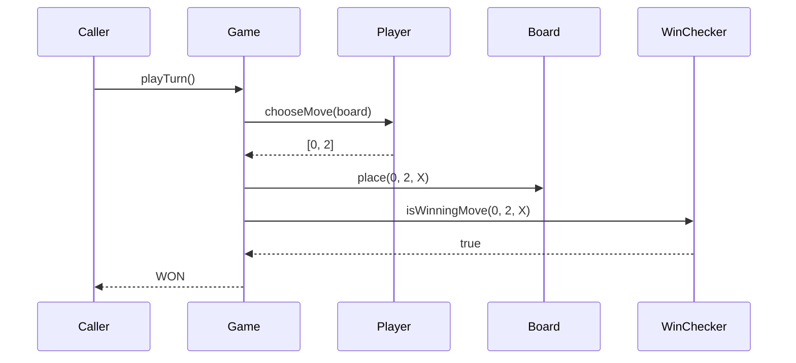

<Callout title="About this question">
  - **Difficulty:** Easy.
  - **Patterns used:** [Strategy](../design-patterns/strategy.mdx) (the `Player` interface, so a bot can play).
  - **Also asked as:** "Design a board game", "Design Connect Four", "Design Gomoku (five in a row)".
</Callout>

## Understand the problem

Everyone has played it on paper: a 3×3 grid, one player draws X, the other draws O, and they take turns. Three in a row, column or diagonal wins. A full grid with no line is a draw.

The game is tiny, so the interviewer looks at two things:

- **Clean classes.** The board, the rules, the players and the game each have one job.
- **A fast win check.** Scanning the whole board after every move works for 3×3. On a 1,000×1,000 board it is slow. There is a neat trick that checks a win in O(1) time.

## Step 1: Requirements

### Functional requirements

1. Users should be able to play on an N×N board (3×3 by default).
2. Users should take turns: X first, then O.
3. Users should get a clear error for a bad move (off the board, or a taken cell), and keep their turn.
4. Users should see the game end with a win (a full row, column or diagonal of one mark) or a draw (a full board).
5. A player can be a person or a bot.

### Out of scope

- Drawing the board on a screen.
- Online play, accounts and scores across games.
- A smart bot (it is an easy extension).

### Questions to ask the interviewer

| Question | What we assume |
| --- | --- |
| What size is the board? | N×N, with N of 3 or more. |
| How many in a row win? | A whole line: N. ("K in a row" is a follow-up.) |
| Who goes first? | X. |
| Are bots needed? | Not now, but the design must make adding one easy. |
| Is undo needed? | No. |

## Step 2: Core classes

| Class | What it is | Key data | Key actions |
| --- | --- | --- | --- |
| `Board` | The N×N grid of cells | `size`, the cells | `place(row, col, mark)`, `isFree`, `isFull()` |
| `WinChecker` | Knows the win rule | one counter per row, column and diagonal | `isWinningMove(row, col, mark)` |
| `Player` (interface) | Someone who picks a move | — | `chooseMove(board)` |
| `HumanPlayer`, `BotPlayer` | A person, and a simple bot | `name`, `mark` | `chooseMove(board)` |
| `Game` | Runs the turns and knows who won | board, checker, players, status | `move`, `playTurn`, `playToEnd` |

**Enums:**

- `Mark`: `X`, `O`.
- `GameStatus`: `IN_PROGRESS`, `WON`, `DRAW`.

## Step 3: Class diagram



- **`WinChecker` is its own class.** The board only stores cells. The checker only knows the rule. If the rule changes (five in a row), only the checker changes. This is the [Single Responsibility Principle](../design-principles/single-responsibility.mdx).
- **`Player` is an interface.** `Game` only calls `chooseMove(board)`. A person, a bot or a player over the network all plug in the same way. Each one is a different "strategy" for picking a move.
- **Composition for the board and checker, aggregation for players.** The board and checker are made for one game and die with it. Players live on: the same person plays many games.
- **Enums, not loose strings.** `Mark.X` and `GameStatus.WON` can't be misspelled the way `'x'` or `'won!'` can.

## Step 4: Main methods

- `Game.move(row, col)` → the new `GameStatus`. Places the current player's mark. A bad move throws, and the turn stays the same.
- `Game.playTurn()` → asks the current player for a move, then calls `move`.
- `Game.playToEnd()` → plays turns until someone wins or it is a draw. Returns the result.
- `Board.place(row, col, mark)` → puts a mark in a free cell.
- `WinChecker.isWinningMove(row, col, mark)` → `true` if this move completed a line. O(1).
- `Player.chooseMove(board)` → `[row, col]`.

One turn:



### The O(1) win check

Keep one counter for each row, each column, and the two diagonals. **X adds 1, O adds -1.**

- A line full of X has a total of **N**. A line full of O has **-N**.
- A line with both marks can never reach N or -N. One O cancels out one X.
- After a move, only four counters change: its row, its column, and the diagonals it sits on. So the check is O(1).

For example, on a 3×3 board X plays (0, 0), (0, 1) and (0, 2). The counter for row 0 goes 1, 2, 3. 3 equals N, so X wins. The cost is a little memory: 2N + 2 counters.

## Step 5: Code

The code is split into small parts. Paste them together in order and they run.

### Part 1: The enums

Plain objects with fixed values, so `Mark.X` can't be misspelled.

```js
// The two marks.
const Mark = {
    X: "X",
    O: "O",
};

// Where the game is at.
const GameStatus = {
    IN_PROGRESS: "IN_PROGRESS",
    WON: "WON",
    DRAW: "DRAW",
};
```

### Part 2: The board

The board only stores the cells. It doesn't know who wins. First, making the empty grid:

```js
// The N×N grid of cells. Each cell is null (empty), "X" or "O".
class Board {
    constructor(size) {
        if (!Number.isInteger(size) || size < 3) {
            throw new Error("Size must be a whole number, 3 or more");
        }

        this.size = size;

        // How many cells have a mark. Makes the "is it full?" check fast.
        this.filled = 0;

        // Make "size" rows. Each row has "size" empty cells.
        this.cells = [];
        for (let i = 0; i < size; i++) {
            const row = new Array(size).fill(null);
            this.cells.push(row);
        }
    }
```

Next, placing marks. A bad move throws an error.

```js
    // True if (row, col) is a whole-number cell on the board.
    isInside(row, col) {
        if (!Number.isInteger(row) || !Number.isInteger(col)) {
            return false;
        }

        const rowFits = row >= 0 && row < this.size;
        const colFits = col >= 0 && col < this.size;
        return rowFits && colFits;
    }

    isFree(row, col) {
        return this.cells[row][col] === null;
    }

    place(row, col, mark) {
        if (!this.isInside(row, col)) {
            throw new Error(`(${row}, ${col}) is off the board`);
        }
        if (!this.isFree(row, col)) {
            throw new Error(`(${row}, ${col}) is taken`);
        }

        this.cells[row][col] = mark;
        this.filled += 1;
    }

    isFull() {
        return this.filled === this.size * this.size;
    }
```

Last, two ways to read the board: the free cells, and the board as text.

```js
    // Every empty cell, as a list of [row, col] pairs.
    freeCells() {
        const free = [];
        for (let row = 0; row < this.size; row++) {
            for (let col = 0; col < this.size; col++) {
                if (this.isFree(row, col)) {
                    free.push([row, col]);
                }
            }
        }
        return free;
    }

    // The board as text, one line per row. Empty cells show as ".".
    toString() {
        const lines = [];
        for (const row of this.cells) {
            const symbols = [];
            for (const cell of row) {
                if (cell === null) {
                    symbols.push(".");
                } else {
                    symbols.push(cell);
                }
            }
            lines.push(symbols.join(" "));
        }
        return lines.join("\n");
    }
}
```

### Part 3: The win checker

This is the O(1) trick from above. It keeps one counter per row, per column and per diagonal.

```js
// X adds 1 and O adds -1. A line is full of one mark
// when its counter reaches size (all X) or -size (all O).
class WinChecker {
    constructor(size) {
        this.size = size;
        this.rows = new Array(size).fill(0);
        this.cols = new Array(size).fill(0);
        this.diagonal = 0;
        this.antiDiagonal = 0;
    }
```

After each move, only four counters change: the move's row, its column, and the diagonals it sits on.

```js
    isWinningMove(row, col, mark) {
        let add = -1;
        if (mark === Mark.X) {
            add = 1;
        }

        this.rows[row] += add;
        this.cols[col] += add;

        // The main diagonal: top-left to bottom-right.
        if (row === col) {
            this.diagonal += add;
        }
        // The other diagonal: top-right to bottom-left.
        if (row + col === this.size - 1) {
            this.antiDiagonal += add;
        }

        // A counter of size or -size means one mark fills that line.
        const totals = [this.rows[row], this.cols[col], this.diagonal, this.antiDiagonal];
        for (const total of totals) {
            if (Math.abs(total) === this.size) {
                return true;
            }
        }
        return false;
    }
}
```

### Part 4: The players

`Player` is the interface. A person and the bot are two classes that fill it in.

```js
// The Player "interface": every player has a chooseMove method
// that returns the move as [row, col].
class Player {
    chooseMove(board) {
        throw new Error("not implemented");
    }
}

// A person. In a real app, moves come from clicks.
// Here they come from a list, so the example can run on its own.
class HumanPlayer extends Player {
    constructor(name, mark, moves = []) {
        super();
        this.name = name;
        this.mark = mark;
        // A copy, so we don't change the caller's list.
        this.moves = moves.slice();
    }

    // Take the next move from the front of the list.
    chooseMove() {
        return this.moves.shift();
    }
}
```

The bot is just one more class:

```js
// A simple bot: the center if it is free, else the first free cell.
class BotPlayer extends Player {
    constructor(name, mark) {
        super();
        this.name = name;
        this.mark = mark;
    }

    chooseMove(board) {
        const middle = Math.floor(board.size / 2);
        if (board.isFree(middle, middle)) {
            return [middle, middle];
        }

        const freeCells = board.freeCells();
        return freeCells[0];
    }
}
```

In JavaScript, duck typing also works: any object with `name`, `mark` and a `chooseMove` method can play. The base class makes the role easy to see. In Java, `Player` would be an `interface`.

### Part 5: The game

The game owns the board and the checker, and counts the turns.

```js
// Runs the turns and knows who won.
class Game {
    constructor(size, playerX, playerO) {
        if (playerX.mark !== Mark.X || playerO.mark !== Mark.O) {
            throw new Error("Players must be X and O");
        }

        this.board = new Board(size);
        this.checker = new WinChecker(size);
        this.players = [playerX, playerO];
        this.status = GameStatus.IN_PROGRESS;
        this.winner = null;

        // Counts the turns. Even means X plays, odd means O plays.
        this.turn = 0;
    }

    getCurrentPlayer() {
        const index = this.turn % 2;
        return this.players[index];
    }
```

`move` places a mark. It checks for a win **before** it checks for a draw, so a win on the last free cell counts as a win.

```js
    move(row, col) {
        if (this.status !== GameStatus.IN_PROGRESS) {
            throw new Error("The game is over");
        }

        const player = this.getCurrentPlayer();

        // Throws on a bad move. The turn doesn't change, so the same player tries again.
        this.board.place(row, col, player.mark);

        if (this.checker.isWinningMove(row, col, player.mark)) {
            this.status = GameStatus.WON;
            this.winner = player;
        } else if (this.board.isFull()) {
            this.status = GameStatus.DRAW;
        } else {
            // No winner yet: now it's the other player's turn.
            this.turn += 1;
        }

        return this.status;
    }
```

Last, playing turns by asking the players, and the result as a short sentence.

```js
    // Ask the current player for a move, then make it.
    playTurn() {
        const player = this.getCurrentPlayer();
        const chosen = player.chooseMove(this.board);
        const row = chosen[0];
        const col = chosen[1];
        return this.move(row, col);
    }

    // Keep playing until someone wins or it's a draw.
    playToEnd() {
        while (this.status === GameStatus.IN_PROGRESS) {
            this.playTurn();
        }
        return this.getResult();
    }

    getResult() {
        if (this.status === GameStatus.WON) {
            return `${this.winner.name} (${this.winner.mark}) wins`;
        }
        if (this.status === GameStatus.DRAW) {
            return "Draw";
        }

        const player = this.getCurrentPlayer();
        return `${player.name} (${player.mark}) to play`;
    }
}
```

### Part 6: Try it

Three games: two people, a person against the bot on 4×4, and two bots. `show` runs an action and returns the error message if it throws, so the program keeps going.

```js
// "action" is a small function, like () => game.move(0, 0).
function show(action) {
    try {
        return action();
    } catch (error) {
        return error.message;
    }
}
```

Game 1: two people on a 3×3 board, one move at a time.

```js
const asha = new HumanPlayer("Asha", Mark.X);
const ben = new HumanPlayer("Ben", Mark.O);
const game = new Game(3, asha, ben);

// Asha plays (0, 0), then Ben plays (1, 0).
game.move(0, 0);
game.move(1, 0);

// Bad moves throw, and it stays Asha's turn.
console.log(show(() => game.move(0, 0))); // (0, 0) is taken
console.log(show(() => game.move(3, 3))); // (3, 3) is off the board
console.log(game.getResult()); // Asha (X) to play

// Asha, Ben, then Asha fills the top row.
game.move(0, 1);
game.move(1, 1);
console.log(game.move(0, 2)); // WON
console.log(game.getResult()); // Asha (X) wins

console.log(game.board.toString());
// X X X
// O O .
// . . .

console.log(show(() => game.move(2, 0))); // The game is over
```

Game 2: a person against the bot on a 4×4 board. Asha's moves are planned ahead, and she wins on the anti-diagonal.

```js
const ashaMoves = [[0, 3], [1, 2], [2, 1], [3, 0]];
const human = new HumanPlayer("Asha", Mark.X, ashaMoves);
const bot = new BotPlayer("Bot", Mark.O);
const game2 = new Game(4, human, bot);

console.log(game2.playToEnd()); // Asha (X) wins

console.log(game2.board.toString());
// O O . X
// . . X .
// . X O .
// X . . .
```

Game 3: two bots. The same `Game` class works with no change.

```js
const bot1 = new BotPlayer("Bot 1", Mark.X);
const bot2 = new BotPlayer("Bot 2", Mark.O);
const game3 = new Game(3, bot1, bot2);

console.log(game3.playToEnd()); // Draw
```

## Step 6: Edge cases and extensions

### Edge cases

| Case | What happens |
| --- | --- |
| A move off the board, or not a whole number | Throws "off the board". The same player moves again. |
| A move on a taken cell | Throws "taken". The same player moves again. |
| A move after the game ended | Throws "The game is over". |
| A win on the last free cell | Counted as a win, because the win check runs before the draw check. |
| A board size of 2, 0 or 2.5 | The `Board` constructor throws. |
| Two players with the same mark | The `Game` constructor throws. |
| The bot on a full board | Never happens. A full board ends the game before the bot is asked. |

### Two requests at once

In an online game, a player can double-click, or both players can click at the same moment. In JavaScript, `move` has no `await` inside, so each call runs to the end: the check, the mark and the turn change happen together. The second call already sees the new turn.

One gap: `move` trusts that the caller is the current player. Online, the server must check who is asking:

```js
// A fragment, not runnable on its own: the online version of move.
move(playerId, row, col) {
    if (this.getCurrentPlayer().id !== playerId) {
        throw new Error("Not your turn");
    }

    // ...the same as before
}
```

With many servers, keep the game in a database with a version number. Save a move with `UPDATE games SET board = ..., version = version + 1 WHERE id = ... AND version = 7`. If 0 rows change, someone else moved first. See [Race Conditions and Locks](../concurrency/race-conditions-locks.mdx).

### Adding features

- **A smarter bot:** add `MinimaxBot extends Player`. `Game` doesn't change. This is [Strategy](../design-patterns/strategy.mdx).
- **Five in a row on a big board (Gomoku):** make `WinChecker` an interface and add a checker that counts matching marks outward from the last move in four directions. That is O(K) for K in a row. The board and game don't change.
- **Undo:** save each move as an object that can do and undo itself. Undo clears the cell, subtracts from the counters and steps the turn back. This is [Command](../design-patterns/command.mdx).

## Patterns used

| Pattern | Where | Why |
| --- | --- | --- |
| [Strategy](../design-patterns/strategy.mdx) | `Player`: `HumanPlayer`, `BotPlayer` | Swap how moves are chosen without touching `Game`. |
| [Single Responsibility](../design-principles/single-responsibility.mdx) | `Board`, `WinChecker`, `Game` | Cells, the win rule and turns change for different reasons. |
| [Command](../design-patterns/command.mdx) (extension) | A move object with undo | History and undo for free. |

In the real world, the official React tutorial on react.dev builds tic-tac-toe. Its `calculateWinner` function checks a fixed list of the 8 possible lines. That is perfect for 3×3. The counter trick matters when N grows.

## Follow-up questions

<Accordions>
<Accordion title="Why not just scan the board after every move?">

Scanning the whole board is O(N²) per move. Scanning only the last move's row, column and diagonals is O(N). The counters make it O(1), for 2N + 2 numbers of memory. For 3×3 any of them is fine, so say the trade-off out loud.

</Accordion>
<Accordion title="Does the counter trick work for three players?">

No. With three marks, +1 and -1 can't tell them apart. Keep one set of counters per player instead: `rows[player][row]`. A player wins when one of their counters reaches N.

</Accordion>
<Accordion title="How would you add undo?">

Keep a stack of moves. To undo, pop the last move, clear the cell, subtract its value from the counters, and step the turn back. If the game had ended, set the status back to `IN_PROGRESS`.

</Accordion>
<Accordion title="How would a person play from a web page?">

The page calls `game.move(row, col)` on each click and redraws the board from `game.board`. `HumanPlayer.chooseMove` is only needed when the game asks for moves, as `playToEnd` does. Clicks can also feed a queue that `chooseMove` reads.

</Accordion>
</Accordions>

## What the interviewer expects

<Tabs items={['Mid-level', 'Senior', 'Staff']}>
<Tab value="Mid-level">

- A working game: turns, bad moves, win and draw.
- Clear classes for the board, the players and the game.
- A correct win check, even if it scans.

</Tab>
<Tab value="Senior">

- The O(1) counter win check, with its trade-off.
- A `Player` interface so a bot can join without changes.
- Edge cases: a win on the last cell, a move after the end, wrong sizes.

</Tab>
<Tab value="Staff">

- Everything from senior, but faster.
- How the design stretches: K in a row, three players, undo, online play.
- Knowing when the simple scan is good enough.

</Tab>
</Tabs>

<Callout title="Remember this" type="success">
  - `Board` stores cells, `WinChecker` knows the rule, `Game` runs the turns. One job each.
  - O(1) win check: a counter per row, column and diagonal. X adds 1, O adds -1. N or -N means a win.
  - Check for a win before you check for a draw.
  - `Player` is an interface, so people and bots plug in the same way.
  - A bad move throws, and the same player tries again.
</Callout>
