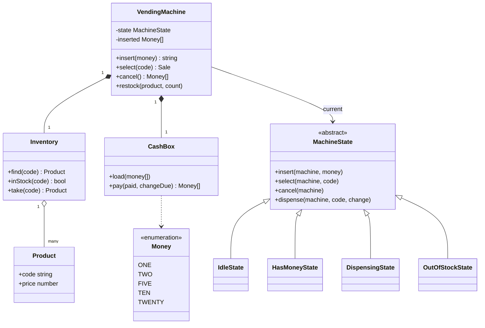
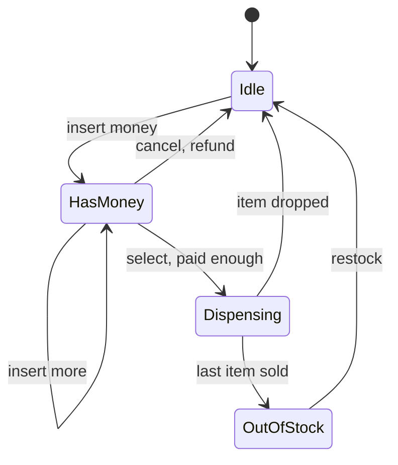
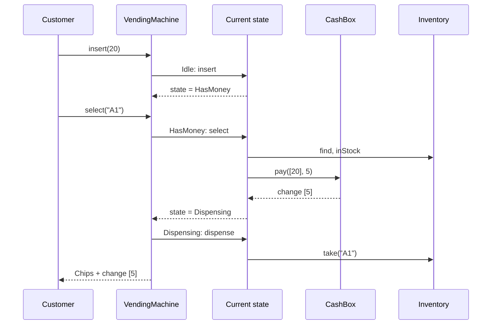

<Callout title="About this question">
  - **Difficulty:** Easy.
  - **Patterns used:** [State](../design-patterns/state.mdx) (the heart of it), [Strategy](../design-patterns/strategy.mdx) (for payment, as an extension).
  - **Also asked as:** "Design a coffee machine", "Design a ticket machine", "Design a snack machine".
</Callout>

## Understand the problem

Think of the snack machine at an office. You put in coins or notes, press a button, a snack drops, and you get your change. Press "cancel" and your money comes back.

What makes it interesting is that **the same button does different things at different times**:

- Press "A1" with no money in: "Insert money first".
- Press "A1" with enough money: a snack drops.
- Put money in while a snack is dropping: refused.
- Put money in when the machine is empty: refused, money returned.

The machine has a few clear **states** (situations it can be in), and the rules depend on the state. That is exactly what the [State](../design-patterns/state.mdx) pattern is for.

## Step 1: Requirements

### Functional requirements

1. Users should be able to insert coins (1, 2, 5) and notes (10, 20), one at a time. Other money is rejected.
2. Users should be able to select a product by its code, like `A1`.
3. Users should get the product and the right change when they paid enough.
4. Users should be able to cancel and get back exactly the money they put in.
5. The machine should refuse money when it is completely sold out.
6. An operator should be able to restock products.

### Out of scope

- Card and phone payments (we add them as an extension).
- The hardware: motors, coin sensors, the display.
- Sales reports and remote monitoring.

### Questions to ask the interviewer

| Question | What we assume |
| --- | --- |
| One product per selection? | Yes. One item per sale. |
| What if the machine can't make change? | Refuse the sale. The customer can use exact money or cancel. |
| Does cancel return the same coins? | Yes. Money stays separate until the sale happens. |
| Can a customer buy again without taking change first? | No. Each sale ends with the product and the change. |
| Is there a time limit before auto-cancel? | Not now. It is an easy extension. |

## Step 2: Core classes

| Class | What it is | Key data | Key actions |
| --- | --- | --- | --- |
| `Product` | A snack and its price | `code`, `name`, `price` | — |
| `Inventory` | The slots and how many items each has | code → `{ product, count }` | `add`, `find`, `inStock`, `take` |
| `CashBox` | The money inside the machine | count of each coin and note | `load`, `pay(paid, changeDue)` |
| `MachineState` (abstract) | One situation the machine can be in | — | `insert`, `select`, `cancel`, `dispense` |
| `IdleState`, `HasMoneyState`, `DispensingState`, `OutOfStockState` | The four states | — | the actions they allow |
| `VendingMachine` | The main service. The buttons and slot call it. | the current state, the money put in | `insert`, `select`, `cancel`, `restock` |

**Enum:** `Money`: `ONE`, `TWO`, `FIVE` (coins) and `TEN`, `TWENTY` (notes). Its values are the amounts, so they can be added up.

## Step 3: Class diagram



And the states, with what moves the machine from one to the next:



- **One class per state.** Each state holds its own rules. `IdleState.select()` says "Insert money first". `HasMoneyState.select()` sells. There is no big `switch (state)` inside every method.
- **`MachineState` is an abstract class, not a pure interface.** Its default for every action is "refuse". Each state overrides only what it allows, so `OutOfStockState` is just two lines.
- **Composition for `Inventory` and `CashBox`.** They are parts of this one machine and live and die with it. Products are only aggregated: the same `Product` object can sit in many machines.
- **`CashBox.pay()` is all or nothing.** It either keeps the money and returns change, or changes nothing. A sale never ends half done.

## Step 4: Main methods

- `VendingMachine.insert(money)` → the new balance. Rejects money that isn't a `Money` value.
- `VendingMachine.select(code)` → `{ product, change }`. Throws with a clear message if the sale can't happen.
- `VendingMachine.cancel()` → the exact money put in, as an array.
- `VendingMachine.restock(product, count)` → for the operator. Moves `OutOfStock` back to `Idle`.
- `CashBox.pay(paid, changeDue)` → the change, or `null` if exact change is impossible.

Each public action just asks the current state: `insert(money)` runs `this.state.insert(this, money)`. The main flow, one sale:



## Step 5: Code

The code is split into small parts. Paste them together in order and they run.

### Part 1: Money and products

`Money` is a plain object used as an enum. Its values are the amounts, so they can be added up.

```js
// The coins and notes the machine takes.
// Coins: 1, 2, 5. Notes: 10, 20.
const Money = {
    ONE: 1,
    TWO: 2,
    FIVE: 5,
    TEN: 10,
    TWENTY: 20,
};

// All accepted amounts, to check money quickly at the slot.
const ACCEPTED = new Set(Object.values(Money));

// A snack and its price.
class Product {
    constructor(code, name, price) {
        this.code = code;
        this.name = name;
        this.price = price;
    }
}
```

### Part 2: The inventory

`Inventory` keeps one slot per product code. Each slot holds the product and how many are left. First, adding and finding products:

```js
// The slots in the machine, and how many items each slot has.
class Inventory {
    constructor() {
        // code -> { product, count }
        this.slots = new Map();
    }

    // Put more items of a product into its slot.
    add(product, count) {
        let slot = this.slots.get(product.code);

        // First time we see this product: make an empty slot for it.
        if (slot === undefined) {
            slot = { product: product, count: 0 };
            this.slots.set(product.code, slot);
        }

        slot.count += count;
    }

    // Find a product by its code. Returns null if there is no such slot.
    find(code) {
        const slot = this.slots.get(code);
        if (slot === undefined) {
            return null;
        }
        return slot.product;
    }
```

The rest of the `Inventory` class checks stock and takes items out:

```js
    // True if the slot has at least one item left.
    inStock(code) {
        const slot = this.slots.get(code);
        if (slot === undefined) {
            return false;
        }
        return slot.count > 0;
    }

    // Take one item out of its slot.
    take(code) {
        const slot = this.slots.get(code);
        slot.count -= 1;
        return slot.product;
    }

    // True when every slot is empty.
    isEmpty() {
        for (const slot of this.slots.values()) {
            if (slot.count !== 0) {
                return false;
            }
        }
        return true;
    }
}
```

### Part 3: The cash box

`CashBox` counts the coins and notes inside the machine. `pay()` is all or nothing: it either keeps the money and returns change, or changes nothing.

```js
// The money inside the machine: how many of each coin and note.
class CashBox {
    constructor() {
        // money value -> how many the machine holds
        this.counts = new Map();
    }

    // Add coins and notes to the box.
    load(values) {
        for (const value of values) {
            let count = this.counts.get(value);
            if (count === undefined) {
                count = 0;
            }
            this.counts.set(value, count + 1);
        }
    }

    // Keep the paid money and hand back change.
    // If exact change is impossible, nothing changes and it returns null.
    pay(paid, changeDue) {
        // Put the paid money in first, so it can be used as change too.
        this.load(paid);

        const change = this.pickChange(changeDue);

        // No exact change: take the paid money back out, as if nothing happened.
        if (change === null) {
            this.remove(paid);
            return null;
        }

        this.remove(change);
        return change;
    }
```

The rest of `CashBox` picks the change with the biggest coins first. This is called a "greedy" method.

```js
    // Pick coins for the change, biggest first.
    // Returns null if the box can't make the exact amount.
    pickChange(amount) {
        const values = Array.from(this.counts.keys());
        // Sort from biggest to smallest.
        values.sort((first, second) => second - first);

        const change = [];
        let amountLeft = amount;

        for (const value of values) {
            let coinsLeft = this.counts.get(value);

            // Use this coin as many times as it fits.
            while (amountLeft >= value && coinsLeft > 0) {
                change.push(value);
                amountLeft -= value;
                coinsLeft -= 1;
            }
        }

        // Something is still owed: exact change is impossible.
        if (amountLeft !== 0) {
            return null;
        }
        return change;
    }

    // Take coins and notes out of the box.
    remove(values) {
        for (const value of values) {
            const count = this.counts.get(value);
            this.counts.set(value, count - 1);
        }
    }
}
```

### Part 4: The base state

The base state refuses everything. Each real state allows only what makes sense, and picks the next state.

```js
// The base for all states. By default, every action is refused.
class MachineState {
    constructor() {
        // "Abstract": you can't make a plain MachineState,
        // only one of the real states below.
        if (this.constructor === MachineState) {
            throw new Error("MachineState is abstract");
        }
    }

    insert(machine, money) {
        throw new Error(`${this.getName()}: can't take money now`);
    }

    select(machine, code) {
        throw new Error(`${this.getName()}: can't select now`);
    }

    // Nothing to give back.
    cancel(machine) {
        return [];
    }

    dispense(machine, code, change) {
        throw new Error(`${this.getName()}: can't dispense now`);
    }

    // The class name, like "IdleState". Used in messages.
    getName() {
        return this.constructor.name;
    }
}
```

### Part 5: Idle and has-money states

`IdleState` waits for the first coin. Selecting before paying is refused.

```js
// No money in yet. Waiting for a customer.
class IdleState extends MachineState {
    // The first coin moves the machine to "has money".
    insert(machine, money) {
        machine.addMoney(money);
        machine.setState(machine.states.hasMoney);
        return `Balance: ${machine.getBalance()}`;
    }

    select() {
        throw new Error("Insert money first");
    }
}
```

`HasMoneyState` lets the customer add more money or cancel:

```js
// Money is in. The customer can add more, buy, or cancel.
class HasMoneyState extends MachineState {
    insert(machine, money) {
        machine.addMoney(money);
        return `Balance: ${machine.getBalance()}`;
    }

    // Give back exactly the money that was put in.
    cancel(machine) {
        const refund = machine.takeInsertedMoney();
        machine.setState(machine.states.idle);
        return refund;
    }
```

The rest of `HasMoneyState` is the sale itself. Each check throws a clear message if it fails.

```js
    select(machine, code) {
        const product = machine.inventory.find(code);
        if (product === null) {
            throw new Error(`No product ${code}`);
        }
        if (!machine.inventory.inStock(code)) {
            throw new Error(`${product.name} is sold out. Pick another or cancel`);
        }

        // Not enough money yet: say how much more is needed.
        const balance = machine.getBalance();
        if (balance < product.price) {
            const missing = product.price - balance;
            throw new Error(`${product.name} costs ${product.price}. Insert ${missing} more`);
        }

        // Pay and make change. null means the box can't make exact change.
        const changeDue = balance - product.price;
        const change = machine.cashBox.pay(machine.inserted, changeDue);
        if (change === null) {
            throw new Error("No change available. Use exact money or cancel");
        }

        // Paid: switch to "dispensing" and drop the product.
        machine.setState(machine.states.dispensing);
        return machine.dispense(code, change);
    }
}
```

### Part 6: Dispensing and out-of-stock states

While the motor runs, only `dispense` is allowed. When everything is sold, the machine refuses money until a restock.

```js
// The motor is running. Everything else is refused.
class DispensingState extends MachineState {
    dispense(machine, code, change) {
        const product = machine.inventory.take(code);

        // The money is now in the cash box, so clear what was put in.
        machine.takeInsertedMoney();

        // The last item is gone: the machine is out of stock.
        if (machine.inventory.isEmpty()) {
            machine.setState(machine.states.outOfStock);
        } else {
            machine.setState(machine.states.idle);
        }

        return { product: product.name, change: change };
    }
}

// Everything is sold out.
class OutOfStockState extends MachineState {
    insert() {
        throw new Error("Sold out. Money returned");
    }

    select() {
        throw new Error("Sold out");
    }
}
```

### Part 7: The machine

The machine keeps the current state and one object for each state. The money put in stays separate until a sale, so cancel can return the same coins.

```js
// The main class. The buttons and the coin slot call it.
class VendingMachine {
    constructor(inventory, cashBox) {
        this.inventory = inventory;
        this.cashBox = cashBox;

        // The money put in for the current sale.
        this.inserted = [];

        // One object for each state. The states switch between them.
        this.states = {
            idle: new IdleState(),
            hasMoney: new HasMoneyState(),
            dispensing: new DispensingState(),
            outOfStock: new OutOfStockState(),
        };

        // Nothing to sell yet? Start in "out of stock".
        if (inventory.isEmpty()) {
            this.state = this.states.outOfStock;
        } else {
            this.state = this.states.idle;
        }
    }
```

Next, what the customer and the operator can do. Each customer action just asks the current state what to do.

```js
    insert(money) {
        // Fake coins are rejected here, before any state sees them.
        if (!ACCEPTED.has(money)) {
            throw new Error(`Rejected: ${money} is not a coin or note we take`);
        }
        return this.state.insert(this, money);
    }

    select(code) {
        return this.state.select(this, code);
    }

    cancel() {
        return this.state.cancel(this);
    }

    // For the operator: add items, and wake up a sold-out machine.
    restock(product, count) {
        this.inventory.add(product, count);

        if (this.state === this.states.outOfStock) {
            this.setState(this.states.idle);
        }
    }
```

Last, small helpers the states call to switch state and handle the money.

```js
    getStateName() {
        return this.state.getName();
    }

    setState(state) {
        this.state = state;
    }

    dispense(code, change) {
        return this.state.dispense(this, code, change);
    }

    addMoney(money) {
        this.inserted.push(money);
    }

    // The total of the money put in.
    getBalance() {
        let total = 0;
        for (const money of this.inserted) {
            total += money;
        }
        return total;
    }

    // Hand over the money put in, and start again with none.
    takeInsertedMoney() {
        const money = this.inserted;
        this.inserted = [];
        return money;
    }
}
```

### Part 8: Try it

`show` runs an action. If the action throws, it returns the error message, so the program keeps going.

```js
// "action" is a small function, like () => machine.select("A1").
function show(action) {
    try {
        return action();
    } catch (error) {
        return error.message;
    }
}

const chips = new Product("A1", "Chips", 15);
const soda = new Product("A2", "Soda", 25);

const inventory = new Inventory();
inventory.add(chips, 2);
inventory.add(soda, 1);

// A little change to start with.
const cashBox = new CashBox();
cashBox.load([Money.FIVE, Money.TWO, Money.ONE]);

const machine = new VendingMachine(inventory, cashBox);
```

A normal sale. Selecting too early, or with too little money, is refused.

```js
console.log(machine.getStateName()); // IdleState
console.log(show(() => machine.select("A1"))); // Insert money first

console.log(machine.insert(Money.TEN)); // Balance: 10
console.log(machine.getStateName()); // HasMoneyState
console.log(show(() => machine.select("A2"))); // Soda costs 25. Insert 15 more

console.log(machine.insert(Money.TWENTY)); // Balance: 30
console.log(machine.select("A2")); // { product: 'Soda', change: [ 5 ] }
console.log(machine.getStateName()); // IdleState
```

A fake coin, a sale with no change possible, and a cancel:

```js
console.log(show(() => machine.insert(3))); // Rejected: 3 is not a coin or note we take

console.log(machine.insert(Money.TWENTY)); // Balance: 20
console.log(show(() => machine.select("A1"))); // No change available. Use exact money or cancel

console.log(machine.cancel()); // [ 20 ]
```

Selling out, then a restock:

```js
machine.insert(Money.TEN);
machine.insert(Money.FIVE);
console.log(machine.select("A1")); // { product: 'Chips', change: [] }

machine.insert(Money.TWENTY);
console.log(machine.select("A1")); // { product: 'Chips', change: [ 5 ] }
console.log(machine.getStateName()); // OutOfStockState
console.log(show(() => machine.insert(Money.TEN))); // Sold out. Money returned

machine.restock(chips, 5);
console.log(machine.getStateName()); // IdleState
```

Why "No change available" the second time? The only 5 went out with the soda. The box has one 2 and one 1, which make 3, not 5. So the sale is refused, and cancel returns the same 20 note. After the next sale adds a 5 to the box, change works again.

## Step 6: Edge cases and extensions

### Edge cases

| Case | What happens |
| --- | --- |
| A fake coin or a 3-coin | Rejected at the slot, before any state sees it. |
| Not enough money | The sale is refused with "Insert N more". The state stays `HasMoney`. |
| One product is sold out | "Sold out. Pick another or cancel". The money stays in. |
| The machine can't make change | The sale is refused, and nothing in the cash box changes. The customer can cancel. |
| Cancel with no money in | Returns an empty array. Nothing happens. |
| Everything is sold out | `OutOfStock`: money is refused until the operator restocks. |
| Greedy change misses an answer | Owing 6 with one 5 and three 2s: greedy takes the 5, then fails. 2 + 2 + 2 works. A small search ("coin change" in DSA) fixes this. |
| The item gets stuck | A real machine has a drop sensor. If no item falls, refund the money and mark the slot as broken. |

### Two requests at once

A machine serves one customer, but the coin slot, the buttons and a phone app all send events. In JavaScript they arrive one at a time, and each runs to the end, so the checks and the state change in `select` can't be split.

The danger comes when dispensing takes time. The motor needs a second or two, so real code would `await` it. **Set the state to `Dispensing` before the `await`.** Then a second press in that time hits `DispensingState` and is refused.

```js
// A fragment, not runnable on its own.
async select(machine, code) {
    // ...checks and payment as before...

    // First: close the door to other presses.
    machine.setState(machine.states.dispensing);

    // Slow: the motor takes a second or two.
    await machine.motor.drop(code);

    machine.setState(machine.states.idle);
}
```

If the state changed only after the `await`, two quick presses could both pass the checks and sell one paid item twice. More on this in [Race Conditions and Locks](../concurrency/race-conditions-locks.mdx).

### Adding features

- **Card and phone payment:** add a `PaymentMethod` interface with `pay(amount)`, and classes `CashPayment` and `CardPayment`. The states call the interface. This is [Strategy](../design-patterns/strategy.mdx).
- **A maintenance mode** (the operator opens the door): add a `MaintenanceState` that refuses everything. The other states stay the same. This is [State](../design-patterns/state.mdx) plus the [Open-Closed Principle](../design-principles/open-closed.mdx).
- **Low-stock alerts:** the machine sends a "sold" event, and a stock monitor listens. This is [Observer](../design-patterns/observer.mdx).

## Patterns used

| Pattern | Where | Why |
| --- | --- | --- |
| [State](../design-patterns/state.mdx) | `MachineState` and its four states | The same button does different things in different states, with no `switch` everywhere. |
| [Strategy](../design-patterns/strategy.mdx) | `PaymentMethod` (extension) | New ways to pay without changing the states. |
| [Facade](../design-patterns/facade.mdx) | `VendingMachine` | The buttons talk to one simple object, not to the inventory, cash box and states. |

The State pattern is common in real code. A JavaScript `Promise` is a tiny state machine: pending, then fulfilled or rejected, and it never goes back. Libraries like XState help you build bigger state machines in JavaScript.

## Follow-up questions

<Accordions>
<Accordion title="Why the State pattern and not a switch?">

With a `switch`, every action (`insert`, `select`, `cancel`) has its own `switch (state)`. A new state means editing every one of them. With State, each state's rules sit in one class, and a new state is a new class. For two or three tiny states, a `switch` is fine. Keep it simple until it hurts.

</Accordion>
<Accordion title="Who should change the state: the state or the machine?">

Here, each state picks the next one, because it knows what comes next. The cost is that states know about each other. The other way is a transition table in the machine, like `{ Idle: { insert: 'HasMoney' } }`. It keeps all moves in one place, which helps when there are many states.

</Accordion>
<Accordion title="How do you make change when coins run low?">

Greedy (biggest coin first) is simple and works for normal coin sets when the box is full. With few coins it can fail, as in the 6 = 2 + 2 + 2 case. Try combinations instead (a small coin-change search). Also turn on an "exact money only" light when the box is low.

</Accordion>
<Accordion title="How would you add a timeout that cancels after 60 seconds?">

When the machine enters `HasMoney`, start a timer. When the timer fires, call `cancel()` and refund. Any new action restarts the timer. Leaving `HasMoney` clears it.

</Accordion>
</Accordions>

## What the interviewer expects

<Tabs items={['Mid-level', 'Senior', 'Staff']}>
<Tab value="Mid-level">

- Clear states, and the moves between them.
- A working sale: insert, select, product, change.
- Cancel that returns the money.

</Tab>
<Tab value="Senior">

- The State pattern, with a clear reason why it beats a `switch` here.
- Change-making that is all or nothing, and what happens when change is impossible.
- Edge cases: sold out, stuck item, fake coin, a press while dispensing.

</Tab>
<Tab value="Staff">

- Everything from senior, but faster.
- Trade-offs: states that pick the next state vs a transition table.
- How the design grows: card payment, many machines reporting stock to one server.

</Tab>
</Tabs>

<Callout title="Remember this" type="success">
  - The same button does different things in different states. That is the State pattern.
  - Four states: Idle, HasMoney, Dispensing, OutOfStock. Draw the moves between them first.
  - The base state refuses everything. Each state allows only what makes sense.
  - Paying and making change is all or nothing. If change is impossible, refuse the sale and keep the money separate.
  - Switch to `Dispensing` before any `await`, so a second press is refused.
</Callout>
