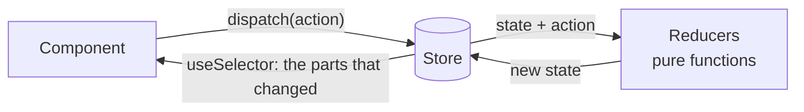

## The idea

**Redux** keeps your app's shared state in **one central store**, outside your components. Components **read** the parts they need, and to change anything they **send an action** describing what happened. **Reducers**, pure functions, work out the new state.

Think of the **departure board at an airport**. Everyone reads the same board. Passengers can't walk up and change it. When a flight is delayed, the gate sends a message to the control room ("flight 42 delayed"), and the control room updates the board by fixed rules. Everyone looking at flight 42 sees the change.

- The board is the **store**.
- The message is an **action**.
- The control room's rules are the **reducers**.
- Looking at your flight is a **selector**.

**Redux Toolkit** (RTK) is the official, modern way to write Redux. It's what interviewers expect, and what this page uses.

## The three ideas of Redux

1. **One store.** All the shared state lives in one object: the single source of truth.
2. **State is read-only.** The only way to change it is to **dispatch an action**: a plain object like `{ type: "user/login", payload: "Ana" }`.
3. **Pure reducers make the changes.** A reducer takes the current state and an action, and returns the next state. No side effects.



The data always flows **one way**, so you can always answer "why did this change?": some action was dispatched. Redux DevTools shows every action and the state after it.

If this looks like [useReducer with context](../hooks/use-reducer.mdx), it is the same idea, app-wide, with extra tools: components subscribe to only the slice they need, middleware handles async work, and DevTools records every change.

## Why Redux Toolkit

Plain Redux needed a lot of hand-written code for each piece of state: action type constants, action creator functions, and `switch` reducers that copy objects with `...`:

```jsx
// Plain Redux: all of this by hand.
const LOGIN = "user/login";

function login(username) {
    return { type: LOGIN, payload: username };
}

function userReducer(state = initialState, action) {
    switch (action.type) {
        case LOGIN:
            return { ...state, loggedIn: true, username: action.payload };
        default:
            return state;
    }
}
```

Redux Toolkit writes most of that for you:

| Plain Redux | Redux Toolkit |
| --- | --- |
| Action types, action creators and a reducer, written separately | **`createSlice`** makes all three from one object |
| Copy objects by hand with `...` | Write `state.loggedIn = true`; **Immer** makes the copy |
| `createStore` plus setup for middleware and DevTools | **`configureStore`**: thunks, DevTools and safety checks built in |
| Your own code for async loading states | **`createAsyncThunk`**, and RTK Query for server data |

`createStore` is marked **deprecated** in Redux. New code uses `configureStore`.

## Step 1: a slice

A **slice** is one feature's part of the store: its starting state, and the reducers that change it.

```jsx
// features/user/userSlice.js
import { createSlice } from "@reduxjs/toolkit";

const initialState = {
    loggedIn: false,
    username: "",
};

export const userSlice = createSlice({
    name: "user",
    initialState,
    reducers: {
        login(state, action) {
            // The username comes in action.payload.
            state.loggedIn = true;
            state.username = action.payload;
        },
        logout(state) {
            state.loggedIn = false;
            state.username = "";
        },
    },
});

// Action creators, made for you from the reducer names.
export const { login, logout } = userSlice.actions;

// The reducer, for the store.
export default userSlice.reducer;
```

`createSlice` makes an **action creator** for each reducer. Calling it builds the action object, with the slice's name in front of the type:

```jsx
console.log(login("Ana"));
// { type: "user/login", payload: "Ana" }

console.log(logout());
// { type: "user/logout", payload: undefined }
```

## Immer: "mutating" safely

Redux state must never be changed in place. So how can `state.loggedIn = true` be allowed?

Inside `createSlice` reducers, `state` is not the real state. It's a **draft** made by a library called **Immer**. Immer records your changes to the draft, then builds a **new** state object with those changes. The old state is never touched.

```jsx
// You write:
state.loggedIn = true;

// Immer produces the same result as:
return { ...state, loggedIn: true };
```

Two rules:

- **Either change the draft, or return a new object, not both.** `state.loggedIn = true; return { loggedIn: true, username: "Ana" };` throws: "An immer producer returned a new value *and* modified its draft."
- **Don't reassign `state`.** `state = { loggedIn: false }` only changes your local variable, and the state stays as it was. To replace the whole slice, `return { loggedIn: false, username: "" }`.

This only works **inside** `createSlice` and `createReducer`. Anywhere else, Redux state must be copied by hand. Immer also **freezes** the state it makes, so changing it in place anywhere else throws a `TypeError`.

## Step 2: slices can react to each other's actions

Every dispatched action goes to **every** slice. A slice's own `reducers` handle its own actions; **`extraReducers`** lets it react to actions from **other** slices. Here, the sidebar closes when the user logs out:

```jsx
// features/ui/uiSlice.js
import { createSlice } from "@reduxjs/toolkit";
import { logout } from "../user/userSlice";

const initialState = {
    sidebarOpen: true,
};

export const uiSlice = createSlice({
    name: "ui",
    initialState,
    reducers: {
        toggleSidebar(state) {
            state.sidebarOpen = !state.sidebarOpen;
        },
    },
    extraReducers(builder) {
        // Close the sidebar when the user logs out.
        builder.addCase(logout, (state) => {
            state.sidebarOpen = false;
        });
    },
});

export const { toggleSidebar } = uiSlice.actions;
export default uiSlice.reducer;
```

One `logout` action now updates two slices. The user slice doesn't need to know the UI slice exists.

## Step 3: the store

```jsx
// app/store.js
import { configureStore } from "@reduxjs/toolkit";
import userReducer from "../features/user/userSlice";
import uiReducer from "../features/ui/uiSlice";

export const store = configureStore({
    reducer: {
        user: userReducer,
        ui: uiReducer,
    },
});
```

The keys become the shape of the state:

```jsx
console.log(store.getState());
// { user: { loggedIn: false, username: "" }, ui: { sidebarOpen: true } }
```

`configureStore` also turns on the **thunk** middleware for async logic, connects to the **Redux DevTools** browser extension, and adds development checks that warn if you change state in place or put things like functions or promises in the state or in actions.

## Step 4: give the store to React

Wrap the app in React-Redux's **`Provider`**, in the entry file:

```jsx
// main.jsx
import { createRoot } from "react-dom/client";
import { Provider } from "react-redux";
import { store } from "./app/store";
import App from "./App";

createRoot(document.getElementById("root")).render(
    <Provider store={store}>
        <App />
    </Provider>
);
```

`Provider` uses React [context](../hooks/use-context.mdx) to pass the store down. But the context only carries the **store**, which never changes. The **state** reaches components through subscriptions, which is why Redux doesn't re-render everyone on every change the way a context value does.

## Step 5: useSelector and useDispatch

```jsx
// App.jsx
import { useSelector, useDispatch } from "react-redux";
import { login, logout } from "./features/user/userSlice";
import { toggleSidebar } from "./features/ui/uiSlice";

function App() {
    const dispatch = useDispatch();

    // Read only the values this component needs.
    const username = useSelector((state) => state.user.username);
    const loggedIn = useSelector((state) => state.user.loggedIn);
    const sidebarOpen = useSelector((state) => state.ui.sidebarOpen);

    function handleLogin() {
        dispatch(login("Ana"));
    }

    function handleLogout() {
        dispatch(logout());
    }

    function handleToggleSidebar() {
        dispatch(toggleSidebar());
    }

    return (
        <div>
            <h1>User: {loggedIn ? username : "Guest"}</h1>
            <h2>Sidebar is {sidebarOpen ? "open" : "closed"}</h2>

            <button onClick={handleLogin}>Log in</button>
            <button onClick={handleLogout}>Log out</button>
            <button onClick={handleToggleSidebar}>Toggle sidebar</button>
        </div>
    );
}

export default App;
```

- **`useSelector(fn)`** reads a value from the store, and **re-renders** the component when that value changes.
- **`useDispatch()`** gives you `dispatch`, to send actions.

Clicking **Log in** shows "User: Ana". Clicking **Log out** shows "User: Guest" and also closes the sidebar, thanks to the `extraReducers` in the UI slice.

## How useSelector decides to re-render

After **every** dispatched action, React-Redux runs each component's selector again and compares the new result with the last one using **`===`**. Same result → no re-render. Different → re-render.

That's why each component should select the **smallest** piece it needs. And it's why this is a trap:

```jsx
// Wrong: a new object every time the selector runs.
const user = useSelector((state) => {
    return { name: state.user.username, loggedIn: state.user.loggedIn };
});
```

The selector returns a **new object** every time, and a new object is never `===` the old one. So this component re-renders after **every** action in the whole app, even ones that have nothing to do with the user. In development, React-Redux warns: "Selector unknown returned a different result when called with the same parameters."

Fixes:

- Call `useSelector` once per value, as in Step 5.
- Or select the existing object: `useSelector((state) => state.user)`. It's the same object until the user slice changes.
- For values that must be worked out, like a filtered list, use a **memoized selector** made with `createSelector`, which returns the same result while its inputs are the same.

## Async logic: createAsyncThunk

Reducers must be pure, so where does fetching go? Into a **thunk**: a function that's dispatched like an action, can do async work, and dispatches real actions along the way. **`createAsyncThunk`** makes one, and dispatches three actions for you: **pending**, **fulfilled** and **rejected**.

```jsx
import { createSlice, createAsyncThunk } from "@reduxjs/toolkit";

export const fetchProfile = createAsyncThunk("profile/fetch", async (userId) => {
    const response = await fetch("/api/users/" + userId);

    // The return value becomes action.payload of "fulfilled".
    return response.json();
});

const profileSlice = createSlice({
    name: "profile",
    initialState: { data: null, status: "idle", error: null },
    reducers: {},
    extraReducers(builder) {
        builder
            .addCase(fetchProfile.pending, (state) => {
                state.status = "loading";
            })
            .addCase(fetchProfile.fulfilled, (state, action) => {
                state.status = "succeeded";
                state.data = action.payload;
            })
            .addCase(fetchProfile.rejected, (state, action) => {
                state.status = "failed";
                state.error = action.error.message;
            });
    },
});
```

A component calls `dispatch(fetchProfile(42))` and reads `status` to show a spinner or an error.

For data that comes from a server, there's an even simpler option: **RTK Query**, part of Redux Toolkit, fetches and caches it for you, like [TanStack Query](./tanstack-query.mdx). Many apps use RTK Query (or TanStack Query) for **server** data and keep only real **client** state in slices.

## When Redux is worth it

| Use | When |
| --- | --- |
| `useState` / lifting state up | State used by one component or a few close ones |
| Context (+ `useReducer`) | Data many components read but that rarely changes: user, theme, language |
| TanStack Query or RTK Query | Data from a server: caching, loading states, refetching |
| **Redux Toolkit** | A lot of shared client state that changes often, complex update logic, many developers, or you want DevTools time-travel |
| Zustand | Like Redux, but much less code: a hook-based store with no provider |

Redux adds files and concepts. For a small app it's usually more than you need. See [Choosing Where State Lives](./where-state-lives.mdx).

## Common mistakes

- **Putting everything in Redux.** Form inputs and one-component UI state belong in `useState`. Server data belongs in a data-fetching library.
- **Selecting a new object or array in `useSelector`.** The component re-renders after every action. Select single values, or use `createSelector`.
- **Both changing the draft and returning a new object** in a slice reducer. Do one or the other.
- **Changing state in place outside `createSlice`**, like in a component after `useSelector`. The state is read-only; dispatch an action.
- **Side effects in reducers**, like fetching or saving. Put them in thunks.
- **Functions, promises or class instances in the state or in actions.** Keep them plain, serializable data. RTK warns about it in development.
- **Forgetting `<Provider store={store}>`.** `useSelector` throws: "could not find react-redux context value".

## In the interview

**Likely question:** "Explain the Redux data flow."

> "All the shared state lives in one store. A component reads what it needs with `useSelector`, and re-renders only when that value changes. To change state, it dispatches an action, a plain object with a `type` and usually a `payload`. The store passes the current state and the action to the reducers, which are pure functions that return the next state. Subscribed components then re-render with the new values. The flow is one-way, so every change can be traced back to an action, which is what Redux DevTools shows."

**Likely follow-up:** "What does Redux Toolkit add?"

**Answer:** "It's the official way to write Redux, with much less code. `createSlice` makes the reducer and the action creators from one object, and lets me write 'mutating' code because Immer turns it into an immutable update. `configureStore` sets up thunks, DevTools and development checks. `createAsyncThunk` handles pending, fulfilled and rejected for async calls, and RTK Query handles fetching and caching server data."

**Another follow-up:** "Redux or Context: which would you use?"

**Answer:** "Context only passes a value down; when the value changes, every component that reads it re-renders. It's good for data that rarely changes, like the theme or the logged-in user. Redux is a full state manager: components subscribe to just the slice they need, and it adds middleware, DevTools and a clear pattern for complex updates. For server data, I'd use RTK Query or TanStack Query instead of either."

<Callout title="Remember this" type="success">
  - Redux: **one store**, state changed only by **dispatching actions**, new state made by **pure reducers**. Data flows **one way**.
  - **Redux Toolkit** is the modern way: **`createSlice`** (reducer + action creators), **`configureStore`** (thunks, DevTools, checks). `createStore` is deprecated.
  - **Immer**: "mutate" the **draft** in slice reducers, and a new state is made for you. Change the draft **or** return a new object, not both.
  - **`extraReducers`** lets a slice react to **other slices' actions**, like closing the sidebar on `logout`.
  - **`useSelector`** re-renders when its result changes by **`===`**. Never return a **new object** from a selector.
  - Async → **`createAsyncThunk`** (pending / fulfilled / rejected). Server data → **RTK Query** or TanStack Query.
  - Use Redux for **lots of shared, often-changing client state**. Small apps: `useState` and context.
</Callout>
