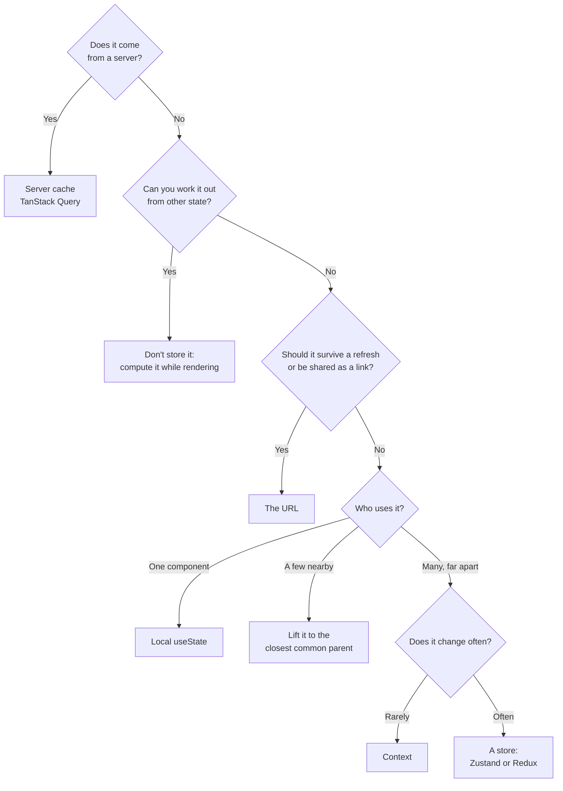

## The idea

Every piece of state needs a home. The rule of thumb: **keep state as close as possible to where it's used**, and move it further out only when you have a reason. State in the wrong place causes bugs and needless re-renders.

Think of where things live in a **house**. Your toothbrush stays in your own bathroom. The TV remote lives in the living room, because the whole family uses it. The house address is written on the door, so anyone can find it. You don't put your toothbrush on the front door.

## The decision

Ask these questions in order:



## Local and lifted state

**Start local.** Whether a dropdown is open, or the text in an input, belongs in a `useState` inside that component. It's the simplest choice, and a change re-renders only that component and its children. See [State with useState](../state-and-rendering/use-state.mdx).

When two components need the same data, like a tab list and the panel that shows the selected tab, **lift** the state to their **closest common parent**, and pass it down as props. See [Lifting State Up](../state-and-rendering/lifting-state-up.mdx). Don't lift it higher than you need: every change re-renders the owner and everything below it.

## Context

When many components far apart need the same value, passing props through every level is **prop drilling**. [Context](../hooks/use-context.mdx) delivers the value to any component below its provider. It's best for app-wide data that **rarely changes**, like the logged-in user, the theme or the language, because when the value changes, **every** component that reads it re-renders.

## The URL

Search text, filters, sort order and page numbers often belong in the **URL**: `?q=shoes&page=2`. Then a refresh keeps them, the Back button works, and a link shows someone else the same results. Read and change them with `useSearchParams`. See [Routing with React Router](../ecosystem/routing.mdx).

## Server cache

Data from an API isn't really your state: it's a **copy** of the server's. Keep the product list or a user's profile in a server cache like **TanStack Query** or **RTK Query**, not in `useState` or Redux. See [Server State with TanStack Query](./tanstack-query.mdx).

## A store: Zustand or Redux

For lots of shared data that changes often, like a shopping cart or the shapes in a drawing app, use a **store**. A store keeps state **outside** the component tree. Any component can read just the piece it needs, and it re-renders **only when that piece changes**. That fixes context's "everyone re-renders" problem for big, busy state.

**Zustand** is a small store with almost no setup:

```jsx
import { create } from "zustand";

const useCartStore = create((set) => ({
    items: [],
    addItem: (item) => set((state) => ({ items: [...state.items, item] })),
}));

function CartCount() {
    // Re-renders only when items changes.
    const items = useCartStore((state) => state.items);

    return <p>{items.length} items</p>;
}

function AddToCartButton({ product }) {
    const addItem = useCartStore((state) => state.addItem);

    return <button onClick={() => addItem(product)}>Add to cart</button>;
}
```

The store **is** a hook, and no provider is needed. **Redux Toolkit** does the same job with more structure: actions, reducers and DevTools, which helps in big apps with many developers. See [Redux and Redux Toolkit](./redux.mdx).

## Don't store what you can compute

If a value can be worked out from props or state, like a filtered list or a total price, **compute it while rendering**. Storing a copy means keeping two values in sync, and they drift apart. See [When Not to Use an Effect](../hooks/you-might-not-need-an-effect.mdx).

## Common mistakes

- **Putting everything in a global store.** A dropdown's open flag in Redux makes simple code hard to follow. Start local.
- **Server data in `useState` or Redux.** You end up writing caching and refetching by hand. Use a server cache.
- **Context for data that changes often**, like the text in an input. Every reader re-renders on every key press. Keep it local, or use a store.
- **Filters and page numbers in `useState`.** A refresh loses them, and the link can't be shared. Put them in the URL.
- **Storing values you can compute.** The copy goes out of date. Work it out while rendering.

## In the interview

**Likely question:** "How do you decide where to keep state in a React app?"

> "I keep state as close as possible to where it's used: local `useState` when one component needs it, lifted to the closest common parent when a few nearby components share it. Data from the server goes in a server cache like TanStack Query, and anything that should survive a refresh or be shareable, like filters, goes in the URL. For app-wide values that rarely change, like the theme or the user, I use context. For large shared state that changes often, I use a store like Zustand or Redux Toolkit."

**Likely follow-up:** "Context or a store like Zustand: which would you pick?"

**Answer:** "Context only delivers a value. When it changes, every component that reads it re-renders, so it suits data that rarely changes. A store lets each component subscribe to just the piece it needs, so only those components re-render. For often-changing shared state, I'd pick a store."

**Another follow-up:** "Should data from the API go in Redux?"

**Answer:** "Usually not. Server data is a cache of the server, and it can go out of date. A server cache like TanStack Query or RTK Query handles loading, caching, refetching and retries for me. I keep Redux or Zustand for state that really belongs to the app."

<Callout title="Remember this" type="success">
  - **Keep state as close as possible** to where it's used. Move it out only for a reason.
  - **One component** → local `useState`. **A few nearby** → **lift** to the closest common parent.
  - **Server data** → a **server cache** (TanStack Query, RTK Query), not `useState` or Redux.
  - **Survives a refresh, shareable** (search, filters, page) → **the URL**.
  - **App-wide, rarely changes** (user, theme) → **context**. **Shared and changes often** → a **store** like **Zustand** or Redux.
  - **Can be computed** → don't store it. Work it out while rendering.
</Callout>
