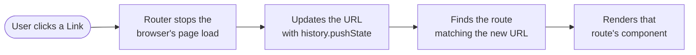

## The idea

**React has no built-in routing.** React is a UI library: it renders components. It doesn't read the URL or handle navigation on its own. A **router** library adds that: it watches the URL and shows the matching component. **React Router** is the most used one.

Think of a **TV**. Changing the channel doesn't mean buying a new TV: the same screen just shows a different program. In a React app, the browser loads **one** HTML page, and changing the URL just swaps the components on the screen. The URL is the channel number.

## Server-side vs client-side routing

| | Traditional website | React app with a router |
| --- | --- | --- |
| Clicking a link | The browser asks the server for a **new HTML page** | JavaScript **catches the click** and swaps components |
| Page reload | **Yes**, every time | **No** |
| State in memory (form input, scroll, data) | Lost on every page | Kept |
| Speed after the first load | A round trip per page | Instant: the code is already loaded |

How a click on a React Router link works:



The browser's **Back** and **Forward** buttons still work, because the router writes each change into the browser's history.

## Installing

```bash
npm install react-router
```

Everything imports from **`react-router`**. Older code imports the same things from **`react-router-dom`**. Since React Router 7 that package only re-exports `react-router`, and React Router 8 removed it, so for new code use `react-router`.

React Router has three **modes**. This page uses the simplest, **declarative mode**: `<BrowserRouter>`, `<Routes>` and `<Route>`. **Data mode** (`createBrowserRouter`) adds `loader` functions that fetch data before a page shows. **Framework mode** turns it into a full-stack framework with a Vite plugin, server rendering and file-based routes.

## A complete small app

```jsx
import { BrowserRouter, Routes, Route, Link, useParams, useNavigate } from "react-router";

function Home() {
    return <h2>Home</h2>;
}

function About() {
    return <h2>About</h2>;
}

function User() {
    // For the URL /user/123, id is "123".
    const { id } = useParams();

    return <h2>User ID: {id}</h2>;
}

function Login() {
    const navigate = useNavigate();

    function handleLogin() {
        // ...log the user in, then go to another page.
        navigate("/about");
    }

    return <button onClick={handleLogin}>Log in and go to About</button>;
}

function App() {
    return (
        <BrowserRouter>
            <nav>
                <Link to="/">Home</Link> | <Link to="/about">About</Link> |{" "}
                <Link to="/user/123">User 123</Link>
            </nav>

            <Routes>
                <Route path="/" element={<Home />} />
                <Route path="/about" element={<About />} />
                <Route path="/user/:id" element={<User />} />
                <Route path="/login" element={<Login />} />
                <Route path="*" element={<h2>404 Not Found</h2>} />
            </Routes>
        </BrowserRouter>
    );
}
```

- **`<BrowserRouter>`** wraps the app and connects it to the browser's URL. Every other router feature must be inside it.
- **`<Routes>`** looks at the URL and renders the **one** `<Route>` that matches best.
- **`<Route path element>`** pairs a URL pattern with what to show.
- **`:id`** is a **dynamic segment**: it matches any value, like `/user/123` or `/user/ana`.
- **`path="*"`** matches anything no other route matched: your 404 page.
- **`<Link to>`** is a link that changes the URL **without** reloading the page.

The order of the `<Route>`s doesn't matter. React Router picks the **most specific** match, so `/about` wins over `*`.

## Link, not a

```jsx
// Wrong: a plain link reloads the whole app.
<a href="/about">About</a>
```

```jsx
// Right: changes the URL and swaps components, no reload.
<Link to="/about">About</Link>
```

`<Link>` still renders a real `<a href="/about">` on the page, so right-click, "open in new tab" and keyboard navigation work. It just catches normal clicks and handles them in JavaScript. A plain `<a>` reloads everything: all state is lost and the app starts again from scratch.

For **menus**, use **`<NavLink>`**: it adds an **`active`** class (and `aria-current="page"`) when its URL is the current one, so you can highlight the current page.

```jsx
<nav>
    <NavLink to="/">Home</NavLink>
    <NavLink to="/dashboard" end>Dashboard</NavLink>
    <NavLink to="/dashboard/settings">Settings</NavLink>
</nav>
```

A `NavLink` is also active on the pages **below** its URL: without `end`, "Dashboard" would light up on `/dashboard/settings` too. **`end`** makes it active only on exactly `/dashboard`. (The root link `to="/"` is a special case: it's only active on `/` itself.)

## The router hooks

| Hook | Gives you |
| --- | --- |
| `useParams()` | The dynamic segments of the URL, like `{ id: "123" }` |
| `useSearchParams()` | The query string, like `?q=shoes&page=2` |
| `useNavigate()` | A `navigate` function, to change pages from code |
| `useLocation()` | The current location: `pathname`, `search`, `hash` and `state` |
| `useMatch(pattern)` | A match object if the current URL matches the pattern, otherwise `null` |

### useParams: values from the path

```jsx
// Route: <Route path="/shop/:category/:productId" element={<Product />} />
// URL:   /shop/lamps/42
function Product() {
    const { category, productId } = useParams();

    console.log(category); // "lamps"
    console.log(productId); // "42"

    return <h2>Product {productId}</h2>;
}
```

Params are always **strings**. Convert them when you need a number: `Number(productId)`.

### useSearchParams: the query string

The part after `?` is good for things like search terms, filters and page numbers. They stay in the URL, so they survive a refresh, and the link can be shared.

```jsx
import { useSearchParams } from "react-router";

// URL: /search?q=shoes&page=2
function SearchPage() {
    const [searchParams, setSearchParams] = useSearchParams();

    const query = searchParams.get("q"); // "shoes"
    const page = Number(searchParams.get("page") || "1"); // 2

    function goToNextPage() {
        setSearchParams({ q: query, page: String(page + 1) });
    }

    return (
        <div>
            <p>Results for "{query}", page {page}</p>
            <button onClick={goToNextPage}>Next page</button>
        </div>
    );
}
```

It works like `useState`, but the value lives in the URL. See [Choosing Where State Lives](../data-and-state/where-state-lives.mdx).

### useNavigate: changing pages from code

```jsx
function LoginForm() {
    const navigate = useNavigate();

    async function handleSubmit(event) {
        event.preventDefault();
        await logIn(new FormData(event.target));

        // Done: go to the dashboard.
        navigate("/dashboard");
    }

    return <form onSubmit={handleSubmit}>...</form>;
}
```

Other forms:

- `navigate(-1)` goes **back** one page, like the browser's Back button.
- `navigate("/login", { replace: true })` **replaces** the current history entry, so Back doesn't return to it. Use it for redirects.
- `navigate("/checkout", { state: { from: "cart" } })` passes data along, read with `useLocation().state`.

When the user **clicks** to go somewhere, use `<Link>` instead: it's a real link, with keyboard support, "open in new tab", and so on. Keep `navigate` for moves that happen **after** something: a form was saved, a login finished, a timer ran out.

### useLocation and useMatch

```jsx
import { useLocation, useMatch } from "react-router";

function CurrentPath() {
    const location = useLocation();

    return <p>Current path: {location.pathname}</p>;
}

function AboutMenuItem() {
    // An object when the URL is /about, otherwise null.
    const match = useMatch("/about");

    return <div className={match ? "active" : ""}>About</div>;
}
```

`useLocation` is also handy in an effect that runs on every page change, like sending a page view to analytics: `useEffect(() => { trackPageView(location.pathname); }, [location]);`

## Nested routes and Outlet

Pages often share a **layout**: a dashboard with a sidebar, where only the main area changes. Put the child routes **inside** the parent route, and mark where they render with **`<Outlet />`**:

```jsx
import { Routes, Route, Outlet, NavLink } from "react-router";

function DashboardLayout() {
    return (
        <div className="dashboard">
            <aside>
                <NavLink to="/dashboard" end>Overview</NavLink>
                <NavLink to="/dashboard/settings">Settings</NavLink>
            </aside>

            <main>
                {/* The matching child route renders here. */}
                <Outlet />
            </main>
        </div>
    );
}

function AppRoutes() {
    return (
        <Routes>
            <Route path="/dashboard" element={<DashboardLayout />}>
                <Route index element={<Overview />} />
                <Route path="settings" element={<Settings />} />
            </Route>
        </Routes>
    );
}
```

| URL | What shows |
| --- | --- |
| `/dashboard` | `DashboardLayout` with `Overview` in the outlet |
| `/dashboard/settings` | `DashboardLayout` with `Settings` in the outlet |

- Child paths are **relative**: `settings` inside `/dashboard` means `/dashboard/settings`.
- An **index route** (`index` instead of a `path`) is the default child, shown at the parent's own URL.
- The layout **stays mounted** while you move between its children, so its state, like a scroll position or an open menu, is kept.

A `<Route>` with an `element` but **no** `path` is a **layout route**: it wraps its children in a layout without adding anything to the URL. That's how you give a group of pages a shared header.

## Protected routes

Some pages are only for logged-in users. A common pattern is a wrapper component that sends everyone else to the login page:

```jsx
import { Navigate, Outlet, useLocation } from "react-router";

function RequireAuth() {
    const user = useCurrentUser();
    const location = useLocation();

    if (!user) {
        // Send them to login, and remember where they were going.
        return <Navigate to="/login" replace state={{ from: location.pathname }} />;
    }

    return <Outlet />;
}

function AppRoutes() {
    return (
        <Routes>
            <Route path="/login" element={<Login />} />

            {/* Every route inside needs a logged-in user. */}
            <Route element={<RequireAuth />}>
                <Route path="/dashboard" element={<Dashboard />} />
                <Route path="/settings" element={<Settings />} />
            </Route>
        </Routes>
    );
}
```

- **`<Navigate to>`** redirects as soon as it renders. `replace` keeps the protected URL out of the history, so Back doesn't loop.
- After logging in, the login page reads `location.state.from` and sends the user back to the page they wanted.
- This only hides pages in the browser. The **server** must still check the user on every API call, because anyone can change JavaScript in their own browser.

## Loading pages only when needed

Each page's code can be split into its own file and loaded only when the user visits it, with `React.lazy` and `<Suspense>`:

```jsx
import { lazy, Suspense } from "react";

const Settings = lazy(() => import("./pages/Settings"));

<Route
    path="/settings"
    element={
        <Suspense fallback={<p>Loading...</p>}>
            <Settings />
        </Suspense>
    }
/>;
```

The first load is smaller and faster. See [Code Splitting with lazy and Suspense](../performance/lazy-and-suspense.mdx).

## In the real world: the refresh 404

A classic production bug: the app works when you click around, but **refreshing** `/about`, or opening a shared link to it, shows the **server's** 404 page.

Clicking a `<Link>` never asks the server for `/about`: the router handles it in the browser. But a refresh does ask the server for `/about`, and on a plain static server there is no file called `about`. The fix is a **fallback** on the server: send `index.html` for every path that isn't a real file. The React app then loads, reads the URL, and shows the right page. Static hosts like Netlify, Vercel and S3 with CloudFront all have a setting for this.

If you can't change the server, **`<HashRouter>`** puts the route after a `#`, like `/#/about`. The browser never sends the part after `#` to the server, so a refresh always loads `index.html`. The URLs are uglier, so it's a last resort.

Frameworks like **Next.js** and React Router's framework mode use **file-based routing** instead: a file like `app/about/page.jsx` becomes the `/about` route, and the server knows every route.

## Common mistakes

- **`<a href>` for links inside the app.** It reloads the whole app. Use `<Link>`.
- **Using a router hook outside `<BrowserRouter>`**, like in a component rendered above it. It throws. Put the router at the top of the app.
- **Forgetting `<Outlet />` in a layout.** The child routes match, but nothing shows.
- **Treating params as numbers.** `useParams()` and `searchParams.get()` always give **strings** (or `null`).
- **`navigate()` during render.** Call it in an event handler or an effect, or render `<Navigate />`.
- **Thinking a protected route is security.** It only hides the UI. The server must check permissions.
- **No server fallback.** Refreshing a deep link gives a 404 in production.

## In the interview

**Likely question:** "How does routing work in a React app?"

> "React itself has no routing, so I use a library like React Router. It does client-side routing: the browser loads one HTML page, and when the user clicks a `<Link>`, the router stops the normal page load, updates the URL with the History API, and renders the component whose route matches. Nothing reloads, so state is kept and navigation is instant. I define routes with `<Routes>` and `<Route path element>`, read URL values with `useParams` and `useSearchParams`, and navigate from code with `useNavigate`."

**Likely follow-up:** "Why does refreshing a page give a 404 in production?"

**Answer:** "Because the refresh asks the server for that path, and a static server has no file for it: only the router in the browser knows it. The server needs a fallback that returns `index.html` for unknown paths, so the app loads and the router shows the right page. Or, as a last resort, `HashRouter`."

**Another follow-up:** "How would you protect a route?"

**Answer:** "A wrapper route component that checks the user: if they're logged in it renders `<Outlet />`, otherwise it renders `<Navigate to='/login' replace />` and passes the original path in `state`, so I can send them back after login. And the server still checks permissions on every request, because client code can be changed."

<Callout title="Remember this" type="success">
  - **React has no routing.** React Router does **client-side routing**: one HTML page, URL changes with the **History API**, **no reload**.
  - **`<BrowserRouter>`** → **`<Routes>`** → **`<Route path element>`**. `:id` = dynamic segment, `*` = 404.
  - **`<Link to>`**, never `<a href>`, inside the app. **`<NavLink>`** adds an **`active`** class.
  - Hooks: **`useParams`** (path values, always **strings**), **`useSearchParams`** (query string), **`useNavigate`** (go from code; `-1` = back), **`useLocation`**, **`useMatch`**.
  - **Nested routes** render in the parent's **`<Outlet />`**. **Index route** = the default child.
  - **Protected route**: render `<Outlet />` or `<Navigate to="/login" replace />`. The **server** must still check.
  - Refresh 404 → the server must **fall back to `index.html`**. Import from **`react-router`** (`react-router-dom` is the old name).
</Callout>
