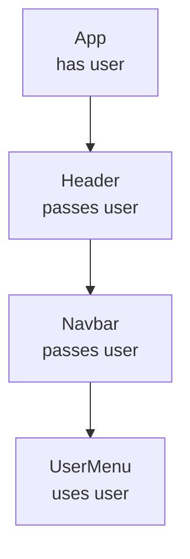

## The idea

**Context** lets a parent make a value available to **every component below it**, however deep, without passing it as a prop through each level. Components read it with the **`useContext`** hook.

Think of **Wi-Fi in a building**. Without it, you'd run a cable from the router through every room to reach the laptop in the back office. With Wi-Fi, the router sends the signal once, and any device in range picks it up directly. The **provider** is the router; **`useContext`** is a device connecting to it.

## The problem: prop drilling

Say the logged-in user is known in `App`, and only `UserMenu`, four levels down, needs it:



With props, every level in between must accept `user` and pass it on, even though `Header` and `Navbar` never use it:

```jsx
function App() {
    const user = { name: "Ana", role: "Engineer" };

    return <Header user={user} />;
}

function Header({ user }) {
    return <Navbar user={user} />;
}

function Navbar({ user }) {
    return <UserMenu user={user} />;
}
```

This is **prop drilling**. It's fine for two levels. For many levels it's tiring, and every component in the middle has to change when the data changes.

## Three steps: create, provide, use

**Step 1: Create a context.** Usually in its own file, so any component can import it.

```jsx
import { createContext } from "react";

export const UserContext = createContext(null);
```

The argument (`null` here) is the **default value**, used only when a component reads the context with **no provider** above it.

**Step 2: Provide a value.** Wrap part of the tree in the context, and give it a `value`.

```jsx
import { UserContext } from "./UserContext";

function App() {
    const user = { name: "Ana", role: "Engineer" };

    return (
        <UserContext value={user}>
            <Header />
        </UserContext>
    );
}
```

Since **React 19**, you can use the context itself as the provider: `<UserContext value={user}>`. Before React 19 you wrote **`<UserContext.Provider value={user}>`**. The old form still works, and you'll see it in most existing code.

**Step 3: Read it with `useContext`**, in any component inside the provider:

```jsx
import { useContext } from "react";
import { UserContext } from "./UserContext";

function UserMenu() {
    const user = useContext(UserContext);

    return (
        <div>
            <p>Hello, {user.name}</p>
            <p>Your role: {user.role}</p>
        </div>
    );
}
```

`Header` and `Navbar` no longer need a `user` prop at all.

## Which value does a component get?

`useContext` looks **up** the tree and uses the **nearest** provider above the component.

```jsx
const ThemeContext = createContext("light");

function Page() {
    return (
        <ThemeContext value="dark">
            {/* Reads "dark" */}
            <Sidebar />

            <ThemeContext value="light">
                {/* Reads "light": the nearer provider wins */}
                <Footer />
            </ThemeContext>
        </ThemeContext>
    );
}
```

With **no** provider above it, a component gets the **default** from `createContext("light")`.

## Context with state

Context only **passes** a value down. To let components **change** it, keep the value in state in the provider, and pass the setter too:

```jsx
import { createContext, useContext, useState } from "react";

const ThemeContext = createContext(null);

function ThemeProvider({ children }) {
    const [theme, setTheme] = useState("light");

    function toggleTheme() {
        setTheme((current) => (current === "light" ? "dark" : "light"));
    }

    return (
        <ThemeContext value={{ theme, toggleTheme }}>
            {children}
        </ThemeContext>
    );
}

function ThemeButton() {
    const { theme, toggleTheme } = useContext(ThemeContext);

    return <button onClick={toggleTheme}>Theme: {theme}</button>;
}

function App() {
    return (
        <ThemeProvider>
            <ThemeButton />
        </ThemeProvider>
    );
}
```

Clicking the button changes the state in `ThemeProvider`, which passes a new value, and every component reading `ThemeContext` re-renders with it.

## A custom hook for each context

A common pattern: wrap `useContext` in a small hook that also checks for a missing provider.

```jsx
function useTheme() {
    const value = useContext(ThemeContext);

    if (value === null) {
        throw new Error("useTheme must be used inside <ThemeProvider>");
    }

    return value;
}

function ThemeButton() {
    const { theme, toggleTheme } = useTheme();

    return <button onClick={toggleTheme}>Theme: {theme}</button>;
}
```

Components call `useTheme()` and never import the context itself. A forgotten provider gives a clear error instead of "cannot read properties of null". See [Custom Hooks](./custom-hooks.mdx).

## Who re-renders when the value changes

When a provider's `value` changes, **every component that reads that context re-renders**. This happens even when a parent in between is wrapped in `React.memo`: context skips past it to reach the readers.

That has two costs to know about:

**1. An object made during render is a new value every time.**

```jsx
function ThemeProvider({ children }) {
    const [theme, setTheme] = useState("light");

    // A new object on every render of ThemeProvider.
    const value = { theme, setTheme };

    return <ThemeContext value={value}>{children}</ThemeContext>;
}
```

React compares the old and new `value` with `Object.is`. A new object is never equal to the old one, so whenever `ThemeProvider` re-renders for any reason, **every reader** re-renders too. If that matters, keep the object the same with `useMemo`:

```jsx
const value = useMemo(() => ({ theme, setTheme }), [theme]);
```

**2. One big context re-renders everyone.** If a single context holds the user, the theme and the cart, changing the cart re-renders every component that only wanted the theme. **Split** unrelated data into separate contexts.

## When not to use context

- **Only one or two levels.** Pass props. They make the data flow easy to see.
- **The middle components just wrap content.** Pass the content as **`children`** instead, and the data doesn't need to travel through them. See [Composition and Children](../patterns/composition-and-children.mdx).
- **Data that changes very often**, like a mouse position or text typed in a big form, read by many components. Every change re-renders every reader. A store like Zustand or Redux lets each component subscribe to just the piece it needs.

Good fits for context: the logged-in user, the theme, the language, and data that a group of components shares, like the open tab in a `<Tabs>` component.

Context is **not a state manager**. It doesn't store or update anything. State (`useState` or `useReducer`) holds the data; context just **delivers** it. See [useReducer](./use-reducer.mdx) for the two used together, and [Choosing Where State Lives](../data-and-state/where-state-lives.mdx).

## Common mistakes

- **Reading the context outside its provider.** You silently get the default value. A custom hook that throws makes this obvious.
- **A new object as `value` on every render.** Every reader re-renders whenever the provider does. Use `useMemo`.
- **One context for everything.** Unrelated changes re-render everyone. Split it.
- **Reaching for context for one level of props.** Props are simpler and clearer.
- **Expecting `React.memo` to stop context updates.** It doesn't. A memo'd component that reads the context still re-renders when the value changes.

## In the interview

**Likely question:** "What is prop drilling, and how do you avoid it?"

> "Prop drilling is passing a prop through components that don't use it, only to reach a deep child. Context fixes it: I create a context, wrap part of the tree in a provider with a value, and any component inside reads it with `useContext`, however deep it is. I use it for things many components need, like the user, theme or language. For one or two levels, I just pass props, and sometimes passing `children` removes the drilling without context."

**Likely follow-up:** "Does context replace Redux?"

**Answer:** "Not really. Context only passes a value down the tree; it doesn't manage state. Combined with `useState` or `useReducer`, it's enough for small, slow-changing global data. But when the value changes, every component that reads the context re-renders. Redux or Zustand let each component subscribe to only the slice it needs, and add tools like devtools and middleware, which matters for big, often-changing state."

**Another follow-up:** "What does the default value in `createContext` do?"

**Answer:** "It's used only when a component reads the context with no provider above it. It's not a starting value for the provider."

<Callout title="Remember this" type="success">
  - **Prop drilling** = passing props through components that don't use them. **Context** fixes it.
  - Three steps: **`createContext(default)`**, wrap with a **provider** and a `value`, read with **`useContext(MyContext)`**.
  - React 19: **`<MyContext value={...}>`**. Before: **`<MyContext.Provider value={...}>`**.
  - The **nearest** provider above wins. No provider → the **default value**.
  - When the value changes, **every reader re-renders**, even past `React.memo`. **`useMemo` the value**, and **split** unrelated contexts.
  - Context **delivers** data; **state** holds it. Not a replacement for a store when data changes often.
</Callout>
